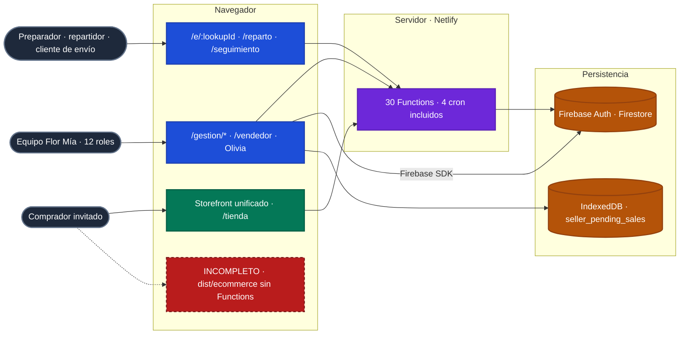
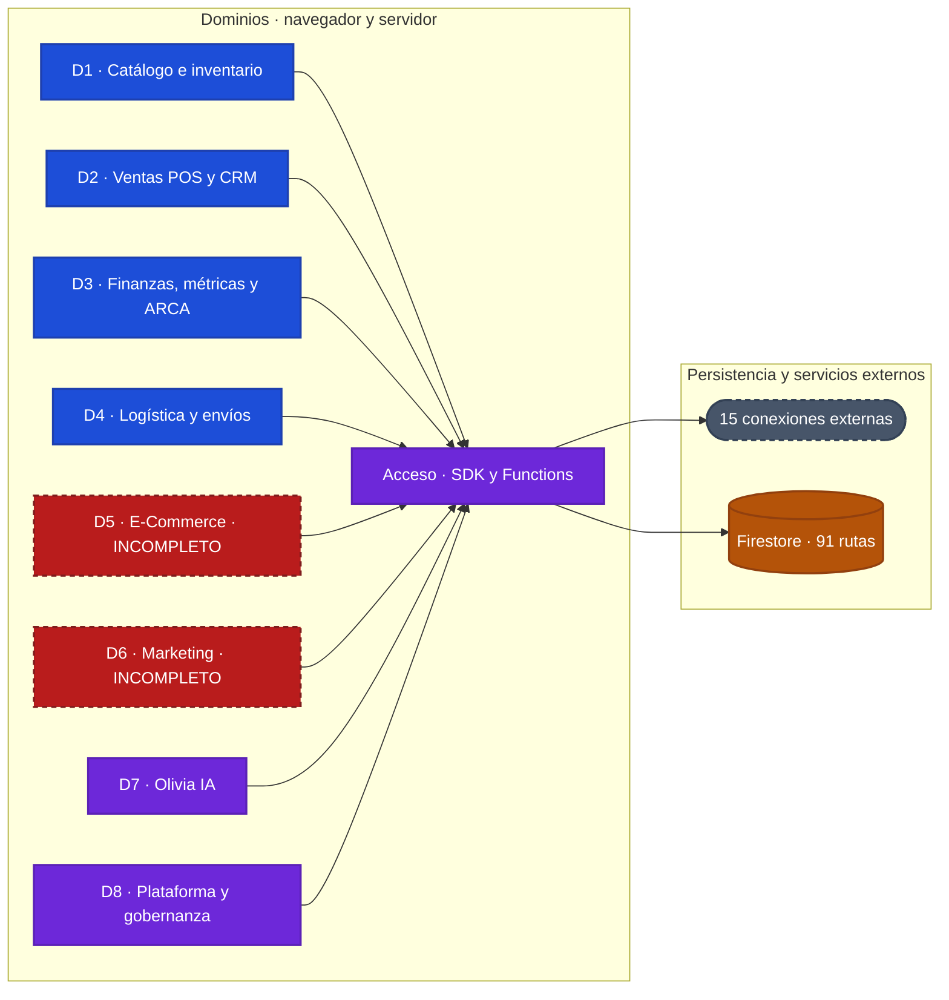
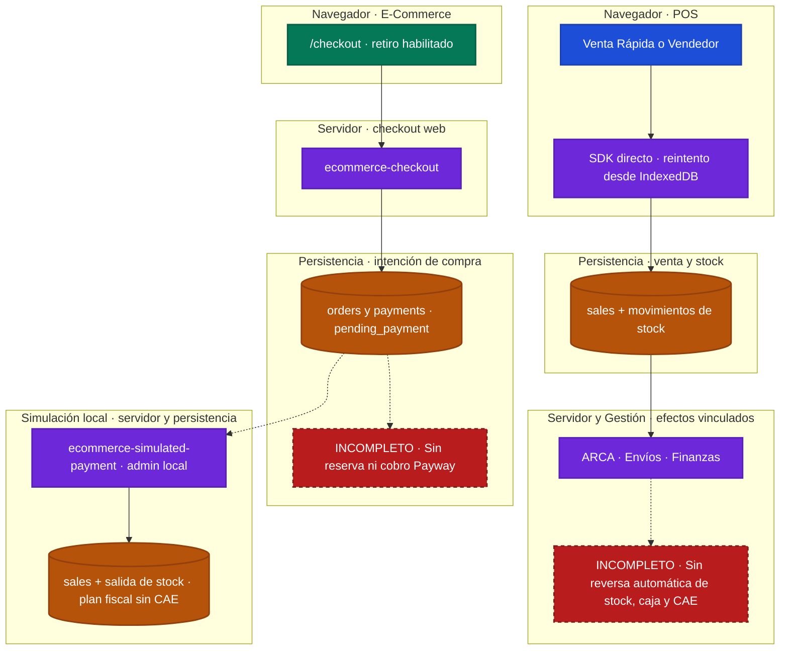

# Mapa Maestro · Flor Mía

**Paso 0 · Corte `d0f1225` del [PR #68](https://github.com/AgustinBazanUB/App-Integral-FM/pull/68)**

La suite describe la operación del corte auditado. Parte del [Relevamiento funcional del PR #69](https://github.com/AgustinBazanUB/App-Integral-FM/blob/40ad5f8d208c5788416827dc7ddaffda4b801a75/docs/00-relevamiento-funcional-actual.md) y del árbol de código del commit [`d0f1225`](https://github.com/AgustinBazanUB/App-Integral-FM/commit/d0f122581231cdbd4046ce7b4651e90115556cbe). Las funciones del checkout integrado del PR #67 corresponden a otro corte.

[Abrir el visor local](diagrams/index.html). Guardá el archivo y abrilo con doble clic en Chrome. Los diagramas y sus fuentes están embebidos en el HTML. En el visor podés elegir un diagrama, usar los controles de zoom, arrastrar sobre el plano y copiar su código Mermaid.

## Leyenda visual

| Categoría | Color | Qué indica |
| --- | --- | --- |
| `actor` | `#1E293B` | Actores |
| `integral` | `#1D4ED8` | App Integral FM |
| `ecommerce` | `#047857` | E-Commerce |
| `shared` | `#6D28D9` | Capa transversal |
| `db` | `#B45309` | Persistencia |
| `external` | `#475569` | Servicios externos · borde punteado |
| `debt` | `#B91C1C` | Brecha o flujo incompleto · borde punteado |

Las flechas sólidas representan una invocación o un camino de datos. Las punteadas indican un camino condicionado, de enlace o una brecha. La etiqueta `INCOMPLETO` conserva el estado `[INCOMPLETO]` del relevamiento. Las agrupaciones corresponden a superficies o responsabilidades del código.

## Visión global

### 00A · Frontera física

[Fuente Mermaid](diagrams/mmd/00-macro-a-frontera-fisica.mmd) · [SVG](diagrams/svg/00-macro-a-frontera-fisica.svg) · [Visor](diagrams/index.html#00-macro-a-frontera-fisica)



> **Lectura rápida:** La app unificada sirve Gestión y el storefront con Functions. El paquete independiente publica la interfaz de la tienda sin las Functions que el catálogo y el checkout buscan en el mismo origen.

| Nodo | Ruta real en el repo |
| --- | --- |
| Equipo Flor Mía · 12 roles | [`src/gestion/permissions.js`](../src/gestion/permissions.js) · [`src/gestion/AuthContext.jsx`](../src/gestion/AuthContext.jsx) |
| Panel Admin, Vendedor y Olivia | [`src/gestion/ManagementApp.jsx`](../src/gestion/ManagementApp.jsx) · [`src/gestion/olivia/OliviaMount.jsx`](../src/gestion/olivia/OliviaMount.jsx) |
| Preparador, repartidor y seguimiento | [`src/gestion/shipping/ShippingPublicApp.jsx`](../src/gestion/shipping/ShippingPublicApp.jsx) · [`src/gestion/shipping/CourierPortal.jsx`](../src/gestion/shipping/CourierPortal.jsx) |
| Comprador invitado y Storefront | [`src/Storefront.jsx`](../src/Storefront.jsx) · [`src/surfaces/EcommerceSurface.jsx`](../src/surfaces/EcommerceSurface.jsx) · [`src/gestion/StorePreviewGate.jsx`](../src/gestion/StorePreviewGate.jsx) |
| 30 Functions, cuatro programadas | [`netlify/functions/`](../netlify/functions/) · [`netlify.toml`](../netlify.toml) |
| Firebase SDK e IndexedDB | [`src/gestion/services/firebase.js`](../src/gestion/services/firebase.js) · [`src/gestion/seller/offlineSales.js`](../src/gestion/seller/offlineSales.js) |
| Paquete separado y directorio vacío | [`vite.config.js`](../vite.config.js) · [`deploy/ecommerce/netlify.toml`](../deploy/ecommerce/netlify.toml) · [`deploy/ecommerce/functions/.gitkeep`](../deploy/ecommerce/functions/.gitkeep) · [`src/services/ecommerceService.js`](../src/services/ecommerceService.js) |

Roles exactos de `ROLE_TEMPLATES` en este corte: `admin`, `general_admin`, `operational_admin`, `seller`, `location_manager`, `warehouse_manager`, `marketing_manager`, `ecommerce_manager`, `shipping_manager`, `supplier_manager`, `financial_manager` y `analyst`. El preparador depende de asignación, el repartidor externo y el cliente de envío usan accesos acotados, y el comprador del storefront público opera como invitado. El storefront unificado tiene gate de administrador salvo configuración pública. Los cuatro cron son `shipping-retention`, `olivia-retention`, `olivia-resource-retention` y `olivia-voice-cleanup`.

### 00B · Macrodominios

[Fuente Mermaid](diagrams/mmd/00-macro-b-macro-dominios.mmd) · [SVG](diagrams/svg/00-macro-b-macro-dominios.svg) · [Visor](diagrams/index.html#00-macro-b-macro-dominios)



> **Lectura rápida:** Los ocho dominios agrupan capacidades que comparten Firestore y servicios. El nodo de acceso resume los caminos del SDK cliente y las Functions. D5 y D6 concentran flujos comerciales sin cierre en este corte.

| Nodo | Ruta real en el repo |
| --- | --- |
| D1 · Catálogo e inventario | [`src/gestion/services/inventoryService.js`](../src/gestion/services/inventoryService.js) |
| D2 · Ventas POS y CRM | [`src/gestion/services/sellerService.js`](../src/gestion/services/sellerService.js) · [`src/gestion/customers/crmService.js`](../src/gestion/customers/crmService.js) |
| D3 · Finanzas, métricas y ARCA | [`src/gestion/pages/FinancePage.jsx`](../src/gestion/pages/FinancePage.jsx) · [`src/gestion/pages/SalesMetricsPage.jsx`](../src/gestion/pages/SalesMetricsPage.jsx) · [`netlify/functions/arca-invoice.mjs`](../netlify/functions/arca-invoice.mjs) |
| D4 · Logística y envíos | [`netlify/functions/shipping.mjs`](../netlify/functions/shipping.mjs) |
| D5 · E-Commerce | [`src/Storefront.jsx`](../src/Storefront.jsx) · [`netlify/functions/ecommerce-checkout.mjs`](../netlify/functions/ecommerce-checkout.mjs) |
| D6 · Marketing | [`src/gestion/pages/WhatsAppCampaignsPage.jsx`](../src/gestion/pages/WhatsAppCampaignsPage.jsx) · [`src/gestion/pages/MetaAdsPage.jsx`](../src/gestion/pages/MetaAdsPage.jsx) |
| D7 · Olivia IA | [`netlify/functions/olivia.mjs`](../netlify/functions/olivia.mjs) |
| D8 · Plataforma y gobernanza | [`src/gestion/permissions.js`](../src/gestion/permissions.js) · [`firestore.rules`](../firestore.rules) · [`.github/workflows/`](../.github/workflows/) |
| 91 rutas Firestore y 15 conexiones externas | [`firestore.rules`](../firestore.rules) · [`netlify/functions/`](../netlify/functions/) · [`src/gestion/services/firebase.js`](../src/gestion/services/firebase.js) · [Relevamiento funcional del PR #69](https://github.com/AgustinBazanUB/App-Integral-FM/blob/40ad5f8d208c5788416827dc7ddaffda4b801a75/docs/00-relevamiento-funcional-actual.md) |

Las 91 rutas incluyen colecciones y subcolecciones, entre ellas las de acceso exclusivo del servidor. Las 15 conexiones inventariadas comprenden Firebase Authentication, Cloud Firestore, Netlify, GitHub Actions, ARCA, SMTP, Google Drive/OAuth, OpenAI, Google Cloud Text-to-Speech, Banco Nación, PyME Nación, WhatsApp/extensión, Instagram, OpenStreetMap y Google Maps. El conteo incluye plataforma y enlaces externos.

### 00C · Venta física y pedido web

[Fuente Mermaid](diagrams/mmd/00-macro-c-quiebre-venta-fisica-vs-web.mmd) · [SVG](diagrams/svg/00-macro-c-quiebre-venta-fisica-vs-web.svg) · [Visor](diagrams/index.html#00-macro-c-quiebre-venta-fisica-vs-web)



> **Lectura rápida:** Una venta POS confirmada escribe la venta y su movimiento de stock según el caso. Registrar un pedido web genera pedido y pago pendientes. La confirmación de pago solo se ensaya como administrador en un runtime local habilitado.

| Nodo | Ruta real en el repo |
| --- | --- |
| POS y sincronización | [`src/gestion/pages/QuickSalesPage.jsx`](../src/gestion/pages/QuickSalesPage.jsx) · [`src/gestion/seller/SellerPanel.jsx`](../src/gestion/seller/SellerPanel.jsx) · [`src/gestion/seller/offlineSales.js`](../src/gestion/seller/offlineSales.js) · [`src/gestion/services/sellerService.js`](../src/gestion/services/sellerService.js) |
| Venta y efectos vinculados | [`src/shared/operationalWritePlans.mjs`](../src/shared/operationalWritePlans.mjs) · [`netlify/functions/arca-invoice.mjs`](../netlify/functions/arca-invoice.mjs) · [`netlify/functions/_lib/shipping.mjs`](../netlify/functions/_lib/shipping.mjs) · [`src/gestion/pages/FinancePage.jsx`](../src/gestion/pages/FinancePage.jsx) |
| Pedido y pago pendiente | [`src/pages/CheckoutPage.jsx`](../src/pages/CheckoutPage.jsx) · [`netlify/functions/ecommerce-checkout.mjs`](../netlify/functions/ecommerce-checkout.mjs) · [`netlify/functions/_lib/ecommerce/commerceService.mjs`](../netlify/functions/_lib/ecommerce/commerceService.mjs) |
| Simulación y plan fiscal | [`netlify/functions/ecommerce-simulated-payment.mjs`](../netlify/functions/ecommerce-simulated-payment.mjs) · [`netlify/functions/_lib/ecommerce/paymentContract.mjs`](../netlify/functions/_lib/ecommerce/paymentContract.mjs) · [`netlify/functions/_lib/ecommerce/fiscalService.mjs`](../netlify/functions/_lib/ecommerce/fiscalService.mjs) |
| Cierre de envío y reversa | [`netlify/functions/_lib/shipping.mjs`](../netlify/functions/_lib/shipping.mjs) · [`netlify/functions/_lib/arca/saleCancellation.mjs`](../netlify/functions/_lib/arca/saleCancellation.mjs) |

La solicitud de envío originada en el Panel Vendedor puede dejar la imputación del stock pendiente hasta aprobación. La devolución logística deja la restitución de stock, el reembolso y el tratamiento fiscal en operaciones separadas. La simulación de pagos queda bloqueada en producción, Deploy Preview y branch deploy.

## Índice WBS

| Dominio | Alcance | Mermaid | SVG |
| --- | --- | --- | --- |
| [D1 · Catálogo e inventario](diagrams/index.html#01-d1-catalogo-inventario) | La ficha maestra se asocia a los saldos de cada ubicación o depósito. Las transacciones de inventario producen saldos, movimientos y transferencias. Proveedores registra fichas y la compra queda como contrato de datos. | [MMD](diagrams/mmd/01-d1-catalogo-inventario.mmd) | [SVG](diagrams/svg/01-d1-catalogo-inventario.svg) |
| [D2 · Ventas POS y CRM](diagrams/index.html#02-d2-ventas-pos-crm) | Los dos paneles usan sellerService para las ventas directas. El Panel Vendedor conserva pendientes de venta en IndexedDB y reintenta la misma operación. Factura, envío y anulación usan sus Functions cuando corresponde. | [MMD](diagrams/mmd/02-d2-ventas-pos-crm.mmd) | [SVG](diagrams/svg/02-d2-ventas-pos-crm.svg) |
| [D3 · Finanzas, métricas y ARCA](diagrams/index.html#03-d3-finanzas-metricas-arca) | Las ventas alimentan las vistas comerciales y financieras. El comprobante vincula la venta al circuito fiscal. El estado del comprobante condiciona la descarga, el correo y la posible nota de crédito al anular. | [MMD](diagrams/mmd/03-d3-finanzas-metricas-arca.mmd) | [SVG](diagrams/svg/03-d3-finanzas-metricas-arca.svg) |
| [D4 · Logística y envíos](diagrams/index.html#04-d4-logistica-envios) | El servidor aplica el siguiente paso según asignación, credencial y estado. El mapa sirve para editar el punto de entrega o abrir navegación externa. El seguimiento público muestra hitos confirmados. | [MMD](diagrams/mmd/04-d4-logistica-envios.mmd) | [SVG](diagrams/svg/04-d4-logistica-envios.svg) |
| [D5 · E-Commerce y pedidos web](diagrams/index.html#05-d5-ecommerce-pedidos-web) · [INCOMPLETO] | La app unificada consulta el catálogo comercial y registra retiro cuando el backend está configurado. Gestión puede listar hasta 40 pedidos recientes. El build independiente carece de las Functions que solicita el storefront. | [MMD](diagrams/mmd/05-d5-ecommerce-pedidos-web.mmd) | [SVG](diagrams/svg/05-d5-ecommerce-pedidos-web.svg) |
| [D6 · Marketing y campañas](diagrams/index.html#06-d6-marketing-campanas) · [INCOMPLETO] | WhatsApp envía el trabajo de campaña a la extensión Chrome mediante postMessage. Meta Ads prepara estrategia, creatividad y archivos en Drive. Validación, render, publicación y resultados siguen anunciados en la interfaz. | [MMD](diagrams/mmd/06-d6-marketing-campanas.mmd) | [SVG](diagrams/svg/06-d6-marketing-campanas.svg) |
| [D7 · Olivia IA](diagrams/index.html#07-d7-olivia-ia) | Chat, voz, documentos y retención tienen caminos propios. Firestore conserva el estado y uso autorizados. El modo GPT-Live conversacional anterior devuelve 410 y las herramientas de preparación de envíos siguen bloqueadas. | [MMD](diagrams/mmd/07-d7-olivia-ia.mmd) | [SVG](diagrams/svg/07-d7-olivia-ia.svg) |
| [D8 · Plataforma y gobernanza](diagrams/index.html#08-d8-plataforma-gobernanza) | El acceso exige sesión y perfil activo, con comprobaciones en cliente, reglas y servidor. Administración y el servicio de usuarios aplican guardas diferentes a general_admin. Deploy Previews tienen comprobación de aislamiento en Firebase. | [MMD](diagrams/mmd/08-d8-plataforma-gobernanza.mmd) | [SVG](diagrams/svg/08-d8-plataforma-gobernanza.svg) |

## Macrodominios en detalle

### D1 · Catálogo e inventario

[Fuente Mermaid](diagrams/mmd/01-d1-catalogo-inventario.mmd) · [SVG](diagrams/svg/01-d1-catalogo-inventario.svg) · [Visor](diagrams/index.html#01-d1-catalogo-inventario)


> **Lectura rápida:** La ficha maestra se asocia a los saldos de cada ubicación o depósito. Las transacciones de inventario producen saldos, movimientos y transferencias. Proveedores registra fichas y la compra queda como contrato de datos.

| Nodo | Ruta real en el repo |
| --- | --- |
| Productos, categorías y unificación | [`src/gestion/pages/ProductsPage.jsx`](../src/gestion/pages/ProductsPage.jsx) · [`netlify/functions/catalog-merge.mjs`](../netlify/functions/catalog-merge.mjs) · [`netlify/functions/_lib/catalogMerge.mjs`](../netlify/functions/_lib/catalogMerge.mjs) |
| Ubicaciones y depósitos | [`src/gestion/pages/LocationDetailPage.jsx`](../src/gestion/pages/LocationDetailPage.jsx) · [`src/gestion/pages/WarehousePage.jsx`](../src/gestion/pages/WarehousePage.jsx) |
| SDK, existencias y movimientos | [`src/gestion/services/inventoryService.js`](../src/gestion/services/inventoryService.js) · [`src/shared/stockTransferWritePlans.mjs`](../src/shared/stockTransferWritePlans.mjs) |
| Proveedores y purchases | [`src/gestion/modules.js`](../src/gestion/modules.js) · [`src/gestion/pages/GenericModulePage.jsx`](../src/gestion/pages/GenericModulePage.jsx) · [`firestore.rules`](../firestore.rules) |

### D2 · Ventas POS y CRM

[Fuente Mermaid](diagrams/mmd/02-d2-ventas-pos-crm.mmd) · [SVG](diagrams/svg/02-d2-ventas-pos-crm.svg) · [Visor](diagrams/index.html#02-d2-ventas-pos-crm)



> **Lectura rápida:** Los dos paneles usan sellerService para las ventas directas. El Panel Vendedor conserva pendientes de venta en IndexedDB y reintenta la misma operación. Factura, envío y anulación usan sus Functions cuando corresponde.

| Nodo | Ruta real en el repo |
| --- | --- |
| Venta Rápida y origen de stock | [`src/gestion/pages/QuickSalesPage.jsx`](../src/gestion/pages/QuickSalesPage.jsx) · [`src/gestion/services/quickSaleStockService.js`](../src/gestion/services/quickSaleStockService.js) |
| Panel Vendedor y pendientes | [`src/gestion/seller/SellerPanel.jsx`](../src/gestion/seller/SellerPanel.jsx) · [`src/gestion/seller/offlineSales.js`](../src/gestion/seller/offlineSales.js) |
| Venta, contador, stock y cliente | [`src/gestion/services/sellerService.js`](../src/gestion/services/sellerService.js) · [`src/shared/operationalWritePlans.mjs`](../src/shared/operationalWritePlans.mjs) |
| CRM, zonas y fidelización | [`src/gestion/pages/LoyalCustomersPage.jsx`](../src/gestion/pages/LoyalCustomersPage.jsx) · [`src/gestion/services/customerService.js`](../src/gestion/services/customerService.js) · [`src/gestion/customers/crmService.js`](../src/gestion/customers/crmService.js) |
| Operaciones de servidor | [`netlify/functions/sale-cancel.mjs`](../netlify/functions/sale-cancel.mjs) · [`netlify/functions/arca-invoice.mjs`](../netlify/functions/arca-invoice.mjs) · [`netlify/functions/shipping.mjs`](../netlify/functions/shipping.mjs) |

### D3 · Finanzas, métricas y ARCA

[Fuente Mermaid](diagrams/mmd/03-d3-finanzas-metricas-arca.mmd) · [SVG](diagrams/svg/03-d3-finanzas-metricas-arca.svg) · [Visor](diagrams/index.html#03-d3-finanzas-metricas-arca)


> **Lectura rápida:** Las ventas alimentan las vistas comerciales y financieras. El comprobante vincula la venta al circuito fiscal. El estado del comprobante condiciona la descarga, el correo y la posible nota de crédito al anular.

| Nodo | Ruta real en el repo |
| --- | --- |
| Panel, Métricas y falta de exportación | [`src/gestion/pages/DashboardPage.jsx`](../src/gestion/pages/DashboardPage.jsx) · [`src/gestion/pages/SalesMetricsPage.jsx`](../src/gestion/pages/SalesMetricsPage.jsx) |
| Finanzas y contrato cashSessions | [`src/gestion/pages/FinancePage.jsx`](../src/gestion/pages/FinancePage.jsx) · [`src/gestion/finance/financeService.js`](../src/gestion/finance/financeService.js) · [`firestore.rules`](../firestore.rules) |
| Preparación, receptor y Padrón | [`netlify/functions/arca-receiver.mjs`](../netlify/functions/arca-receiver.mjs) · [`netlify/functions/arca-invoice.mjs`](../netlify/functions/arca-invoice.mjs) · [`netlify/functions/arca-taxpayer.mjs`](../netlify/functions/arca-taxpayer.mjs) |
| Autorización y secuencia | [`netlify/functions/arca-authorize.mjs`](../netlify/functions/arca-authorize.mjs) · [`netlify/functions/_lib/arca/sequenceLock.mjs`](../netlify/functions/_lib/arca/sequenceLock.mjs) · [`netlify/functions/_lib/arca/config.mjs`](../netlify/functions/_lib/arca/config.mjs) |
| Documento, correo y nota de crédito | [`netlify/functions/arca-document.mjs`](../netlify/functions/arca-document.mjs) · [`netlify/functions/_lib/arca/invoiceEmail.mjs`](../netlify/functions/_lib/arca/invoiceEmail.mjs) · [`netlify/functions/sale-cancel.mjs`](../netlify/functions/sale-cancel.mjs) · [`netlify/functions/_lib/arca/creditNotePlan.mjs`](../netlify/functions/_lib/arca/creditNotePlan.mjs) |

### D4 · Logística y envíos

[Fuente Mermaid](diagrams/mmd/04-d4-logistica-envios.mmd) · [SVG](diagrams/svg/04-d4-logistica-envios.svg) · [Visor](diagrams/index.html#04-d4-logistica-envios)


> **Lectura rápida:** El servidor aplica el siguiente paso según asignación, credencial y estado. El mapa sirve para editar el punto de entrega o abrir navegación externa. El seguimiento público muestra hitos confirmados.

| Nodo | Ruta real en el repo |
| --- | --- |
| Tablero y portales | [`src/gestion/pages/ShippingPage.jsx`](../src/gestion/pages/ShippingPage.jsx) · [`src/gestion/shipping/ShippingPublicApp.jsx`](../src/gestion/shipping/ShippingPublicApp.jsx) · [`src/gestion/shipping/CourierPortal.jsx`](../src/gestion/shipping/CourierPortal.jsx) |
| 13 estados, shipments y events | [`src/shared/shippingDomain.mjs`](../src/shared/shippingDomain.mjs) · [`netlify/functions/shipping.mjs`](../netlify/functions/shipping.mjs) · [`netlify/functions/_lib/shipping.mjs`](../netlify/functions/_lib/shipping.mjs) |
| Limpieza de posiciones residuales | [`netlify/functions/shipping-retention.mjs`](../netlify/functions/shipping-retention.mjs) · [`netlify/functions/_lib/shippingRetention.mjs`](../netlify/functions/_lib/shippingRetention.mjs) |
| OpenStreetMap y Google Maps | [`src/gestion/shipping/ShippingMap.jsx`](../src/gestion/shipping/ShippingMap.jsx) · [`src/gestion/shipping/ShipmentDetail.jsx`](../src/gestion/shipping/ShipmentDetail.jsx) · [`src/gestion/shipping/CourierPortal.jsx`](../src/gestion/shipping/CourierPortal.jsx) |
| Outbox, Uber y devoluciones | [`netlify/functions/_lib/shipping.mjs`](../netlify/functions/_lib/shipping.mjs) · [`src/shared/shippingDomain.mjs`](../src/shared/shippingDomain.mjs) |

Estados definidos por `SHIPPING_STATES`: `solicitud_pendiente`, `aprobado`, `en_preparacion`, `listo_retirar`, `retirado_origen`, `hacia_repositorio`, `recibido_repositorio`, `reparto_final`, `entregado`, `devuelto`, `cancelado`, `no_entregado` y `rechazado`. La existencia de un estado en el dominio no prueba que se produzca en todas las modalidades.

### D5 · E-Commerce y pedidos web

[Fuente Mermaid](diagrams/mmd/05-d5-ecommerce-pedidos-web.mmd) · [SVG](diagrams/svg/05-d5-ecommerce-pedidos-web.svg) · [Visor](diagrams/index.html#05-d5-ecommerce-pedidos-web)



> **Lectura rápida:** La app unificada consulta el catálogo comercial y registra retiro cuando el backend está configurado. Gestión puede listar hasta 40 pedidos recientes. El build independiente carece de las Functions que solicita el storefront.

| Nodo | Ruta real en el repo |
| --- | --- |
| Portada, catálogo y ficha | [`src/Storefront.jsx`](../src/Storefront.jsx) · [`src/pages/HomePage.jsx`](../src/pages/HomePage.jsx) · [`src/pages/CatalogPage.jsx`](../src/pages/CatalogPage.jsx) · [`src/pages/ProductPage.jsx`](../src/pages/ProductPage.jsx) |
| Carrito, borrador y checkout | [`src/context/CartContext.jsx`](../src/context/CartContext.jsx) · [`src/pages/CheckoutPage.jsx`](../src/pages/CheckoutPage.jsx) |
| Catálogo comercial y stock de un origen | [`netlify/functions/ecommerce-catalog.mjs`](../netlify/functions/ecommerce-catalog.mjs) · [`netlify/functions/_lib/ecommerce/commerceService.mjs`](../netlify/functions/_lib/ecommerce/commerceService.mjs) |
| Registro y simulación | [`netlify/functions/ecommerce-checkout.mjs`](../netlify/functions/ecommerce-checkout.mjs) · [`netlify/functions/ecommerce-simulated-payment.mjs`](../netlify/functions/ecommerce-simulated-payment.mjs) · [`netlify/functions/_lib/ecommerce/paymentContract.mjs`](../netlify/functions/_lib/ecommerce/paymentContract.mjs) |
| Pedidos en Gestión y paquete separado | [`src/gestion/pages/GenericModulePage.jsx`](../src/gestion/pages/GenericModulePage.jsx) · [`src/gestion/services/managementService.js`](../src/gestion/services/managementService.js) · [`deploy/ecommerce/netlify.toml`](../deploy/ecommerce/netlify.toml) |

### D6 · Marketing y campañas

[Fuente Mermaid](diagrams/mmd/06-d6-marketing-campanas.mmd) · [SVG](diagrams/svg/06-d6-marketing-campanas.svg) · [Visor](diagrams/index.html#06-d6-marketing-campanas)



> **Lectura rápida:** WhatsApp envía el trabajo de campaña a la extensión Chrome mediante postMessage. Meta Ads prepara estrategia, creatividad y archivos en Drive. Validación, render, publicación y resultados siguen anunciados en la interfaz.

| Nodo | Ruta real en el repo |
| --- | --- |
| Redes, Marketing y sus registros | [`src/gestion/pages/GenericModulePage.jsx`](../src/gestion/pages/GenericModulePage.jsx) · [`src/gestion/modules.js`](../src/gestion/modules.js) |
| WhatsApp, campañas y extensión | [`src/gestion/pages/WhatsAppCampaignsPage.jsx`](../src/gestion/pages/WhatsAppCampaignsPage.jsx) · [`src/gestion/marketing/whatsapp/extensionBridge.js`](../src/gestion/marketing/whatsapp/extensionBridge.js) · [`src/gestion/marketing/whatsapp/campaignService.js`](../src/gestion/marketing/whatsapp/campaignService.js) |
| Meta Ads y etapas futuras | [`src/gestion/pages/MetaAdsPage.jsx`](../src/gestion/pages/MetaAdsPage.jsx) · [`src/gestion/pages/MetaAdsCreativeWorkspace.jsx`](../src/gestion/pages/MetaAdsCreativeWorkspace.jsx) |
| Compilación y planificación | [`netlify/functions/theory-compiler.mjs`](../netlify/functions/theory-compiler.mjs) · [`netlify/functions/campaign-planner.mjs`](../netlify/functions/campaign-planner.mjs) |
| Google Drive y callback OAuth | [`netlify/functions/google-drive.mjs`](../netlify/functions/google-drive.mjs) · [`netlify/functions/google-drive-callback.mjs`](../netlify/functions/google-drive-callback.mjs) |

### D7 · Olivia IA

[Fuente Mermaid](diagrams/mmd/07-d7-olivia-ia.mmd) · [SVG](diagrams/svg/07-d7-olivia-ia.svg) · [Visor](diagrams/index.html#07-d7-olivia-ia)


> **Lectura rápida:** Chat, voz, documentos y retención tienen caminos propios. Firestore conserva el estado y uso autorizados. El modo GPT-Live conversacional anterior devuelve 410 y las herramientas de preparación de envíos siguen bloqueadas.

| Nodo | Ruta real en el repo |
| --- | --- |
| Overlay y administración | [`src/gestion/olivia/OliviaMount.jsx`](../src/gestion/olivia/OliviaMount.jsx) · [`src/gestion/olivia/OliviaSettings.jsx`](../src/gestion/olivia/OliviaSettings.jsx) |
| Chat, stream y background | [`netlify/functions/olivia.mjs`](../netlify/functions/olivia.mjs) · [`netlify/functions/olivia-chat-background.mjs`](../netlify/functions/olivia-chat-background.mjs) · [`netlify/functions/_lib/olivia/stream.mjs`](../netlify/functions/_lib/olivia/stream.mjs) |
| Voz natural y transcripción | [`netlify/functions/olivia-live-transcribe.mjs`](../netlify/functions/olivia-live-transcribe.mjs) · [`netlify/functions/olivia-synthesize.mjs`](../netlify/functions/olivia-synthesize.mjs) · [`netlify/functions/olivia-transcribe.mjs`](../netlify/functions/olivia-transcribe.mjs) · [`netlify/functions/olivia-fast-speech.mjs`](../netlify/functions/olivia-fast-speech.mjs) · [`netlify/functions/olivia-speech-audio.mjs`](../netlify/functions/olivia-speech-audio.mjs) |
| Adjuntos, biblioteca y cotización | [`netlify/functions/olivia-attachment.mjs`](../netlify/functions/olivia-attachment.mjs) · [`netlify/functions/olivia-knowledge.mjs`](../netlify/functions/olivia-knowledge.mjs) · [`netlify/functions/_lib/olivia/knowledge.mjs`](../netlify/functions/_lib/olivia/knowledge.mjs) · [`netlify/functions/_lib/olivia/pricing.mjs`](../netlify/functions/_lib/olivia/pricing.mjs) |
| Retención y 24 rutas de datos | [`netlify/functions/olivia-retention.mjs`](../netlify/functions/olivia-retention.mjs) · [`netlify/functions/olivia-resource-retention.mjs`](../netlify/functions/olivia-resource-retention.mjs) · [`netlify/functions/olivia-voice-cleanup.mjs`](../netlify/functions/olivia-voice-cleanup.mjs) · [Relevamiento funcional del PR #69](https://github.com/AgustinBazanUB/App-Integral-FM/blob/40ad5f8d208c5788416827dc7ddaffda4b801a75/docs/00-relevamiento-funcional-actual.md) |
| 410 y bloqueo de prepare_shipment_create / prepare_shipment_update | [`netlify/functions/olivia-voice-meter-background.mjs`](../netlify/functions/olivia-voice-meter-background.mjs) · [`src/shared/oliviaCapabilities.mjs`](../src/shared/oliviaCapabilities.mjs) |

Las 12 Functions vigentes de Olivia incluyen sus tres cron. La ruta residual `olivia-voice-meter-background` también está presente en el árbol y responde `410`. Las 24 rutas de persistencia incluyen `oliviaConversations/{conversationId}/messages`.

### D8 · Plataforma y gobernanza

[Fuente Mermaid](diagrams/mmd/08-d8-plataforma-gobernanza.mmd) · [SVG](diagrams/svg/08-d8-plataforma-gobernanza.svg) · [Visor](diagrams/index.html#08-d8-plataforma-gobernanza)



> **Lectura rápida:** El acceso exige sesión y perfil activo, con comprobaciones en cliente, reglas y servidor. Administración y el servicio de usuarios aplican guardas diferentes a general_admin. Deploy Previews tienen comprobación de aislamiento en Firebase.

| Nodo | Ruta real en el repo |
| --- | --- |
| Login, PWA y Service Worker | [`src/gestion/pages/LoginPage.jsx`](../src/gestion/pages/LoginPage.jsx) · [`src/main.jsx`](../src/main.jsx) · [`public/service-worker.js`](../public/service-worker.js) |
| RBAC y diferencia en alta de usuarios | [`src/gestion/permissions.js`](../src/gestion/permissions.js) · [`src/gestion/services/managementService.js`](../src/gestion/services/managementService.js) · [`netlify/functions/_lib/firebaseAuth.mjs`](../netlify/functions/_lib/firebaseAuth.mjs) · [`firestore.rules`](../firestore.rules) |
| Administración sin editor de permisos | [`src/gestion/pages/AdministrationPage.jsx`](../src/gestion/pages/AdministrationPage.jsx) |
| Alertas, Actividad y Auditoría | [`src/gestion/pages/GenericModulePage.jsx`](../src/gestion/pages/GenericModulePage.jsx) · [`src/gestion/pages/ActivityPage.jsx`](../src/gestion/pages/ActivityPage.jsx) · [`src/gestion/pages/AuditPage.jsx`](../src/gestion/pages/AuditPage.jsx) |
| Configuración y estado informativo de pagos | [`src/gestion/pages/SettingsPage.jsx`](../src/gestion/pages/SettingsPage.jsx) |
| CI/CD y aislamiento de Firebase | [`netlify/functions/preview-firebase-status.mjs`](../netlify/functions/preview-firebase-status.mjs) · [`scripts/validate-preview-firebase.mjs`](../scripts/validate-preview-firebase.mjs) · [`.github/workflows/ci.yml`](../.github/workflows/ci.yml) · [`.github/workflows/arca-ci.yml`](../.github/workflows/arca-ci.yml) · [`.github/workflows/deploy-firestore.yml`](../.github/workflows/deploy-firestore.yml) |

## Regenerar la suite

Desde la raíz del repositorio, instalá el paquete aislado y ejecutá el renderizador. El script renderiza los 11 SVG con Beautiful Mermaid `1.1.3` y reconstruye el HTML autocontenido.

```powershell
npm.cmd --prefix tools/diagram-renderer ci --ignore-scripts
npm.cmd --prefix tools/diagram-renderer run render
```

El tema base es `github-light` con la paleta de [Flor Mía](../.agents/skills/mermaid-diagram/references/mermaid-theme.md). Las etiquetas usan comillas, texto plano y estados sin corchetes internos. Los SVG embebidos usan una fuente local para funcionar sin red.
