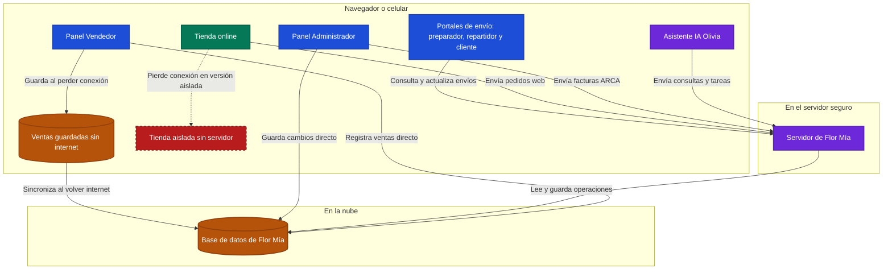
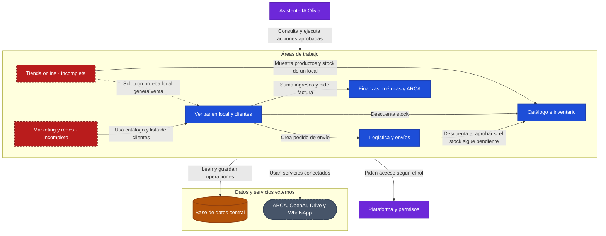

# Mapa Maestro · Flor Mía

**Paso 0 · Corte `d0f1225` del [PR #68](https://github.com/AgustinBazanUB/App-Integral-FM/pull/68)**

La suite describe la operación del corte auditado. Parte del [Relevamiento funcional del PR #69](https://github.com/AgustinBazanUB/App-Integral-FM/blob/40ad5f8d208c5788416827dc7ddaffda4b801a75/docs/00-relevamiento-funcional-actual.md) y del árbol de código del commit [`d0f1225`](https://github.com/AgustinBazanUB/App-Integral-FM/commit/d0f122581231cdbd4046ce7b4651e90115556cbe). Las funciones del checkout integrado del PR #67 corresponden a otro corte.

[Abrir el visor local](diagrams/index.html). Guardá el archivo y abrilo con doble clic en Chrome. Los diagramas y sus fuentes están embebidos en el HTML. En el visor podés elegir un diagrama, usar los controles de zoom, arrastrar sobre el plano y copiar su código Mermaid.

## Leyenda visual

| Categoría | Color | Qué indica |
| --- | --- | --- |
| `actor` | `#1E293B` | Actores |
| `integral` | `#1D4ED8` | App Integral FM |
| `ecommerce` | `#047857` | E-Commerce |
| `shared` | `#6D28D9` | Capa transversal |
| `db` | `#B45309` | Persistencia |
| `external` | `#475569` | Servicios externos · borde punteado |
| `debt` | `#B91C1C` | Brecha o flujo incompleto · borde punteado |

Las flechas muestran acciones. Las líneas punteadas marcan caminos condicionados o pasos pendientes. Las cajas rojas señalan brechas del flujo.

## Visión global

### 00A · Pantallas, servidor y datos

[Fuente Mermaid](diagrams/mmd/00-macro-a-frontera-fisica.mmd) · [SVG](diagrams/svg/00-macro-a-frontera-fisica.svg) · [Visor](diagrams/index.html#00-macro-a-frontera-fisica)



> **Lectura rápida:** Cada persona usa su propio panel. El vendedor puede guardar una venta en su dispositivo hasta que vuelva internet. Facturas, envíos, Olivia y pedidos de tienda pasan por el servidor.

| Caja en el diagrama | Artefactos técnicos reales en el código |
| --- | --- |
| Panel Administrador | `/gestion/*`, `ManagementApp` · [`src/gestion/ManagementApp.jsx`](../src/gestion/ManagementApp.jsx) · [`src/gestion/olivia/OliviaMount.jsx`](../src/gestion/olivia/OliviaMount.jsx) |
| Panel Vendedor | `/vendedor` · [`src/gestion/seller/SellerPanel.jsx`](../src/gestion/seller/SellerPanel.jsx) |
| Ventas guardadas sin internet | `IndexedDB`, `seller_pending_sales` · [`src/gestion/seller/offlineSales.js`](../src/gestion/seller/offlineSales.js) |
| Asistente IA Olivia | `OliviaMount`, `olivia` · [`src/gestion/olivia/OliviaMount.jsx`](../src/gestion/olivia/OliviaMount.jsx) · [`netlify/functions/olivia.mjs`](../netlify/functions/olivia.mjs) |
| Portales de envío: preparador, repartidor y cliente | `/e/:lookupId`, `/reparto`, `/seguimiento` · [`src/gestion/shipping/ShippingPublicApp.jsx`](../src/gestion/shipping/ShippingPublicApp.jsx) · [`src/gestion/shipping/CourierPortal.jsx`](../src/gestion/shipping/CourierPortal.jsx) |
| Tienda online | `/tienda` · [`src/Storefront.jsx`](../src/Storefront.jsx) · [`src/surfaces/EcommerceSurface.jsx`](../src/surfaces/EcommerceSurface.jsx) · [`src/gestion/StorePreviewGate.jsx`](../src/gestion/StorePreviewGate.jsx) |
| Tienda aislada sin servidor | `dist/ecommerce`, `ecommerce-catalog`, `ecommerce-checkout` · [`vite.config.js`](../vite.config.js) · [`deploy/ecommerce/netlify.toml`](../deploy/ecommerce/netlify.toml) · [`deploy/ecommerce/functions/.gitkeep`](../deploy/ecommerce/functions/.gitkeep) · [`src/services/ecommerceService.js`](../src/services/ecommerceService.js) |
| Servidor de Flor Mía | `30 Functions con 4 ejecuciones programadas` · [`netlify/functions/`](../netlify/functions/) · [`netlify.toml`](../netlify.toml) |
| Base de datos de Flor Mía | `Cloud Firestore`, `Firebase Authentication` · [`src/gestion/services/firebase.js`](../src/gestion/services/firebase.js) · [`firestore.rules`](../firestore.rules) |

### 00B · Cómo se conectan las áreas

[Fuente Mermaid](diagrams/mmd/00-macro-b-macro-dominios.mmd) · [SVG](diagrams/svg/00-macro-b-macro-dominios.svg) · [Visor](diagrams/index.html#00-macro-b-macro-dominios)



> **Lectura rápida:** La tienda, las ventas y los envíos usan el mismo inventario. Al aprobar un envío, logística descuenta las existencias si la venta estaba pendiente de stock. Marketing toma productos del catálogo y elige destinatarios de la lista de clientes. Olivia consulta y actúa con los permisos y confirmaciones de cada operación.

| Caja en el diagrama | Artefactos técnicos reales en el código |
| --- | --- |
| Marketing y redes · incompleto | `/gestion/social`, `/gestion/marketing/whatsapp`, `/gestion/marketing/meta-ads` · [`src/gestion/pages/WhatsAppCampaignsPage.jsx`](../src/gestion/pages/WhatsAppCampaignsPage.jsx) · [`src/gestion/pages/MetaAdsPage.jsx`](../src/gestion/pages/MetaAdsPage.jsx) · [`src/gestion/marketing/metaAds/knowledgeService.js`](../src/gestion/marketing/metaAds/knowledgeService.js) · [`src/gestion/marketing/whatsapp/campaignService.js`](../src/gestion/marketing/whatsapp/campaignService.js) |
| Tienda online · incompleta | `ecommerce-catalog`, `ecommerce-checkout`, `ecommerce-simulated-payment` · [`src/Storefront.jsx`](../src/Storefront.jsx) · [`netlify/functions/ecommerce-checkout.mjs`](../netlify/functions/ecommerce-checkout.mjs) |
| Ventas en local y clientes | `/vendedor`, `/gestion/quick-sales`, `/gestion/loyal-customers`, `sales`, `customers` · [`src/gestion/services/sellerService.js`](../src/gestion/services/sellerService.js) · [`src/gestion/customers/crmService.js`](../src/gestion/customers/crmService.js) |
| Logística y envíos | `shipments`, `stockCommitState: pending → committed` · [`netlify/functions/shipping.mjs`](../netlify/functions/shipping.mjs) · [`netlify/functions/_lib/shipping.mjs`](../netlify/functions/_lib/shipping.mjs) |
| Finanzas, métricas y ARCA | `/gestion/finance`, `/gestion/metrics/sales`, `financialEntries` · [`src/gestion/pages/FinancePage.jsx`](../src/gestion/pages/FinancePage.jsx) · [`src/gestion/pages/SalesMetricsPage.jsx`](../src/gestion/pages/SalesMetricsPage.jsx) · [`netlify/functions/arca-invoice.mjs`](../netlify/functions/arca-invoice.mjs) |
| Catálogo e inventario | `products`, `locationStock`, `warehouseStock`, `stockMovements` · [`src/gestion/services/inventoryService.js`](../src/gestion/services/inventoryService.js) |
| Asistente IA Olivia | `olivia`, `acciones sujetas a confirmación y permisos` · [`netlify/functions/olivia.mjs`](../netlify/functions/olivia.mjs) · [`src/shared/oliviaCapabilities.mjs`](../src/shared/oliviaCapabilities.mjs) |
| Plataforma y permisos | `roles de aplicación` · [`src/gestion/permissions.js`](../src/gestion/permissions.js) · [`firestore.rules`](../firestore.rules) · [`.github/workflows/`](../.github/workflows/) |
| Base de datos central | `Cloud Firestore`, `91 rutas entre colecciones y subcolecciones` · [`firestore.rules`](../firestore.rules) |
| ARCA, OpenAI, Drive y WhatsApp | `ARCA (WSAA, WSFE y Padrón)`, `OpenAI`, `Google Drive OAuth`, `extensión WhatsApp` · [`netlify/functions/`](../netlify/functions/) · [`src/gestion/marketing/whatsapp/extensionBridge.js`](../src/gestion/marketing/whatsapp/extensionBridge.js) |

El inventario del corte registra 91 rutas de Firestore y 15 conexiones, incluidas las de infraestructura y navegación externa. [Relevamiento del PR #69](https://github.com/AgustinBazanUB/App-Integral-FM/blob/40ad5f8d208c5788416827dc7ddaffda4b801a75/docs/00-relevamiento-funcional-actual.md)

### 00C · Venta en local y compra en tienda web

[Fuente Mermaid](diagrams/mmd/00-macro-c-quiebre-venta-fisica-vs-web.mmd) · [SVG](diagrams/svg/00-macro-c-quiebre-venta-fisica-vs-web.svg) · [Visor](diagrams/index.html#00-macro-c-quiebre-venta-fisica-vs-web)

```mermaid
flowchart TB
    %% Una venta en local y un pedido web avanzan por caminos distintos.
    subgraph local["Venta en local o asistida"]
        vendedor["Vendedor confirma la venta"]:::integral
        venta[("Venta registrada y stock descontado si es directa")]:::db
        impacto["Facturación, ingresos y envíos"]:::shared
        devolucion["Sin reversa automática de stock, caja ni factura"]:::debt
        vendedor -->|"Registra en línea o al volver internet"| venta
        venta -->|"Suma ingresos y habilita factura y envío"| impacto
        impacto -.->|"Si un envío se devuelve o cancela"| devolucion
    end
    subgraph web["Compra en tienda web"]
        retiro["El cliente confirma retiro"]:::ecommerce
        pendiente[("Pedido pendiente sin reservar stock")]:::db
        falta["Falta cobro online con Payway y envío a domicilio"]:::debt
        prueba["Prueba local de administrador"]:::shared
        cierre[("Venta registrada, stock descontado y borrador fiscal")]:::db
        retiro -->|"Guarda el pedido pendiente"| pendiente
        pendiente -.->|"Se frena antes del cobro"| falta
        pendiente -.->|"Solo la prueba local simula el pago"| prueba
        prueba -->|"Registra la venta y prepara el borrador fiscal"| cierre
    end

    classDef actor fill:#1E293B,stroke:#64748B,color:#FFFFFF,stroke-width:2px
    classDef integral fill:#1D4ED8,stroke:#1E40AF,color:#FFFFFF,stroke-width:2px
    classDef ecommerce fill:#047857,stroke:#065F46,color:#FFFFFF,stroke-width:2px
    classDef shared fill:#6D28D9,stroke:#5B21B6,color:#FFFFFF,stroke-width:2px
    classDef db fill:#B45309,stroke:#92400E,color:#FFFFFF,stroke-width:2px
    classDef external fill:#475569,stroke:#334155,color:#FFFFFF,stroke-width:2px,stroke-dasharray:5 4
    classDef debt fill:#B91C1C,stroke:#7F1D1D,color:#FFFFFF,stroke-width:2px,stroke-dasharray:5 4
```



> **Lectura rápida:** Una venta directa registra y descuenta stock. Si el envío requiere aprobar el origen, el descuento espera esa aprobación. En la tienda, confirmar el retiro deja un pedido pendiente sin reservar stock. La prueba local es el único camino del corte auditado que simula el pago y prepara el borrador fiscal.

| Caja en el diagrama | Artefactos técnicos reales en el código |
| --- | --- |
| Vendedor confirma la venta | `/gestion/quick-sales`, `/vendedor`, `IndexedDB`, `seller_pending_sales` · [`src/gestion/pages/QuickSalesPage.jsx`](../src/gestion/pages/QuickSalesPage.jsx) · [`src/gestion/seller/SellerPanel.jsx`](../src/gestion/seller/SellerPanel.jsx) · [`src/gestion/seller/offlineSales.js`](../src/gestion/seller/offlineSales.js) · [`src/gestion/services/sellerService.js`](../src/gestion/services/sellerService.js) |
| Venta registrada y stock descontado si es directa | `sales`, `stockMovements`, `locationStock`, `warehouseStock` · [`src/shared/operationalWritePlans.mjs`](../src/shared/operationalWritePlans.mjs) · [`netlify/functions/arca-invoice.mjs`](../netlify/functions/arca-invoice.mjs) · [`netlify/functions/_lib/shipping.mjs`](../netlify/functions/_lib/shipping.mjs) · [`src/gestion/pages/FinancePage.jsx`](../src/gestion/pages/FinancePage.jsx) |
| Facturación, ingresos y envíos | `financialEntries`, `arca-invoice`, `shipments` · [`src/shared/operationalWritePlans.mjs`](../src/shared/operationalWritePlans.mjs) · [`netlify/functions/arca-invoice.mjs`](../netlify/functions/arca-invoice.mjs) · [`netlify/functions/_lib/shipping.mjs`](../netlify/functions/_lib/shipping.mjs) · [`src/gestion/pages/FinancePage.jsx`](../src/gestion/pages/FinancePage.jsx) |
| Sin reversa automática de stock, caja ni factura | `shipments`, `cancelado/devuelto`, `sale-cancel`, `CAE` · [`netlify/functions/_lib/shipping.mjs`](../netlify/functions/_lib/shipping.mjs) · [`netlify/functions/_lib/arca/saleCancellation.mjs`](../netlify/functions/_lib/arca/saleCancellation.mjs) |
| El cliente confirma retiro | `/checkout`, `ecommerce-checkout` · [`src/pages/CheckoutPage.jsx`](../src/pages/CheckoutPage.jsx) · [`netlify/functions/ecommerce-checkout.mjs`](../netlify/functions/ecommerce-checkout.mjs) · [`netlify/functions/_lib/ecommerce/commerceService.mjs`](../netlify/functions/_lib/ecommerce/commerceService.mjs) |
| Pedido pendiente sin reservar stock | `orders`, `payments`, `pending_payment` · [`src/pages/CheckoutPage.jsx`](../src/pages/CheckoutPage.jsx) · [`netlify/functions/ecommerce-checkout.mjs`](../netlify/functions/ecommerce-checkout.mjs) · [`netlify/functions/_lib/ecommerce/commerceService.mjs`](../netlify/functions/_lib/ecommerce/commerceService.mjs) |
| Falta cobro online con Payway y envío a domicilio | `Payway sin integrar`, `retiro únicamente` · [`src/pages/CheckoutPage.jsx`](../src/pages/CheckoutPage.jsx) · [`netlify/functions/_lib/ecommerce/paymentContract.mjs`](../netlify/functions/_lib/ecommerce/paymentContract.mjs) |
| Prueba local de administrador | `ecommerce-simulated-payment`, `solo administrador en local` · [`netlify/functions/ecommerce-simulated-payment.mjs`](../netlify/functions/ecommerce-simulated-payment.mjs) · [`netlify/functions/_lib/ecommerce/paymentContract.mjs`](../netlify/functions/_lib/ecommerce/paymentContract.mjs) · [`netlify/functions/_lib/ecommerce/fiscalService.mjs`](../netlify/functions/_lib/ecommerce/fiscalService.mjs) |
| Venta registrada, stock descontado y borrador fiscal | `sales`, `stockMovements`, `invoices (borrador sin CAE)` · [`netlify/functions/ecommerce-simulated-payment.mjs`](../netlify/functions/ecommerce-simulated-payment.mjs) · [`netlify/functions/_lib/ecommerce/paymentContract.mjs`](../netlify/functions/_lib/ecommerce/paymentContract.mjs) · [`netlify/functions/_lib/ecommerce/fiscalService.mjs`](../netlify/functions/_lib/ecommerce/fiscalService.mjs) |

## Índice WBS

| Dominio | Alcance | Mermaid | SVG |
| --- | --- | --- | --- |
| [D1 · Catálogo e inventario](diagrams/index.html#01-d1-catalogo-inventario) | La ficha maestra se asocia a los saldos de cada ubicación o depósito. Las transacciones de inventario producen saldos, movimientos y transferencias. Proveedores registra fichas y la compra queda como contrato de datos. | [MMD](diagrams/mmd/01-d1-catalogo-inventario.mmd) | [SVG](diagrams/svg/01-d1-catalogo-inventario.svg) |
| [D2 · Ventas POS y CRM](diagrams/index.html#02-d2-ventas-pos-crm) | Los dos paneles usan sellerService para las ventas directas. El Panel Vendedor conserva pendientes de venta en IndexedDB y reintenta la misma operación. Factura, envío y anulación usan sus Functions cuando corresponde. | [MMD](diagrams/mmd/02-d2-ventas-pos-crm.mmd) | [SVG](diagrams/svg/02-d2-ventas-pos-crm.svg) |
| [D3 · Finanzas, métricas y ARCA](diagrams/index.html#03-d3-finanzas-metricas-arca) | Las ventas alimentan las vistas comerciales y financieras. El comprobante vincula la venta al circuito fiscal. El estado del comprobante condiciona la descarga, el correo y la posible nota de crédito al anular. | [MMD](diagrams/mmd/03-d3-finanzas-metricas-arca.mmd) | [SVG](diagrams/svg/03-d3-finanzas-metricas-arca.svg) |
| [D4 · Logística y envíos](diagrams/index.html#04-d4-logistica-envios) | El servidor aplica el siguiente paso según asignación, credencial y estado. El mapa sirve para editar el punto de entrega o abrir navegación externa. El seguimiento público muestra hitos confirmados. | [MMD](diagrams/mmd/04-d4-logistica-envios.mmd) | [SVG](diagrams/svg/04-d4-logistica-envios.svg) |
| [D5 · E-Commerce y pedidos web](diagrams/index.html#05-d5-ecommerce-pedidos-web) · [INCOMPLETO] | La app unificada consulta el catálogo comercial y registra retiro cuando el backend está configurado. Gestión puede listar hasta 40 pedidos recientes. El build independiente carece de las Functions que solicita el storefront. | [MMD](diagrams/mmd/05-d5-ecommerce-pedidos-web.mmd) | [SVG](diagrams/svg/05-d5-ecommerce-pedidos-web.svg) |
| [D6 · Marketing y campañas](diagrams/index.html#06-d6-marketing-campanas) · [INCOMPLETO] | WhatsApp envía el trabajo de campaña a la extensión Chrome mediante postMessage. Meta Ads prepara estrategia, creatividad y archivos en Drive. Validación, render, publicación y resultados siguen anunciados en la interfaz. | [MMD](diagrams/mmd/06-d6-marketing-campanas.mmd) | [SVG](diagrams/svg/06-d6-marketing-campanas.svg) |
| [D7 · Olivia IA](diagrams/index.html#07-d7-olivia-ia) | Chat, voz, documentos y retención tienen caminos propios. Firestore conserva el estado y uso autorizados. El modo GPT-Live conversacional anterior devuelve 410 y las herramientas de preparación de envíos siguen bloqueadas. | [MMD](diagrams/mmd/07-d7-olivia-ia.mmd) | [SVG](diagrams/svg/07-d7-olivia-ia.svg) |
| [D8 · Plataforma y gobernanza](diagrams/index.html#08-d8-plataforma-gobernanza) | El acceso exige sesión y perfil activo, con comprobaciones en cliente, reglas y servidor. Administración y el servicio de usuarios aplican guardas diferentes a general_admin. Deploy Previews tienen comprobación de aislamiento en Firebase. | [MMD](diagrams/mmd/08-d8-plataforma-gobernanza.mmd) | [SVG](diagrams/svg/08-d8-plataforma-gobernanza.svg) |

## Macrodominios en detalle

### D1 · Catálogo e inventario

[Fuente Mermaid](diagrams/mmd/01-d1-catalogo-inventario.mmd) · [SVG](diagrams/svg/01-d1-catalogo-inventario.svg) · [Visor](diagrams/index.html#01-d1-catalogo-inventario)



> **Lectura rápida:** Las fichas de producto se comparten entre locales y depósitos. Cada ajuste o traslado cambia la cantidad y deja un registro. Proveedores permite registrar fichas. La gestión de compras sigue pendiente.

| Caja en el diagrama | Artefactos técnicos reales en el código |
| --- | --- |
| Cargar y editar productos | `/gestion/products` · [`src/gestion/pages/ProductsPage.jsx`](../src/gestion/pages/ProductsPage.jsx) · [`netlify/functions/catalog-merge.mjs`](../netlify/functions/catalog-merge.mjs) · [`netlify/functions/_lib/catalogMerge.mjs`](../netlify/functions/_lib/catalogMerge.mjs) |
| Stock de locales | `/gestion/locations/:locationId`, `locationStock/{locationId}/items` · [`src/gestion/pages/LocationDetailPage.jsx`](../src/gestion/pages/LocationDetailPage.jsx) · [`src/gestion/pages/WarehousePage.jsx`](../src/gestion/pages/WarehousePage.jsx) |
| Stock de depósitos | `/gestion/warehouse`, `warehouseStock/{warehouseId}/items` · [`src/gestion/pages/LocationDetailPage.jsx`](../src/gestion/pages/LocationDetailPage.jsx) · [`src/gestion/pages/WarehousePage.jsx`](../src/gestion/pages/WarehousePage.jsx) |
| Ingresos, ajustes y traslados | `Firebase SDK`, `transacciones de ajustes y traslados` · [`src/gestion/services/inventoryService.js`](../src/gestion/services/inventoryService.js) · [`src/shared/stockTransferWritePlans.mjs`](../src/shared/stockTransferWritePlans.mjs) |
| Pantalla de proveedores incompleta | `/gestion/suppliers` · [`src/gestion/modules.js`](../src/gestion/modules.js) · [`src/gestion/pages/GenericModulePage.jsx`](../src/gestion/pages/GenericModulePage.jsx) · [`firestore.rules`](../firestore.rules) |
| Unir productos duplicados | `catalog-merge` · [`src/gestion/pages/ProductsPage.jsx`](../src/gestion/pages/ProductsPage.jsx) · [`netlify/functions/catalog-merge.mjs`](../netlify/functions/catalog-merge.mjs) · [`netlify/functions/_lib/catalogMerge.mjs`](../netlify/functions/_lib/catalogMerge.mjs) |
| Productos y categorías | `products`, `productCategories` · [`src/gestion/pages/ProductsPage.jsx`](../src/gestion/pages/ProductsPage.jsx) · [`netlify/functions/catalog-merge.mjs`](../netlify/functions/catalog-merge.mjs) · [`netlify/functions/_lib/catalogMerge.mjs`](../netlify/functions/_lib/catalogMerge.mjs) |
| Existencias por local y depósito | `locationStock`, `warehouseStock` · [`src/gestion/services/inventoryService.js`](../src/gestion/services/inventoryService.js) · [`src/shared/stockTransferWritePlans.mjs`](../src/shared/stockTransferWritePlans.mjs) |
| Historial de movimientos y traslados | `stockMovements`, `stockTransfers` · [`src/gestion/services/inventoryService.js`](../src/gestion/services/inventoryService.js) · [`src/shared/stockTransferWritePlans.mjs`](../src/shared/stockTransferWritePlans.mjs) |
| Fichas de proveedores | `suppliers` · [`src/gestion/modules.js`](../src/gestion/modules.js) · [`src/gestion/pages/GenericModulePage.jsx`](../src/gestion/pages/GenericModulePage.jsx) · [`firestore.rules`](../firestore.rules) |
| Compras sin pantalla de gestión | `purchases (sin pantalla propia)` · [`src/gestion/modules.js`](../src/gestion/modules.js) · [`src/gestion/pages/GenericModulePage.jsx`](../src/gestion/pages/GenericModulePage.jsx) · [`firestore.rules`](../firestore.rules) |

### D2 · Ventas POS y CRM

[Fuente Mermaid](diagrams/mmd/02-d2-ventas-pos-crm.mmd) · [SVG](diagrams/svg/02-d2-ventas-pos-crm.svg) · [Visor](diagrams/index.html#02-d2-ventas-pos-crm)


> **Lectura rápida:** Las ventas rápidas y las del vendedor registran el cobro, el cliente y los movimientos de stock cuando corresponde. Si se pierde la conexión, el Panel Vendedor guarda la operación y reintenta al recuperarla.

| Caja en el diagrama | Artefactos técnicos reales en el código |
| --- | --- |
| Venta rápida | `/gestion/quick-sales` · [`src/gestion/pages/QuickSalesPage.jsx`](../src/gestion/pages/QuickSalesPage.jsx) · [`src/gestion/services/quickSaleStockService.js`](../src/gestion/services/quickSaleStockService.js) |
| Panel Vendedor | `/vendedor` · [`src/gestion/seller/SellerPanel.jsx`](../src/gestion/seller/SellerPanel.jsx) · [`src/gestion/seller/offlineSales.js`](../src/gestion/seller/offlineSales.js) |
| Ventas guardadas sin internet | `IndexedDB`, `seller_pending_sales` · [`src/gestion/seller/SellerPanel.jsx`](../src/gestion/seller/SellerPanel.jsx) · [`src/gestion/seller/offlineSales.js`](../src/gestion/seller/offlineSales.js) |
| Confirmar venta y origen del stock | `sellerService`, `Firebase SDK (transacción)` · [`src/gestion/services/sellerService.js`](../src/gestion/services/sellerService.js) · [`src/shared/operationalWritePlans.mjs`](../src/shared/operationalWritePlans.mjs) |
| Clientes, zonas y fidelización | `/gestion/loyal-customers` · [`src/gestion/pages/LoyalCustomersPage.jsx`](../src/gestion/pages/LoyalCustomersPage.jsx) · [`src/gestion/services/customerService.js`](../src/gestion/services/customerService.js) · [`src/gestion/customers/crmService.js`](../src/gestion/customers/crmService.js) |
| Anulación, factura o envío | `sale-cancel`, `arca-invoice`, `shipping` · [`netlify/functions/sale-cancel.mjs`](../netlify/functions/sale-cancel.mjs) · [`netlify/functions/arca-invoice.mjs`](../netlify/functions/arca-invoice.mjs) · [`netlify/functions/shipping.mjs`](../netlify/functions/shipping.mjs) |
| Ventas numeradas y movimientos de stock | `sales`, `counters`, `stockMovements` · [`src/gestion/services/sellerService.js`](../src/gestion/services/sellerService.js) · [`src/shared/operationalWritePlans.mjs`](../src/shared/operationalWritePlans.mjs) |
| Fichas de clientes y condiciones comerciales | `customers`, `customerZones`, `settings` · [`src/gestion/pages/LoyalCustomersPage.jsx`](../src/gestion/pages/LoyalCustomersPage.jsx) · [`src/gestion/services/customerService.js`](../src/gestion/services/customerService.js) · [`src/gestion/customers/crmService.js`](../src/gestion/customers/crmService.js) |

### D3 · Finanzas, métricas y ARCA

[Fuente Mermaid](diagrams/mmd/03-d3-finanzas-metricas-arca.mmd) · [SVG](diagrams/svg/03-d3-finanzas-metricas-arca.svg) · [Visor](diagrams/index.html#03-d3-finanzas-metricas-arca)



> **Lectura rápida:** Los números de las ventas se reflejan en el resumen, las métricas y Finanzas. Pedir un comprobante abre otro recorrido con validación, autorización de ARCA y entrega por correo si está configurado.

| Caja en el diagrama | Artefactos técnicos reales en el código |
| --- | --- |
| Resumen del negocio | `/gestion` · [`src/gestion/pages/DashboardPage.jsx`](../src/gestion/pages/DashboardPage.jsx) · [`src/gestion/pages/SalesMetricsPage.jsx`](../src/gestion/pages/SalesMetricsPage.jsx) |
| Métricas de ventas | `/gestion/metrics/sales` · [`src/gestion/pages/DashboardPage.jsx`](../src/gestion/pages/DashboardPage.jsx) · [`src/gestion/pages/SalesMetricsPage.jsx`](../src/gestion/pages/SalesMetricsPage.jsx) |
| Finanzas y movimientos de caja | `/gestion/finance` · [`src/gestion/pages/FinancePage.jsx`](../src/gestion/pages/FinancePage.jsx) · [`src/gestion/finance/financeService.js`](../src/gestion/finance/financeService.js) · [`firestore.rules`](../firestore.rules) |
| Solicitar factura o nota de crédito | `arca-invoice`, `sale-cancel` · [`netlify/functions/arca-document.mjs`](../netlify/functions/arca-document.mjs) · [`netlify/functions/_lib/arca/invoiceEmail.mjs`](../netlify/functions/_lib/arca/invoiceEmail.mjs) · [`netlify/functions/sale-cancel.mjs`](../netlify/functions/sale-cancel.mjs) · [`netlify/functions/_lib/arca/creditNotePlan.mjs`](../netlify/functions/_lib/arca/creditNotePlan.mjs) · [`netlify/functions/arca-invoice.mjs`](../netlify/functions/arca-invoice.mjs) |
| Validar datos del cliente | `arca-receiver`, `arca-taxpayer`, `Padrón` · [`netlify/functions/arca-receiver.mjs`](../netlify/functions/arca-receiver.mjs) · [`netlify/functions/arca-invoice.mjs`](../netlify/functions/arca-invoice.mjs) · [`netlify/functions/arca-taxpayer.mjs`](../netlify/functions/arca-taxpayer.mjs) |
| Autorizar y preparar el comprobante | `arca-authorize`, `arca-document`, `sale-cancel` · [`netlify/functions/arca-authorize.mjs`](../netlify/functions/arca-authorize.mjs) · [`netlify/functions/_lib/arca/sequenceLock.mjs`](../netlify/functions/_lib/arca/sequenceLock.mjs) · [`netlify/functions/_lib/arca/config.mjs`](../netlify/functions/_lib/arca/config.mjs) · [`netlify/functions/arca-document.mjs`](../netlify/functions/arca-document.mjs) · [`netlify/functions/sale-cancel.mjs`](../netlify/functions/sale-cancel.mjs) |
| Ventas y movimientos financieros | `sales`, `financialEntries` · [`src/gestion/pages/FinancePage.jsx`](../src/gestion/pages/FinancePage.jsx) · [`src/gestion/finance/financeService.js`](../src/gestion/finance/financeService.js) · [`firestore.rules`](../firestore.rules) |
| Comprobantes y numeración fiscal | `invoices`, `arcaSequenceLocks` · [`netlify/functions/arca-authorize.mjs`](../netlify/functions/arca-authorize.mjs) · [`netlify/functions/_lib/arca/sequenceLock.mjs`](../netlify/functions/_lib/arca/sequenceLock.mjs) · [`netlify/functions/_lib/arca/config.mjs`](../netlify/functions/_lib/arca/config.mjs) |
| ARCA | `WSAA`, `WSFE`, `Padrón` · [`netlify/functions/arca-receiver.mjs`](../netlify/functions/arca-receiver.mjs) · [`netlify/functions/arca-invoice.mjs`](../netlify/functions/arca-invoice.mjs) · [`netlify/functions/arca-taxpayer.mjs`](../netlify/functions/arca-taxpayer.mjs) · [`netlify/functions/_lib/arca/config.mjs`](../netlify/functions/_lib/arca/config.mjs) |
| Correo del comprobante | `SMTP`, `PDF autorizado` · [`netlify/functions/arca-document.mjs`](../netlify/functions/arca-document.mjs) · [`netlify/functions/_lib/arca/invoiceEmail.mjs`](../netlify/functions/_lib/arca/invoiceEmail.mjs) · [`netlify/functions/sale-cancel.mjs`](../netlify/functions/sale-cancel.mjs) · [`netlify/functions/_lib/arca/creditNotePlan.mjs`](../netlify/functions/_lib/arca/creditNotePlan.mjs) |
| Métricas sin exportación | `Métricas sin exportación` · [`src/gestion/pages/DashboardPage.jsx`](../src/gestion/pages/DashboardPage.jsx) · [`src/gestion/pages/SalesMetricsPage.jsx`](../src/gestion/pages/SalesMetricsPage.jsx) · [`src/gestion/pages/SalesMetricsPage.jsx`](../src/gestion/pages/SalesMetricsPage.jsx) |
| Sin turnos de caja | `cashSessions (sin circuito operativo)` · [`src/gestion/pages/FinancePage.jsx`](../src/gestion/pages/FinancePage.jsx) · [`src/gestion/finance/financeService.js`](../src/gestion/finance/financeService.js) · [`firestore.rules`](../firestore.rules) |

### D4 · Logística y envíos

[Fuente Mermaid](diagrams/mmd/04-d4-logistica-envios.mmd) · [SVG](diagrams/svg/04-d4-logistica-envios.svg) · [Visor](diagrams/index.html#04-d4-logistica-envios)



> **Lectura rápida:** Preparadores y repartidores confirman las etapas. El cliente consulta el avance registrado. Los mapas ayudan con direcciones y navegación. La devolución o cancelación del envío no revierte por sí sola sus efectos en stock, caja y factura.

| Caja en el diagrama | Artefactos técnicos reales en el código |
| --- | --- |
| Tablero de envíos | `/gestion/shipping` · [`src/gestion/pages/ShippingPage.jsx`](../src/gestion/pages/ShippingPage.jsx) · [`src/gestion/shipping/ShippingPublicApp.jsx`](../src/gestion/shipping/ShippingPublicApp.jsx) · [`src/gestion/shipping/CourierPortal.jsx`](../src/gestion/shipping/CourierPortal.jsx) |
| Preparador de pedidos | `/e/:lookupId` · [`src/gestion/pages/ShippingPage.jsx`](../src/gestion/pages/ShippingPage.jsx) · [`src/gestion/shipping/ShippingPublicApp.jsx`](../src/gestion/shipping/ShippingPublicApp.jsx) · [`src/gestion/shipping/CourierPortal.jsx`](../src/gestion/shipping/CourierPortal.jsx) |
| Repartidor | `/reparto` · [`src/gestion/pages/ShippingPage.jsx`](../src/gestion/pages/ShippingPage.jsx) · [`src/gestion/shipping/ShippingPublicApp.jsx`](../src/gestion/shipping/ShippingPublicApp.jsx) · [`src/gestion/shipping/CourierPortal.jsx`](../src/gestion/shipping/CourierPortal.jsx) |
| Seguimiento para el cliente | `/seguimiento` · [`src/gestion/pages/ShippingPage.jsx`](../src/gestion/pages/ShippingPage.jsx) · [`src/gestion/shipping/ShippingPublicApp.jsx`](../src/gestion/shipping/ShippingPublicApp.jsx) · [`src/gestion/shipping/CourierPortal.jsx`](../src/gestion/shipping/CourierPortal.jsx) |
| Control de cada etapa del envío | `shipping`, `13 estados`, `aprobación con stockCommitState: pending` · [`src/shared/shippingDomain.mjs`](../src/shared/shippingDomain.mjs) · [`netlify/functions/shipping.mjs`](../netlify/functions/shipping.mjs) · [`netlify/functions/_lib/shipping.mjs`](../netlify/functions/_lib/shipping.mjs) |
| Limpieza de ubicaciones vencidas | `shipping-retention` · [`netlify/functions/shipping-retention.mjs`](../netlify/functions/shipping-retention.mjs) · [`netlify/functions/_lib/shippingRetention.mjs`](../netlify/functions/_lib/shippingRetention.mjs) |
| Envíos, novedades y sesiones de reparto | `shipments`, `shipments/{shipmentId}/events`, `deliverySessions` · [`src/shared/shippingDomain.mjs`](../src/shared/shippingDomain.mjs) · [`netlify/functions/shipping.mjs`](../netlify/functions/shipping.mjs) · [`netlify/functions/_lib/shipping.mjs`](../netlify/functions/_lib/shipping.mjs) |
| Mapas y navegación | `OpenStreetMap`, `Google Maps` · [`src/gestion/shipping/ShippingMap.jsx`](../src/gestion/shipping/ShippingMap.jsx) · [`src/gestion/shipping/ShipmentDetail.jsx`](../src/gestion/shipping/ShipmentDetail.jsx) · [`src/gestion/shipping/CourierPortal.jsx`](../src/gestion/shipping/CourierPortal.jsx) |
| Avisos automáticos y conexión con Uber pendientes | `shippingOutbox`, `adapter: disabled`, `Uber sin integración con su API` · [`netlify/functions/_lib/shipping.mjs`](../netlify/functions/_lib/shipping.mjs) · [`src/shared/shippingDomain.mjs`](../src/shared/shippingDomain.mjs) |
| Sin reversa de stock, caja ni factura | `shipments (cancelación o devolución)`, `sin reversa automática de stock, caja ni CAE` · [`netlify/functions/_lib/shipping.mjs`](../netlify/functions/_lib/shipping.mjs) · [`src/shared/shippingDomain.mjs`](../src/shared/shippingDomain.mjs) |

### D5 · E-Commerce y pedidos web

[Fuente Mermaid](diagrams/mmd/05-d5-ecommerce-pedidos-web.mmd) · [SVG](diagrams/svg/05-d5-ecommerce-pedidos-web.svg) · [Visor](diagrams/index.html#05-d5-ecommerce-pedidos-web)


> **Lectura rápida:** La tienda muestra stock de un local y guarda el pedido para retiro. Gestión consulta los últimos 40 pedidos. Al publicar la tienda aislada, faltan los servicios que atienden el catálogo y los pedidos.

| Caja en el diagrama | Artefactos técnicos reales en el código |
| --- | --- |
| Portada, catálogo y ficha de producto | `/tienda`, `/productos`, `/producto/:slug` · [`src/Storefront.jsx`](../src/Storefront.jsx) · [`src/pages/HomePage.jsx`](../src/pages/HomePage.jsx) · [`src/pages/CatalogPage.jsx`](../src/pages/CatalogPage.jsx) · [`src/pages/ProductPage.jsx`](../src/pages/ProductPage.jsx) |
| Carrito y confirmación para retiro | `/checkout (retiro)` · [`src/context/CartContext.jsx`](../src/context/CartContext.jsx) · [`src/pages/CheckoutPage.jsx`](../src/pages/CheckoutPage.jsx) |
| Carrito y borrador en tu dispositivo | `localStorage`, `carrito y borrador` · [`src/context/CartContext.jsx`](../src/context/CartContext.jsx) · [`src/pages/CheckoutPage.jsx`](../src/pages/CheckoutPage.jsx) |
| Consulta de los últimos 40 pedidos | `/gestion/ecommerce`, `orders`, `límite de 40 (solo lectura)` · [`src/gestion/pages/GenericModulePage.jsx`](../src/gestion/pages/GenericModulePage.jsx) · [`src/gestion/services/managementService.js`](../src/gestion/services/managementService.js) · [`deploy/ecommerce/netlify.toml`](../deploy/ecommerce/netlify.toml) |
| Tienda aislada sin servidor | `dist/ecommerce`, `deploy/ecommerce/functions/.gitkeep` · [`src/gestion/pages/GenericModulePage.jsx`](../src/gestion/pages/GenericModulePage.jsx) · [`src/gestion/services/managementService.js`](../src/gestion/services/managementService.js) · [`deploy/ecommerce/netlify.toml`](../deploy/ecommerce/netlify.toml) |
| Consulta de productos disponibles | `ecommerce-catalog` · [`netlify/functions/ecommerce-catalog.mjs`](../netlify/functions/ecommerce-catalog.mjs) · [`netlify/functions/_lib/ecommerce/commerceService.mjs`](../netlify/functions/_lib/ecommerce/commerceService.mjs) |
| Recepción de pedidos web | `ecommerce-checkout` · [`netlify/functions/ecommerce-checkout.mjs`](../netlify/functions/ecommerce-checkout.mjs) · [`netlify/functions/ecommerce-simulated-payment.mjs`](../netlify/functions/ecommerce-simulated-payment.mjs) · [`netlify/functions/_lib/ecommerce/paymentContract.mjs`](../netlify/functions/_lib/ecommerce/paymentContract.mjs) |
| Prueba local de administrador | `ecommerce-simulated-payment` · [`netlify/functions/ecommerce-checkout.mjs`](../netlify/functions/ecommerce-checkout.mjs) · [`netlify/functions/ecommerce-simulated-payment.mjs`](../netlify/functions/ecommerce-simulated-payment.mjs) · [`netlify/functions/_lib/ecommerce/paymentContract.mjs`](../netlify/functions/_lib/ecommerce/paymentContract.mjs) |
| Productos y stock de un local | `products`, `locationStock de un único origen` · [`netlify/functions/ecommerce-catalog.mjs`](../netlify/functions/ecommerce-catalog.mjs) · [`netlify/functions/_lib/ecommerce/commerceService.mjs`](../netlify/functions/_lib/ecommerce/commerceService.mjs) |
| Pedido pendiente de pago | `orders`, `payments`, `pending_payment` · [`netlify/functions/ecommerce-checkout.mjs`](../netlify/functions/ecommerce-checkout.mjs) · [`netlify/functions/ecommerce-simulated-payment.mjs`](../netlify/functions/ecommerce-simulated-payment.mjs) · [`netlify/functions/_lib/ecommerce/paymentContract.mjs`](../netlify/functions/_lib/ecommerce/paymentContract.mjs) |
| Sin reserva de stock, Payway ni envío a domicilio | `Payway sin integrar`, `sin envío a domicilio ni reserva` · [`netlify/functions/ecommerce-checkout.mjs`](../netlify/functions/ecommerce-checkout.mjs) · [`netlify/functions/ecommerce-simulated-payment.mjs`](../netlify/functions/ecommerce-simulated-payment.mjs) · [`netlify/functions/_lib/ecommerce/paymentContract.mjs`](../netlify/functions/_lib/ecommerce/paymentContract.mjs) |
| Venta, salida de stock y borrador fiscal | `sales`, `stockMovements`, `invoices sin CAE` · [`netlify/functions/ecommerce-checkout.mjs`](../netlify/functions/ecommerce-checkout.mjs) · [`netlify/functions/ecommerce-simulated-payment.mjs`](../netlify/functions/ecommerce-simulated-payment.mjs) · [`netlify/functions/_lib/ecommerce/paymentContract.mjs`](../netlify/functions/_lib/ecommerce/paymentContract.mjs) · [`netlify/functions/_lib/ecommerce/fiscalService.mjs`](../netlify/functions/_lib/ecommerce/fiscalService.mjs) |

### D6 · Marketing y campañas

[Fuente Mermaid](diagrams/mmd/06-d6-marketing-campanas.mmd) · [SVG](diagrams/svg/06-d6-marketing-campanas.svg) · [Visor](diagrams/index.html#06-d6-marketing-campanas)


> **Lectura rápida:** WhatsApp entrega el trabajo de campaña a un complemento de Chrome. En Meta se prepara la estrategia y el material. La validación final, la publicación y los resultados siguen pendientes.

| Caja en el diagrama | Artefactos técnicos reales en el código |
| --- | --- |
| Contactos de redes sociales | `/gestion/social`, `socialLeads` · [`src/gestion/pages/GenericModulePage.jsx`](../src/gestion/pages/GenericModulePage.jsx) · [`src/gestion/modules.js`](../src/gestion/modules.js) |
| Campañas generales en borrador | `/gestion/marketing`, `campaigns` · [`src/gestion/pages/GenericModulePage.jsx`](../src/gestion/pages/GenericModulePage.jsx) · [`src/gestion/modules.js`](../src/gestion/modules.js) |
| Campañas de WhatsApp | `/gestion/marketing/whatsapp` · [`src/gestion/pages/WhatsAppCampaignsPage.jsx`](../src/gestion/pages/WhatsAppCampaignsPage.jsx) · [`src/gestion/marketing/whatsapp/extensionBridge.js`](../src/gestion/marketing/whatsapp/extensionBridge.js) · [`src/gestion/marketing/whatsapp/campaignService.js`](../src/gestion/marketing/whatsapp/campaignService.js) |
| Plan y piezas para anuncios en Meta | `/gestion/marketing/meta-ads`, `Workspace Creativo` · [`src/gestion/pages/MetaAdsPage.jsx`](../src/gestion/pages/MetaAdsPage.jsx) · [`src/gestion/pages/MetaAdsCreativeWorkspace.jsx`](../src/gestion/pages/MetaAdsCreativeWorkspace.jsx) |
| Preparar estrategia y plan de anuncios | `theory-compiler`, `campaign-planner` · [`netlify/functions/theory-compiler.mjs`](../netlify/functions/theory-compiler.mjs) · [`netlify/functions/campaign-planner.mjs`](../netlify/functions/campaign-planner.mjs) |
| Autorizar acceso a archivos | `google-drive`, `google-drive-callback`, `OAuth` · [`netlify/functions/google-drive.mjs`](../netlify/functions/google-drive.mjs) · [`netlify/functions/google-drive-callback.mjs`](../netlify/functions/google-drive-callback.mjs) |
| Contactos y campañas generales | `socialLeads`, `campaigns` · [`src/gestion/pages/GenericModulePage.jsx`](../src/gestion/pages/GenericModulePage.jsx) · [`src/gestion/modules.js`](../src/gestion/modules.js) |
| Campañas de WhatsApp y destinatarios | `whatsappCampaigns`, `customers (segmentación y consentimiento)` · [`src/gestion/pages/WhatsAppCampaignsPage.jsx`](../src/gestion/pages/WhatsAppCampaignsPage.jsx) · [`src/gestion/marketing/whatsapp/extensionBridge.js`](../src/gestion/marketing/whatsapp/extensionBridge.js) · [`src/gestion/marketing/whatsapp/campaignService.js`](../src/gestion/marketing/whatsapp/campaignService.js) |
| Complemento de WhatsApp para Chrome | `postMessage`, `extensión Chrome externa` · [`src/gestion/pages/WhatsAppCampaignsPage.jsx`](../src/gestion/pages/WhatsAppCampaignsPage.jsx) · [`src/gestion/marketing/whatsapp/extensionBridge.js`](../src/gestion/marketing/whatsapp/extensionBridge.js) · [`src/gestion/marketing/whatsapp/campaignService.js`](../src/gestion/marketing/whatsapp/campaignService.js) |
| OpenAI | `OpenAI` · [`netlify/functions/theory-compiler.mjs`](../netlify/functions/theory-compiler.mjs) · [`netlify/functions/campaign-planner.mjs`](../netlify/functions/campaign-planner.mjs) |
| Google Drive | `Google Drive` · [`netlify/functions/google-drive.mjs`](../netlify/functions/google-drive.mjs) · [`netlify/functions/google-drive-callback.mjs`](../netlify/functions/google-drive-callback.mjs) |
| Validación, generación final, publicación y resultados pendientes | `SOLO UI`, `sin Meta Graph API` · [`src/gestion/pages/MetaAdsPage.jsx`](../src/gestion/pages/MetaAdsPage.jsx) · [`src/gestion/pages/MetaAdsCreativeWorkspace.jsx`](../src/gestion/pages/MetaAdsCreativeWorkspace.jsx) |

### D7 · Olivia IA

[Fuente Mermaid](diagrams/mmd/07-d7-olivia-ia.mmd) · [SVG](diagrams/svg/07-d7-olivia-ia.svg) · [Visor](diagrams/index.html#07-d7-olivia-ia)



> **Lectura rápida:** Olivia conversa, responde por voz y consulta documentos. Sus acciones dependen de permisos y confirmaciones. La preparación de envíos sigue bloqueada.

| Caja en el diagrama | Artefactos técnicos reales en el código |
| --- | --- |
| Ventana de Olivia en Gestión y Ventas | `OliviaMount`, `/gestion/*`, `/vendedor` · [`src/gestion/olivia/OliviaMount.jsx`](../src/gestion/olivia/OliviaMount.jsx) · [`src/gestion/olivia/OliviaSettings.jsx`](../src/gestion/olivia/OliviaSettings.jsx) |
| Ajustes de Olivia | `/gestion/settings`, `OliviaSettings` · [`src/gestion/olivia/OliviaMount.jsx`](../src/gestion/olivia/OliviaMount.jsx) · [`src/gestion/olivia/OliviaSettings.jsx`](../src/gestion/olivia/OliviaSettings.jsx) |
| Conversación y tareas autorizadas | `olivia`, `SSE`, `olivia-chat-background` · [`netlify/functions/olivia.mjs`](../netlify/functions/olivia.mjs) · [`netlify/functions/olivia-chat-background.mjs`](../netlify/functions/olivia-chat-background.mjs) · [`netlify/functions/_lib/olivia/stream.mjs`](../netlify/functions/_lib/olivia/stream.mjs) |
| Reconocer y responder por voz | `olivia-live-transcribe`, `olivia-synthesize`, `olivia-transcribe`, `olivia-fast-speech`, `olivia-speech-audio` · [`netlify/functions/olivia-live-transcribe.mjs`](../netlify/functions/olivia-live-transcribe.mjs) · [`netlify/functions/olivia-synthesize.mjs`](../netlify/functions/olivia-synthesize.mjs) · [`netlify/functions/olivia-transcribe.mjs`](../netlify/functions/olivia-transcribe.mjs) · [`netlify/functions/olivia-fast-speech.mjs`](../netlify/functions/olivia-fast-speech.mjs) · [`netlify/functions/olivia-speech-audio.mjs`](../netlify/functions/olivia-speech-audio.mjs) |
| Adjuntos y biblioteca de consulta | `olivia-attachment`, `olivia-knowledge` · [`netlify/functions/olivia-attachment.mjs`](../netlify/functions/olivia-attachment.mjs) · [`netlify/functions/olivia-knowledge.mjs`](../netlify/functions/olivia-knowledge.mjs) · [`netlify/functions/_lib/olivia/knowledge.mjs`](../netlify/functions/_lib/olivia/knowledge.mjs) · [`netlify/functions/_lib/olivia/pricing.mjs`](../netlify/functions/_lib/olivia/pricing.mjs) |
| Limpieza periódica de datos vencidos | `olivia-retention`, `olivia-resource-retention`, `olivia-voice-cleanup` · [`netlify/functions/olivia-retention.mjs`](../netlify/functions/olivia-retention.mjs) · [`netlify/functions/olivia-resource-retention.mjs`](../netlify/functions/olivia-resource-retention.mjs) · [`netlify/functions/olivia-voice-cleanup.mjs`](../netlify/functions/olivia-voice-cleanup.mjs) · [Relevamiento funcional del PR #69](https://github.com/AgustinBazanUB/App-Integral-FM/blob/40ad5f8d208c5788416827dc7ddaffda4b801a75/docs/00-relevamiento-funcional-actual.md) |
| Charlas, archivos y registros de Olivia | `24 rutas olivia*`, `oliviaConversations/{conversationId}/messages` · [`netlify/functions/olivia-retention.mjs`](../netlify/functions/olivia-retention.mjs) · [`netlify/functions/olivia-resource-retention.mjs`](../netlify/functions/olivia-resource-retention.mjs) · [`netlify/functions/olivia-voice-cleanup.mjs`](../netlify/functions/olivia-voice-cleanup.mjs) · [Relevamiento funcional del PR #69](https://github.com/AgustinBazanUB/App-Integral-FM/blob/40ad5f8d208c5788416827dc7ddaffda4b801a75/docs/00-relevamiento-funcional-actual.md) |
| OpenAI | `OpenAI (modelos, transcripción y vectores)` · [`netlify/functions/olivia-attachment.mjs`](../netlify/functions/olivia-attachment.mjs) · [`netlify/functions/olivia-knowledge.mjs`](../netlify/functions/olivia-knowledge.mjs) · [`netlify/functions/_lib/olivia/knowledge.mjs`](../netlify/functions/_lib/olivia/knowledge.mjs) · [`netlify/functions/_lib/olivia/pricing.mjs`](../netlify/functions/_lib/olivia/pricing.mjs) · [`netlify/functions/olivia.mjs`](../netlify/functions/olivia.mjs) |
| Voz natural de Google | `Google Cloud Text-to-Speech`, `Chirp` · [`netlify/functions/olivia-live-transcribe.mjs`](../netlify/functions/olivia-live-transcribe.mjs) · [`netlify/functions/olivia-synthesize.mjs`](../netlify/functions/olivia-synthesize.mjs) · [`netlify/functions/olivia-transcribe.mjs`](../netlify/functions/olivia-transcribe.mjs) · [`netlify/functions/olivia-fast-speech.mjs`](../netlify/functions/olivia-fast-speech.mjs) · [`netlify/functions/olivia-speech-audio.mjs`](../netlify/functions/olivia-speech-audio.mjs) |
| Cotización del Banco Nación | `Banco Nación`, `PyME Nación` · [`netlify/functions/olivia-attachment.mjs`](../netlify/functions/olivia-attachment.mjs) · [`netlify/functions/olivia-knowledge.mjs`](../netlify/functions/olivia-knowledge.mjs) · [`netlify/functions/_lib/olivia/knowledge.mjs`](../netlify/functions/_lib/olivia/knowledge.mjs) · [`netlify/functions/_lib/olivia/pricing.mjs`](../netlify/functions/_lib/olivia/pricing.mjs) |
| Canal de voz anterior retirado y preparación de envíos bloqueada | `olivia-voice-meter-background (410)`, `prepare_shipment_create`, `prepare_shipment_update` · [`netlify/functions/olivia-voice-meter-background.mjs`](../netlify/functions/olivia-voice-meter-background.mjs) · [`src/shared/oliviaCapabilities.mjs`](../src/shared/oliviaCapabilities.mjs) |

El corte registra 12 Functions activas de Olivia, incluidas sus tres tareas programadas. La ruta retirada se contabiliza aparte.

### D8 · Plataforma y gobernanza

[Fuente Mermaid](diagrams/mmd/08-d8-plataforma-gobernanza.mmd) · [SVG](diagrams/svg/08-d8-plataforma-gobernanza.svg) · [Visor](diagrams/index.html#08-d8-plataforma-gobernanza)


> **Lectura rápida:** El perfil activo y el rol definen qué puede hacer cada persona. Antes de revisar un cambio, se comprueba que el sistema apunte a una base de pruebas separada.

| Caja en el diagrama | Artefactos técnicos reales en el código |
| --- | --- |
| Ingreso y acceso desde el dispositivo | `/gestion/login`, `PWA`, `Service Worker` · [`src/gestion/pages/LoginPage.jsx`](../src/gestion/pages/LoginPage.jsx) · [`src/main.jsx`](../src/main.jsx) · [`public/service-worker.js`](../public/service-worker.js) |
| Administrar usuarios | `/gestion/administration` · [`src/gestion/pages/AdministrationPage.jsx`](../src/gestion/pages/AdministrationPage.jsx) |
| Alertas, actividad y auditoría | `/gestion/alerts`, `/gestion/actividad`, `/gestion/audit` · [`src/gestion/pages/GenericModulePage.jsx`](../src/gestion/pages/GenericModulePage.jsx) · [`src/gestion/pages/ActivityPage.jsx`](../src/gestion/pages/ActivityPage.jsx) · [`src/gestion/pages/AuditPage.jsx`](../src/gestion/pages/AuditPage.jsx) |
| Ajustes de pago solo informativos | `/gestion/settings`, `pagos solo informativos` · [`src/gestion/pages/SettingsPage.jsx`](../src/gestion/pages/SettingsPage.jsx) |
| Sin editor de permisos y alta desigual entre administradores | `admin`, `general_admin`, `sin editor de permisos` · [`src/gestion/permissions.js`](../src/gestion/permissions.js) · [`src/gestion/services/managementService.js`](../src/gestion/services/managementService.js) · [`netlify/functions/_lib/firebaseAuth.mjs`](../netlify/functions/_lib/firebaseAuth.mjs) · [`firestore.rules`](../firestore.rules) · [`src/gestion/pages/AdministrationPage.jsx`](../src/gestion/pages/AdministrationPage.jsx) |
| Control de acceso por perfil y rol | `permissions.js`, `RBAC de 12 roles` · [`src/gestion/permissions.js`](../src/gestion/permissions.js) · [`src/gestion/services/managementService.js`](../src/gestion/services/managementService.js) · [`netlify/functions/_lib/firebaseAuth.mjs`](../netlify/functions/_lib/firebaseAuth.mjs) · [`firestore.rules`](../firestore.rules) |
| Revisión de una versión antes de publicarla | `GitHub Actions`, `Netlify Deploy Preview` · [`netlify/functions/preview-firebase-status.mjs`](../netlify/functions/preview-firebase-status.mjs) · [`scripts/validate-preview-firebase.mjs`](../scripts/validate-preview-firebase.mjs) · [`.github/workflows/ci.yml`](../.github/workflows/ci.yml) · [`.github/workflows/arca-ci.yml`](../.github/workflows/arca-ci.yml) · [`.github/workflows/deploy-firestore.yml`](../.github/workflows/deploy-firestore.yml) |
| Comprobación del entorno de pruebas | `preview-firebase-status`, `validate-preview-firebase` · [`netlify/functions/preview-firebase-status.mjs`](../netlify/functions/preview-firebase-status.mjs) · [`scripts/validate-preview-firebase.mjs`](../scripts/validate-preview-firebase.mjs) · [`.github/workflows/ci.yml`](../.github/workflows/ci.yml) · [`.github/workflows/arca-ci.yml`](../.github/workflows/arca-ci.yml) · [`.github/workflows/deploy-firestore.yml`](../.github/workflows/deploy-firestore.yml) |
| Servicio de identificación | `Firebase Authentication` · [`src/gestion/pages/LoginPage.jsx`](../src/gestion/pages/LoginPage.jsx) · [`src/main.jsx`](../src/main.jsx) · [`public/service-worker.js`](../public/service-worker.js) · [`src/gestion/services/firebase.js`](../src/gestion/services/firebase.js) |
| Perfiles y reglas de acceso | `users`, `firestore.rules` · [`src/gestion/permissions.js`](../src/gestion/permissions.js) · [`src/gestion/services/managementService.js`](../src/gestion/services/managementService.js) · [`netlify/functions/_lib/firebaseAuth.mjs`](../netlify/functions/_lib/firebaseAuth.mjs) · [`firestore.rules`](../firestore.rules) |
| Alertas y registro de cambios | `alerts`, `auditLogs` · [`src/gestion/pages/GenericModulePage.jsx`](../src/gestion/pages/GenericModulePage.jsx) · [`src/gestion/pages/ActivityPage.jsx`](../src/gestion/pages/ActivityPage.jsx) · [`src/gestion/pages/AuditPage.jsx`](../src/gestion/pages/AuditPage.jsx) |
| Base separada para pruebas | `app-integral-fm-pruebas` · [`netlify/functions/preview-firebase-status.mjs`](../netlify/functions/preview-firebase-status.mjs) · [`scripts/validate-preview-firebase.mjs`](../scripts/validate-preview-firebase.mjs) · [`.github/workflows/ci.yml`](../.github/workflows/ci.yml) · [`.github/workflows/arca-ci.yml`](../.github/workflows/arca-ci.yml) · [`.github/workflows/deploy-firestore.yml`](../.github/workflows/deploy-firestore.yml) |

## Regenerar la suite

Desde la raíz del repositorio, instalá el paquete aislado y ejecutá el renderizador. El script renderiza los 11 SVG con Beautiful Mermaid `1.1.3` y reconstruye el HTML autocontenido.

```powershell
npm.cmd --prefix tools/diagram-renderer ci --ignore-scripts
npm.cmd --prefix tools/diagram-renderer run render
```

El tema base es `github-light` con la paleta de [Flor Mía](../.agents/skills/mermaid-diagram/references/mermaid-theme.md). Las etiquetas usan comillas, texto plano y estados sin corchetes internos. Los SVG embebidos usan una fuente local para funcionar sin red.
