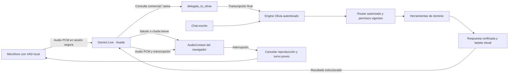

# Arquitectura de Olivia

Olivia conserva una única conversación para crear contenido, aprender y operar. Texto y voz terminan en el mismo motor de negocio, el mismo router Luna, los mismos permisos y los mismos servicios de dominio. Las propuestas de escritura exigen confirmación visual y revalidación transaccional.

## Voz

`OliviaAssistant` integra `NaturalVoiceConversation`, `GeminiLiveSession`, `DictationCapture` y `OliviaVoiceControls`. El chat escrito no solicita el micrófono. El dictado revisable sigue separado. En conversación natural, Gemini Live recibe el audio, transcribe y responde con Aoede: conversa directamente ante saludos y charla breve; para datos del negocio invoca la herramienta delegada, que valida permisos y consulta el motor de Olivia. La respuesta verificada vuelve a Gemini Live para comunicarla con audio.

La API de Gemini Live se usa con un token efímero emitido por Functions; las credenciales permanentes quedan en el servidor. El backend también controla cupos y consumo reportado por el proveedor. No hay sintetizador de voz, clips ni fallback a Chirp: si Gemini no produce audio o se desconecta, la respuesta visible se conserva y Olivia pide reconectar. La métrica de PCM indica audio programado en `AudioContext`, no audibilidad física del dispositivo. El PCM de entrada solo se transmite a la sesión y no se guarda como grabación.

Los endpoints de síntesis Chirp y de clips de voz fueron retirados. Las funciones de medición/cierre legacy solo conservan utilidades de limpieza de sesiones históricas; no hay selección ni creación de sesiones GPT-Live desde la app.

## Resto del motor

El frontend autenticado valida acceso con sesión y perfil Firebase. El endpoint `olivia` coordina estado, chat, tareas en segundo plano y confirmaciones. `engine.mjs` usa el router determinístico, recuperación de conocimiento y herramientas explícitas; los servicios/planes de dominio vuelven a validar autorización y datos al preparar y confirmar.

Las lecturas siguen acotadas y las operaciones mutables generan tarjetas. Aceptar texto hablado no ejecuta acciones. `chatJobs.mjs` publica fases y una respuesta final guardada; Gemini Live comunica en audio el resultado autorizado de una consulta delegada.

El historial conserva hasta 40 mensajes y el contexto usa los últimos 16, sujeto a retención y alcance de permisos. Las métricas de desarrollo de voz reportan medianas/P95 de transcripción y primer audio programado; no afirman medir sonido físico.

La política de modelos y las decisiones de tareas se describen en [OLIVIA-MODEL-ROUTER.md](OLIVIA-MODEL-ROUTER.md). El contrato, límites y entorno de audio se describen en [OLIVIA-VOICE.md](OLIVIA-VOICE.md).

## Copiloto creativo y guía visual

La ruta de generación responde con ideas, nombres, textos o código sin herramientas de negocio; las consultas mixtas siguen usando datos autorizados. El registro cerrado de guías conecta `ScreenContext`, pasos visuales y controles reales con Driver.js bajo demanda, sin actuar sobre formularios. Skills internas y skill de desarrollo se distinguen en [OLIVIA-COPILOT.md](OLIVIA-COPILOT.md).
