# Arquitectura de Olivia

Olivia conserva una única conversación para crear contenido, aprender y operar. Texto y voz terminan en el mismo motor de negocio, el mismo router Luna, los mismos permisos y los mismos servicios de dominio. Las propuestas de escritura exigen confirmación visual y revalidación transaccional.

## Voz

`OliviaAssistant` integra `NaturalVoiceConversation`, `DictationCapture` y `OliviaVoiceControls`. El chat escrito no solicita el micrófono. El dictado captura un audio y deja revisar la transcripción. La conversación natural usa VAD adaptativo y transcripción continua con `/olivia-live-transcribe` (conserva `/olivia-transcribe` para archivo), envía el texto a `engine.chat` como `natural-voice`, persiste la respuesta escrita y una versión corta hablada, y solicita `/olivia-synthesize` para recibir PCM en streaming.

```mermaid
flowchart LR
  Mic[Micrófono con VAD local] -->|Audio continuo| ASR[GPT Live Transcribe]
  ASR -->|Texto| Core[Engine Olivia autenticado]
  Text[Chat escrito] --> Core
  Core --> Router[Luna NONE o MEDIUM; Sol creativo autorizado]
  Router --> Tools[Herramientas con permisos vigentes]
  Tools --> Verified[Respuesta verificada y tarjeta visual]
  Verified --> Saved[Historial: respuesta escrita y texto hablado]
  Saved -->|Solo allowlist administrativa| Chirp[Google Chirp 3 HD]
  Chirp -->|PCM 24 kHz streaming| Player[AudioContext del navegador]
  Player -->|Interrupción| Cancel[Cancelar playback y turno previo]
  Cancel --> Mic
```

La función de síntesis valida Firebase, allowlist, conversación, texto y cupo mensual antes de pedir audio. Google TTS y OpenAI se llaman únicamente desde el backend. La cuota registra solo caracteres, estado de proveedor y costo estimado. La captura/PCM no se conserva. Si falla TTS, la respuesta escrita guardada se mantiene.

GPT-Live, Realtime y la voz económica están deshabilitados como modos conversacionales. El endpoint legacy devuelve HTTP 410 y la configuración nueva elimina los perfiles antiguos al normalizar. Las funciones de medición/cierre legacy solo conservan utilidades de limpieza de sesiones ya creadas; no hay selección ni creación de sesiones GPT-Live desde la app.

## Resto del motor

El frontend autenticado valida acceso con sesión y perfil Firebase. El endpoint `olivia` coordina estado, chat, tareas en segundo plano y confirmaciones. `engine.mjs` usa el router determinístico, recuperación de conocimiento y herramientas explícitas; los servicios/planes de dominio vuelven a validar autorización y datos al preparar y confirmar.

Las lecturas siguen acotadas y las operaciones mutables generan tarjetas. Aceptar texto hablado no ejecuta acciones. `chatJobs.mjs` publica fases y una respuesta final guardada; el cliente acelera el sondeo solo para el modo de voz natural, para iniciar la síntesis apenas queda listo el texto hablado.

El historial conserva hasta 40 mensajes y el contexto usa los últimos 16, sujeto a retención y alcance de permisos. Las métricas de desarrollo de voz reportan medianas/P95 de transcripción y primer audio programado; no afirman medir sonido físico.

La política de modelos y las decisiones de tareas se describen en [OLIVIA-MODEL-ROUTER.md](OLIVIA-MODEL-ROUTER.md). El contrato, límites y entorno de audio se describen en [OLIVIA-VOICE.md](OLIVIA-VOICE.md).

## Copiloto creativo y guía visual

La ruta de generación responde con ideas, nombres, textos o código sin herramientas de negocio; las consultas mixtas siguen usando datos autorizados. El registro cerrado de guías conecta `ScreenContext`, pasos visuales y controles reales con Driver.js bajo demanda, sin actuar sobre formularios. Skills internas y skill de desarrollo se distinguen en [OLIVIA-COPILOT.md](OLIVIA-COPILOT.md).
