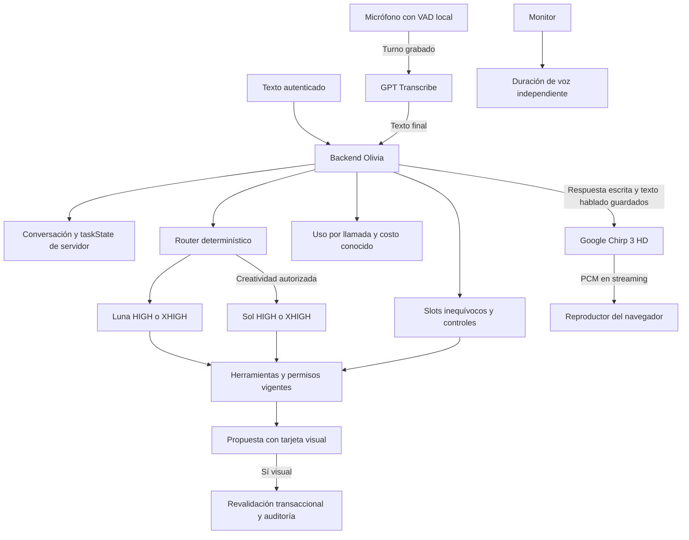

# Política de modelos y tareas conversacionales

Este anexo reemplaza la selección anterior de modelos y el protocolo de voz predeterminado de la evolución de PR31. Se implementa en PR34, sin promover producción ni escribir pruebas comerciales en el Firebase empresarial.

## Política central, versión 2

| Trabajo | Modelo predeterminado | Razonamiento |
|---|---|---|
| Operación habitual administrativa o vendedor | `gpt-6-luna` | `high` |
| Pronóstico, comparación, análisis complejo | La misma Luna | `xhigh` |
| Contenido/diseño creativo en Marketing o Redes con permiso | `gpt-6.1-sol` | `high` |
| Creatividad con análisis, restricciones o volumen complejo | La misma Sol creativa | `xhigh` |
| Conversación natural por voz | `gpt-transcribe` + motor Luna + Google Chirp 3 HD | Turnos finalizados; Chirp solo para síntesis |
| Slots inequívocos, esperar, cancelar, confirmación visual | Código de aplicación | Sin llamada de razonamiento |

La [documentación de Luna](https://developers.openai.com/api/docs/models/gpt-6-luna) y de [Sol](https://developers.openai.com/api/docs/models/gpt-6.1-sol) confirma los IDs y niveles utilizados. La disponibilidad en la cuenta configurada requiere una llamada real, que no forma parte de las pruebas con fixtures.

`modelRouter.mjs` clasifica intención y decide usando módulo autorizado, términos de análisis, fechas distantes, restricciones, Skill, adjuntos, entidades, filas y herramientas. La longitud por sí sola no escala. El módulo Marketing/Redes por sí solo tampoco elige Sol: métricas, inbox y registro operativo de campañas siguen en Luna. No existe fallback general de Luna a Sol.

La decisión no llama a otro modelo. Un aumento de complejidad entre rondas sube el razonamiento de Luna, conserva el modelo y registra cada llamada por separado. Una aclaración breve mantiene la ruta de la tarea incompleta; una intención nueva o una tarea completada permite volver a HIGH. Las Skills de pronóstico activan XHIGH; los análisis simples de ventas mantienen HIGH.

`oliviaConfiguration/global` contiene `modelPolicyVersion`, perfiles de negocio, `routing`, `responseLimits` y `naturalVoice`. El administrador puede editar y confirmar perfiles HIGH/XHIGH, umbrales, límites, voz Chirp y cuota. Los modelos administrativos normal/complejo deben pertenecer a Luna y coincidir; los perfiles creativos deben pertenecer a Sol y coincidir. Los perfiles Live/Reatime antiguos se eliminan al normalizar configuración; la transcripción queda fijada a `gpt-transcribe`. `complexModules` se conserva solo por compatibilidad y no decide la ruta.

## Estado persistente de tarea

La conversación conserva `taskState`: ID generado por servidor, intención, revisión, estado, slots, faltantes, ambigüedades, ruta y fechas. La lease de la conversación impide que una respuesta reemplazada pueda publicar una tarjeta tardía. El frontend nunca aporta este estado como autoridad. Los slots y documentos son candidatos: los servicios revalidan permisos, entidades y datos vivos al preparar y confirmar.

`tasks.mjs` define mínimos por intención sobre los contratos de herramientas. Venta requiere decisiones de promoción, pago, cliente y factura; carga de stock requiere producto, cantidad y destino, con motivo opcional; pronóstico requiere feria, fecha y días. Las opciones de filtro o identificadores de altas intencionalmente nulos no se solicitan como si fueran datos faltantes. `update_task` admite solamente intents habilitados y campos validados de su contrato. Puede almacenar parámetros parciales antes de preguntar, sin ejecutar una operación.

El flujo revisa mensaje, historial reciente, memoria, tarea, pantalla y herramientas. La pantalla es un candidato y las correcciones explícitas prevalecen. La pregunta traduce faltantes a español, agrupa datos relacionados y no muestra nombres técnicos ni pide IDs. El contenido creativo puede conservar objetivo, público, formato y estilo mediante un brief validado.

La carga de stock tiene una ruta determinística con búsquedas reales y acotadas. Ejemplo probado: «Cargame 12 botellas de Original» resuelve presentación o pide desambiguar; «Tribunales» resuelve destino y prepara la tarjeta con stock anterior/posterior sin pedir motivo. «Reposición» puede añadir un motivo y reemplazar la propuesta. Sin motivo se conserva la descripción estándar «Ingreso de mercadería» del plan compartido. «Mejor 20» y «Mejor Pilar» corrigen la misma tarea y revocan la tarjeta anterior. «Sí» conserva la tarjeta sin escribir stock; «Cancelá» cancela la tarea y la propuesta.

`resolve_transfer_origin` consulta stock actual de inventarios autorizados y propone un origen solo si es único y la búsqueda está completa. Si dos depósitos alcanzan, devuelve sus nombres y exige elección. Preparación/recepción física desconocida se representa con `null` y se pregunta expresamente; nunca se deriva de la cantidad prevista. Los servicios y planes de transferencia existentes siguen siendo la autoridad.

Las demás tareas usan Luna/Sol con `update_task`, herramientas de búsqueda y preparación. Los tests inyectan respuestas controladas para verificar esa integración; no certifican que un modelo real elija siempre la herramienta o formule cada pregunta del mismo modo.

## Conversación natural por voz

GPT-Live, Realtime y la variante económica se retiraron como modalidades de conversación. La API legacy rechaza creación, interrupción, herramientas, transcript y cost polling con HTTP 410. El chat escrito y el dictado revisable siguen funcionando.

El micrófono permanece en el navegador con VAD local y controles de cancelación de eco, supresión de ruido y ganancia. Cada turno cerrado por silencio produce un archivo acotado que se envía a [GPT Transcribe](https://developers.openai.com/api/docs/guides/transcription) con idioma/contexto/pistas de dominio. Esta integración usa transcripción de archivo completado; recibir texto incremental de un archivo no significa que el audio del micrófono se esté enviando en vivo.

El texto transcrito se manda al mismo `engine.chat` que el chat escrito. Para voz, Luna devuelve respuesta escrita completa y resumen breve bajo salida estructurada. Las llamadas con herramientas conservan todo el flujo existente; una confirmación oral no ejecuta una tarjeta.

Cuando la respuesta final queda guardada, `chatJobs` publica el resumen hablado. `/olivia-synthesize` valida identidad y propiedad de conversación, limita caracteres y cuota, y llama al stream bidireccional PCM de [Google Chirp 3 HD](https://docs.cloud.google.com/text-to-speech/docs/create-audio-text-streaming). Ese endpoint está en Preview; el cliente Google exige primero la configuración de voz y después el texto. El navegador programa audio PCM mono 24 kHz y cancela la lectura/proveedor cuando el usuario interrumpe.

La función de streaming Netlify tiene un máximo documentado de 60 segundos y 20 MB. El máximo por respuesta hablada y la cuota mensual de caracteres se fijan en la configuración validada por servidor. La única cuenta habilitada durante la prueba es `agsreserva@gmail.com`; la disponibilidad además requiere OpenAI y credenciales ADC/Google TTS en el backend.

## Uso, costo y seguridad

Cada llamada Responses guarda modelo/esfuerzo/ruta/motivo, tokens y costo conocidos, duración, herramientas, módulo, Skill, conversationId y taskId. Los fallos dejan costos desconocidos cuando falta medición. El panel de desarrollo administrativo muestra ruta y tarea; la configuración agrega distribución de las llamadas de los últimos 500 registros. No cuenta comandos determinísticos como llamadas de modelo. Una ronda que pasa de HIGH a XHIGH aparece en ambas categorías según sus llamadas reales.

GPT Transcribe se estima por minutos de audio y Chirp por caracteres sintetizados; el historial guarda conteos y costo estimado, no audio ni texto de síntesis. Las tarifas de referencia consultadas son USD 0,0045/minuto para GPT Transcribe y USD 30 por millón de caracteres para Chirp 3 HD. Los montos reales pueden variar con cuota gratuita, consumo, impuestos y cotización. Las métricas de navegador presentan mediana/P95 de fin de habla a transcripción, transcripción a primer bloque programado y TTFA programado. No miden salida física del altavoz.

La transacción de confirmación sigue releyendo perfil, permisos, cuota y huella de datos. Ningún modelo confirma acciones, modifica reglas, concede permisos ni publica contenido. `oliviaLiveDelegations` y el resto del estado Olivia rechazan lecturas/escrituras directas de browser. La limpieza programada incluye nuevas delegaciones; la retención reconoce solicitudes Live. Los fallos preservan slots conocidos, muestran error y permiten continuar con una nueva solicitud o el flujo manual; no cambian a Sol.

## Diagrama

Pruebas y evidencia: `olivia-router-tasks.test.mjs`, `olivia-live.test.mjs`, suites existentes y reglas de emulador. La [matriz del anexo](OLIVIA-ANNEX-REQUIREMENTS.md) distingue código implementado, evidencia con fixtures y validaciones externas pendientes.
