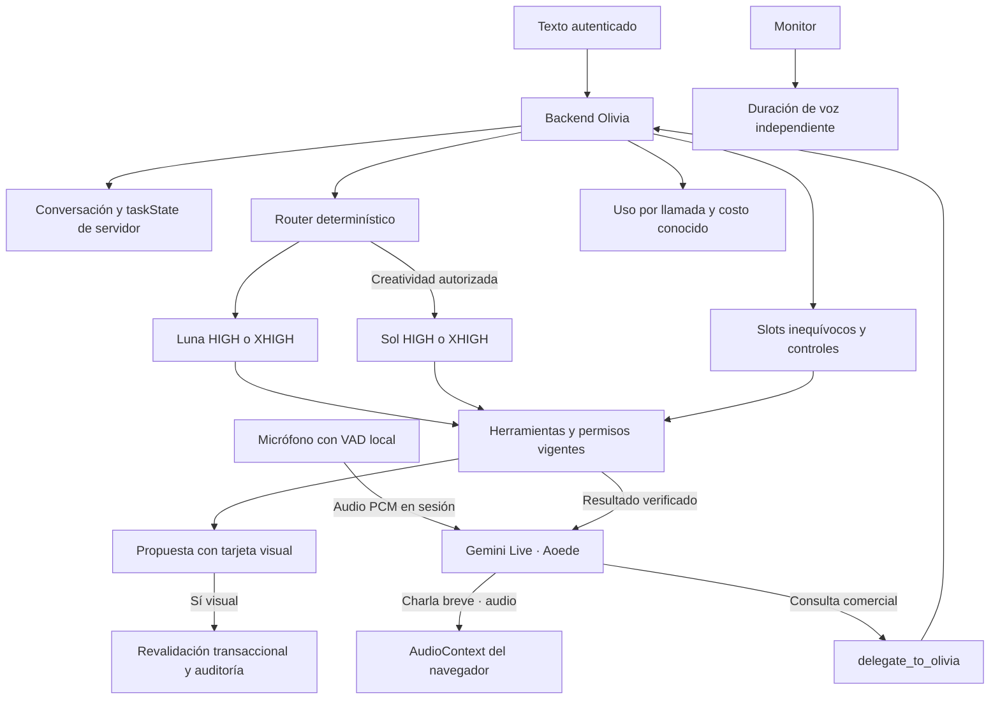

# Política de modelos y tareas conversacionales

> La sección de voz de este anexo se actualizó a V5. Las referencias generales a V3/PR34 describen su origen; la arquitectura vigente es Gemini Live/Aoede según [OLIVIA-VOICE.md](OLIVIA-VOICE.md).

Este anexo reemplaza la selección anterior de modelos y el protocolo de voz predeterminado de la evolución de PR31. Se implementa en PR34, sin promover producción ni escribir pruebas comerciales en el Firebase empresarial.

## Política central, versión 2

| Trabajo | Modelo predeterminado | Razonamiento |
|---|---|---|
| Operación habitual administrativa o vendedor | `gpt-6-luna` | `high` |
| Pronóstico, comparación, análisis complejo | La misma Luna | `xhigh` |
| Contenido/diseño creativo en Marketing o Redes con permiso | `gpt-6.1-sol` | `high` |
| Creatividad con análisis, restricciones o volumen complejo | La misma Sol creativa | `xhigh` |
| Charla breve por voz | Gemini Live · audio Aoede | Respuesta de voz directa, sin llamada a Luna |
| Consulta comercial por voz | Gemini Live → herramienta delegada → motor Olivia → Gemini Live | Datos verificados y respuesta de voz; permisos y confirmaciones existentes |
| Slots inequívocos, esperar, cancelar, confirmación visual | Código de aplicación | Sin llamada de razonamiento |

La [documentación de Luna](https://developers.openai.com/api/docs/models/gpt-6-luna) y de [Sol](https://developers.openai.com/api/docs/models/gpt-6.1-sol) confirma los IDs y niveles utilizados. La disponibilidad en la cuenta configurada requiere una llamada real, que no forma parte de las pruebas con fixtures.

`modelRouter.mjs` clasifica intención y decide usando módulo autorizado, términos de análisis, fechas distantes, restricciones, Skill, adjuntos, entidades, filas y herramientas. La longitud por sí sola no escala. El módulo Marketing/Redes por sí solo tampoco elige Sol: métricas, inbox y registro operativo de campañas siguen en Luna. No existe fallback general de Luna a Sol.

La decisión no llama a otro modelo. Un aumento de complejidad entre rondas sube el razonamiento de Luna, conserva el modelo y registra cada llamada por separado. Una aclaración breve mantiene la ruta de la tarea incompleta; una intención nueva o una tarea completada permite volver a HIGH. Las Skills de pronóstico activan XHIGH; los análisis simples de ventas mantienen HIGH.

`oliviaConfiguration/global` contiene `modelPolicyVersion`, perfiles de negocio, `routing`, `responseLimits`, `naturalVoice` y los límites híbridos de Gemini Live. El administrador puede editar y confirmar perfiles HIGH/XHIGH, umbrales, límites y cuota. Los modelos administrativos normal/complejo deben pertenecer a Luna y coincidir; los perfiles creativos deben pertenecer a Sol y coincidir. Los campos heredados de TTS se descartan al leer configuración; no seleccionan voces ni proveedores. `complexModules` se conserva solo por compatibilidad y no decide la ruta.

## Estado persistente de tarea

La conversación conserva `taskState`: ID generado por servidor, intención, revisión, estado, slots, faltantes, ambigüedades, ruta y fechas. La lease de la conversación impide que una respuesta reemplazada pueda publicar una tarjeta tardía. El frontend nunca aporta este estado como autoridad. Los slots y documentos son candidatos: los servicios revalidan permisos, entidades y datos vivos al preparar y confirmar.

`tasks.mjs` define mínimos por intención sobre los contratos de herramientas. Venta requiere decisiones de promoción, pago, cliente y factura; carga de stock requiere producto, cantidad y destino, con motivo opcional; pronóstico requiere feria, fecha y días. Las opciones de filtro o identificadores de altas intencionalmente nulos no se solicitan como si fueran datos faltantes. `update_task` admite solamente intents habilitados y campos validados de su contrato. Puede almacenar parámetros parciales antes de preguntar, sin ejecutar una operación.

El flujo revisa mensaje, historial reciente, memoria, tarea, pantalla y herramientas. La pantalla es un candidato y las correcciones explícitas prevalecen. La pregunta traduce faltantes a español, agrupa datos relacionados y no muestra nombres técnicos ni pide IDs. El contenido creativo puede conservar objetivo, público, formato y estilo mediante un brief validado.

La carga de stock tiene una ruta determinística con búsquedas reales y acotadas. Ejemplo probado: «Cargame 12 botellas de Original» resuelve presentación o pide desambiguar; «Tribunales» resuelve destino y prepara la tarjeta con stock anterior/posterior sin pedir motivo. «Reposición» puede añadir un motivo y reemplazar la propuesta. Sin motivo se conserva la descripción estándar «Ingreso de mercadería» del plan compartido. «Mejor 20» y «Mejor Pilar» corrigen la misma tarea y revocan la tarjeta anterior. «Sí» conserva la tarjeta sin escribir stock; «Cancelá» cancela la tarea y la propuesta.

`resolve_transfer_origin` consulta stock actual de inventarios autorizados y propone un origen solo si es único y la búsqueda está completa. Si dos depósitos alcanzan, devuelve sus nombres y exige elección. Preparación/recepción física desconocida se representa con `null` y se pregunta expresamente; nunca se deriva de la cantidad prevista. Los servicios y planes de transferencia existentes siguen siendo la autoridad.

Las demás tareas usan Luna/Sol con `update_task`, herramientas de búsqueda y preparación. Los tests inyectan respuestas controladas para verificar esa integración; no certifican que un modelo real elija siempre la herramienta o formule cada pregunta del mismo modo.

## Conversación natural por voz

La voz conversacional activa es Gemini Live. El micrófono permanece en el navegador con VAD local, cancelación de eco, supresión de ruido y ganancia; el audio PCM se transmite a una sesión Live autenticada con token efímero. Gemini entrega transcripción y responde de forma directa a saludos y charla breve en español argentino con Aoede.

La política local clasifica la transcripción final antes de publicar texto/audio: la charla simple puede salir por voz; consultas sobre precios, stock, ventas, clientes, envíos y tareas se delegan a `delegate_to_olivia`. El motor verifica acceso y datos, y el resultado vuelve a Gemini Live para comunicarlo. Hablar o aceptar una respuesta no confirma operaciones; la tarjeta visual conserva la confirmación existente.

Los límites de sesión y consumo se controlan en Functions. No hay síntesis HTTP ni fallback de Chirp. Ante desconexión o respuesta sin audio, el texto disponible queda visible y se pide reconectar. La única cuenta habilitada durante la prueba es `agsreserva@gmail.com`; las pruebas administrativas ampliadas requieren Gemini Live pagado y el Firebase aislado `app-integral-fm-pruebas`.

## Uso, costo y seguridad

Cada llamada Responses guarda modelo/esfuerzo/ruta/motivo, tokens y costo conocidos, duración, herramientas, módulo, Skill, conversationId y taskId. Los fallos dejan costos desconocidos cuando falta medición. El panel de desarrollo administrativo muestra ruta y tarea; la configuración agrega distribución de las llamadas de los últimos 500 registros. No cuenta comandos determinísticos como llamadas de modelo. Una ronda que pasa de HIGH a XHIGH aparece en ambas categorías según sus llamadas reales.

Gemini Live informa consumo por modalidad cuando los metadatos están disponibles; el historial no guarda grabaciones. La métrica del navegador presenta la programación de PCM, no la salida física del altavoz. Los costos sin medición completa se mantienen como desconocidos.

La transacción de confirmación sigue releyendo perfil, permisos, cuota y huella de datos. Ningún modelo confirma acciones, modifica reglas, concede permisos ni publica contenido. `oliviaLiveDelegations` y el resto del estado Olivia rechazan lecturas/escrituras directas de browser. La limpieza programada incluye nuevas delegaciones; la retención reconoce solicitudes Live. Los fallos preservan slots conocidos, muestran error y permiten continuar con una nueva solicitud o el flujo manual; no cambian a Sol.

## Diagrama

Pruebas y evidencia: `olivia-router-tasks.test.mjs`, `olivia-live.test.mjs`, suites existentes y reglas de emulador. La [matriz del anexo](OLIVIA-ANNEX-REQUIREMENTS.md) distingue código implementado, evidencia con fixtures y validaciones externas pendientes.
