# Mapas C4 de Flor Mía

## Leyenda visual

| Clase | Color | Forma y significado |
| --- | --- | --- |
| Actor | Pizarra oscuro | Píldora para personas y roles. |
| App/API Integral | Azul | Rectángulo redondeado para vistas, servicios y procesos. |
| E-Commerce | Verde | Rectángulo redondeado para la tienda y sus componentes. |
| Compartido | Violeta | Rectángulo redondeado para código e infraestructura compartida. |
| Datos | Ámbar | Cilindro para base de datos o almacenamiento. |
| Externo | Gris con borde discontinuo | Rectángulo para sistemas externos. |
| Deuda | Rojo con borde discontinuo | Rectángulo redondeado para módulos parciales o limitaciones verificadas. |

Base auditada [056e847](https://github.com/AgustinBazanUB/App-Integral-FM/commit/056e847132e9167cfc971b6a19a0bb978d7c1e51). Los mapas se amplían en el [manual arc42](02-arc42-flor-mia.md) y en el [inventario de código y datos](03-system-inventory.md).

## Nivel 1 · Contexto del sistema

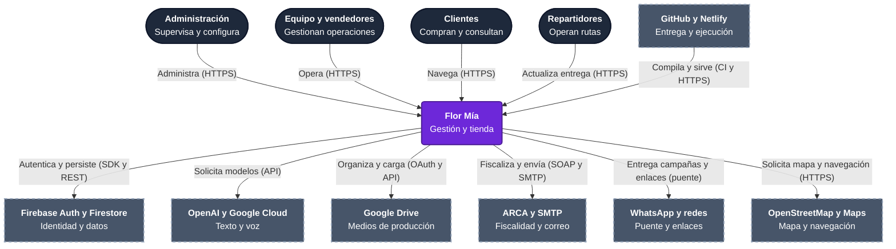

> **Lectura rápida:**
>
> - La gestión interna usa Firebase Auth. Compradores y repartidores también tienen recorridos públicos.
> - Los mapas de componentes y la tabla arc42 desglosan los proveedores agrupados aquí.
> - Payway figura como integración pendiente. El portal usa enlaces de navegación y contacto además de las API activas.

Evidencia por nodo

- **Administración** · [AdministrationPage.jsx](../../src/gestion/pages/AdministrationPage.jsx)
- **Equipo y vendedores** · [permissions.js](../../src/gestion/permissions.js), [SellerPanel.jsx](../../src/gestion/seller/SellerPanel.jsx)
- **Clientes** · [CheckoutPage.jsx](../../src/pages/CheckoutPage.jsx), [ShippingPublicApp.jsx](../../src/gestion/shipping/ShippingPublicApp.jsx)
- **Repartidores** · [CourierPortal.jsx](../../src/gestion/shipping/CourierPortal.jsx)
- **Flor Mía** · [App.jsx](../../src/App.jsx), [Storefront.jsx](../../src/Storefront.jsx)
- **Firebase Auth y Firestore** · [firebase.js](../../src/gestion/services/firebase.js), [firestore.rules](../../firestore.rules)
- **OpenAI y Google Cloud** · [provider.mjs](../../netlify/functions/_lib/olivia/provider.mjs), [chirp.mjs](../../netlify/functions/_lib/olivia/chirp.mjs)
- **Google Drive** · [google-drive.mjs](../../netlify/functions/google-drive.mjs)
- **ARCA y SMTP** · [config.mjs](../../netlify/functions/_lib/arca/config.mjs), [invoiceEmail.mjs](../../netlify/functions/_lib/arca/invoiceEmail.mjs)
- **WhatsApp y redes** · [extensionBridge.js](../../src/gestion/marketing/whatsapp/extensionBridge.js), [brand.js](../../src/data/brand.js)
- **OpenStreetMap y Maps** · [ShippingMap.jsx](../../src/gestion/shipping/ShippingMap.jsx), [shippingIntegrations.mjs](../../src/shared/shippingIntegrations.mjs)
- **GitHub y Netlify** · [ci.yml](../../.github/workflows/ci.yml), [netlify.toml](../../netlify.toml)

## Nivel 2 · Contenedores y topología

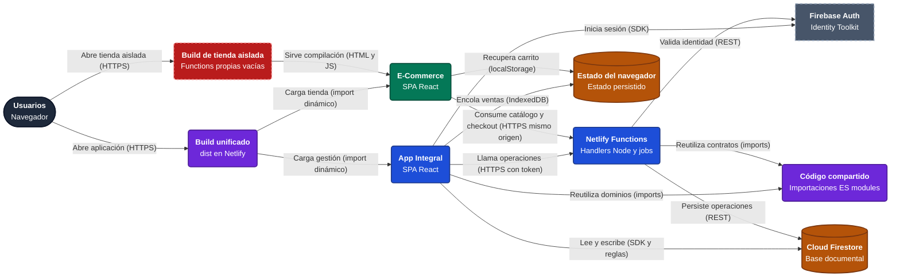

> **Lectura rápida:**
>
> - Un paquete npm genera la compilación unificada y las variantes gestión y ecommerce.
> - La tienda conserva URL de API relativas al origen. El mapa muestra la llamada en el sitio que sí empaqueta Functions.
> - El SDK directo convive con acceso REST de servidor. Los jobs durables usan documentos Firestore.

Evidencia por nodo

- **Usuarios** · [main.jsx](../../src/main.jsx)
- **Build unificado** · [vite.config.js](../../vite.config.js), [netlify.toml](../../netlify.toml)
- **App Integral** · [ManagementSurface.jsx](../../src/surfaces/ManagementSurface.jsx), [ManagementApp.jsx](../../src/gestion/ManagementApp.jsx)
- **E-Commerce** · [EcommerceSurface.jsx](../../src/surfaces/EcommerceSurface.jsx), [Storefront.jsx](../../src/Storefront.jsx)
- **Código compartido** · [shared](../../src/shared), [router.jsx](../../src/router.jsx)
- **Netlify Functions** · [functions](../../netlify/functions), [netlify.toml](../../netlify.toml)
- **Firebase Auth** · [firebaseAuth.mjs](../../netlify/functions/_lib/firebaseAuth.mjs)
- **Cloud Firestore** · [firestore.rules](../../firestore.rules), [firestore.indexes.json](../../firestore.indexes.json)
- **Estado del navegador** · [CartContext.jsx](../../src/context/CartContext.jsx), [offlineSales.js](../../src/gestion/seller/offlineSales.js), [service-worker.js](../../public/service-worker.js)
- **Build de tienda aislada** · [netlify.toml](../../deploy/ecommerce/netlify.toml), [.gitkeep](../../deploy/ecommerce/functions/.gitkeep)

## Nivel 3A · Índice de dominios de App y API Integral

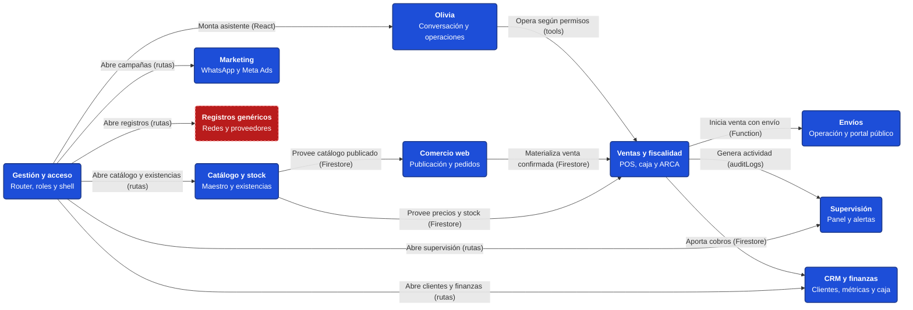

> **Lectura rápida:**
>
> - El shell aplica permisos por perfil y monta la navegación interna.
> - El catálogo y el stock alimentan ventas físicas y online. Las ventas alimentan métricas, finanzas y auditoría.
> - Los siguientes mapas abren las familias indicadas, con evidencia para cada nodo.

Evidencia por nodo

- **Gestión y acceso** · [ManagementApp.jsx](../../src/gestion/ManagementApp.jsx), [permissions.js](../../src/gestion/permissions.js)
- **Supervisión** · [DashboardPage.jsx](../../src/gestion/pages/DashboardPage.jsx), [ActivityPage.jsx](../../src/gestion/pages/ActivityPage.jsx), [AuditPage.jsx](../../src/gestion/pages/AuditPage.jsx)
- **Catálogo y stock** · [ProductsPage.jsx](../../src/gestion/pages/ProductsPage.jsx), [LocationsPage.jsx](../../src/gestion/pages/LocationsPage.jsx), [WarehousePage.jsx](../../src/gestion/pages/WarehousePage.jsx)
- **Ventas y fiscalidad** · [QuickSalesPage.jsx](../../src/gestion/pages/QuickSalesPage.jsx), [SellerPanel.jsx](../../src/gestion/seller/SellerPanel.jsx), [arca-authorize.mjs](../../netlify/functions/arca-authorize.mjs)
- **CRM y finanzas** · [LoyalCustomersPage.jsx](../../src/gestion/pages/LoyalCustomersPage.jsx), [SalesMetricsPage.jsx](../../src/gestion/pages/SalesMetricsPage.jsx), [FinancePage.jsx](../../src/gestion/pages/FinancePage.jsx)
- **Envíos** · [ShippingPage.jsx](../../src/gestion/pages/ShippingPage.jsx), [shipping.mjs](../../netlify/functions/shipping.mjs)
- **Comercio web** · [GenericModulePage.jsx](../../src/gestion/pages/GenericModulePage.jsx), [commerceService.mjs](../../netlify/functions/_lib/ecommerce/commerceService.mjs)
- **Marketing** · [WhatsAppCampaignsPage.jsx](../../src/gestion/pages/WhatsAppCampaignsPage.jsx), [MetaAdsPage.jsx](../../src/gestion/pages/MetaAdsPage.jsx), [modules.js](../../src/gestion/modules.js)
- **Registros genéricos** · [GenericModulePage.jsx](../../src/gestion/pages/GenericModulePage.jsx), [modules.js](../../src/gestion/modules.js)
- **Olivia** · [OliviaMount.jsx](../../src/gestion/olivia/OliviaMount.jsx), [olivia.mjs](../../netlify/functions/olivia.mjs)

## 3A.1 · Identidad, administración y configuración

```mermaid
flowchart LR
    U(["<b>Personal autorizado</b><br/>Administración y vendedor"]):::actor
    L("<b>Ingreso y navegación</b><br/>Login, portería y shell"):::integral
    A["<b>Firebase Auth</b><br/>Identidad del SDK web"]:::external
    P("<b>Perfil y permisos</b><br/>AuthContext y acciones"):::integral
    C("<b>Administración y ajustes</b><br/>Usuarios y permisos"):::integral
    G("<b>Guards de Functions</b><br/>Bearer y perfil activo"):::integral
    R("<b>Proyecto del preview</b><br/>Build y servidor"):::integral
    D[("<b>Firestore</b><br/>users, roles y settings")]:::db
    U -->|"Envía credenciales (HTTPS)"| L
    L -->|"Inicia sesión (SDK)"| A
    A -->|"Entrega identidad (SDK)"| P
    P -->|"Lee perfil activo (SDK)"| D
    P -->|"Habilita acciones (RBAC)"| C
    C -->|"Guarda cambios (SDK)"| D
    P -->|"Adjunta ID token (Bearer)"| G
    G -->|"Comprueba sesión (REST)"| A
    G -->|"Resuelve perfil (REST)"| D
    R -->|"Comprueba proyecto (configuración)"| G
    classDef actor fill:#1E293B,stroke:#0F172A,color:#FFFFFF,stroke-width:2px
    classDef integral fill:#1D4ED8,stroke:#1E3A8A,color:#FFFFFF,stroke-width:2px
    classDef ecommerce fill:#047857,stroke:#064E3B,color:#FFFFFF,stroke-width:2px
    classDef shared fill:#6D28D9,stroke:#4C1D95,color:#FFFFFF,stroke-width:2px
    classDef db fill:#B45309,stroke:#78350F,color:#FFFFFF,stroke-width:2px
    classDef external fill:#475569,stroke:#94A3B8,color:#FFFFFF,stroke-width:2px,stroke-dasharray: 5 5
    classDef debt fill:#B91C1C,stroke:#FCA5A5,color:#FFFFFF,stroke-width:2px,stroke-dasharray: 4 4
```

> **Lectura rápida:**
>
> - Firebase Auth identifica al usuario y el perfil define sus facultades.
> - La UI, las reglas Firestore y los handlers verifican permisos en sus respectivos bordes.
> - El build y el diagnóstico de preview comprueban capas diferentes del aislamiento.

Evidencia por nodo

- **Personal autorizado** · [permissions.js](../../src/gestion/permissions.js)
- **Ingreso y navegación** · [LoginPage.jsx](../../src/gestion/pages/LoginPage.jsx), [ManagementApp.jsx](../../src/gestion/ManagementApp.jsx)
- **Firebase Auth** · [firebase.js](../../src/gestion/services/firebase.js)
- **Perfil y permisos** · [AuthContext.jsx](../../src/gestion/AuthContext.jsx), [permissions.js](../../src/gestion/permissions.js)
- **Administración y ajustes** · [AdministrationPage.jsx](../../src/gestion/pages/AdministrationPage.jsx), [SettingsPage.jsx](../../src/gestion/pages/SettingsPage.jsx), [managementService.js](../../src/gestion/services/managementService.js)
- **Guards de Functions** · [firebaseAuth.mjs](../../netlify/functions/_lib/firebaseAuth.mjs)
- **Proyecto del preview** · [firebaseProject.mjs](../../netlify/functions/_lib/firebaseProject.mjs), [validate-preview-firebase.mjs](../../scripts/validate-preview-firebase.mjs), [preview-firebase-status.mjs](../../netlify/functions/preview-firebase-status.mjs)
- **Firestore** · [firestore.rules](../../firestore.rules)

## 3A.2 · Productos, ubicaciones, depósitos e inventario

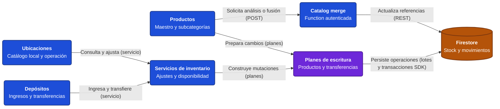

> **Lectura rápida:**
>
> - El maestro describe productos y categorías fuera de las existencias por origen.
> - Las existencias se representan por origen y producto. Los movimientos conservan la trazabilidad del cambio.
> - La fusión maestra tiene un handler propio. Venta rápida escucha cambios de disponibilidad por origen.

Evidencia por nodo

- **Productos** · [ProductsPage.jsx](../../src/gestion/pages/ProductsPage.jsx), [catalogOrganizationService.js](../../src/gestion/services/catalogOrganizationService.js)
- **Ubicaciones** · [LocationsPage.jsx](../../src/gestion/pages/LocationsPage.jsx), [LocationDetailPage.jsx](../../src/gestion/pages/LocationDetailPage.jsx)
- **Depósitos** · [WarehousePage.jsx](../../src/gestion/pages/WarehousePage.jsx)
- **Servicios de inventario** · [inventoryService.js](../../src/gestion/services/inventoryService.js), [quickSaleStockService.js](../../src/gestion/services/quickSaleStockService.js), [remainingStockService.js](../../src/gestion/services/remainingStockService.js)
- **Catalog merge** · [catalog-merge.mjs](../../netlify/functions/catalog-merge.mjs), [catalogMerge.mjs](../../netlify/functions/_lib/catalogMerge.mjs)
- **Planes de escritura** · [productWritePlans.mjs](../../src/shared/productWritePlans.mjs), [stockTransferWritePlans.mjs](../../src/shared/stockTransferWritePlans.mjs)
- **Firestore** · [firestore.rules](../../firestore.rules)

## 3A.3 · Ventas rápidas, vendedor y anulación

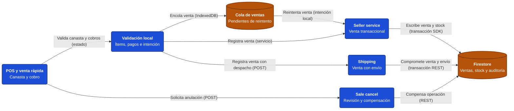

> **Lectura rápida:**
>
> - Venta rápida puede seleccionar stock de local o depósito.
> - Las ventas compatibles del vendedor pueden quedar en cola local. La venta con despacho pasa por Shipping. La rama administrativa compromete stock al crear; la solicitud de vendedor lo difiere a la aprobación.
> - La anulación revisa estado fiscal, stock y envío para determinar la compensación aplicable.

Evidencia por nodo

- **POS y venta rápida** · [SellerPanel.jsx](../../src/gestion/seller/SellerPanel.jsx), [QuickSalesPage.jsx](../../src/gestion/pages/QuickSalesPage.jsx)
- **Validación local** · [sellerValidation.js](../../src/gestion/seller/sellerValidation.js), [quickSaleIntent.js](../../src/gestion/seller/quickSaleIntent.js)
- **Cola de ventas** · [offlineSales.js](../../src/gestion/seller/offlineSales.js)
- **Seller service** · [sellerService.js](../../src/gestion/services/sellerService.js)
- **Shipping** · [shipping.mjs](../../netlify/functions/shipping.mjs), [shipping.mjs](../../netlify/functions/_lib/shipping.mjs)
- **Sale cancel** · [sale-cancel.mjs](../../netlify/functions/sale-cancel.mjs), [saleCancellation.mjs](../../netlify/functions/_lib/arca/saleCancellation.mjs)
- **Firestore** · [firestore.rules](../../firestore.rules)

## 3A.4 · Facturación, recuperación y entrega ARCA

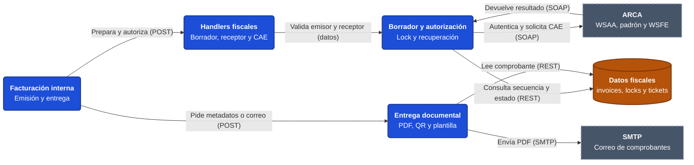

> **Lectura rápida:**
>
> - Borrador, autorización y entrega tienen controles separados.
> - Los tickets, secuencias y resultados se conservan en Firestore. La recuperación coteja los estados.
> - La entrega usa metadatos de impresión o un PDF adjunto enviado por SMTP.

Evidencia por nodo

- **Facturación interna** · [SaleInvoicePanel.jsx](../../src/gestion/components/SaleInvoicePanel.jsx), [ArcaBillingDialog.jsx](../../src/gestion/components/ArcaBillingDialog.jsx)
- **Handlers fiscales** · [arca-invoice.mjs](../../netlify/functions/arca-invoice.mjs), [arca-authorize.mjs](../../netlify/functions/arca-authorize.mjs), [arca-taxpayer.mjs](../../netlify/functions/arca-taxpayer.mjs), [arca-receiver.mjs](../../netlify/functions/arca-receiver.mjs)
- **Borrador y autorización** · [invoiceDraft.mjs](../../netlify/functions/_lib/arca/invoiceDraft.mjs), [authorizer.mjs](../../netlify/functions/_lib/arca/authorizer.mjs), [recoveryService.mjs](../../netlify/functions/_lib/arca/recoveryService.mjs)
- **ARCA** · [wsaa.mjs](../../netlify/functions/_lib/arca/wsaa.mjs), [wsfe.mjs](../../netlify/functions/_lib/arca/wsfe.mjs), [registry.mjs](../../netlify/functions/_lib/arca/registry.mjs)
- **Datos fiscales** · [invoicePersistence.mjs](../../netlify/functions/_lib/arca/invoicePersistence.mjs), [sequenceLock.mjs](../../netlify/functions/_lib/arca/sequenceLock.mjs), [wsaaSharedCache.mjs](../../netlify/functions/_lib/arca/wsaaSharedCache.mjs)
- **Entrega documental** · [arca-document.mjs](../../netlify/functions/arca-document.mjs), [invoicePdf.mjs](../../netlify/functions/_lib/arca/invoicePdf.mjs), [invoiceEmail.mjs](../../netlify/functions/_lib/arca/invoiceEmail.mjs)
- **SMTP** · [invoiceEmail.mjs](../../netlify/functions/_lib/arca/invoiceEmail.mjs)

## 3A.5 · Clientes, métricas y finanzas

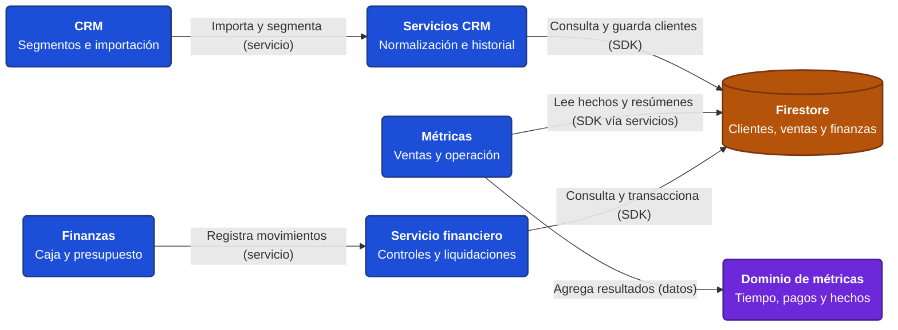

> **Lectura rápida:**
>
> - El CRM consulta clientes, ventas, consentimientos y zonas para segmentar y reconstruir historial.
> - Las métricas aplican reglas de tiempo, pagos y operación a las fuentes de venta.
> - Finanzas guarda controles, liquidaciones y presupuesto con auditoría y alertas cuando corresponde.

Evidencia por nodo

- **CRM** · [LoyalCustomersPage.jsx](../../src/gestion/pages/LoyalCustomersPage.jsx), [CustomerImportModal.jsx](../../src/gestion/customers/CustomerImportModal.jsx)
- **Servicios CRM** · [crmService.js](../../src/gestion/customers/crmService.js), [customerService.js](../../src/gestion/services/customerService.js)
- **Métricas** · [SalesMetricsPage.jsx](../../src/gestion/pages/SalesMetricsPage.jsx), [OperatingMetricsPanel.jsx](../../src/gestion/components/OperatingMetricsPanel.jsx)
- **Dominio de métricas** · [metrics.js](../../src/modules/locations/domain/metrics.js), [operatingMetrics.js](../../src/modules/locations/domain/operatingMetrics.js), [saleFacts.js](../../src/modules/locations/domain/saleFacts.js)
- **Finanzas** · [FinancePage.jsx](../../src/gestion/pages/FinancePage.jsx)
- **Servicio financiero** · [financeService.js](../../src/gestion/finance/financeService.js), [financeDomain.js](../../src/gestion/finance/financeDomain.js)
- **Firestore** · [firestore.rules](../../firestore.rules)

## 3A.6 · Panel general, actividad, auditoría y alertas

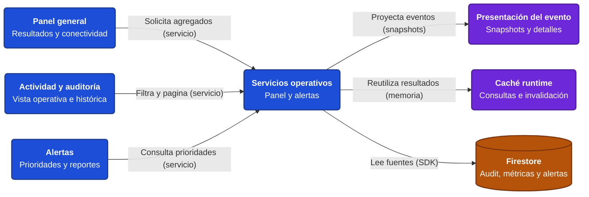

> **Lectura rápida:**
>
> - Panel general, actividad y auditoría comparten fuentes con criterios de acceso y presentación propios.
> - Las alertas operativas se combinan con registros persistentes y con reportes de Olivia.
> - Las cachés de sesión aceleran consultas y Firestore conserva los registros durables.

Evidencia por nodo

- **Panel general** · [DashboardPage.jsx](../../src/gestion/pages/DashboardPage.jsx), [ConnectionIndicator.jsx](../../src/gestion/components/ConnectionIndicator.jsx)
- **Actividad y auditoría** · [ActivityPage.jsx](../../src/gestion/pages/ActivityPage.jsx), [AuditPage.jsx](../../src/gestion/pages/AuditPage.jsx)
- **Alertas** · [GenericModulePage.jsx](../../src/gestion/pages/GenericModulePage.jsx), [DashboardAlerts.jsx](../../src/gestion/components/DashboardAlerts.jsx)
- **Servicios operativos** · [dashboardService.js](../../src/gestion/services/dashboardService.js), [activityService.js](../../src/gestion/services/activityService.js), [alertsService.js](../../src/gestion/services/alertsService.js)
- **Presentación del evento** · [activitySnapshots.mjs](../../src/shared/activitySnapshots.mjs), [activityDetails.js](../../src/gestion/activity/activityDetails.js), [activityPresentation.js](../../src/gestion/activity/activityPresentation.js)
- **Caché runtime** · [runtimeCache.js](../../src/gestion/services/runtimeCache.js), [sharedResources.js](../../src/gestion/services/sharedResources.js)
- **Firestore** · [firestore.rules](../../firestore.rules)

## 3A.7 · Envíos, reparto y seguimiento

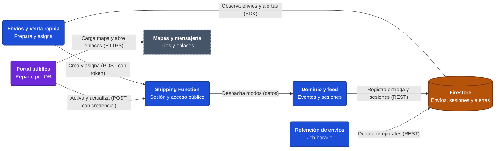

> **Lectura rápida:**
>
> - La pantalla interna combina suscripción de Firestore y feed HTTP de respaldo.
> - La superficie pública opera con credenciales de alcance acotado y respuestas públicas.
> - El job horario depura datos temporales. El mapa usa tiles y enlaces externos.

Evidencia por nodo

- **Envíos y venta rápida** · [ShippingPage.jsx](../../src/gestion/pages/ShippingPage.jsx), [QuickSalesPage.jsx](../../src/gestion/pages/QuickSalesPage.jsx)
- **Portal público** · [ShippingPublicApp.jsx](../../src/gestion/shipping/ShippingPublicApp.jsx), [CourierPortal.jsx](../../src/gestion/shipping/CourierPortal.jsx)
- **Shipping Function** · [shipping.mjs](../../netlify/functions/shipping.mjs), [firebaseAuth.mjs](../../netlify/functions/_lib/firebaseAuth.mjs)
- **Dominio y feed** · [shipping.mjs](../../netlify/functions/_lib/shipping.mjs), [shippingFeed.mjs](../../netlify/functions/_lib/shippingFeed.mjs)
- **Retención de envíos** · [shipping-retention.mjs](../../netlify/functions/shipping-retention.mjs), [shippingRetention.mjs](../../netlify/functions/_lib/shippingRetention.mjs)
- **Firestore** · [firestore.rules](../../firestore.rules)
- **Mapas y mensajería** · [ShippingMap.jsx](../../src/gestion/shipping/ShippingMap.jsx), [shippingIntegrations.mjs](../../src/shared/shippingIntegrations.mjs)

## 3A.8 · Comercio web dentro de Gestión

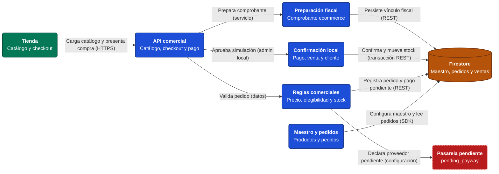

> **Lectura rápida:**
>
> - La ubicación comercial rige el stock y la vista genérica lista pedidos.
> - El checkout público guarda pedido y pago pendientes. La materialización de venta depende de la confirmación.
> - La simulación administrativa local confirma pago y luego entra al servicio fiscal.

Evidencia por nodo

- **Maestro y pedidos** · [ProductsPage.jsx](../../src/gestion/pages/ProductsPage.jsx), [GenericModulePage.jsx](../../src/gestion/pages/GenericModulePage.jsx)
- **Tienda** · [Storefront.jsx](../../src/Storefront.jsx), [CheckoutPage.jsx](../../src/pages/CheckoutPage.jsx)
- **API comercial** · [ecommerce-catalog.mjs](../../netlify/functions/ecommerce-catalog.mjs), [ecommerce-checkout.mjs](../../netlify/functions/ecommerce-checkout.mjs), [ecommerce-simulated-payment.mjs](../../netlify/functions/ecommerce-simulated-payment.mjs)
- **Reglas comerciales** · [commerceDomain.mjs](../../netlify/functions/_lib/ecommerce/commerceDomain.mjs), [commerceService.mjs](../../netlify/functions/_lib/ecommerce/commerceService.mjs)
- **Confirmación local** · [paymentService.mjs](../../netlify/functions/_lib/ecommerce/paymentService.mjs), [customerLink.mjs](../../netlify/functions/_lib/ecommerce/customerLink.mjs)
- **Preparación fiscal** · [fiscalService.mjs](../../netlify/functions/_lib/ecommerce/fiscalService.mjs)
- **Firestore** · [firestore.rules](../../firestore.rules)
- **Pasarela pendiente** · [paymentContract.mjs](../../netlify/functions/_lib/ecommerce/paymentContract.mjs), [commerceService.mjs](../../netlify/functions/_lib/ecommerce/commerceService.mjs)

## 3A.9 · WhatsApp, campañas generales, redes y proveedores

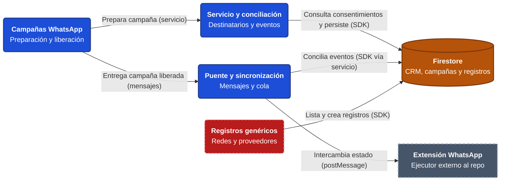

> **Lectura rápida:**
>
> - WhatsApp prepara destinatarios elegibles y requiere liberación para entregarlos a la extensión.
> - La app reconcilia los eventos del ejecutor externo en Firestore.
> - Las vistas genéricas cubren redes, campañas generales y proveedores. Compras y contenidos tienen reglas propias.

Evidencia por nodo

- **Campañas WhatsApp** · [WhatsAppCampaignsPage.jsx](../../src/gestion/pages/WhatsAppCampaignsPage.jsx), [campaignRelease.js](../../src/gestion/marketing/whatsapp/campaignRelease.js)
- **Servicio y conciliación** · [campaignService.js](../../src/gestion/marketing/whatsapp/campaignService.js), [campaignReconciliation.js](../../src/gestion/marketing/whatsapp/campaignReconciliation.js)
- **Puente y sincronización** · [extensionBridge.js](../../src/gestion/marketing/whatsapp/extensionBridge.js), [campaignEventQueue.js](../../src/gestion/marketing/whatsapp/campaignEventQueue.js), [WhatsAppExtensionSync.jsx](../../src/gestion/marketing/whatsapp/WhatsAppExtensionSync.jsx)
- **Extensión WhatsApp** · [whatsapp-extension-contract.md](../../docs/whatsapp-extension-contract.md), [extensionBridge.js](../../src/gestion/marketing/whatsapp/extensionBridge.js)
- **Registros genéricos** · [GenericModulePage.jsx](../../src/gestion/pages/GenericModulePage.jsx), [modules.js](../../src/gestion/modules.js)
- **Firestore** · [firestore.rules](../../firestore.rules)

## 3A.10 · Meta Ads, IA y Google Drive

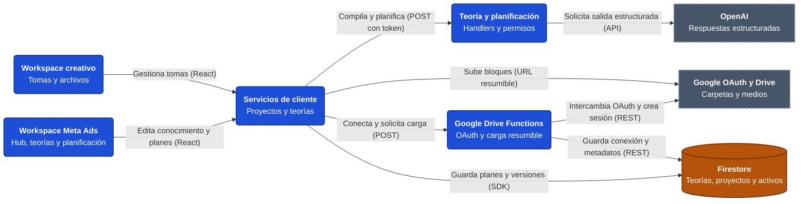

> **Lectura rápida:**
>
> - Meta Ads tiene teoría versionada, planificación y producción creativa.
> - Los modelos se invocan desde el servidor. Drive gestiona conexión, jerarquía y carga resumible.
> - Firestore conserva metadatos y referencias de campaña.

Evidencia por nodo

- **Workspace Meta Ads** · [MetaAdsPage.jsx](../../src/gestion/pages/MetaAdsPage.jsx), [MetaAdsHubPage.jsx](../../src/gestion/pages/MetaAdsHubPage.jsx), [MetaAdsTheoriesView.jsx](../../src/gestion/pages/MetaAdsTheoriesView.jsx)
- **Workspace creativo** · [MetaAdsCreativeWorkspace.jsx](../../src/gestion/pages/MetaAdsCreativeWorkspace.jsx)
- **Servicios de cliente** · [metaAds](../../src/gestion/marketing/metaAds)
- **Teoría y planificación** · [theory-compiler.mjs](../../netlify/functions/theory-compiler.mjs), [campaign-planner.mjs](../../netlify/functions/campaign-planner.mjs), [firebaseAuth.mjs](../../netlify/functions/_lib/firebaseAuth.mjs)
- **Google Drive Functions** · [google-drive.mjs](../../netlify/functions/google-drive.mjs), [google-drive-callback.mjs](../../netlify/functions/google-drive-callback.mjs)
- **OpenAI** · [theory-compiler.mjs](../../netlify/functions/theory-compiler.mjs), [campaign-planner.mjs](../../netlify/functions/campaign-planner.mjs)
- **Google OAuth y Drive** · [googleDrive.mjs](../../netlify/functions/_lib/googleDrive.mjs)
- **Firestore** · [firestore.rules](../../firestore.rules)

## 3A.11 · Olivia, chat, conocimiento y operaciones

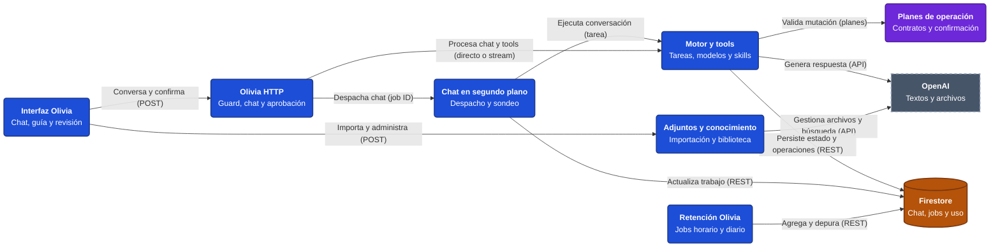

> **Lectura rápida:**
>
> - La UI monta Olivia en gestión con contexto de pantalla y permisos.
> - El chat admite ejecución directa, stream o trabajo con sondeo. Las herramientas mutantes pasan por planes y confirmaciones.
> - Adjuntos, conocimiento y retención tienen handlers independientes.

Evidencia por nodo

- **Interfaz Olivia** · [OliviaMount.jsx](../../src/gestion/olivia/OliviaMount.jsx), [OliviaAssistant.jsx](../../src/gestion/olivia/OliviaAssistant.jsx), [OliviaGuideHost.jsx](../../src/gestion/olivia/OliviaGuideHost.jsx)
- **Olivia HTTP** · [olivia.mjs](../../netlify/functions/olivia.mjs), [guards.mjs](../../netlify/functions/_lib/olivia/guards.mjs)
- **Adjuntos y conocimiento** · [olivia-attachment.mjs](../../netlify/functions/olivia-attachment.mjs), [olivia-knowledge.mjs](../../netlify/functions/olivia-knowledge.mjs)
- **Chat en segundo plano** · [olivia-chat-background.mjs](../../netlify/functions/olivia-chat-background.mjs), [chatJobs.mjs](../../netlify/functions/_lib/olivia/chatJobs.mjs)
- **Motor y tools** · [engine.mjs](../../netlify/functions/_lib/olivia/engine.mjs), [modelRouter.mjs](../../netlify/functions/_lib/olivia/modelRouter.mjs), [toolExecution.mjs](../../netlify/functions/_lib/olivia/toolExecution.mjs), [skills.mjs](../../netlify/functions/_lib/olivia/skills.mjs)
- **Planes de operación** · [oliviaContracts.mjs](../../src/shared/oliviaContracts.mjs), [operationalWritePlans.mjs](../../src/shared/operationalWritePlans.mjs), [managementWritePlans.mjs](../../src/shared/managementWritePlans.mjs)
- **OpenAI** · [provider.mjs](../../netlify/functions/_lib/olivia/provider.mjs)
- **Retención Olivia** · [olivia-retention.mjs](../../netlify/functions/olivia-retention.mjs), [olivia-resource-retention.mjs](../../netlify/functions/olivia-resource-retention.mjs)
- **Firestore** · [store.mjs](../../netlify/functions/_lib/olivia/store.mjs), [firestore.rules](../../firestore.rules)

## 3A.12 · Olivia, voz y mantenimiento

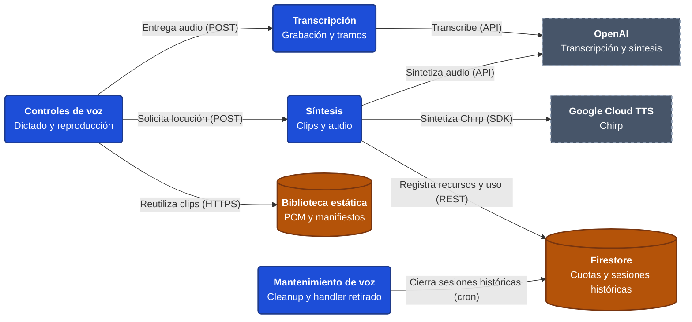

> **Lectura rápida:**
>
> - La transcripción y cada familia de síntesis tienen contratos propios.
> - Los clips estáticos permiten respuestas repertoriadas. Las operaciones de sesión continua anterior devuelven retiro.
> - El cleanup mantiene sesiones históricas. La ruta antigua de medición permanece como handler retirado.

Evidencia por nodo

- **Controles de voz** · [OliviaVoiceControls.jsx](../../src/gestion/olivia/OliviaVoiceControls.jsx), [dictation.mjs](../../src/gestion/olivia/dictation.mjs)
- **Transcripción** · [olivia-transcribe.mjs](../../netlify/functions/olivia-transcribe.mjs), [olivia-live-transcribe.mjs](../../netlify/functions/olivia-live-transcribe.mjs)
- **Síntesis** · [olivia-synthesize.mjs](../../netlify/functions/olivia-synthesize.mjs), [olivia-fast-speech.mjs](../../netlify/functions/olivia-fast-speech.mjs), [olivia-speech-audio.mjs](../../netlify/functions/olivia-speech-audio.mjs)
- **Biblioteca estática** · [olivia-speech](../../public/olivia-speech), [oliviaSpeechLibrary.json](../../src/shared/oliviaSpeechLibrary.json)
- **OpenAI** · [provider.mjs](../../netlify/functions/_lib/olivia/provider.mjs)
- **Google Cloud TTS** · [chirp.mjs](../../netlify/functions/_lib/olivia/chirp.mjs)
- **Mantenimiento de voz** · [olivia-voice-cleanup.mjs](../../netlify/functions/olivia-voice-cleanup.mjs), [olivia-voice-meter-background.mjs](../../netlify/functions/olivia-voice-meter-background.mjs), [voice.mjs](../../netlify/functions/_lib/olivia/voice.mjs)
- **Firestore** · [store.mjs](../../netlify/functions/_lib/olivia/store.mjs), [firestore.rules](../../firestore.rules)

## Nivel 3B · E-Commerce, vistas, estado y renderizado

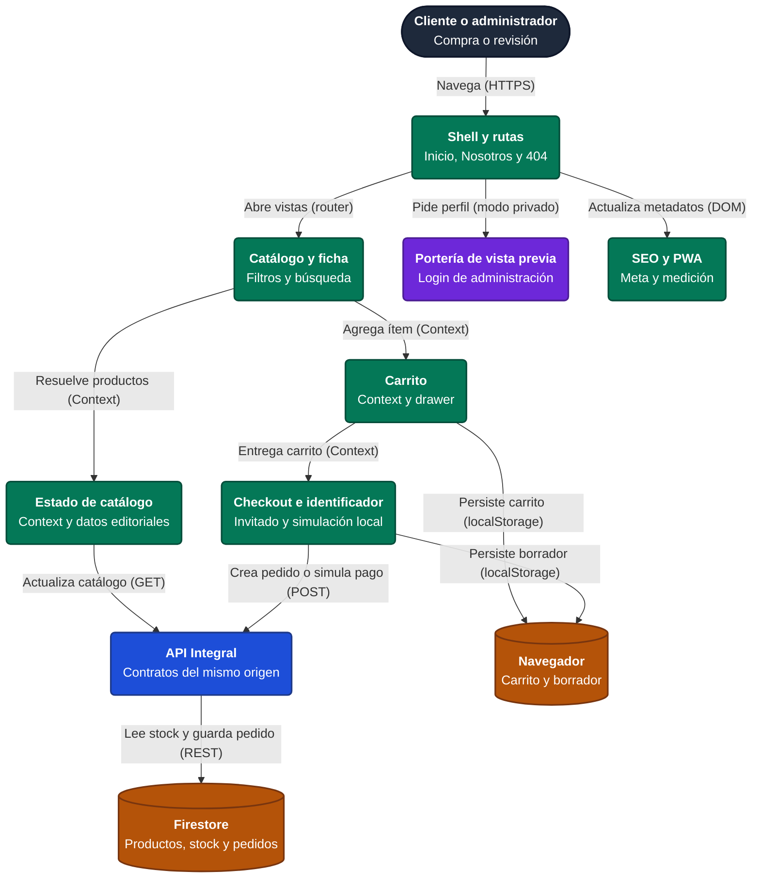

> **Lectura rápida:**
>
> - El catálogo comercial aporta disponibilidad y precio. La tienda agrega atributos editoriales.
> - El invitado recibe el resultado en checkout. La portería y la simulación administrativa reutilizan identidad de Gestión.
> - SEO y PWA combinan HTML, metadatos de cliente y archivos estáticos que varían según el build.

Evidencia por nodo

- **Cliente o administrador** · [Storefront.jsx](../../src/Storefront.jsx), [StorePreviewGate.jsx](../../src/gestion/StorePreviewGate.jsx)
- **Shell y rutas** · [Storefront.jsx](../../src/Storefront.jsx), [router.jsx](../../src/router.jsx), [HomePage.jsx](../../src/pages/HomePage.jsx), [AboutPage.jsx](../../src/pages/AboutPage.jsx), [NotFoundPage.jsx](../../src/pages/NotFoundPage.jsx)
- **Catálogo y ficha** · [CatalogPage.jsx](../../src/pages/CatalogPage.jsx), [ProductPage.jsx](../../src/pages/ProductPage.jsx), [SearchExperience.jsx](../../src/components/SearchExperience.jsx), [OccasionBuilder.jsx](../../src/components/OccasionBuilder.jsx)
- **Portería de vista previa** · [StorePreviewGate.jsx](../../src/gestion/StorePreviewGate.jsx)
- **Estado de catálogo** · [CommerceCatalogContext.jsx](../../src/context/CommerceCatalogContext.jsx), [products.js](../../src/data/products.js)
- **Carrito** · [CartContext.jsx](../../src/context/CartContext.jsx), [CartDrawer.jsx](../../src/components/CartDrawer.jsx)
- **Checkout e identificador** · [CheckoutPage.jsx](../../src/pages/CheckoutPage.jsx), [ecommerceService.js](../../src/services/ecommerceService.js)
- **API Integral** · [ecommerce-catalog.mjs](../../netlify/functions/ecommerce-catalog.mjs), [ecommerce-checkout.mjs](../../netlify/functions/ecommerce-checkout.mjs), [ecommerce-simulated-payment.mjs](../../netlify/functions/ecommerce-simulated-payment.mjs)
- **Firestore** · [firestore.rules](../../firestore.rules)
- **Navegador** · [CartContext.jsx](../../src/context/CartContext.jsx), [CheckoutPage.jsx](../../src/pages/CheckoutPage.jsx)
- **SEO y PWA** · [PageMeta.jsx](../../src/components/PageMeta.jsx), [analytics.js](../../src/utils/analytics.js), [sitemap.xml](../../public/sitemap.xml), [service-worker.js](../../public/service-worker.js)

