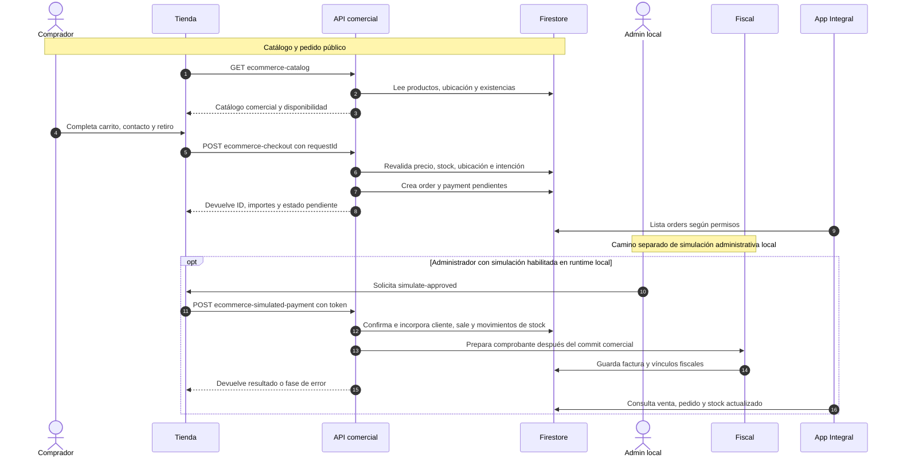
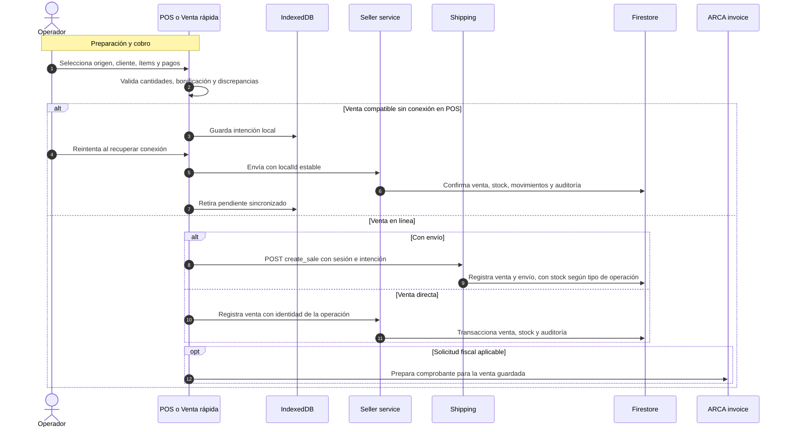
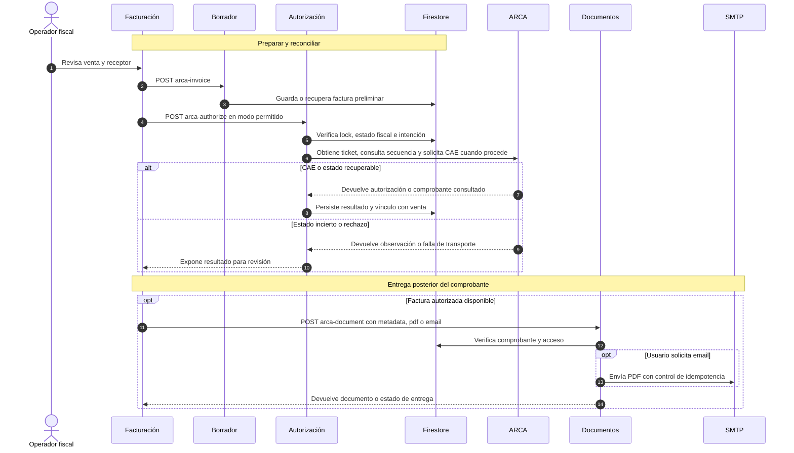
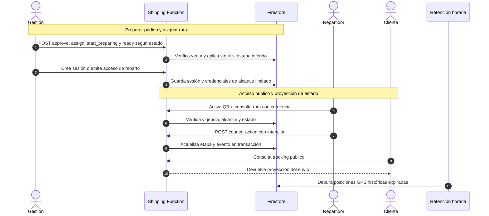

# Manual arc42 de Flor Mía · Estado actual

Base auditada [056e847](https://github.com/AgustinBazanUB/App-Integral-FM/commit/056e847132e9167cfc971b6a19a0bb978d7c1e51). El manual describe el comportamiento verificable en esa revisión. La disponibilidad efectiva de servicios depende del sitio, su contexto y la configuración desplegada.

- [Mapas C4](01-c4-maps.md)
- [Inventario de módulos, API y datos](03-system-inventory.md)
- [ADR 0001 · Monorepo y stack](../adr/0001-estructura-monorepo-y-stack.md)
- [ADR 0002 · API y datos](../adr/0002-arquitectura-api-y-modelo-de-datos.md)
- [ADR 0003 · Integración comercial](../adr/0003-integracion-app-integral-y-ecommerce.md)

## 1. Metas, alcance y fronteras

| Producto | Personas y responsabilidad | Límites del código |
| --- | --- | --- |
| App Integral | Administración y equipo gestionan catálogo, ubicaciones, depósitos, ventas, CRM, finanzas, métricas, campañas, envíos y facturación. El vendedor opera su panel. Olivia asiste desde gestión. | [Router de gestión](../../src/gestion/ManagementApp.jsx), [configuración de módulos](../../src/gestion/modules.js), [portal de envíos](../../src/gestion/shipping/ShippingPublicApp.jsx). |
| API Integral | Functions para las operaciones de servidor, integraciones externas, portal logístico, checkout público y trabajos programados. | [Handlers](../../netlify/functions), [librerías privadas](../../netlify/functions/_lib). |
| E-Commerce | El visitante explora productos y genera un pedido pendiente desde checkout. La vista privada de tienda usa identidad de Gestión. | [Tienda](../../src/Storefront.jsx), [cliente HTTP](../../src/services/ecommerceService.js), [portería](../../src/gestion/StorePreviewGate.jsx). |
| Frontera compartida | React y router, archivos de dominio ES modules, activos estáticos y un proyecto Firestore por contexto. Catálogo, stock y ventas cruzan productos mediante contratos. | [Entrada](../../src/main.jsx), [configuración de build](../../vite.config.js), [código compartido](../../src/shared), [reglas](../../firestore.rules). |

El portal de reparto y seguimiento se enruta desde unificado y gestión. Las colecciones de comercio viven en el mismo Firestore que catálogo, ventas y fiscalidad, dentro del proyecto elegido para cada entorno.

## 2. Contexto y dependencias externas

Los nombres corresponden a entradas de configuración observadas en el código. Las alternativas y los flags dependen de la operación.

| Integración | Uso y condición | Configuración o implementación | Variables de entorno por nombre |
| --- | --- | --- | --- |
| Firebase Authentication | Email y contraseña en Gestión. Functions validan Bearer con Identity Toolkit y consultan perfil. El diagnóstico verifica el proyecto por separado. | [SDK web](../../src/gestion/services/firebase.js), [guard HTTP](../../netlify/functions/_lib/firebaseAuth.mjs), [diagnóstico](../../netlify/functions/preview-firebase-status.mjs) | Cliente de preview: `VITE_PREVIEW_FIREBASE_API_KEY`, `VITE_PREVIEW_FIREBASE_AUTH_DOMAIN`, `VITE_PREVIEW_FIREBASE_PROJECT_ID`, `VITE_PREVIEW_FIREBASE_STORAGE_BUCKET`, `VITE_PREVIEW_FIREBASE_MESSAGING_SENDER_ID`, `VITE_PREVIEW_FIREBASE_APP_ID`. Functions: `FIREBASE_WEB_API_KEY`, `VITE_FIREBASE_API_KEY` como alternativa del guard, `FIREBASE_PROJECT_ID`, `VITE_FIREBASE_PROJECT_ID`. |
| Cloud Firestore y OAuth de cuenta de servicio | SDK bajo reglas en cliente. REST con OAuth en servidor. La identidad del cliente y la de la cuenta de servicio deben corresponder al contexto. | [Resolución de proyecto](../../netlify/functions/_lib/firebaseProject.mjs), [REST administrativo](../../netlify/functions/_lib/firestoreAdminRest.mjs), [segundo adaptador REST](../../netlify/functions/_lib/serverFirestore.mjs), [reglas](../../firestore.rules) | `FIREBASE_PROJECT_ID`, `VITE_FIREBASE_PROJECT_ID`, `FIREBASE_SERVICE_ACCOUNT_JSON` o `FIREBASE_SERVICE_ACCOUNT_APP_INTEGRAL_FM`, `FIREBASE_ADMIN_CLIENT_EMAIL` y `FIREBASE_ADMIN_PRIVATE_KEY` como alternativa donde corresponda, `FIRESTORE_DATABASE_ID` para el adaptador serverFirestore. |
| ARCA WSAA, WSFE y padrón | Firma CMS y ticket WSAA, consulta de receptor, autorización, consulta de comprobante y verificación fiscal. Homologación y producción tienen controles separados. | [Configuración](../../netlify/functions/_lib/arca/config.mjs), [WSAA](../../netlify/functions/_lib/arca/wsaa.mjs), [WSFE](../../netlify/functions/_lib/arca/wsfe.mjs), [padrón](../../netlify/functions/_lib/arca/registry.mjs), [QR](../../netlify/functions/_lib/arca/invoiceQr.mjs) | `ARCA_ENVIRONMENT`, `ARCA_ISSUER_CUIT`, `ARCA_POINT_OF_SALE`, `ARCA_CERTIFICATE_PEM`, `ARCA_PRIVATE_KEY_PEM`, `ARCA_TA_ENCRYPTION_KEY`, `ARCA_ISSUER_VAT_CONDITION`, `ARCA_DEFAULT_PRODUCT_VAT_RATE`, `ARCA_CONSUMER_FINAL_ID_THRESHOLD`, `ARCA_ISSUER_LEGAL_NAME`, `ARCA_ISSUER_COMMERCIAL_ADDRESS`, `ARCA_ISSUER_FISCAL_ADDRESS`, `ARCA_ISSUER_GROSS_INCOME`, `ARCA_ISSUER_ACTIVITY_START`, `ARCA_ALLOW_CAE_HOMOLOGATION`, `ARCA_ALLOW_PRODUCTION_READONLY`, `ARCA_ALLOW_PRODUCTION_INVOICE_PREPARE`, `ARCA_ALLOW_PRODUCTION_TAXPAYER_LOOKUP`, `ARCA_ALLOW_PRODUCTION_CAE`, `ARCA_PRODUCTION_CAE_SALE_CODE`, `ARCA_AUTO_AUTHORIZE_PRODUCTION`, `ARCA_AUTO_AUTHORIZE_PRODUCTION_SOURCES`. |
| SMTP de facturas | Nodemailer envía PDF. El servidor guarda recibos e impone controles de idempotencia y resultado incierto. | [Entrega fiscal](../../netlify/functions/arca-document.mjs), [correo y configuración](../../netlify/functions/_lib/arca/invoiceEmail.mjs) | `INVOICE_SMTP_HOST`, `INVOICE_SMTP_PORT`, `INVOICE_SMTP_FROM`, `INVOICE_SMTP_USER`, `INVOICE_SMTP_PASSWORD`. |
| OpenAI | Olivia usa Responses, archivos, vector stores, búsqueda, audio y transcripción. Meta Ads usa Responses con esquemas estructurados para teorías y planes. | [Proveedor Olivia](../../netlify/functions/_lib/olivia/provider.mjs), [motor](../../netlify/functions/_lib/olivia/engine.mjs), [transcripción](../../netlify/functions/_lib/olivia/voice.mjs), [transcripción en vivo](../../netlify/functions/_lib/olivia/liveTranscription.mjs), [teoría](../../netlify/functions/theory-compiler.mjs), [planificación](../../netlify/functions/campaign-planner.mjs) | `OPENAI_API_KEY`, `OLIVIA_ENABLED`, `OLIVIA_MODEL_ADMIN`, `OLIVIA_MODEL_SELLER`, `OLIVIA_MODEL_CREATIVE`, `OLIVIA_MODEL_LIVE`, `OLIVIA_MODEL_TRANSCRIPTION`, `OLIVIA_MODEL_LIVE_TRANSCRIPTION`, `OLIVIA_MODEL_REALTIME`, `OPENAI_THEORY_MODEL`, `OPENAI_CAMPAIGN_PLAN_MODEL`, `OPENAI_QUESTION_MODEL`, `OPENAI_THEORY_INPUT_USD_PER_MTOK`, `OPENAI_THEORY_OUTPUT_USD_PER_MTOK`, `OPENAI_PLANNER_INPUT_USD_PER_MTOK`, `OPENAI_PLANNER_OUTPUT_USD_PER_MTOK`. |
| Google Cloud Text-to-Speech | Síntesis Chirp mediante SDK con credenciales del servidor. | [Chirp](../../netlify/functions/_lib/olivia/chirp.mjs), [disponibilidad](../../src/shared/oliviaVoiceAvailability.mjs) | `GOOGLE_APPLICATION_CREDENTIALS_JSON` o credenciales de aplicación `GOOGLE_APPLICATION_CREDENTIALS`, `GOOGLE_CLOUD_PROJECT`. |
| Google OAuth y Drive | Conecta la cuenta de producción creativa, crea carpetas y sesiones resumibles, valida la carga. El navegador sube bloques con la URL de sesión. | [Adaptador](../../netlify/functions/_lib/googleDrive.mjs), [handler](../../netlify/functions/google-drive.mjs), [callback](../../netlify/functions/google-drive-callback.mjs), [cliente de carga](../../src/gestion/marketing/metaAds/googleDriveService.js) | `GOOGLE_CLIENT_ID`, `GOOGLE_CLIENT_SECRET`, `GOOGLE_OAUTH_REDIRECT_URI`, `GOOGLE_TOKEN_ENCRYPTION_KEY`, `GOOGLE_DRIVE_ROOT_FOLDER_NAME`, `GOOGLE_DRIVE_SHARED_DRIVE_ID`, `META_ADS_MAX_UPLOAD_BYTES`, `META_ADS_UPLOAD_CHUNK_BYTES`. |
| WhatsApp y extensión de campañas | La app prepara y concilia campañas por puente de mensajes de navegador. La extensión recibe el paquete y devuelve estado. La tienda y los envíos también contienen enlaces de navegación a WhatsApp. | [Puente](../../src/gestion/marketing/whatsapp/extensionBridge.js), [contrato externo](../whatsapp-extension-contract.md), [datos de contacto](../../src/data/brand.js), [dominio de envíos](../../src/shared/shippingDomain.mjs) | El puente y los enlaces se definen en código. |
| OpenStreetMap y Google Maps | Leaflet solicita tiles. Los enlaces abren mapas o navegación. El adaptador de geocodificación permite proveedor inyectado y expone estado sin proveedor. | [Mapa](../../src/gestion/shipping/ShippingMap.jsx), [contratos y geocodificador](../../src/shared/shippingIntegrations.mjs), [contacto](../../src/data/brand.js) | `VITE_SHIPPING_TILE_URL`, `VITE_PUBLIC_APP_BASE_URL`, `SHIPPING_ENABLED`, `SHIPPING_TRACKING_TTL_HOURS`, `SHIPPING_COURIER_TTL_HOURS`, `SHIPPING_REPOSITORY_ADDRESS`. |
| Contacto social, email y analítica web | Enlaces a Instagram, WhatsApp, mapas, teléfono y correo. El emisor de eventos usa el navegador y un `dataLayer` si ya existe. | [Marca](../../src/data/brand.js), [pie de página](../../src/components/Footer.jsx), [eventos](../../src/utils/analytics.js) | Sin configuración de proveedor de analítica en este emisor. |
| GitHub Actions, Netlify y Firebase CLI | Pull requests verifican Node, build y emulador. Netlify sirve SPA y Functions. Un flujo de `main` verifica y publica reglas e índices con destino explícito. | [CI](../../.github/workflows/ci.yml), [CI ARCA](../../.github/workflows/arca-ci.yml), [deploy Firestore](../../.github/workflows/deploy-firestore.yml), [Netlify principal](../../netlify.toml), [Netlify tienda](../../deploy/ecommerce/netlify.toml), [contexto preview](../../scripts/validate-preview-firebase.mjs) | `NODE_VERSION`, `NETLIFY`, `CONTEXT`, `NETLIFY_PREVIEW_SERVER`, `VITE_APP_SURFACE`, `VITE_STOREFRONT_PUBLIC`, `VITE_MANAGEMENT_URL`, `FIREBASE_SERVICE_ACCOUNT_APP_INTEGRAL_FM` en el workflow. |
| Pago y despacho pendientes | **[INCOMPLETO]** Payway tiene un identificador y un normalizador de estados. Los adaptadores de Envíos para Ecommerce, Uber API y WhatsApp Sender están deshabilitados. | [Comercio](../../netlify/functions/_lib/ecommerce/commerceService.mjs), [contrato de pago](../../netlify/functions/_lib/ecommerce/paymentContract.mjs), [envíos](../../src/shared/shippingIntegrations.mjs) | `ECOMMERCE_LOCATION_ID`, `ECOMMERCE_PICKUP_ENABLED`, `ECOMMERCE_SIMULATED_PAYMENT_ENABLED`, `CONTEXT`, `NETLIFY_DEV`, `NETLIFY_LOCAL` controlan el flujo implementado. |

Firebase Storage aparece en la configuración web como nombre de bucket. Las imágenes de catálogo usan rutas estáticas, manifiestos o URL de documentos. Drive guarda archivos creativos y OpenAI guarda recursos del proveedor de Olivia. Las menciones de Meta Ads describen herramientas internas de creación y planificación. La publicación de anuncios se muestra como etapa del workspace.

## 3. Estrategia de solución y stack real

| Capa | App Integral | API/Backend | E-Commerce | Compartido |
| --- | --- | --- | --- | --- |
| Compilación y UI | React 18, Vite 6, lazy routes, CSS y componentes propios. | Node 20 según Netlify, ESM `.mjs`, handlers que devuelven `Response`. | React 18, Vite 6, contextos y SPA. | [Manifiesto npm](../../package.json), [entrada](../../src/main.jsx), [router](../../src/router.jsx), [CSS](../../src/styles), [design system](../../src/design-system/index.jsx). |
| Transporte | SDK Firebase y Functions same-origin. | JSON, multipart, streaming, REST Firestore y SOAP ARCA. | HTTPS JSON same-origin y SDK Auth para la portería y la simulación. | [Auth](../../src/gestion/services/firebase.js) y [contratos ES modules](../../src/shared). |
| Datos | Documentos, snapshots, caché de sesión, IndexedDB del vendedor y preferencias locales. | REST, transacciones, precondiciones por versión, guard de identidad y estados de jobs en Firestore. | Context de catálogo y carrito, borrador local, datos editoriales estáticos. | [Reglas](../../firestore.rules), [índices](../../firestore.indexes.json), [service worker](../../public/service-worker.js). |
| Integraciones de UI | Leaflet y dotLottie para envíos, Driver.js para guías, lectura Excel en WhatsApp/importaciones, jsPDF y QR en flujos de entrega y facturación. | Google TTS, Nodemailer, jsPDF/QR y adaptadores HTTP externos. | Imágenes locales, búsqueda, OG y SEO por DOM. | [Dependencias declaradas](../../package.json), [activos](../../public). |
| Verificación | Pruebas Node de dominios y emulador de reglas. | Pruebas con dobles de proveedores y contratos, más verificaciones específicas de ARCA. | Pruebas Node de catálogo, checkout, contratos, pago y arranque de superficies. | [Tests](../../tests), [workflows](../../.github/workflows). |

## 4. Vista de bloques del monorepo

```text
.
├── .agents/skills/                     Guía de trabajo local para Olivia
├── .github/workflows/                 CI, CI ARCA y publicación de reglas/índices
├── deploy/ecommerce/                  Configuración del sitio aislado y ajuste de robots/sitemap
├── docs/                              Manuales, decisiones, checkpoints y evidencias históricas
├── netlify/functions/                 Handlers HTTP, trabajos background y programados
│   └── _lib/                          Adaptadores REST, identidad, fusiones, logística y Drive
│       ├── arca/                      SOAP, fiscalidad, persistencia, correo y recuperación
│       ├── ecommerce/                 Dominio de catálogo/checkout, pago, cliente y fiscalidad
│       └── olivia/                     Motor, tools, proveedor, voz, almacenamiento y skills
├── output/pdf/                        Ejemplo versionado de etiquetas de Envíos
├── public/                            Imágenes, manifiestos, PWA, SEO, animación y clips de voz
├── scripts/                           Auditorías, build de recursos, entorno y migraciones
│   └── legacy-migration/              Dominio y operaciones de la migración histórica
├── src/
│   ├── components/, context/         Shell y estado de tienda
│   ├── data/, pages/, services/       Editorial, vistas y cliente HTTP E-Commerce
│   ├── design-system/, hooks/         Componentes base y hook de focus trap
│   ├── gestion/                       Auth, shell, navegación y permisos
│   │   ├── activity/, components/    Presentación de actividad y UI operativa
│   │   ├── customers/, finance/      Servicios y dominio CRM y finanzas
│   │   ├── marketing/                WhatsApp, teorías, planes y medios de Meta Ads
│   │   ├── olivia/                   Chat, guías, voz, configuración y revisión
│   │   ├── pages/, seller/           Rutas privadas y panel del vendedor
│   │   └── services/, shipping/, styles/  SDK, portal logístico y estilos locales
│   ├── modules/                      Dominios puros alerts, inventory y locations
│   ├── shared/                       Contratos y planes comunes a vistas y Functions
│   └── styles/, surfaces/, utils/     CSS, entradas de build, búsqueda y eventos
└── tests/                             Unitarias, contratos, reglas y scripts QA
```

Configuración raíz en [package.json](../../package.json), [vite.config.js](../../vite.config.js), [index.html](../../index.html), [netlify.toml](../../netlify.toml), [firebase.json](../../firebase.json), [firebase.staging.json](../../firebase.staging.json), [.firebaserc](../../.firebaserc), [firestore.rules](../../firestore.rules) e índices de [producción](../../firestore.indexes.json) y [pruebas](../../firestore.indexes.staging.json). El inventario abre archivos, importaciones y orden de activación por superficie.

## 5. Tiempo de ejecución

### 5.1 Compra E-Commerce y efecto operativo



> **Lectura rápida:**
>
> - El checkout público revalida contra Firestore y registra el pedido y el pago pendientes sin comprometer existencias.
> - La confirmación local administrativa usa otra operación. Revalida stock y crea la venta una sola vez.
> - Los datos comerciales y la preparación fiscal tienen commits distintos. Un error fiscal puede ocurrir después de confirmar el pago.

Evidencia en [CheckoutPage](../../src/pages/CheckoutPage.jsx), [commerceDomain](../../netlify/functions/_lib/ecommerce/commerceDomain.mjs), [commerceService](../../netlify/functions/_lib/ecommerce/commerceService.mjs), [paymentService](../../netlify/functions/_lib/ecommerce/paymentService.mjs), [fiscalService](../../netlify/functions/_lib/ecommerce/fiscalService.mjs) y [vista de pedidos](../../src/gestion/pages/GenericModulePage.jsx).

### 5.2 Venta presencial o rápida y efectos de inventario



> **Lectura rápida:**
>
> - El POS y Venta rápida comparten reglas de pagos, ítems y existencias. El origen puede cambiar los permisos y el camino de stock.
> - El POS conserva una intención offline para casos compatibles y la reintenta con identidad estable.
> - El envío administrativo compromete stock al crear. La solicitud del vendedor difiere el stock hasta la aprobación. La solicitud fiscal usa una venta registrada.

Evidencia en [SellerPanel](../../src/gestion/seller/SellerPanel.jsx), [Venta rápida](../../src/gestion/pages/QuickSalesPage.jsx), [IndexedDB](../../src/gestion/seller/offlineSales.js), [sellerService](../../src/gestion/services/sellerService.js) y [Shipping](../../netlify/functions/_lib/shipping.mjs).

### 5.3 Autorización fiscal, recuperación y entrega



> **Lectura rápida:**
>
> - La venta, el borrador y la autorización fiscal se validan en momentos distintos.
> - Una respuesta incierta requiere revisar o reconciliar el comprobante antes de continuar el flujo.
> - La entrega tiene permisos por comprobante y puede ser por metadatos de impresión, PDF o correo.

Evidencia en [factura](../../netlify/functions/arca-invoice.mjs), [autorización](../../netlify/functions/arca-authorize.mjs), [recuperación](../../netlify/functions/_lib/arca/recoveryService.mjs) y [documentos](../../netlify/functions/arca-document.mjs).

### 5.4 Preparación de envío y ruta pública de reparto



> **Lectura rápida:**
>
> - Gestión asigna y prepara con perfil activo. La aprobación puede comprometer el stock diferido de una solicitud de vendedor.
> - Una credencial acotada permite al repartidor confirmar etapas y al cliente consultar una vista pública derivada.
> - La Function valida transiciones y el job horario depura posiciones históricas vencidas.

Evidencia en [ShippingPage](../../src/gestion/pages/ShippingPage.jsx), [portal público](../../src/gestion/shipping/ShippingPublicApp.jsx), [handler](../../netlify/functions/shipping.mjs), [dominio](../../netlify/functions/_lib/shipping.mjs) y [retención](../../netlify/functions/_lib/shippingRetention.mjs).

## 6. Conceptos transversales

| Concepto | Implementación comprobable |
| --- | --- |
| Identidad | `AuthContext` espera cambios de sesión y obtiene `users/{uid}`. `permissions.js` combina rol normalizado, módulos y acciones. El perfil inactivo se trata aparte. Acceso público de Envíos usa credenciales distintas de un token Firebase. [Contexto](../../src/gestion/AuthContext.jsx), [permisos](../../src/gestion/permissions.js), [guard](../../netlify/functions/_lib/firebaseAuth.mjs), [envíos](../../netlify/functions/_lib/shipping.mjs). |
| Validación, atomicidad y errores | UI, dominio y reglas tienen controles complementarios. Las Functions elevadas validan permiso y entrada antes de operar por REST. Venta rápida, ventas offline, pedidos y confirmaciones usan recibos, claves o huellas según dominio. Checkout y Envíos aplican errores públicos y cabeceras `no-store`. [SDK seller](../../src/gestion/services/sellerService.js), [REST](../../netlify/functions/_lib/firestoreAdminRest.mjs), [errores comercio](../../netlify/functions/_lib/ecommerce/publicError.mjs), [Shipping](../../netlify/functions/shipping.mjs). |
| Estado y caché | Context y Web Storage para tienda. React para estado de vistas. `runtimeCache` y `sharedResources` usan memoria e invalidación; la cola del POS usa IndexedDB. El service worker mantiene el shell y recursos según método, URL y destino. [Carrito](../../src/context/CartContext.jsx), [caché](../../src/gestion/services/runtimeCache.js), [cola](../../src/gestion/seller/offlineSales.js), [PWA](../../public/service-worker.js). |
| Imágenes y archivos | Editorial y PWA vienen de `public/`. Gestión usa URL de imagen de producto y resolución de fallback. Drive guarda activos creativos. Olivia guarda metadatos/adjuntos mediante Firestore, OpenAI y transitorios según el tipo. Los comprobantes se generan desde el snapshot fiscal. [Imágenes](../../src/shared/productImages.mjs), [Drive](../../netlify/functions/google-drive.mjs), [adjuntos](../../netlify/functions/_lib/olivia/attachments.mjs), [PDF](../../netlify/functions/_lib/arca/invoicePdf.mjs). |
| Jobs y scheduling | `olivia-chat-background` ejecuta trabajo con estado durable. `olivia-retention` y `shipping-retention` son horarios, `olivia-resource-retention` es diario y `olivia-voice-cleanup` se programa cada minuto. El antiguo `olivia-voice-meter-background` devuelve HTTP 410 tras validar sesión. [Catálogo de jobs y contratos](03-system-inventory.md#contratos-http-y-trabajos). |
| Despliegue | `npm run build` publica `dist` con SPA y Functions. `build:gestion` y `build:ecommerce` generan `dist/gestion` y `dist/ecommerce`. El sitio aislado aplica `noindex`, elimina el sitemap heredado y bloquea rastreo en robots. El preview exige Firebase aislado; `main` es el contexto de publicación productiva. [Vite](../../vite.config.js), [Netlify](../../netlify.toml), [tienda aislada](../../deploy/ecommerce/netlify.toml), [preparación](../../deploy/ecommerce/prepare-preview.mjs), [procedimiento](../FIREBASE-PRUEBAS.md), [política del repo](../../AGENTS.md). |

## 7. Riesgos y deuda técnica

| Prioridad | Hallazgo y efecto | Evidencia |
| --- | --- | --- |
| Alta | **[INCOMPLETO]** La compilación de tienda aislada apunta al mismo origen para la API y su directorio de Functions está vacío. Su configuración versionada carece de proxy comercial, por lo que una SPA funcional puede presentar error de catálogo y checkout en ese sitio. | [Cliente](../../src/services/ecommerceService.js), [Netlify tienda](../../deploy/ecommerce/netlify.toml), [directorio](../../deploy/ecommerce/functions/.gitkeep). |
| Alta | **[INCOMPLETO]** La compra pública termina en pago pendiente. Payway carece de handler de cobro o webhook en el inventario. El despacho público está bloqueado en el dominio y la confirmación simulada se restringe al runtime local. | [Checkout público](../../netlify/functions/ecommerce-checkout.mjs), [dominio](../../netlify/functions/_lib/ecommerce/commerceDomain.mjs), [contrato de pago](../../netlify/functions/_lib/ecommerce/paymentContract.mjs). |
| Alta | **[DEUDA TÉCNICA]** La autoridad de las mutaciones se divide entre reglas de cliente y validaciones de servidor elevadas. Cambiar stock, autorización o invariantes implica mantener paridad entre caminos de venta, despacho y comercio. | [Reglas](../../firestore.rules), [sellerService](../../src/gestion/services/sellerService.js), [Shipping](../../netlify/functions/_lib/shipping.mjs), [REST administrativo](../../netlify/functions/_lib/firestoreAdminRest.mjs). |
| Media | **[DEUDA TÉCNICA]** Pago, preparación fiscal y correo tienen fronteras de commit distintas. El estado comercial puede quedar confirmado con el comprobante pendiente, o puede faltar el acuse del proveedor de correo tras iniciar el envío. | [Simulación](../../netlify/functions/ecommerce-simulated-payment.mjs), [correo](../../netlify/functions/_lib/arca/invoiceEmail.mjs), [recuperación](../../netlify/functions/_lib/arca/recoveryService.mjs). |
| Media | **[INCOMPLETO]** Pedidos, redes, proveedores y campañas generales usan superficies genéricas. Compras y contenidos tienen reglas pero carecen de rutas de dominio dedicadas. Envíos conserva adaptadores deshabilitados para despacho externo. | [Rutas](../../src/gestion/ManagementApp.jsx), [módulos](../../src/gestion/modules.js), [vista genérica](../../src/gestion/pages/GenericModulePage.jsx), [adaptadores](../../src/shared/shippingIntegrations.mjs). |
| Media | **[DEUDA TÉCNICA]** Los limitadores de teoría y planificación mantienen estado en memoria de la instancia serverless, lo cual limita su alcance bajo reinicios o paralelismo. | [Teoría](../../netlify/functions/theory-compiler.mjs), [planificador](../../netlify/functions/campaign-planner.mjs). |
| Media | **[DEUDA TÉCNICA]** Checkout conserva campos de contacto y notas del borrador en Web Storage hasta completar el pedido. La persistencia por navegador importa en equipos o perfiles compartidos. | [CheckoutPage](../../src/pages/CheckoutPage.jsx). |
| Media | **[DEUDA TÉCNICA]** Los dos adaptadores REST y la resolución de credenciales por función amplían la superficie a verificar en cada ambiente. Los cron dependen de Netlify y los dos archivos de índices desactivan TTL para las colecciones temporales indicadas. | [REST administrativo](../../netlify/functions/_lib/firestoreAdminRest.mjs), [serverFirestore](../../netlify/functions/_lib/serverFirestore.mjs), [índices](../../firestore.indexes.json), [pruebas](../../firestore.indexes.staging.json). |
| Baja | **[DEUDA TÉCNICA]** Conviven la redirección SPA, metadatos de cliente y archivos SEO de origen histórico. La variante de revisión elimina sitemap y usa `noindex`. | [HTML base](../../index.html), [PageMeta](../../src/components/PageMeta.jsx), [preparación del preview de tienda](../../deploy/ecommerce/prepare-preview.mjs). |
| Baja | **[DEUDA TÉCNICA]** La voz retirada conserva rutas y documentos para cierres de sesiones anteriores. Esos nombres siguen siendo parte del inventario operativo. | [Ruta retirada](../../netlify/functions/olivia-voice-meter-background.mjs), [cleanup](../../netlify/functions/olivia-voice-cleanup.mjs), [reglas](../../firestore.rules#L1461). |

El [inventario](03-system-inventory.md) registra los puntos de entrada verificables para continuar el relevamiento en Fase 2.
