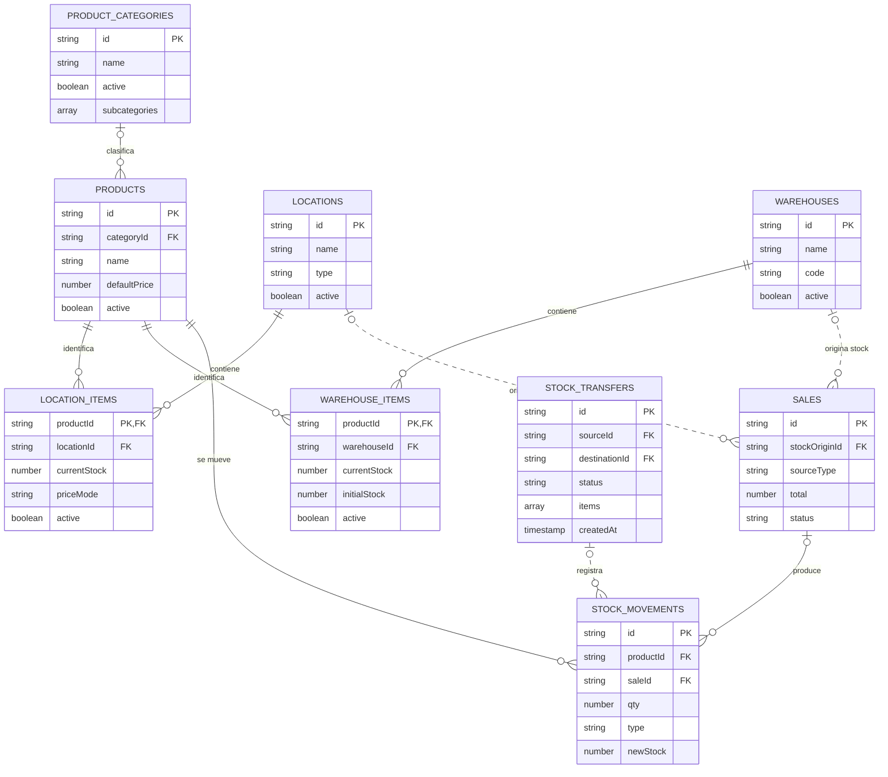
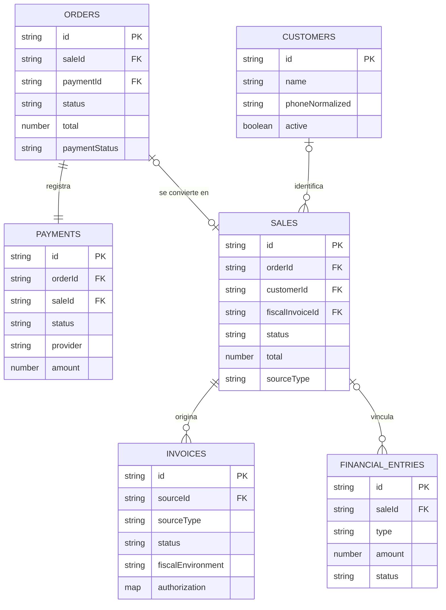
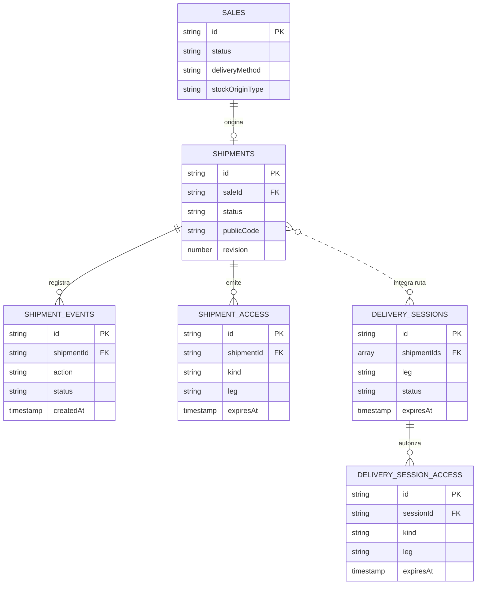
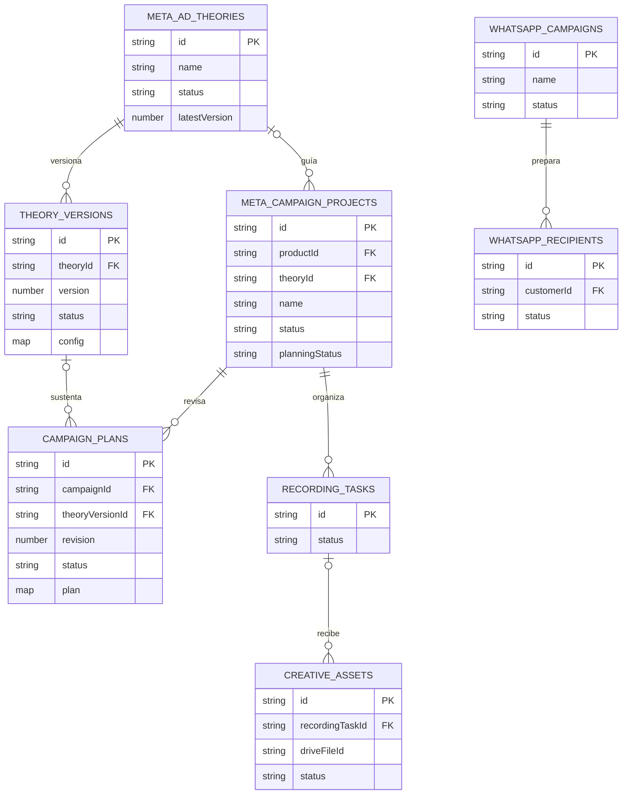
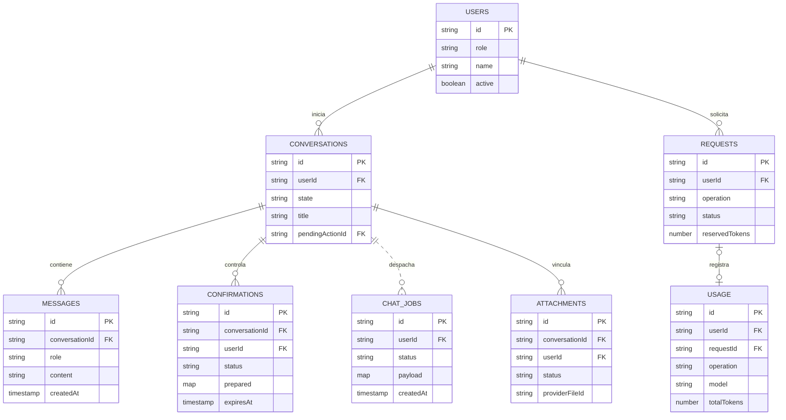

# Inventario verificable de Flor Mía

Base auditada [056e847](https://github.com/AgustinBazanUB/App-Integral-FM/commit/056e847132e9167cfc971b6a19a0bb978d7c1e51). Este inventario se lee junto con los [mapas C4](01-c4-maps.md) y el [manual arc42](02-arc42-flor-mia.md). Las rutas corresponden al código versionado en la base auditada. El estado efectivo de un ambiente depende de su configuración de despliegue.

- [App y API Integral](#app-y-api-integral)
- [E-Commerce](#e-commerce)
- [Contratos HTTP y trabajos](#contratos-http-y-trabajos)
- [Modelo documental](#modelo-documental)
- [Reglas de arquitectura](#reglas-de-arquitectura)
- [Índice por archivo y dependencias](#índice-por-archivo-y-dependencias)

## App y API Integral

[ManagementApp](../../src/gestion/ManagementApp.jsx) resuelve el segundo segmento y las especializaciones por segmentos adicionales. [modules.js](../../src/gestion/modules.js) declara 13 módulos de negocio y cinco entradas principales adicionales. El cuadro incorpora también vendedores, Olivia, facturación y el portal público.

| Módulo | Responsabilidad | Entrada | Archivos y carpetas | Dependencias internas |
| --- | --- | --- | --- | --- |
| Ingreso y permisos | Ingreso, sesión y perfil; barra, guard, mensajes de autorización y conexiones. | `/ y /gestion en unificado`, `/gestion y /vendedor según superficie` | [LoginPage.jsx](../../src/gestion/pages/LoginPage.jsx), [NotAuthorizedPage.jsx](../../src/gestion/pages/NotAuthorizedPage.jsx), [AuthContext.jsx](../../src/gestion/AuthContext.jsx), [ManagementShell.jsx](../../src/gestion/ManagementShell.jsx), [ManagementApp.jsx](../../src/gestion/ManagementApp.jsx), [permissions.js](../../src/gestion/permissions.js), [connection.js](../../src/gestion/connection.js), [routePreload.js](../../src/gestion/routePreload.js) | [firebase.js](../../src/gestion/services/firebase.js), [firebaseAuth.mjs](../../netlify/functions/_lib/firebaseAuth.mjs), [firestore.rules](../../firestore.rules) |
| Panel general | Indicadores, filtros, ingresos, alertas y disponibilidad. | `/gestion` | [DashboardPage.jsx](../../src/gestion/pages/DashboardPage.jsx), [dashboardPresentation.js](../../src/gestion/dashboardPresentation.js), [DashboardFilters.jsx](../../src/gestion/components/DashboardFilters.jsx), [DashboardAlerts.jsx](../../src/gestion/components/DashboardAlerts.jsx), [DashboardPayments.jsx](../../src/gestion/components/DashboardPayments.jsx) | [dashboardService.js](../../src/gestion/services/dashboardService.js), [alertsService.js](../../src/gestion/services/alertsService.js), [dashboard.js](../../src/modules/locations/domain/dashboard.js) |
| Ubicaciones | Listado, detalle, ciclo de vida, asignaciones, descuentos, inventario y ventas de origen. | `/gestion/locations`, `/gestion/locations/:locationId` | [LocationsPage.jsx](../../src/gestion/pages/LocationsPage.jsx), [LocationDetailPage.jsx](../../src/gestion/pages/LocationDetailPage.jsx), [LocationSalesPanel.jsx](../../src/gestion/components/LocationSalesPanel.jsx), [locationManagementService.js](../../src/gestion/services/locationManagementService.js), [locationEnhancementsService.js](../../src/gestion/services/locationEnhancementsService.js) | [locationSalesService.js](../../src/gestion/services/locationSalesService.js), [inventoryService.js](../../src/gestion/services/inventoryService.js), [domain](../../src/modules/locations/domain) |
| Productos | Maestro, imagen, categoría/subcategoría, precios, estado del producto y análisis/fusión de duplicados. | `/gestion/products` | [ProductsPage.jsx](../../src/gestion/pages/ProductsPage.jsx), [ProductForm.jsx](../../src/gestion/components/ProductForm.jsx), [ProductMergeDialog.jsx](../../src/gestion/components/ProductMergeDialog.jsx), [SubcategoriesDialog.jsx](../../src/gestion/components/SubcategoriesDialog.jsx), [catalogOrganizationService.js](../../src/gestion/services/catalogOrganizationService.js) | [inventoryService.js](../../src/gestion/services/inventoryService.js), [productWritePlans.mjs](../../src/shared/productWritePlans.mjs), [productImages.mjs](../../src/shared/productImages.mjs), [catalog-merge.mjs](../../netlify/functions/catalog-merge.mjs), [catalogMerge.mjs](../../netlify/functions/_lib/catalogMerge.mjs) |
| Depósitos e inventario | Depósitos, ingreso, ajuste, traslado, cantidades restantes y seguimiento por origen. | `/gestion/warehouse`, `/gestion/warehouse/:warehouseId` | [WarehousePage.jsx](../../src/gestion/pages/WarehousePage.jsx), [InventoryTransferModal.jsx](../../src/gestion/components/InventoryTransferModal.jsx), [InventoryAdjustmentModal.jsx](../../src/gestion/components/InventoryAdjustmentModal.jsx), [inventoryService.js](../../src/gestion/services/inventoryService.js), [remainingStockService.js](../../src/gestion/services/remainingStockService.js) | [domain](../../src/modules/inventory/domain), [stockTransferWritePlans.mjs](../../src/shared/stockTransferWritePlans.mjs), [operationalWritePlans.mjs](../../src/shared/operationalWritePlans.mjs) |
| Ventas rápidas | Venta administrativa por canal, cliente, bonificaciones, stock vivo, cobro y despacho eventual. | `/gestion/quick-sales` | [QuickSalesPage.jsx](../../src/gestion/pages/QuickSalesPage.jsx), [quickSaleIntent.js](../../src/gestion/seller/quickSaleIntent.js), [quickSaleStockService.js](../../src/gestion/services/quickSaleStockService.js), [sellerService.js](../../src/gestion/services/sellerService.js) | [sellerValidation.js](../../src/gestion/seller/sellerValidation.js), [shippingService.js](../../src/gestion/services/shippingService.js), [arcaService.js](../../src/gestion/services/arcaService.js), [sales.js](../../src/modules/locations/domain/sales.js) |
| Panel vendedor | POS asignado por ubicación, edición, anulación, pedido de factura, canasta y cola IndexedDB. | `/vendedor y rama de vendedor puro` | [SellerPanel.jsx](../../src/gestion/seller/SellerPanel.jsx), [SellerCatalogList.jsx](../../src/gestion/seller/SellerCatalogList.jsx), [offlineSales.js](../../src/gestion/seller/offlineSales.js), [hooks.js](../../src/gestion/seller/hooks.js) | [sellerService.js](../../src/gestion/services/sellerService.js), [sharedResources.js](../../src/gestion/services/sharedResources.js), [customerService.js](../../src/gestion/services/customerService.js), [arcaService.js](../../src/gestion/services/arcaService.js) |
| Clientes | Alta, búsqueda, historial, zonas, lealtad, importación y datos de consentimiento para campañas. | `/gestion/loyal-customers` | [LoyalCustomersPage.jsx](../../src/gestion/pages/LoyalCustomersPage.jsx), [customers](../../src/gestion/customers), [customerService.js](../../src/gestion/services/customerService.js) | [customerHistoryQueries.mjs](../../src/shared/customerHistoryQueries.mjs), [sellerService.js](../../src/gestion/services/sellerService.js) |
| Métricas generales | Ventas, pagos, resultados por fechas y origen y vista operativa. | `/gestion/metrics → /gestion/metrics/sales` | [SalesMetricsPage.jsx](../../src/gestion/pages/SalesMetricsPage.jsx), [MetricsFiltersPanel.jsx](../../src/gestion/components/MetricsFiltersPanel.jsx), [OperatingMetricsPanel.jsx](../../src/gestion/components/OperatingMetricsPanel.jsx), [MetricsVisuals.jsx](../../src/gestion/components/MetricsVisuals.jsx) | [operatingCalendarService.js](../../src/gestion/services/operatingCalendarService.js), [locationSalesService.js](../../src/gestion/services/locationSalesService.js), [metrics.js](../../src/modules/locations/domain/metrics.js), [operatingMetrics.js](../../src/modules/locations/domain/operatingMetrics.js), [saleFacts.js](../../src/modules/locations/domain/saleFacts.js) |
| Administración financiera | Ingresos y egresos, conciliación, presupuesto, liquidaciones y controles asociados a ventas. | `/gestion/finance` | [FinancePage.jsx](../../src/gestion/pages/FinancePage.jsx), [financeService.js](../../src/gestion/finance/financeService.js), [financeDomain.js](../../src/gestion/finance/financeDomain.js), [SalesIncomePanel.jsx](../../src/gestion/components/SalesIncomePanel.jsx) | [dashboardService.js](../../src/gestion/services/dashboardService.js), [alertsService.js](../../src/gestion/services/alertsService.js), [payments.js](../../src/modules/locations/domain/payments.js) |
| Página web y ecommerce | [INCOMPLETO] Lista pedidos recientes y revisión desde Olivia. El maestro se configura en Productos. El backend comercial publica catálogo y persiste checkout/pago. | `/gestion/ecommerce` | [GenericModulePage.jsx](../../src/gestion/pages/GenericModulePage.jsx), [managementService.js](../../src/gestion/services/managementService.js), [ecommerce](../../netlify/functions/_lib/ecommerce) | [ProductsPage.jsx](../../src/gestion/pages/ProductsPage.jsx), [ecommerce-catalog.mjs](../../netlify/functions/ecommerce-catalog.mjs), [ecommerce-checkout.mjs](../../netlify/functions/ecommerce-checkout.mjs), [ecommerce-simulated-payment.mjs](../../netlify/functions/ecommerce-simulated-payment.mjs) |
| Redes sociales | [INCOMPLETO] Listado y alta mínima de oportunidades en socialLeads. | `/gestion/social` | [GenericModulePage.jsx](../../src/gestion/pages/GenericModulePage.jsx), [modules.js](../../src/gestion/modules.js) | [managementService.js](../../src/gestion/services/managementService.js), [firestore.rules](../../firestore.rules) |
| Marketing general y contenidos | [INCOMPLETO] Campañas generales con alta mínima en campaigns y accesos a WhatsApp y Meta Ads. contentItems tiene reglas propias y carece de pantalla de dominio. | `/gestion/marketing` | [GenericModulePage.jsx](../../src/gestion/pages/GenericModulePage.jsx), [modules.js](../../src/gestion/modules.js), [firestore.rules](../../firestore.rules) | [managementService.js](../../src/gestion/services/managementService.js), [marketing](../../src/gestion/marketing) |
| Marketing WhatsApp | Candidatos CRM o Excel, deduplicación, control de consentimiento, liberación, entrega y conciliación. | `/gestion/marketing/whatsapp` | [WhatsAppCampaignsPage.jsx](../../src/gestion/pages/WhatsAppCampaignsPage.jsx), [whatsapp](../../src/gestion/marketing/whatsapp) | [customerService.js](../../src/gestion/services/customerService.js), [whatsapp-extension-contract.md](../../docs/whatsapp-extension-contract.md), [firestore.rules](../../firestore.rules) |
| Meta Ads · campañas y conocimiento | Proyectos, estado, producto asociado, marca y perfiles de marketing. | `/gestion/marketing/meta-ads`, `/gestion/marketing/meta-ads/:campaignId`, `/gestion/marketing/meta-ads/knowledge` | [MetaAdsHubPage.jsx](../../src/gestion/pages/MetaAdsHubPage.jsx), [MetaAdsPage.jsx](../../src/gestion/pages/MetaAdsPage.jsx), [MetaAdsKnowledgeView.jsx](../../src/gestion/pages/MetaAdsKnowledgeView.jsx), [campaignProjectService.js](../../src/gestion/marketing/metaAds/campaignProjectService.js), [knowledgeService.js](../../src/gestion/marketing/metaAds/knowledgeService.js) | [sharedResources.js](../../src/gestion/services/sharedResources.js), [firestore.rules](../../firestore.rules) |
| Meta Ads · metodologías y planificación | Extracción de fuente, teoría/versiones, preguntas, plan, revisión y aprobación. | `/gestion/marketing/meta-ads/theories`, `/gestion/marketing/meta-ads/theories/:theoryId`, `workspace dentro de :campaignId` | [MetaAdsTheoriesView.jsx](../../src/gestion/pages/MetaAdsTheoriesView.jsx), [MetaAdsCampaignPlanningWorkspace.jsx](../../src/gestion/pages/MetaAdsCampaignPlanningWorkspace.jsx), [theorySchema.js](../../src/gestion/marketing/metaAds/theorySchema.js), [theoryService.js](../../src/gestion/marketing/metaAds/theoryService.js), [campaignPlanningService.js](../../src/gestion/marketing/metaAds/campaignPlanningService.js) | [theory-compiler.mjs](../../netlify/functions/theory-compiler.mjs), [campaign-planner.mjs](../../netlify/functions/campaign-planner.mjs), [firebaseAuth.mjs](../../netlify/functions/_lib/firebaseAuth.mjs) |
| Meta Ads · producción creativa | Tareas y tomas, OAuth, estructura de carpetas, carga resumible, confirmación y activo seleccionado. | `Workspace dentro de /gestion/marketing/meta-ads/:campaignId` | [MetaAdsCreativeWorkspace.jsx](../../src/gestion/pages/MetaAdsCreativeWorkspace.jsx), [googleDriveService.js](../../src/gestion/marketing/metaAds/googleDriveService.js), [creativeWorkspaceDomain.js](../../src/gestion/marketing/metaAds/creativeWorkspaceDomain.js) | [google-drive.mjs](../../netlify/functions/google-drive.mjs), [google-drive-callback.mjs](../../netlify/functions/google-drive-callback.mjs), [googleDrive.mjs](../../netlify/functions/_lib/googleDrive.mjs) |
| Envíos internos | Venta con despacho, feed, asignaciones, preparación, impresión, estados, incidencias y alertas. | `/gestion/shipping` | [ShippingPage.jsx](../../src/gestion/pages/ShippingPage.jsx), [ShippingTasks.jsx](../../src/gestion/shipping/ShippingTasks.jsx), [ShippingRequests.jsx](../../src/gestion/shipping/ShippingRequests.jsx), [ShippingSaleRecovery.jsx](../../src/gestion/shipping/ShippingSaleRecovery.jsx), [shippingService.js](../../src/gestion/services/shippingService.js) | [shipping.mjs](../../netlify/functions/shipping.mjs), [shipping.mjs](../../netlify/functions/_lib/shipping.mjs), [shippingFeed.mjs](../../netlify/functions/_lib/shippingFeed.mjs), [shippingDomain.mjs](../../src/shared/shippingDomain.mjs) |
| Portal público de envíos | Entrega y seguimiento con credenciales públicas, QR, enlace de reparto y proyección de estado. | `/e/:lookup`, `/reparto`, `/seguimiento` | [ShippingPublicApp.jsx](../../src/gestion/shipping/ShippingPublicApp.jsx), [CourierPortal.jsx](../../src/gestion/shipping/CourierPortal.jsx), [ShippingMap.jsx](../../src/gestion/shipping/ShippingMap.jsx), [AnimatedDeliveryJourney.jsx](../../src/gestion/shipping/AnimatedDeliveryJourney.jsx) | [shipping.mjs](../../netlify/functions/shipping.mjs), [shipping-retention.mjs](../../netlify/functions/shipping-retention.mjs), [shippingDomain.mjs](../../src/shared/shippingDomain.mjs), [shippingIntegrations.mjs](../../src/shared/shippingIntegrations.mjs) |
| Alertas | Panel de prioridades, notificaciones de envíos, alertas de negocio y detalle de reportes de Olivia. | `/gestion/alerts y panel general` | [GenericModulePage.jsx](../../src/gestion/pages/GenericModulePage.jsx), [DashboardAlerts.jsx](../../src/gestion/components/DashboardAlerts.jsx), [ShippingBell.jsx](../../src/gestion/shipping/ShippingBell.jsx), [alertsService.js](../../src/gestion/services/alertsService.js) | [alerts.js](../../src/modules/alerts/domain/alerts.js), [dashboardService.js](../../src/gestion/services/dashboardService.js) |
| Proveedores y compras | [INCOMPLETO] Alta mínima y consulta de proveedores. purchases tiene reglas y carece de una pantalla de compras dedicada. | `/gestion/suppliers` | [GenericModulePage.jsx](../../src/gestion/pages/GenericModulePage.jsx), [modules.js](../../src/gestion/modules.js), [firestore.rules](../../firestore.rules) | [managementService.js](../../src/gestion/services/managementService.js) |
| Actividad | Consulta y presentación de acciones operativas con detalle por evento y filtros. | `/gestion/actividad` | [ActivityPage.jsx](../../src/gestion/pages/ActivityPage.jsx), [ActivityDetail.jsx](../../src/gestion/components/ActivityDetail.jsx), [activity](../../src/gestion/activity), [activityService.js](../../src/gestion/services/activityService.js) | [activitySnapshots.mjs](../../src/shared/activitySnapshots.mjs), [firestore.rules](../../firestore.rules) |
| Administración | Perfiles, permisos por módulo/acción y acceso a controles administrativos. | `/gestion/administration` | [AdministrationPage.jsx](../../src/gestion/pages/AdministrationPage.jsx), [permissions.js](../../src/gestion/permissions.js), [managementService.js](../../src/gestion/services/managementService.js) | [AuthContext.jsx](../../src/gestion/AuthContext.jsx), [firestore.rules](../../firestore.rules) |
| Auditoría | Registro histórico consultable con acceso administrativo según perfil. | `/gestion/audit` | [AuditPage.jsx](../../src/gestion/pages/AuditPage.jsx), [activityService.js](../../src/gestion/services/activityService.js) | [managementService.js](../../src/gestion/services/managementService.js), [firestore.rules](../../firestore.rules) |
| Configuración | Preferencias, atajos y paneles de configuración, voz, uso y conocimiento de Olivia según permisos. | `/gestion/settings` | [SettingsPage.jsx](../../src/gestion/pages/SettingsPage.jsx), [OliviaSettings.jsx](../../src/gestion/olivia/OliviaSettings.jsx), [OliviaPreferences.jsx](../../src/gestion/olivia/OliviaPreferences.jsx), [OliviaKnowledgeManager.jsx](../../src/gestion/olivia/OliviaKnowledgeManager.jsx), [OliviaUsage.jsx](../../src/gestion/olivia/OliviaUsage.jsx) | [keyboard.js](../../src/modules/locations/domain/keyboard.js), [managementService.js](../../src/gestion/services/managementService.js), [engine.mjs](../../netlify/functions/_lib/olivia/engine.mjs) |
| ARCA y entrega | Consulta de receptor, factura pendiente, CAE, recuperación, nota de crédito, PDF, impresión y email. | `Acciones de venta y paneles de facturación` | [arcaService.js](../../src/gestion/services/arcaService.js), [arcaInvoicePrint.js](../../src/gestion/services/arcaInvoicePrint.js), [SaleInvoicePanel.jsx](../../src/gestion/components/SaleInvoicePanel.jsx), [ArcaBillingDialog.jsx](../../src/gestion/components/ArcaBillingDialog.jsx), [ArcaInvoiceEmailDialog.jsx](../../src/gestion/components/ArcaInvoiceEmailDialog.jsx), [arca](../../netlify/functions/_lib/arca) | [arca-taxpayer.mjs](../../netlify/functions/arca-taxpayer.mjs), [arca-receiver.mjs](../../netlify/functions/arca-receiver.mjs), [arca-invoice.mjs](../../netlify/functions/arca-invoice.mjs), [arca-authorize.mjs](../../netlify/functions/arca-authorize.mjs), [arca-document.mjs](../../netlify/functions/arca-document.mjs), [sale-cancel.mjs](../../netlify/functions/sale-cancel.mjs) |
| Olivia · asistente y operaciones | Conversaciones, anticipación, guías de interfaz, análisis, creatividad, pronósticos, herramientas y confirmaciones. | `Launcher de Gestión y vendedor`, `revisión en Gestión` | [OliviaMount.jsx](../../src/gestion/olivia/OliviaMount.jsx), [OliviaAssistant.jsx](../../src/gestion/olivia/OliviaAssistant.jsx), [OliviaGuideHost.jsx](../../src/gestion/olivia/OliviaGuideHost.jsx), [OliviaReviewPanel.jsx](../../src/gestion/olivia/OliviaReviewPanel.jsx), [engine.mjs](../../netlify/functions/_lib/olivia/engine.mjs), [tools.mjs](../../netlify/functions/_lib/olivia/tools.mjs), [skills](../../netlify/functions/_lib/olivia/skills) | [olivia.mjs](../../netlify/functions/olivia.mjs), [olivia-chat-background.mjs](../../netlify/functions/olivia-chat-background.mjs), [oliviaContracts.mjs](../../src/shared/oliviaContracts.mjs), [oliviaUiGuides.mjs](../../src/shared/oliviaUiGuides.mjs) |
| Olivia · conocimiento, adjuntos y voz | Gestión de fuentes, turnos de voz, audio, clips y datos de uso. | `Composer, controles de voz y ajustes de Olivia` | [OliviaComposer.jsx](../../src/gestion/olivia/OliviaComposer.jsx), [OliviaVoiceControls.jsx](../../src/gestion/olivia/OliviaVoiceControls.jsx), [OliviaKnowledgeManager.jsx](../../src/gestion/olivia/OliviaKnowledgeManager.jsx), [attachments.mjs](../../netlify/functions/_lib/olivia/attachments.mjs), [knowledge.mjs](../../netlify/functions/_lib/olivia/knowledge.mjs), [chirp.mjs](../../netlify/functions/_lib/olivia/chirp.mjs) | [olivia-attachment.mjs](../../netlify/functions/olivia-attachment.mjs), [olivia-knowledge.mjs](../../netlify/functions/olivia-knowledge.mjs), [olivia-transcribe.mjs](../../netlify/functions/olivia-transcribe.mjs), [olivia-live-transcribe.mjs](../../netlify/functions/olivia-live-transcribe.mjs), [olivia-synthesize.mjs](../../netlify/functions/olivia-synthesize.mjs), [olivia-fast-speech.mjs](../../netlify/functions/olivia-fast-speech.mjs), [olivia-speech-audio.mjs](../../netlify/functions/olivia-speech-audio.mjs) |
| Ejecución y mantenimiento | FireStore REST, aislamiento, persistencia y trabajos programados de Olivia y Envíos. | `Build, deploy y jobs` | [firebaseProject.mjs](../../netlify/functions/_lib/firebaseProject.mjs), [firestoreAdminRest.mjs](../../netlify/functions/_lib/firestoreAdminRest.mjs), [serverFirestore.mjs](../../netlify/functions/_lib/serverFirestore.mjs), [preview-firebase-status.mjs](../../netlify/functions/preview-firebase-status.mjs), [shipping-retention.mjs](../../netlify/functions/shipping-retention.mjs), [olivia-retention.mjs](../../netlify/functions/olivia-retention.mjs), [olivia-resource-retention.mjs](../../netlify/functions/olivia-resource-retention.mjs), [olivia-voice-cleanup.mjs](../../netlify/functions/olivia-voice-cleanup.mjs) | [validate-preview-firebase.mjs](../../scripts/validate-preview-firebase.mjs), [workflows](../../.github/workflows), [netlify.toml](../../netlify.toml) |

## E-Commerce

[Storefront](../../src/Storefront.jsx) declara las rutas. En unificado, [App](../../src/App.jsx) entrega la raíz a Gestión y la tienda empieza en `/tienda`. La superficie [EcommerceSurface](../../src/surfaces/EcommerceSurface.jsx) monta la tienda en la raíz. Todas las llamadas comerciales salen de [ecommerceService](../../src/services/ecommerceService.js) con URL relativas.

| Módulo | Responsabilidad | Evidencia | Rutas y consumo |
| --- | --- | --- | --- |
| Shell y navegación | Anuncios, cabecera, pie, scroll, router e integración de activos visuales. | [Storefront.jsx](../../src/Storefront.jsx), [Header.jsx](../../src/components/Header.jsx), [AnnouncementBar.jsx](../../src/components/AnnouncementBar.jsx), [Footer.jsx](../../src/components/Footer.jsx), [router.jsx](../../src/router.jsx) | El proveedor de catálogo carga al montar. |
| Inicio y relato de marca | Inicio editorial, destacados, categorías, ocasiones y vínculos; historia y contacto. | [HomePage.jsx](../../src/pages/HomePage.jsx), [AboutPage.jsx](../../src/pages/AboutPage.jsx), [content.js](../../src/data/content.js), [brand.js](../../src/data/brand.js) | / y /tienda; /nosotros. Inicio lee catálogo por Context. |
| Catálogo y filtros | Listado, filtros, categorías, vistas y tarjetas comerciales. | [CatalogPage.jsx](../../src/pages/CatalogPage.jsx), [ProductCard.jsx](../../src/components/ProductCard.jsx), [catalogViews.js](../../src/data/catalogViews.js), [categories.js](../../src/data/categories.js), [promotions.js](../../src/data/promotions.js) | /productos. GET ecommerce-catalog vía Context. |
| Ficha y guías de compra | Detalle por slug, imágenes, comparación sensorial, armado por ocasión. | [ProductPage.jsx](../../src/pages/ProductPage.jsx), [SensoryComparison.jsx](../../src/components/SensoryComparison.jsx), [OccasionBuilder.jsx](../../src/components/OccasionBuilder.jsx), [oliveProfiles.js](../../src/data/oliveProfiles.js), [productImages.js](../../src/data/productImages.js), [legacyProductImages.js](../../src/data/legacyProductImages.js), [assetsManifest.js](../../src/data/assetsManifest.js) | /producto/:slug. GET ecommerce-catalog vía Context. |
| Búsqueda | Normalización y sugerencias desde el catálogo y UI de búsqueda. | [SearchModal.jsx](../../src/components/SearchModal.jsx), [SearchExperience.jsx](../../src/components/SearchExperience.jsx), [search.js](../../src/utils/search.js) | Usa el catálogo ya cargado. |
| Catálogo global | Estado de red, disponibilidad, índices por ID/slug y combinación con contenido editorial. | [CommerceCatalogContext.jsx](../../src/context/CommerceCatalogContext.jsx), [products.js](../../src/data/products.js), [ecommerceService.js](../../src/services/ecommerceService.js) | GET ecommerce-catalog. |
| Carrito | Añade, quita y ajusta cantidades, muestra resumen y persiste localmente. | [CartContext.jsx](../../src/context/CartContext.jsx), [CartDrawer.jsx](../../src/components/CartDrawer.jsx) | Usa catálogo y estado en navegador. |
| Checkout invitado y resultado | Borrador, datos de contacto, retiro, petición idempotente, respuesta de pedido y simulación local opcional. | [CheckoutPage.jsx](../../src/pages/CheckoutPage.jsx), [ecommerceService.js](../../src/services/ecommerceService.js) | /checkout. GET ecommerce-catalog; POST ecommerce-checkout; POST ecommerce-simulated-payment (status y aprobación local). |
| Identidad, pedidos y acceso | El comprador completa sus datos como invitado y ve el ID y estados de su pedido en checkout. La portería exige administrador si el flag público está apagado. [INCOMPLETO] El mapa de rutas no ofrece cuenta ni historial por comprador. | [Storefront.jsx](../../src/Storefront.jsx), [StorePreviewGate.jsx](../../src/gestion/StorePreviewGate.jsx), [AuthContext.jsx](../../src/gestion/AuthContext.jsx), [CheckoutPage.jsx](../../src/pages/CheckoutPage.jsx) | Firebase Auth para portería y simulación; respuesta de ecommerce-checkout para el resultado. |
| SEO, no encontrado, eventos y PWA | Metadatos/OG, fallback cliente, sitemap/robots estáticos, eventos locales, manifiesto y caché del shell. | [PageMeta.jsx](../../src/components/PageMeta.jsx), [NotFoundPage.jsx](../../src/pages/NotFoundPage.jsx), [analytics.js](../../src/utils/analytics.js), [index.html](../../index.html), [sitemap.xml](../../public/sitemap.xml), [robots.txt](../../public/robots.txt), [service-worker.js](../../public/service-worker.js), [manifest.ecommerce.webmanifest](../../public/manifest.ecommerce.webmanifest), [prepare-preview.mjs](../../deploy/ecommerce/prepare-preview.mjs) | Ruta *. Estado DOM/browser; el cliente no establece un endpoint analítico. |
| Entrega aislada de tienda | Build por modo, navegación independiente y revisión no indexable. [INCOMPLETO] El directorio Functions del sitio está vacío y el cliente espera API del mismo origen. | [EcommerceSurface.jsx](../../src/surfaces/EcommerceSurface.jsx), [vite.config.js](../../vite.config.js), [netlify.toml](../../deploy/ecommerce/netlify.toml), [.gitkeep](../../deploy/ecommerce/functions/.gitkeep) | Las rutas comerciales requieren el sitio que expone Functions o una configuración que las conecte. |

## Contratos HTTP y trabajos

El prefijo para los handlers HTTP es `/.netlify/functions/`. La columna de consumidor indica llamadas del código, uso operativo, callbacks o trabajos alojados. Un método de diagnóstico se registra aparte cuando comparte handler. Los adaptadores de proveedor, helpers de `netlify/functions/_lib/` y accesos directos a Firestore se documentan como dependencias.

| Método y ruta | Propósito y contrato | Consumidor | Handler |
| --- | --- | --- | --- |
| GET `/.netlify/functions/ecommerce-catalog` | Carga {ok, catalog} con ubicación, configuración, productos elegibles y estados comerciales. Respuesta pública sin caché. | E-Commerce y arranque unificado | [ecommerce-catalog.mjs](../../netlify/functions/ecommerce-catalog.mjs) |
| POST `/.netlify/functions/ecommerce-checkout` | Recibe requestId, items, customer, shipping, notes y paymentMode pendiente; devuelve orden y totales, más created/idempotent. | E-Commerce | [ecommerce-checkout.mjs](../../netlify/functions/ecommerce-checkout.mjs) |
| POST `/.netlify/functions/ecommerce-simulated-payment` | mode status devuelve capacidad; simulate-approved recibe orderId, idempotencyKey y receiverCuit opcional. Bearer admin, flag y runtime local para aprobar. Devuelve pago, orden, factura y fase fiscal. | E-Commerce, administrador local | [ecommerce-simulated-payment.mjs](../../netlify/functions/ecommerce-simulated-payment.mjs) |
| POST `/.netlify/functions/catalog-merge` | action preview o merge, sourceId, targetId y expectedFingerprint. Valida admin y origen; devuelve diagnóstico o resultado conciliado. | App Integral · Productos | [catalog-merge.mjs](../../netlify/functions/catalog-merge.mjs) |
| POST `/.netlify/functions/arca-taxpayer` | Consulta CUIT o modos status, wsaa-cache-status, wsaa-shared-smoke, wsaa-registry-shared-smoke, production-readonly-preflight y diagnostics. Bearer admin. | App Integral · ARCA y utilidades operativas | [arca-taxpayer.mjs](../../netlify/functions/arca-taxpayer.mjs) |
| POST `/.netlify/functions/arca-receiver` | Resuelve receptor fiscal por CUIT a partir de sesión y permisos; devuelve datos de padrón normalizados. | App Integral · Facturación | [arca-receiver.mjs](../../netlify/functions/arca-receiver.mjs) |
| POST `/.netlify/functions/arca-invoice` | mode validate-draft valida artículos, importe y receptor antes de la venta. La rama de emisión identifica sourceType/sourceId, prepara factura y puede autorizar según políticas del entorno. | App Integral · Facturación | [arca-invoice.mjs](../../netlify/functions/arca-invoice.mjs) |
| POST `/.netlify/functions/arca-authorize` | mode dry-run, authorize, review, reconcile, recover-pre-cae o verify-authorized. Bearer admin y controles adicionales para autorización. | App Integral · Facturación | [arca-authorize.mjs](../../netlify/functions/arca-authorize.mjs) |
| POST `/.netlify/functions/arca-document` | mode metadata, pdf, email o email-connection. Control de sesión, comprobante, diagnóstico admin de conexión y permisos para el documento. | App Integral · Facturación | [arca-document.mjs](../../netlify/functions/arca-document.mjs) |
| POST `/.netlify/functions/sale-cancel` | mode preview o cancel; saleId y motivo. Inspecciona destino de compensación y aplica anulación con controles operativos y fiscales. | App Integral · Ventas | [sale-cancel.mjs](../../netlify/functions/sale-cancel.mjs) |
| POST `/.netlify/functions/shipping` | mode create_sale, create_courier_session, activate_courier_qr, courier_session_detail, resources, feed, notifications o read_notification. El resto se delega a shippingOperation. Responde {ok,result} o código público. | App Integral y portal público de envíos | [shipping.mjs](../../netlify/functions/shipping.mjs) |
| GET `/.netlify/functions/campaign-planner?health=1` | Diagnóstico de configuración de planificación. | App Integral · Meta Ads | [campaign-planner.mjs](../../netlify/functions/campaign-planner.mjs) |
| POST `/.netlify/functions/campaign-planner` | operation generateQuestions o generatePlan; payload de proyecto, teoría y contexto, con permiso y salida estructurada. | App Integral · Meta Ads | [campaign-planner.mjs](../../netlify/functions/campaign-planner.mjs) |
| GET `/.netlify/functions/theory-compiler?health=1` | Diagnóstico de configuración de compilación. | App Integral · Meta Ads | [theory-compiler.mjs](../../netlify/functions/theory-compiler.mjs) |
| POST `/.netlify/functions/theory-compiler` | Compila fuente de teoría a estructura validada con permiso y métricas de uso OpenAI. | App Integral · Meta Ads | [theory-compiler.mjs](../../netlify/functions/theory-compiler.mjs) |
| GET `/.netlify/functions/google-drive?health=1` | Devuelve disponibilidad, modo, alcance, límites de carga y estado de configuración. | App Integral · Meta Ads | [google-drive.mjs](../../netlify/functions/google-drive.mjs) |
| POST `/.netlify/functions/google-drive` | operation status, workspace, prepareWorkspace, provisionCampaign, createUpload, confirmUpload, reportUploadError, selectAsset, oauthStart, testConnection o disconnect. Bearer con permiso por operación. | App Integral · Meta Ads | [google-drive.mjs](../../netlify/functions/google-drive.mjs) |
| GET `/.netlify/functions/google-drive-callback` | Callback OAuth con state, code o error; consume estado y vuelve a la aplicación. | Google OAuth → App Integral | [google-drive-callback.mjs](../../netlify/functions/google-drive-callback.mjs) |
| POST `/.netlify/functions/olivia` | JSON con operation y contexto. Chat JSON o stream, trabajos, estado, historial, tools, confirmación, cuota, configuración y reportes. Las operaciones de voz continua retirada retornan 410. | App Integral · Olivia | [olivia.mjs](../../netlify/functions/olivia.mjs) |
| POST `/.netlify/functions/olivia-attachment` | Multipart autenticado; sube y registra adjunto con presupuesto y vínculo a conversación. | App Integral · Olivia | [olivia-attachment.mjs](../../netlify/functions/olivia-attachment.mjs) |
| POST `/.netlify/functions/olivia-knowledge` | Multipart publica fuente. JSON operation list o remove consulta/elimina si está autorizado. | App Integral · Olivia | [olivia-knowledge.mjs](../../netlify/functions/olivia-knowledge.mjs) |
| POST `/.netlify/functions/olivia-transcribe` | Multipart autenticado; transcribe grabación y aplica cuotas. | App Integral · Olivia | [olivia-transcribe.mjs](../../netlify/functions/olivia-transcribe.mjs) |
| POST `/.netlify/functions/olivia-live-transcribe` | JSON operation start, turn o stop; inicio por SDP, cuotas, medición de turnos y cierre. | App Integral · Olivia | [olivia-live-transcribe.mjs](../../netlify/functions/olivia-live-transcribe.mjs) |
| POST `/.netlify/functions/olivia-fast-speech` | JSON autenticado para seleccionar clip, sintetizar o preparar reproducción breve según contexto. | App Integral · Olivia | [olivia-fast-speech.mjs](../../netlify/functions/olivia-fast-speech.mjs) |
| POST `/.netlify/functions/olivia-speech-audio` | JSON autenticado para preparar/recuperar clip privado servido por backend. | App Integral · Olivia | [olivia-speech-audio.mjs](../../netlify/functions/olivia-speech-audio.mjs) |
| POST `/.netlify/functions/olivia-synthesize` | Solicitud de locución Chirp; valida sesión, disponibilidad y presupuesto, devuelve audio de voz. | App Integral · Olivia | [olivia-synthesize.mjs](../../netlify/functions/olivia-synthesize.mjs) |
| POST `/.netlify/functions/olivia-chat-background` | Background interno. Recibe jobId, valida sesión y ejecuta el job recibido; no es el estado consultado por la UI. | olivia Function · despacho | [olivia-chat-background.mjs](../../netlify/functions/olivia-chat-background.mjs) |
| POST `/.netlify/functions/olivia-voice-meter-background` | Handler legado. Tras validar sesión responde 410 voice-mode-retired. | Compatibilidad histórica de App Integral | [olivia-voice-meter-background.mjs](../../netlify/functions/olivia-voice-meter-background.mjs) |
| GET `/.netlify/functions/preview-firebase-status` | Diagnóstico de solo lectura restringido al host de Deploy Preview de Integral; verifica proyecto, cuenta, Auth y lectura REST de Firestore. | Operación QA | [preview-firebase-status.mjs](../../netlify/functions/preview-firebase-status.mjs) |
| Job `@hourly` | Depura campos históricos de posición y sesión GPS vencidos. | Netlify Scheduler | [shipping-retention.mjs](../../netlify/functions/shipping-retention.mjs) |
| Job `@hourly` | Retiene, agrega o depura conversaciones, solicitudes, eventos y métricas mediante lotes acotados. | Netlify Scheduler | [olivia-retention.mjs](../../netlify/functions/olivia-retention.mjs) |
| Job `@daily` | Vence y limpia adjuntos, recursos de voz y trabajos según política. | Netlify Scheduler | [olivia-resource-retention.mjs](../../netlify/functions/olivia-resource-retention.mjs) |
| Job `* * * * *` | Cierra sesiones de voz legado expiradas y actualiza el estado. | Netlify Scheduler | [olivia-voice-cleanup.mjs](../../netlify/functions/olivia-voice-cleanup.mjs) |

### Despachos dentro de los handlers

- **Shipping** · `shippingOperation` agrega `tracking`, `detail`, `approve`, `start_preparing`, `ready`, `incident`, `resolve`, `reject`, `review`, `retry`, `cancel`, `return`, `undelivered`, `address`, `assign`, `issue_access`, `revoke_access`, `courier_action` y `labels`. Responde 410 para `gps_start`, `gps_stop`, `position` y `delivery_exception`. Los detalles públicos y las transiciones usan una credencial de alcance específico, un estado y datos de operación. [Despacho y modos](../../netlify/functions/_lib/shipping.mjs#L316).
- **Olivia** · `chat`, `tool`, `startChat`, `chatStatus`, `cancelChat`, `cancelTurn`, `reportError`, `state`, `confirm`, `cancel`, `estimate`, `resume`, `history`, `requestQuotaExtension`, `configuration` y `saveConfiguration`. La rama de voz retirada comprende `realtime`, `realtimeTool`, `realtimeTranscript`, `interruptVoice`, `stopRealtime` y `voiceCosts`. [Handler](../../netlify/functions/olivia.mjs).
- **Drive** · Las subidas con URL resumible se dirigen directamente a Drive. El callback OAuth y la confirmación de activo se resuelven en la API Integral. [Cliente Drive](../../src/gestion/marketing/metaAds/googleDriveService.js), [callback](../../netlify/functions/google-drive-callback.mjs).
- **Firebase y extensión** · Acceso del SDK a Firestore, Firebase Auth y el puente de WhatsApp son contratos aparte de Functions. [Firebase](../../src/gestion/services/firebase.js), [reglas](../../firestore.rules), [contrato WhatsApp](../whatsapp-extension-contract.md).

## Modelo documental

Firestore almacena documentos flexibles. PK representa el ID en la ruta documental. FK representa un enlace lógico mediante campo, ruta o lista de IDs. Firestore aplica controles de acceso y validaciones, mientras que la integridad de esos enlaces depende de los servicios. Los snapshots incrustados conservan datos históricos.

### Catálogo, inventario y ventas

> **Lectura rápida:**
>
> - El maestro y las existencias tienen ciclos distintos. El producto identifica el ítem dentro de un origen.
> - La venta, el ajuste y el traslado producen movimientos con vínculos según el caso.
> - Los campos de identificación de origen conviven con referencias y snapshots históricos.

### Comercio, CRM y fiscalidad

> **Lectura rápida:**
>
> - El pedido y el pago nacen juntos. La venta online se materializa al confirmar el pago.
> - La venta puede vincularse a un cliente y al pedido. El comprobante lleva sourceId y sourceType.
> - Los asientos de finanzas pueden referirse a ventas, además de manejar gastos, presupuesto y liquidaciones.

### Envíos y sesiones de reparto

> **Lectura rápida:**
>
> - El envío conserva estado, revisión y eventos propios.
> - Una ruta puede agrupar envíos y tiene sus documentos de acceso.
> - El acceso público se valida y proyecta desde el servidor.

### Proyectos, teorías y campañas

> **Lectura rápida:**
>
> - Meta Ads conserva teorías versionadas y planes con revisión.
> - Las tareas y tomas se vinculan con referencias de Drive.
> - WhatsApp usa campañas y destinatarios propios.

### Olivia, conversación y ejecución

> **Lectura rápida:**
>
> - El padre de conversación guarda metadatos, tareas y referencia a confirmación.
> - Los mensajes son subcolección. Trabajos y adjuntos se vinculan con los IDs de conversación.
> - Solicitudes y consumo explican la reserva y el registro de uso.

### Colecciones, campos y relaciones

La tabla cubre las rutas con regla propia y las rutas de escritura administrativa detectadas. Enumera campos observables, cambios por variante y constructores de mapas y listas flexibles. «Solo reglas» indica que la revisión no encontró constructor en los puntos de entrada activos. El código versionado permite describir el contrato de escritura y lectura. Una instancia podría contener documentos históricos o importados con otras formas. Los índices de [producción](../../firestore.indexes.json) y [pruebas](../../firestore.indexes.staging.json) completan las claves de consulta.

#### Identidad, inventario y CRM

| Ruta e ID | Campos y variantes | Relación | Escritura y reglas |
| --- | --- | --- | --- |
| `users/{uid}` | `active`, `allowedLocationIds`, `archived`, `archivedAt`, `archivedBy`, `archivedByName`, `createdAt`, `createdBy`, `createdByName`, `deleted`, `deletedAt`, `email`, `name`, `pinnedLocationIds`, `preferencesUpdatedAt`, `restoredAt`, `role`, `updatedAt`, `updatedBy`, `updatedByName` | UID de Auth, roles y alcance de ubicaciones. | [managementService.js](../../src/gestion/services/managementService.js), [permissions.js](../../src/gestion/permissions.js), [Regla](../../firestore.rules#L963), [locationEnhancementsService.js](../../src/gestion/services/locationEnhancementsService.js#L54) |
| `roles/{roleId}` | Solo reglas. Los permisos por rol se aplican en permissions.js. | Configuración administrativa de roles. | [permissions.js](../../src/gestion/permissions.js), [Regla](../../firestore.rules#L972) |
| `permissions/{permissionId}` | Solo reglas. | Configuración administrativa de permisos. | [permissions.js](../../src/gestion/permissions.js), [Regla](../../firestore.rules#L976) |
| `locations/{locationId}` | `active`, `assignedSellerIds`, `codePrefix`, `createdAt`, `deleted`, `description`, `enabledDiscountIds`, `name`, `stockConfiguredAt`, `type`, `updatedAt`, `updatedBy`, `updatedByName` | Padre lógico de inventario y origen asociado a ventas, vendedores y descuentos. | [locationManagementService.js](../../src/gestion/services/locationManagementService.js), [locationEnhancementsService.js](../../src/gestion/services/locationEnhancementsService.js), [managementWritePlans.mjs](../../src/shared/managementWritePlans.mjs), [Regla](../../firestore.rules#L980), [catalogStock.mjs](../../netlify/functions/_lib/olivia/catalogStock.mjs#L139), [managementService.js](../../src/gestion/services/managementService.js#L91) |
| `products/{productId}` | `abbreviation`, `abbreviationKey`, `active`, `arcaVatRate`, `buttonCode`, `buttonKey`, `buttonLabel`, `buttonLocation`, `categoryId`, `categoryName`, `createdAt`, `createdBy`, `createdByName`, `defaultPrice`, `deleted`, `description`, `ecommerceEditorialId`, `ecommerceSlug`, `editorialId`, `imageAlt`, `imageStatus`, `imageUrl`, `mergedAt`, `mergedIntoProductId`, `name`, `nameKey`, `originalImageFileName`, `redAlertQty`, `slug`, `subcategoryId`, `subcategoryName`, `thumbUrl`, `updatedAt`, `updatedBy`, `updatedByName`, `yellowAlertQty`. La API comercial filtra por active/deleted y usa campos editoriales optativos. | Vincula categoría, saldos por origen e ítems. Publicación web y fusión modifican variantes. | [productWritePlans.mjs](../../src/shared/productWritePlans.mjs), [inventoryService.js](../../src/gestion/services/inventoryService.js), [catalogOrganizationService.js](../../src/gestion/services/catalogOrganizationService.js), [commerceService.mjs](../../netlify/functions/_lib/ecommerce/commerceService.mjs), [catalogMerge.mjs](../../netlify/functions/_lib/catalogMerge.mjs), [Regla](../../firestore.rules#L1014), [locationEnhancementsService.js](../../src/gestion/services/locationEnhancementsService.js#L173) |
| `productCategories/{categoryId}` | `active`, `createdAt`, `deleted`, `description`, `name`, `sortOrder`, `subcategories`, `updatedAt`, `updatedBy` | Subcategorías incrustadas; productos referencian categoría. | [catalogOrganizationService.js](../../src/gestion/services/catalogOrganizationService.js), [productSubcategories.mjs](../../src/shared/productSubcategories.mjs), [Regla](../../firestore.rules#L1021) |
| `discounts/{discountId}` | `active`, `createdAt`, `deleted`, `name`, `type`, `updatedAt`, `value` | Elegibilidad y variantes de descuentos en ventas. | [discounts.js](../../src/modules/locations/domain/discounts.js), [locationManagementService.js](../../src/gestion/services/locationManagementService.js), [Regla](../../firestore.rules#L1027) |
| `settings/{settingId}` | Documentos `keyboardShortcuts`, `operatingHolidays`, `crmLoyalty` y `financeConfig`. `previewFirebaseStatus` se consulta en el diagnóstico. `updatedAt`, `updatedBy`, `version`, `versions`, `years`. | Atajos, calendario, fidelización y configuración financiera. | [keyboard.js](../../src/modules/locations/domain/keyboard.js), [operatingCalendarService.js](../../src/gestion/services/operatingCalendarService.js), [crmService.js](../../src/gestion/customers/crmService.js), [financeService.js](../../src/gestion/finance/financeService.js), [preview-firebase-status.mjs](../../netlify/functions/preview-firebase-status.mjs), [Regla](../../firestore.rules#L1032) |
| `locationStock/{locationId}` | Padre lógico de las existencias. | Las escrituras van en items. | [firestore.rules](../../firestore.rules#L1038), [Regla](../../firestore.rules#L1038) |
| `locationStock/{locationId}/items/{productId}` | `abbreviation`, `active`, `assignedAt`, `assignedBy`, `categoryId`, `categoryName`, `createdAt`, `createdBy`, `currentStock`, `deleted`, `deletedAt`, `imageUrl`, `initialStock`, `lastMovementId`, `lastSaleId`, `locationId`, `masterDefaultPrice`, `price`, `priceMode`, `priceOverride`, `productDeleted`, `productId`, `productName`, `redAlertQty`, `subcategoryId`, `subcategoryName`, `thumbUrl`, `updatedAt`, `updatedBy`, `yellowAlertQty` | Ítem por producto y local. Alta, configuración y movimientos se escriben con planes. | [inventoryService.js](../../src/gestion/services/inventoryService.js), [operationalWritePlans.mjs](../../src/shared/operationalWritePlans.mjs), [locationManagementService.js](../../src/gestion/services/locationManagementService.js), [Regla](../../firestore.rules#L1040), [commerceService.mjs](../../netlify/functions/_lib/ecommerce/commerceService.mjs#L332), [paymentService.mjs](../../netlify/functions/_lib/ecommerce/paymentService.mjs#L277), [shipping.mjs](../../netlify/functions/_lib/shipping.mjs#L414), [locationEnhancementsService.js](../../src/gestion/services/locationEnhancementsService.js#L189) |
| `warehouses/{warehouseId}` | `active`, `address`, `createdAt`, `createdBy`, `createdByName`, `deleted`, `description`, `name`, `updatedAt`, `updatedBy`, `updatedByName` | Depósito y origen o destino de inventario. | [inventoryService.js](../../src/gestion/services/inventoryService.js), [stockTransferWritePlans.mjs](../../src/shared/stockTransferWritePlans.mjs), [Regla](../../firestore.rules#L1052) |
| `warehouseStock/{warehouseId}` | Padre lógico de las existencias. | Las escrituras van en items. | [firestore.rules](../../firestore.rules#L1062), [Regla](../../firestore.rules#L1062) |
| `warehouseStock/{warehouseId}/items/{productId}` | `abbreviation`, `active`, `assignedAt`, `assignedBy`, `categoryId`, `categoryName`, `createdAt`, `createdBy`, `currentStock`, `deleted`, `imageUrl`, `initialStock`, `lastMovementId`, `lastSaleId`, `productDeleted`, `productId`, `productName`, `thumbUrl`, `updatedAt`, `updatedBy`, `warehouseId` | Ítem por producto y depósito, con fases de alta, ajuste y traslado. | [inventoryService.js](../../src/gestion/services/inventoryService.js), [stockTransferWritePlans.mjs](../../src/shared/stockTransferWritePlans.mjs), [sellerService.js](../../src/gestion/services/sellerService.js), [Regla](../../firestore.rules#L1064), [shipping.mjs](../../netlify/functions/_lib/shipping.mjs#L414) |
| `sales/{saleId}` | `cancelledAt`, `cancelledBy`, `cancelledByName`, `cancelReason`, `cashRoundingDiscountTotal`, `cashRoundingEnabled`, `createdAt`, `createdBy`, `createdByName`, `createdLocallyAt`, `createdOffline`, `crmLinkStatus`, `customerDni`, `customerEmailSnapshot`, `customerId`, `customerNameSnapshot`, `customerPhoneNormalized`, `customerPhoneSnapshot`, `dateKey`, `deletedAt`, `deliveryMethod`, `discount`, `discounts`, `discountTotal`, `editedAt`, `editedBy`, `editedByName`, `fiscalCancellation`, `fiscalEnvironment`, `fiscalInvoice`, `fiscalInvoiceId`, `fiscalReceiverSnapshot`, `fiscalUpdatedAt`, `fixedDiscountTotal`, `giftDiscountTotal`, `idempotencyKey`, `invoiceRequested`, `invoiceStatus`, `items`, `locationId`, `locationName`, `locationPrefix`, `offlineLocalId`, `orderId`, `paymentMethod`, `paymentMethodLabel`, `paymentProvider`, `paymentReference`, `payments`, `paymentStatus`, `percentageDiscountTotal`, `priceOverrides`, `saleCode`, `schemaVersion`, `sellerId`, `sellerName`, `shippingAmount`, `sourceChannel`, `sourceType`, `status`, `stockAuthorization`, `stockCommitState`, `stockDiscrepancies`, `stockOriginId`, `stockOriginName`, `stockOriginType`, `subtotal`, `syncedAt`, `ticketRequested`, `ticketStatus`, `total`, `totalBeforeDiscounts`, `totalItems`, `updatedAt`, `warehouseId`, `warehouseName`. Los campos de día, snapshots e impuestos dependen de la fuente. | Snapshot de origen, ítems, cliente y cobro. Variantes de venta, despacho, comercio y anulación. | [operationalWritePlans.mjs](../../src/shared/operationalWritePlans.mjs), [sellerService.js](../../src/gestion/services/sellerService.js), [shipping.mjs](../../netlify/functions/_lib/shipping.mjs), [commerceService.mjs](../../netlify/functions/_lib/ecommerce/commerceService.mjs), [paymentService.mjs](../../netlify/functions/_lib/ecommerce/paymentService.mjs), [invoicePersistence.mjs](../../netlify/functions/_lib/arca/invoicePersistence.mjs), [saleCancellation.mjs](../../netlify/functions/_lib/arca/saleCancellation.mjs), [Regla](../../firestore.rules#L1095), [arca-invoice.mjs](../../netlify/functions/arca-invoice.mjs#L83) |
| `stockMovements/{movementId}` | `carrierName`, `createdAt`, `destinationId`, `destinationType`, `inventoryId`, `inventoryType`, `locationId`, `locationName`, `lostQty`, `missingQty`, `newStock`, `operationId`, `operationType`, `orderId`, `origin`, `preparedQty`, `previousSaleItemIndex`, `previousStock`, `productId`, `productName`, `qty`, `quantity`, `reason`, `receivedQty`, `requestedQty`, `saleId`, `saleItemIndex`, `shipmentId`, `sourceId`, `sourceType`, `status`, `stockOriginId`, `stockOriginType`, `transferId`, `type`, `userId`, `userName`, `warehouseId`, `warehouseName` | Movimiento por producto y origen, asociado a la operación cuando corresponde. | [operationalWritePlans.mjs](../../src/shared/operationalWritePlans.mjs), [stockTransferWritePlans.mjs](../../src/shared/stockTransferWritePlans.mjs), [inventoryService.js](../../src/gestion/services/inventoryService.js), [shipping.mjs](../../netlify/functions/_lib/shipping.mjs), [paymentService.mjs](../../netlify/functions/_lib/ecommerce/paymentService.mjs), [Regla](../../firestore.rules#L1137), [saleCancellation.mjs](../../netlify/functions/_lib/arca/saleCancellation.mjs#L414), [catalogMerge.mjs](../../netlify/functions/_lib/catalogMerge.mjs#L64), [commerceService.mjs](../../netlify/functions/_lib/ecommerce/commerceService.mjs#L343), [catalogStock.mjs](../../netlify/functions/_lib/olivia/catalogStock.mjs#L136) |
| `stockOperations/{operationId}` | `createdAt`, `createdCategories`, `createdProducts`, `itemCount`, `lines`, `locationId`, `locationName`, `mode`, `operationId`, `origin`, `reason`, `status`, `totalUnits`, `userId` | Recibo de carga de stock local. | [locationManagementService.js](../../src/gestion/services/locationManagementService.js), [catalogStock.mjs](../../netlify/functions/_lib/olivia/catalogStock.mjs), [Regla](../../firestore.rules#L1147) |
| `inventoryOperations/{operationId}` | `createdAt`, `inventoriesBefore`, `inventoryId`, `inventoryType`, `newStock`, `operationId`, `operationType`, `previousStock`, `productId`, `quantity`, `reason`, `result`, `sourceBefore`, `status`, `userId`, `userName` | Recibo de ingreso, ajuste o fusión con campos según operación. | [inventoryService.js](../../src/gestion/services/inventoryService.js), [catalogMerge.mjs](../../netlify/functions/_lib/catalogMerge.mjs), [Regla](../../firestore.rules#L1160) |
| `stockTransfers/{transferId}` | `carrierName`, `createdAt`, `createdBy`, `createdByName`, `destinationId`, `destinationName`, `destinationType`, `itemCount`, `items`, `lostQuantity`, `missingQuantity`, `note`, `preparedBy`, `preparedByName`, `preparedQuantity`, `receivedAt`, `receivedBy`, `receivedByName`, `receivedQuantity`, `sourceId`, `sourceName`, `sourceType`, `status`, `totalQuantity`, `updatedAt` | Traslado con ítems y movimientos de origen/destino. | [stockTransferWritePlans.mjs](../../src/shared/stockTransferWritePlans.mjs), [inventoryService.js](../../src/gestion/services/inventoryService.js), [Regla](../../firestore.rules#L1181) |
| `counters/{counterId}` | `date`, `lastNumber`, `locationId`, `stockOriginId`, `stockOriginType` | Contador por prefijo y día de venta. | [operationalWritePlans.mjs](../../src/shared/operationalWritePlans.mjs), [sellerService.js](../../src/gestion/services/sellerService.js), [shipping.mjs](../../netlify/functions/_lib/shipping.mjs), [Regla](../../firestore.rules#L1187) |
| `customers/{customerId}` | `active`, `createdAt`, `createdBy`, `createdByName`, `customerKey`, `customZone`, `deleted`, `email`, `lastPurchaseAt`, `lastSaleId`, `migratedFromCustomerId`, `movedAt`, `movedToCustomerId`, `name`, `originalCreatedAt`, `originalCreatedBy`, `originalCreatedByName`, `phone`, `phoneNormalized`, `previousCustomerIds`, `source`, `updatedAt`, `updatedBy`, `updatedByName`, `zoneId`, `zoneName` | Cliente normalizado y variante histórica; referencias en ventas y campañas. | [customerDomain.js](../../src/gestion/customers/customerDomain.js), [crmService.js](../../src/gestion/customers/crmService.js), [customerService.js](../../src/gestion/services/customerService.js), [customerLink.mjs](../../netlify/functions/_lib/ecommerce/customerLink.mjs), [Regla](../../firestore.rules#L1199), [extendedOperations.mjs](../../netlify/functions/_lib/olivia/extendedOperations.mjs#L91) |
| `customers/{customerId}/interactions/{interactionId}` | Solo reglas de lectura y escritura. `createdBy` debe corresponder al autor. El repositorio no define un constructor en el CRM. | Historial de interacciones del cliente. | [customerService.js](../../src/gestion/services/customerService.js), [Regla](../../firestore.rules#L1208) |
| `customerZones/{zoneId}` | `active`, `createdAt`, `createdBy`, `createdByName`, `deleted`, `name`, `order`, `updatedAt`, `updatedBy`, `updatedByName` | Referencia opcional en cliente y filtros de CRM. | [customerService.js](../../src/gestion/services/customerService.js), [extendedOperations.mjs](../../netlify/functions/_lib/olivia/extendedOperations.mjs), [Regla](../../firestore.rules#L1214) |

#### Comercio, logística, facturación y finanzas

| Ruta e ID | Campos y variantes | Relación | Escritura y reglas |
| --- | --- | --- | --- |
| `orders/{orderId}` | `createdAt`, `customer`, `discountTotal`, `fiscalEnvironment`, `idempotencyKey`, `invoiceId`, `invoiceStatus`, `items`, `locationId`, `locationName`, `paymentId`, `paymentProvider`, `paymentReference`, `paymentStatus`, `requestFingerprint`, `requestId`, `saleId`, `schemaVersion`, `shipping`, `shippingAmount`, `sourceType`, `status`, `subtotal`, `total`, `updatedAt` | Pedido idempotente. Pago creado con el pedido, venta/factura posteriores. | [commerceService.mjs](../../netlify/functions/_lib/ecommerce/commerceService.mjs), [paymentService.mjs](../../netlify/functions/_lib/ecommerce/paymentService.mjs), [fiscalService.mjs](../../netlify/functions/_lib/ecommerce/fiscalService.mjs), [Regla](../../firestore.rules#L1222) |
| `payments/{paymentId}` | `amount`, `confirmedAt`, `createdAt`, `currency`, `idempotencyKey`, `invoiceId`, `orderId`, `provider`, `providerReference`, `providerStatus`, `providerTransactionId`, `saleId`, `schemaVersion`, `sourceType`, `status`, `updatedAt` | Intento de pago, confirmación y vínculo posterior. | [commerceService.mjs](../../netlify/functions/_lib/ecommerce/commerceService.mjs), [paymentService.mjs](../../netlify/functions/_lib/ecommerce/paymentService.mjs), [fiscalService.mjs](../../netlify/functions/_lib/ecommerce/fiscalService.mjs), [Regla](../../firestore.rules#L1229) |
| `shipments/{shipmentId}` | `activeGpsSession`, `approvalReview`, `assignedPreparerIds`, `commercialLocationId`, `commercialLocationName`, `courierGrantHashes`, `courierSessionId`, `courierSessionLeg`, `courierVersions`, `createdAt`, `createdBy`, `creationSource`, `customerSnapshot`, `deliveredAt`, `deliveryException`, `deliveryType`, `destination`, `destinationRevision`, `gpsTrail`, `id`, `incident`, `itemsSnapshot`, `labelGenerations`, `lastPosition`, `preparerNames`, `publicCode`, `publicLookupId`, `repository`, `revision`, `saleCode`, `saleCreatedAt`, `saleId`, `shippingSchemaVersion`, `status`, `stockCommitMode`, `stockCommitState`, `stockMovementIds`, `stockOriginId`, `stockOriginName`, `stockOriginType`, `trackingVersion`, `updatedAt` | Venta, preparación, destino y asignación. Los estados agregan campos propios. | [shipping.mjs](../../netlify/functions/_lib/shipping.mjs), [shippingRetention.mjs](../../netlify/functions/_lib/shippingRetention.mjs), [shippingDomain.mjs](../../src/shared/shippingDomain.mjs), [Regla](../../firestore.rules#L1234) |
| `shipments/{shipmentId}/events/{eventId}` | `action`, `actorId`, `actorRole`, `createdAt`, `leg`, `previousLeg`, `previousStatus`, `sequence`, `status`. El mapa de detalle varía por transición. | Subcolección de historial. | [shipping.mjs](../../netlify/functions/_lib/shipping.mjs), [Regla](../../firestore.rules#L1240) |
| `shipments/{shipmentId}/operations/{operationId}` | `createdAt`, `fingerprint`, `result` | Recibo de transición. | [shipping.mjs](../../netlify/functions/_lib/shipping.mjs), [Regla](../../firestore.rules#L1246) |
| `shipmentAccess/{credential}` | `createdAt`, `expiresAt`, `issuedBy`, `kind`, `leg`, `shipmentId`, `version` | Acceso acotado a una etapa o seguimiento. | [shipping.mjs](../../netlify/functions/_lib/shipping.mjs), [Regla](../../firestore.rules#L1248) |
| `shipmentLookups/{lookup}` | `shipmentId` | Localizador público de un envío. | [shipping.mjs](../../netlify/functions/_lib/shipping.mjs), [Regla](../../firestore.rules#L1249) |
| `deliverySessions/{sessionId}` | `accessHash`, `createdAt`, `createdBy`, `expiresAt`, `gpsEnabled`, `gpsSession`, `gpsStoppedAt`, `gpsTrail`, `lastPosition`, `leg`, `revokedAt`, `revokedBy`, `revokeReason`, `shipmentIds`, `source`, `status`, `updatedAt`, `version` | Agrupa envíos por tramo. | [shipping.mjs](../../netlify/functions/_lib/shipping.mjs), [Regla](../../firestore.rules#L1250) |
| `deliverySessionAccess/{credential}` | `createdAt`, `expiresAt`, `issuedBy`, `kind`, `leg`, `sessionId`, `version` | Acceso acotado a la sesión de reparto. | [shipping.mjs](../../netlify/functions/_lib/shipping.mjs), [Regla](../../firestore.rules#L1255) |
| `shippingRouteOperations/{operationId}` | `createdAt`, `fingerprint`, `result` | Recibo de creación o reemplazo de sesión. | [shipping.mjs](../../netlify/functions/_lib/shipping.mjs), [Regla](../../firestore.rules#L1256) |
| `shippingQrOperations/{operationId}` | `createdAt`, `fingerprint`, `result` | Recibo de activación QR. | [shipping.mjs](../../netlify/functions/_lib/shipping.mjs), [Regla](../../firestore.rules#L1480) |
| `shippingRateLimits/{bucket}` | `count`, `expiresAt` | Ventana de peticiones públicas. | [shipping.mjs](../../netlify/functions/_lib/shipping.mjs), [Regla](../../firestore.rules#L1257) |
| `shippingOutbox/{event}` | `adapter`, `createdAt`, `event`, `shipmentId` | Evento de tracking con adaptador deshabilitado. | [shipping.mjs](../../netlify/functions/_lib/shipping.mjs), [Regla](../../firestore.rules#L1258) |
| `invoices/{invoiceId}` | `associatedInvoice`, `authorization`, `billingVersion`, `cancelledAt`, `createdAt`, `creditedAt`, `creditNoteId`, `documentKind`, `error`, `fiscalEnvironment`, `fiscalReadiness`, `issuerCuit`, `originalInvoiceId`, `pointOfSaleSnapshot`, `productFiscalSnapshot`, `receiverSnapshot`, `recovery`, `requestedAt`, `requestedBy`, `requestedByName`, `saleSnapshot`, `schemaVersion`, `sourceId`, `sourceType`, `status`, `updatedAt`, `verification` | Factura o nota vinculada a una venta, con snapshot fiscal. | [invoicePersistence.mjs](../../netlify/functions/_lib/arca/invoicePersistence.mjs), [authorizer.mjs](../../netlify/functions/_lib/arca/authorizer.mjs), [recoveryService.mjs](../../netlify/functions/_lib/arca/recoveryService.mjs), [saleCancellation.mjs](../../netlify/functions/_lib/arca/saleCancellation.mjs), [Regla](../../firestore.rules#L1259) |
| `arcaWsaaTickets/{ticketId}` | `authTag`, `cipher`, `ciphertext`, `iv`, `leaseExpiresAt`, `leaseHolder`, `schemaVersion`, `ticketExpiresAt`, `updatedAt`. El ID codifica el ámbito del ticket. El payload se cifra en el servidor. | Caché de ticket WSAA por ámbito fiscal. | [wsaaSharedCache.mjs](../../netlify/functions/_lib/arca/wsaaSharedCache.mjs), [Regla](../../firestore.rules#L1265) |
| `arcaSequenceLocks/{lockId}` | `holder`, `leaseExpiresAt`, `reservation`, `updatedAt`. La identidad fiscal se codifica en el ID y el estado reside en los campos del lock. | Coordina secuencia y recuperación fiscal. | [sequenceLock.mjs](../../netlify/functions/_lib/arca/sequenceLock.mjs), [Regla](../../firestore.rules#L1270) |
| `invoiceEmailRequests/{requestId}` | `acceptedAt`, `invoiceId`, `messageId`, `requestId`, `startedAt`, `status`, `to`, `uid`, `updatedAt` | Recibo por comprobante e intención. | [invoiceEmail.mjs](../../netlify/functions/_lib/arca/invoiceEmail.mjs), [Regla](../../firestore.rules#L1480) |
| `invoiceEmailLimits/{guardId}` | `startedAt` | Límite de correo. | [invoiceEmail.mjs](../../netlify/functions/_lib/arca/invoiceEmail.mjs), [Regla](../../firestore.rules#L1480) |
| `financialEntries/{entryId}` | `active`, `amount`, `cancellationReason`, `category`, `createdAt`, `createdBy`, `deleted`, `dueAt`, `evidenceSource`, `intentPayload`, `locationId`, `method`, `month`, `occurredAt`, `paidAt`, `paidOn`, `policyVersion`, `reference`, `saleId`, `scope`, `status`, `threshold`, `type`, `updatedAt`, `updatedBy` | Vínculos opcionales a venta, ubicación y proveedor. | [financeDomain.js](../../src/gestion/finance/financeDomain.js), [financeService.js](../../src/gestion/finance/financeService.js), [Regla](../../firestore.rules#L1274), [extendedOperations.mjs](../../netlify/functions/_lib/olivia/extendedOperations.mjs#L96) |
| `cashSessions/{sessionId}` | Solo reglas. | Permisos de edición del módulo finanzas. | [firestore.rules](../../firestore.rules#L1280), [Regla](../../firestore.rules#L1280) |
| `suppliers/{supplierId}` | `createdAt`, `createdBy`, `createdByName`, `deleted`, `name`, `notes`, `status`, `updatedAt` | Alta genérica y referencia opcional de egreso. | [GenericModulePage.jsx](../../src/gestion/pages/GenericModulePage.jsx), [managementService.js](../../src/gestion/services/managementService.js), [financeService.js](../../src/gestion/finance/financeService.js), [Regla](../../firestore.rules#L1285) |
| `purchases/{purchaseId}` | Solo reglas de proveedores y controles de autoría. | Colección sin pantalla propia. | [firestore.rules](../../firestore.rules#L1292), [Regla](../../firestore.rules#L1292) |

#### Marketing y supervisión

| Ruta e ID | Campos y variantes | Relación | Escritura y reglas |
| --- | --- | --- | --- |
| `campaigns/{campaignId}` | `createdAt`, `createdBy`, `createdByName`, `deleted`, `name`, `notes`, `status`, `updatedAt` | Alta genérica de campañas. | [GenericModulePage.jsx](../../src/gestion/pages/GenericModulePage.jsx), [managementService.js](../../src/gestion/services/managementService.js), [Regla](../../firestore.rules#L1298) |
| `marketingKnowledge/{documentId}` | `brandArguments`, `brandDescription`, `channels`, `characteristics`, `createdAt`, `createdBy`, `createdByName`, `differentiators`, `history`, `policies`, `positioning`, `promotions`, `schemaVersion`, `updatedAt`, `updatedBy`, `updatedByName` | Contexto businessContext. | [knowledgeService.js](../../src/gestion/marketing/metaAds/knowledgeService.js), [Regla](../../firestore.rules#L1304) |
| `marketingProductProfiles/{productId}` | `arguments`, `benefits`, `createdAt`, `createdBy`, `createdByName`, `differentiators`, `marketingNotes`, `objections`, `origin`, `productId`, `schemaVersion`, `updatedAt`, `updatedBy`, `updatedByName`, `uses` | Ficha de marketing asociada al producto. | [knowledgeService.js](../../src/gestion/marketing/metaAds/knowledgeService.js), [Regla](../../firestore.rules#L1309) |
| `metaAdTheories/{theoryId}` | `activeVersion`, `activeVersionId`, `createdAt`, `createdBy`, `createdByName`, `description`, `latestVersion`, `latestVersionId`, `name`, `schemaVersion`, `status`, `updatedAt`, `updatedBy`, `updatedByName` | Padre de versiones de teoría. | [theoryService.js](../../src/gestion/marketing/metaAds/theoryService.js), [Regla](../../firestore.rules#L1314) |
| `metaAdTheories/{theoryId}/versions/{versionId}` | `activatedAt`, `activatedBy`, `activatedByName`, `approvedAt`, `approvedBy`, `approvedByName`, `compileError`, `compilerMetadata`, `config`, `createdAt`, `createdBy`, `createdByName`, `derivedFromVersionId`, `schemaVersion`, `sourceMetadata`, `sourceText`, `status`, `theoryId`, `updatedAt`, `updatedBy`, `updatedByName`, `version` | Versión con estado y configuración validada. | [theoryService.js](../../src/gestion/marketing/metaAds/theoryService.js), [theorySchema.js](../../src/gestion/marketing/metaAds/theorySchema.js), [Regla](../../firestore.rules#L1318) |
| `aiUsage/{usageId}` | `actualCostUsd`, `campaignId`, `createdAt`, `errorCode`, `inputTokens`, `model`, `operation`, `outputTokens`, `responseId`, `schemaVersion`, `success`, `theoryId`, `theoryVersionId`, `totalTokens`, `userId`, `userName` | Consumo de IA de teoría o plan. | [theoryService.js](../../src/gestion/marketing/metaAds/theoryService.js), [campaignPlanningService.js](../../src/gestion/marketing/metaAds/campaignPlanningService.js), [Regla](../../firestore.rules#L1324) |
| `metaCampaignProjects/{campaignId}` | `approvedPlanRevision`, `archived`, `archivedAt`, `archivedBy`, `archivedByName`, `channel`, `createdAt`, `createdBy`, `createdByName`, `driveConnectionId`, `driveFolderId`, `driveId`, `driveProvisionedAt`, `driveStructure`, `lastPlanningAt`, `lastPlanningBy`, `latestPlanRevision`, `name`, `planningStatus`, `productId`, `productNameSnapshot`, `schemaVersion`, `status`, `theoryId`, `theoryNameSnapshot`, `theoryVersion`, `theoryVersionId`, `updatedAt`, `updatedBy`, `updatedByName` | Proyecto, metodología, revisiones y estructura Drive. | [campaignProjectService.js](../../src/gestion/marketing/metaAds/campaignProjectService.js), [google-drive.mjs](../../netlify/functions/google-drive.mjs), [Regla](../../firestore.rules#L1326), [campaignPlanningService.js](../../src/gestion/marketing/metaAds/campaignPlanningService.js#L21) |
| `metaCampaignProjects/{campaignId}/planning/{planningId}` | `answers`, `approvedPlanRevision`, `campaignId`, `createdAt`, `createdBy`, `createdByName`, `latestPlanRevision`, `questions`, `schemaVersion`, `status`, `theoryId`, `theoryVersion`, `theoryVersionId`, `updatedAt`, `updatedBy`, `updatedByName` | Preguntas, respuestas y estados de planeamiento. | [campaignPlanningService.js](../../src/gestion/marketing/metaAds/campaignPlanningService.js), [Regla](../../firestore.rules#L1331) |
| `metaCampaignProjects/{campaignId}/plans/{planId}` | `approvedAt`, `approvedBy`, `approvedByName`, `campaignId`, `createdAt`, `createdBy`, `createdByName`, `model`, `plan`, `responseId`, `revision`, `schemaVersion`, `status`, `theoryId`, `theoryVersion`, `theoryVersionId`, `updatedAt`, `updatedBy`, `updatedByName` | Revisiones del plan estructurado. | [campaignPlanningService.js](../../src/gestion/marketing/metaAds/campaignPlanningService.js), [Regla](../../firestore.rules#L1336) |
| `metaCampaignProjects/{campaignId}/recordingTasks/{taskId}` | `createdAt`, `createdBy`, `createdByName`, `driveFolderId`, `selectedAssetId`, `status`, `updatedAt`, `updatedBy`, `updatedByName` | Hijo de proyecto con sus tomas. | [creativeWorkspaceDomain.js](../../src/gestion/marketing/metaAds/creativeWorkspaceDomain.js), [google-drive.mjs](../../netlify/functions/google-drive.mjs), [Regla](../../firestore.rules#L1341) |
| `metaCampaignProjects/{campaignId}/creativeAssets/{assetId}` | `campaignId`, `createdAt`, `creativePieceId`, `driveCreatedAt`, `driveFileId`, `driveFileName`, `driveFolderId`, `driveId`, `id`, `mimeType`, `originalFileName`, `recordingTaskId`, `requirementKey`, `schemaVersion`, `sizeBytes`, `sourcePlanRevision`, `status`, `takeNumber`, `updatedAt`, `uploadedAt`, `uploadedBy`, `uploadedByName` | Toma vinculada a la tarea y al archivo remoto. | [google-drive.mjs](../../netlify/functions/google-drive.mjs), [creativeWorkspaceDomain.js](../../src/gestion/marketing/metaAds/creativeWorkspaceDomain.js), [Regla](../../firestore.rules#L1345) |
| `integrationConnections/{integrationId}` | `accountEmail`, `accountName`, `connectedAt`, `connectedBy`, `disconnectedAt`, `disconnectedBy`, `driveId`, `errorCode`, `mode`, `provider`, `rootFolderId`, `rootFolderName`, `schemaVersion`, `scope`, `status`, `updatedAt` | Conexión usada por campañas y carga. | [google-drive.mjs](../../netlify/functions/google-drive.mjs), [google-drive-callback.mjs](../../netlify/functions/google-drive-callback.mjs), [Regla](../../firestore.rules#L1350), [googleDrive.mjs](../../netlify/functions/_lib/googleDrive.mjs#L369) |
| `integrationSecrets/{secretId}` | `connectedBy`, `encryptedRefreshToken`, `provider`, `schemaVersion`, `updatedAt` | Documento privado del servidor. | [googleDrive.mjs](../../netlify/functions/_lib/googleDrive.mjs), [google-drive-callback.mjs](../../netlify/functions/google-drive-callback.mjs), [Regla](../../firestore.rules#L1354) |
| `integrationOauthStates/{stateId}` | `createdAt`, `expiresAt`, `provider`, `returnUrl`, `schemaVersion`, `uid`, `userName` | Validez de callback y conexión. | [google-drive.mjs](../../netlify/functions/google-drive.mjs), [google-drive-callback.mjs](../../netlify/functions/google-drive-callback.mjs), [Regla](../../firestore.rules#L1355) |
| `creativeUploadSessions/{sessionId}` | `assetId`, `campaignId`, `createdAt`, `creativePieceId`, `driveFileName`, `driveFolderId`, `expiresAt`, `mimeType`, `originalFileName`, `recordingTaskId`, `requirementKey`, `schemaVersion`, `sizeBytes`, `sourcePlanRevision`, `status`, `takeNumber`, `uploadId`, `userId` | Sesión ligada a proyecto, tarea y activo. | [google-drive.mjs](../../netlify/functions/google-drive.mjs), [Regla](../../firestore.rules#L1356) |
| `whatsappCampaigns/{campaignId}` | `active`, `cancelledAt`, `cancelledBy`, `createdAt`, `createdBy`, `createdByName`, `deleted`, `deliveredToExtensionAt`, `errorCount`, `filters`, `finishedAt`, `imageCount`, `imageMetadata`, `imageNames`, `imageOrder`, `message`, `name`, `preparedAt`, `progressPercentage`, `sentCount`, `snapshotState`, `source`, `status`, `totalRecipients`, `updatedAt`, `updatedBy`, `updatedByName`. El recuento y la liberación de campañas dependen del servicio y de las reglas. | Campaña, destinatarios y eventos por fase. | [campaignService.js](../../src/gestion/marketing/whatsapp/campaignService.js), [campaignRelease.js](../../src/gestion/marketing/whatsapp/campaignRelease.js), [Regla](../../firestore.rules#L1357) |
| `whatsappCampaigns/{campaignId}/recipients/{recipientId}` | `category`, `clientId`, `createdAt`, `name`, `phone`, `phoneNormalized`, `recipientId`, `source`, `status`, `updatedAt`, `whatsappPhone`, `zone` | Cliente opcional para origen Excel. | [campaignService.js](../../src/gestion/marketing/whatsapp/campaignService.js), [campaignReconciliation.js](../../src/gestion/marketing/whatsapp/campaignReconciliation.js), [Regla](../../firestore.rules#L1367) |
| `whatsappCampaigns/{campaignId}/events/{eventId}` | `blockReason`, `confirmedSentCount`, `createdAt`, `errorCount`, `extensionVersion`, `finalSummary`, `label`, `message`, `processedCount`, `progressPercentage`, `reason`, `retryableFailed`, `retryCycle`, `sentCount`, `sequence`, `type`, `unverifiedSentCount`, `userId`, `userName` | Eventos de campaña. | [campaignService.js](../../src/gestion/marketing/whatsapp/campaignService.js), [campaignRelease.js](../../src/gestion/marketing/whatsapp/campaignRelease.js), [Regla](../../firestore.rules#L1380) |
| `contentItems/{contentId}` | Solo reglas de Marketing. | Colección sin pantalla de contenido dedicada. | [firestore.rules](../../firestore.rules#L1386), [Regla](../../firestore.rules#L1386) |
| `socialLeads/{leadId}` | `createdAt`, `createdBy`, `createdByName`, `deleted`, `name`, `notes`, `status`, `updatedAt` | Alta genérica de consultas de redes. | [GenericModulePage.jsx](../../src/gestion/pages/GenericModulePage.jsx), [managementService.js](../../src/gestion/services/managementService.js), [Regla](../../firestore.rules#L1391) |
| `alerts/{alertId}` | `active`, `codexDescription`, `controlSignature`, `controlTitle`, `conversationId`, `createdAt`, `createdBy`, `createdByName`, `deleted`, `description`, `diagnosticJson`, `entityId`, `entityType`, `errorCode`, `event`, `expectedBehavior`, `href`, `manualResolution`, `moduleId`, `name`, `notes`, `originalMessage`, `read`, `readAt`, `reporterId`, `reporterName`, `reporterRole`, `reportId`, `resolution`, `resolvedBy`, `resolvedControlSignature`, `responsibleId`, `responsibleName`, `screenContext`, `severity`, `source`, `sourceId`, `status`, `suggestionPanel`, `suggestionSummary`, `targetPath`, `title`, `updatedAt` | Alertas persistentes y avisos de operación. | [alertsService.js](../../src/gestion/services/alertsService.js), [shipping.mjs](../../netlify/functions/_lib/shipping.mjs), [financeService.js](../../src/gestion/finance/financeService.js), [errorReports.mjs](../../netlify/functions/_lib/olivia/errorReports.mjs), [suggestions.mjs](../../netlify/functions/_lib/olivia/suggestions.mjs), [Regla](../../firestore.rules#L1397), [shippingFeed.mjs](../../netlify/functions/_lib/shippingFeed.mjs#L42) |
| `dailySummaries/{summaryId}` | Solo reglas y referencia de configuración de métricas. Sin productor programado detectado. | Separado de la agregación de ventas en la vista. | [modules.js](../../src/gestion/modules.js), [dashboardService.js](../../src/gestion/services/dashboardService.js), [Regla](../../firestore.rules#L1414) |
| `auditLogs/{logId}` | `action`, `after`, `amount`, `audience`, `before`, `carrierName`, `changedFields`, `configurationHash`, `createdAt`, `creditNoteId`, `customerId`, `dates`, `description`, `destinationId`, `destinationType`, `detailSnapshot`, `entityId`, `entityName`, `entityType`, `knowledgeModule`, `locationId`, `locationName`, `lostQuantity`, `missingQuantity`, `moduleId`, `newSettings`, `newStock`, `next`, `origin`, `policy`, `previous`, `previousSettings`, `previousStock`, `receivedQuantity`, `requestId`, `result`, `role`, `scope`, `sourceId`, `sourceSaleId`, `sourceType`, `sourceWarehouseId`, `status`, `stockDiscrepancies`, `storageCostUsd`, `targetLocationIds`, `title`, `userId`, `userName`, `warehouseId`, `warehouseName` | Trazabilidad por entidad y autor. | [activityService.js](../../src/gestion/services/activityService.js), [activitySnapshots.mjs](../../src/shared/activitySnapshots.mjs), [Regla](../../firestore.rules#L1419), [saleCancellation.mjs](../../netlify/functions/_lib/arca/saleCancellation.mjs#L485), [catalogMerge.mjs](../../netlify/functions/_lib/catalogMerge.mjs#L68), [customerLink.mjs](../../netlify/functions/_lib/ecommerce/customerLink.mjs#L20), [catalogStock.mjs](../../netlify/functions/_lib/olivia/catalogStock.mjs#L63), [engine.mjs](../../netlify/functions/_lib/olivia/engine.mjs#L1315), [extendedOperations.mjs](../../netlify/functions/_lib/olivia/extendedOperations.mjs#L130), [knowledge.mjs](../../netlify/functions/_lib/olivia/knowledge.mjs#L57), [google-drive-callback.mjs](../../netlify/functions/google-drive-callback.mjs#L48), [google-drive.mjs](../../netlify/functions/google-drive.mjs#L79), [crmService.js](../../src/gestion/customers/crmService.js#L37), [financeService.js](../../src/gestion/finance/financeService.js#L24), [campaignPlanningService.js](../../src/gestion/marketing/metaAds/campaignPlanningService.js#L21), [campaignProjectService.js](../../src/gestion/marketing/metaAds/campaignProjectService.js#L91), [knowledgeService.js](../../src/gestion/marketing/metaAds/knowledgeService.js#L78), [theoryService.js](../../src/gestion/marketing/metaAds/theoryService.js#L19), [campaignRelease.js](../../src/gestion/marketing/whatsapp/campaignRelease.js#L50), [campaignService.js](../../src/gestion/marketing/whatsapp/campaignService.js#L193), [catalogOrganizationService.js](../../src/gestion/services/catalogOrganizationService.js#L18), [customerService.js](../../src/gestion/services/customerService.js#L133), [inventoryService.js](../../src/gestion/services/inventoryService.js#L140), [locationEnhancementsService.js](../../src/gestion/services/locationEnhancementsService.js#L217), [locationManagementService.js](../../src/gestion/services/locationManagementService.js#L111), [operatingCalendarService.js](../../src/gestion/services/operatingCalendarService.js#L16), [sellerService.js](../../src/gestion/services/sellerService.js#L613), [stockTransferWritePlans.mjs](../../src/shared/stockTransferWritePlans.mjs#L176) |

#### Olivia y ciclo de vida

| Ruta e ID | Campos y variantes | Relación | Escritura y reglas |
| --- | --- | --- | --- |
| `oliviaAttachments/{id}` | `conversationId`, `createdAt`, `deletionPending`, `expiresAt`, `providerFileId`, `sessionBinding`, `status`, `userId`. Los metadatos adicionales vienen del validador del archivo. | Adjunto temporal de conversación. | [attachments.mjs](../../netlify/functions/_lib/olivia/attachments.mjs), [olivia-resource-retention.mjs](../../netlify/functions/olivia-resource-retention.mjs), [Regla](../../firestore.rules#L1461) |
| `oliviaUploadBudgets/{id}` | `count`, `expiresAt` | Presupuesto de cargas por alcance y fecha. | [attachments.mjs](../../netlify/functions/_lib/olivia/attachments.mjs), [knowledge.mjs](../../netlify/functions/_lib/olivia/knowledge.mjs), [Regla](../../firestore.rules#L1462) |
| `oliviaKnowledgeDocuments/{id}` | `active`, `audience`, `createdAt`, `createdBy`, `deletionPending`, `module`, `providerFileId`, `retiredAt`, `status`, `vectorStoreId`, `version`. Los metadatos adicionales vienen del validador de la fuente. | Fuente indexada y recurso remoto. | [knowledge.mjs](../../netlify/functions/_lib/olivia/knowledge.mjs), [Regla](../../firestore.rules#L1463) |
| `oliviaKnowledgeSettings/{id}` | `createdAt`, `vectorStoreId` | Configuración de recuperación semántica. | [knowledge.mjs](../../netlify/functions/_lib/olivia/knowledge.mjs), [Regla](../../firestore.rules#L1464) |
| `oliviaToolEvents/{id}` | `conversationId`, `createdAt`, `expiresAt`, `mode`, `module`, `origin`, `requestId`, `result`, `role`, `skills`, `taskId`, `tool`, `userId`, `userName`. Registra contexto, alcance, habilidad y resultado por llamada. | Eventos operativos. | [toolExecution.mjs](../../netlify/functions/_lib/olivia/toolExecution.mjs), [engine.mjs](../../netlify/functions/_lib/olivia/engine.mjs), [olivia-resource-retention.mjs](../../netlify/functions/olivia-resource-retention.mjs), [Regla](../../firestore.rules#L1465) |
| `oliviaRealtimeToolCalls/{id}` | Legado: registro de llamadas sujeto a retención. | Cliente bloqueado por regla. | [olivia-resource-retention.mjs](../../netlify/functions/olivia-resource-retention.mjs), [Regla](../../firestore.rules#L1466) |
| `oliviaRealtimeTurns/{id}` | Legado: turnos sujetos a retención. | Cliente bloqueado por regla. | [olivia-resource-retention.mjs](../../netlify/functions/olivia-resource-retention.mjs), [Regla](../../firestore.rules#L1467) |
| `oliviaConfiguration/{id}` | `updatedAt`, `updatedBy`. El resto del documento se construye desde la configuración global validada en el motor. | Configuración global del asistente. | [engine.mjs](../../netlify/functions/_lib/olivia/engine.mjs), [oliviaContracts.mjs](../../src/shared/oliviaContracts.mjs), [Regla](../../firestore.rules#L1468) |
| `oliviaChatJobs/{id}` | `createdAt`, `deadlineAt`, `expiresAt`, `failure`, `fingerprint`, `interruption`, `payload`, `permissionScope`, `phase`, `result`, `sessionBinding`, `status`, `text`, `updatedAt`, `userId`, `voiceText` | Trabajo durable y vínculo al chat en payload.conversationId. | [chatJobs.mjs](../../netlify/functions/_lib/olivia/chatJobs.mjs), [olivia-chat-background.mjs](../../netlify/functions/olivia-chat-background.mjs), [Regla](../../firestore.rules#L1469) |
| `oliviaErrorReports/{id}` | `alertId`, `createdAt`, `diagnostics`, `expiresAt`, `sentAt`, `sessionBinding`, `status`, `userId` | Puede generar alerta interna. | [errorReports.mjs](../../netlify/functions/_lib/olivia/errorReports.mjs), [olivia-resource-retention.mjs](../../netlify/functions/olivia-resource-retention.mjs), [Regla](../../firestore.rules#L1470) |
| `oliviaConversations/{id}` | `activeChatJobId`, `activeSkills`, `busyRequestId`, `busyUntil`, `draft`, `fastSpeechRecent`, `guide`, `guideState`, `ideaContext`, `lastFailure`, `lastScreenContext`, `memory`, `messageCount`, `messages`, `metricsPeriod`, `pendingActionId`, `permissionScope`, `queuedChatRequestId`, `roleBinding`, `sessionBinding`, `state`, `suspendedTasks`, `taskState`, `title`, `updatedAt` | Padre de mensajes, con referencias a confirmación y jobs. | [engine.mjs](../../netlify/functions/_lib/olivia/engine.mjs), [conversations.mjs](../../netlify/functions/_lib/olivia/conversations.mjs), [olivia-retention.mjs](../../netlify/functions/olivia-retention.mjs), [Regla](../../firestore.rules#L1471), [chatJobs.mjs](../../netlify/functions/_lib/olivia/chatJobs.mjs#L28), [fastSpeech.mjs](../../netlify/functions/_lib/olivia/fastSpeech.mjs#L76) |
| `oliviaConversations/{id}/messages/{messageId}` | `content`, `createdAt`, `id`, `inputMode`, `role` | Subcolección de mensajes. | [conversations.mjs](../../netlify/functions/_lib/olivia/conversations.mjs), [olivia-retention.mjs](../../netlify/functions/olivia-retention.mjs), [Regla](../../firestore.rules#L1471) |
| `oliviaConfirmations/{id}` | `completedAt`, `confirmationToken`, `conversationId`, `createdAt`, `expiresAt`, `id`, `prepared`, `requestId`, `result`, `sessionBinding`, `status`, `tokenHash`, `updatedAt`, `userId` | Confirmación de mutación. | [engine.mjs](../../netlify/functions/_lib/olivia/engine.mjs), [chatJobs.mjs](../../netlify/functions/_lib/olivia/chatJobs.mjs), [Regla](../../firestore.rules#L1472), [conversations.mjs](../../netlify/functions/_lib/olivia/conversations.mjs#L201) |
| `oliviaBudgets/{id}` | `lastRequestAt`, `period`, `requests`, `reservedTokens`, `retentionExpiresAt`, `updatedAt`, `usedTokens`, `userId` | Presupuesto por usuario y período. | [usage.mjs](../../netlify/functions/_lib/olivia/usage.mjs), [olivia-retention.mjs](../../netlify/functions/olivia-retention.mjs), [Regla](../../firestore.rules#L1473) |
| `oliviaRequests/{id}` | `budgetPath`, `createdAt`, `expiresAt`, `interruptRequested`, `operation`, `requestId`, `reservedTokens`, `status`, `userId` | Intención y reserva por solicitud. | [usage.mjs](../../netlify/functions/_lib/olivia/usage.mjs), [engine.mjs](../../netlify/functions/_lib/olivia/engine.mjs), [Regla](../../firestore.rules#L1474) |
| `oliviaUsage/{id}` | `actualCostArs`, `actualCostUsd`, `allocatedEstimatedCostUsd`, `billingUnit`, `characters`, `costIncludedInSession`, `createdAt`, `durationSeconds`, `errorCode`, `estimated`, `estimatedCostUsd`, `estimatedSeconds`, `inputTokens`, `measurement`, `model`, `operation`, `origin`, `outputTokens`, `requestId`, `reservedSeconds`, `retentionExpiresAt`, `role`, `success`, `totalTokens`, `userId` | Registro de consumo y agregado posterior. | [usage.mjs](../../netlify/functions/_lib/olivia/usage.mjs), [chirp.mjs](../../netlify/functions/_lib/olivia/chirp.mjs), [liveTranscription.mjs](../../netlify/functions/_lib/olivia/liveTranscription.mjs), [olivia-retention.mjs](../../netlify/functions/olivia-retention.mjs), [Regla](../../firestore.rules#L1475) |
| `oliviaRealtime/{id}` | `answer`, `callId`, `closedAt`, `conversationId`, `createdAt`, `errorCode`, `estimatedCostUsd`, `estimatedSeconds`, `expiresAt`, `finalization`, `fingerprint`, `kind`, `measurement`, `meteringStatus`, `model`, `retentionExpiresAt`, `sessionBinding`, `status`, `userId` | Registros de transcripción y de voz histórica. | [liveTranscription.mjs](../../netlify/functions/_lib/olivia/liveTranscription.mjs), [olivia-voice-cleanup.mjs](../../netlify/functions/olivia-voice-cleanup.mjs), [Regla](../../firestore.rules#L1476) |
| `oliviaLiveDelegations/{id}` | Legado: delegaciones observadas en limpieza. | Cliente bloqueado por regla. | [olivia-resource-retention.mjs](../../netlify/functions/olivia-resource-retention.mjs), [Regla](../../firestore.rules#L1477) |
| `oliviaAnonymousUsage/{id}` | `counts`, `day`, `inputModes`, `operations`, `schemaVersion`, `tokens` | Resumen anonimizado. | [olivia-retention.mjs](../../netlify/functions/olivia-retention.mjs), [Regla](../../firestore.rules#L1478) |
| `oliviaQuotaRequests/{id}` | `createdAt`, `period`, `reason`, `retentionExpiresAt`, `status`, `userId`, `userName` | Petición de aumento de cuota. | [engine.mjs](../../netlify/functions/_lib/olivia/engine.mjs), [olivia-retention.mjs](../../netlify/functions/olivia-retention.mjs), [Regla](../../firestore.rules#L1479) |
| `oliviaIdentifierClaims/{id}` | `createdAt`, `kind`, `locationId`, `origin` | Previene colisiones de prefijo. | [extendedOperations.mjs](../../netlify/functions/_lib/olivia/extendedOperations.mjs), [Regla](../../firestore.rules#L1480) |
| `oliviaPrivateSpeech/{id}` | `audio`, `characters`, `checksum`, `createdAt`, `durationMs`, `expiresAt`, `leaseUntil`, `retentionExpiresAt`, `status`, `userId`, `voiceVersion` | Caché privada de síntesis. | [speechAudio.mjs](../../netlify/functions/_lib/olivia/speechAudio.mjs), [olivia-retention.mjs](../../netlify/functions/olivia-retention.mjs), [Regla](../../firestore.rules#L1480) |
| `oliviaVoiceBudgets/{id}` | `characters`, `liveActiveRequest`, `liveActiveUntil`, `liveReservedSeconds`, `period`, `renewsAt`, `retentionExpiresAt`, `updatedAt`, `userId` | Contadores de voz. | [chirp.mjs](../../netlify/functions/_lib/olivia/chirp.mjs), [liveTranscription.mjs](../../netlify/functions/_lib/olivia/liveTranscription.mjs), [olivia-retention.mjs](../../netlify/functions/olivia-retention.mjs), [Regla](../../firestore.rules#L1480) |
| `oliviaVoiceRequests/{id}` | `characters`, `createdAt`, `estimatedCostUsd`, `model`, `operation`, `period`, `retentionExpiresAt`, `status`, `userId` | Intención de síntesis registrada. | [chirp.mjs](../../netlify/functions/_lib/olivia/chirp.mjs), [olivia-retention.mjs](../../netlify/functions/olivia-retention.mjs), [Regla](../../firestore.rules#L1480) |

### Esquemas de campos incrustados

| Componente | Constructores, validación y proyección |
| --- | --- |
| Línea de venta, precios, descuentos y bonificaciones | [Plan de operaciones](../../src/shared/operationalWritePlans.mjs), [ventas](../../src/modules/locations/domain/sales.js), [descuentos](../../src/modules/locations/domain/discounts.js), [pagos](../../src/modules/locations/domain/payments.js), [validación de vendedor](../../src/gestion/seller/sellerValidation.js). |
| Configuración de inventario, producto y traslado | [Maestro](../../src/shared/productWritePlans.mjs), [inventario](../../src/gestion/services/inventoryService.js), [plan de traslado](../../src/shared/stockTransferWritePlans.mjs), [organización](../../src/gestion/services/catalogOrganizationService.js). |
| Contacto, ítem, retiro y estado comercial | [Validación de checkout](../../netlify/functions/_lib/ecommerce/commerceDomain.mjs), [creación de pedido/pago](../../netlify/functions/_lib/ecommerce/commerceService.mjs), [confirmación de pago](../../netlify/functions/_lib/ecommerce/paymentService.mjs), [CRM en comercio](../../netlify/functions/_lib/ecommerce/customerLink.mjs). |
| Cliente, consentimiento, zona y seguimiento | [Dominio CRM](../../src/gestion/customers/customerDomain.js), [Servicio CRM](../../src/gestion/customers/crmService.js), [cliente](../../src/gestion/services/customerService.js), [importación](../../src/gestion/customers/customerImport.js), [consentimiento para campañas](../../src/gestion/marketing/whatsapp/campaignDomain.js). |
| Destino, hitos y proyecciones de envío | [Dominio de envíos](../../src/shared/shippingDomain.mjs), [transiciones y documentos](../../netlify/functions/_lib/shipping.mjs), [feed](../../netlify/functions/_lib/shippingFeed.mjs). |
| Emisor, receptor, IVA, CAE y nota de crédito | [Borrador](../../netlify/functions/_lib/arca/invoiceDraft.mjs), [receptor](../../netlify/functions/_lib/arca/receiver.mjs), [plan de autorización](../../netlify/functions/_lib/arca/authorizationPlan.mjs), [persistencia](../../netlify/functions/_lib/arca/invoicePersistence.mjs), [nota de crédito](../../netlify/functions/_lib/arca/creditNotePlan.mjs). |
| Metodologías, preguntas, planes, releases y tomas | [Reglas Meta Ads](../../firestore.rules#L580), [esquema teorías](../../src/gestion/marketing/metaAds/theorySchema.js), [planeamiento](../../src/gestion/marketing/metaAds/campaignPlanningDomain.js), [conciliación WhatsApp](../../src/gestion/marketing/whatsapp/campaignReconciliation.js), [creatividad](../../src/gestion/marketing/metaAds/creativeWorkspaceDomain.js), [confirmación de carga](../../netlify/functions/google-drive.mjs). |
| Memoria, contexto, presupuesto y retención de Olivia | [Contratos](../../src/shared/oliviaContracts.mjs), [memoria](../../src/shared/oliviaMemory.mjs), [motor](../../netlify/functions/_lib/olivia/engine.mjs), [uso](../../netlify/functions/_lib/olivia/usage.mjs), [retención](../../netlify/functions/olivia-retention.mjs). |

### Persistencia en el navegador y por proveedor

| Almacén | Uso | Evidencia |
| --- | --- | --- |
| Firestore SDK y PWA | Sesión del SDK, caché y app shell. Los manifiestos se seleccionan por modo. | [Firebase](../../src/gestion/services/firebase.js), [worker](../../public/service-worker.js), [build](../../vite.config.js). |
| IndexedDB del vendedor | `flor_mia_integral_offline`, store `seller_pending_sales` con clave `localId` e índices `sellerId` y `status`. | [offlineSales](../../src/gestion/seller/offlineSales.js). |
| Web Storage | Carrito, borrador comercial, intención de venta rápida, zonas conocidas, preferencias de Olivia y reconciliación de campañas según su capa. | [carrito](../../src/context/CartContext.jsx), [checkout](../../src/pages/CheckoutPage.jsx), [intención](../../src/gestion/seller/quickSaleIntent.js), [zonas](../../src/gestion/services/customerService.js), [Olivia](../../src/gestion/olivia/preferences.mjs), [cola WhatsApp](../../src/gestion/marketing/whatsapp/campaignEventQueue.js). |
| Drive y OpenAI | Activos creativos en Drive. Archivos y recursos de búsqueda de adjuntos y conocimiento en OpenAI, vinculados por ID. | [Drive](../../netlify/functions/google-drive.mjs), [adjuntos](../../netlify/functions/_lib/olivia/attachments.mjs), [conocimiento](../../netlify/functions/_lib/olivia/knowledge.mjs). |

## Reglas de arquitectura

1. **Alcance de superficie.** Comprobar modo, router y guard antes de dar una pantalla por accesible. Compilar, navegar y resolver HTTP son responsabilidades distintas. [Vite](../../vite.config.js), [App](../../src/App.jsx), [Gestión](../../src/surfaces/ManagementSurface.jsx), [Tienda](../../src/surfaces/EcommerceSurface.jsx).
2. **Autorización por borde.** Resolver perfil activo, módulos y acciones en UI, reglas y guards según dónde vive la operación. El adaptador administrativo tiene identidad de servicio. [Permisos](../../src/gestion/permissions.js), [reglas](../../firestore.rules), [guard](../../netlify/functions/_lib/firebaseAuth.mjs).
3. **Importación de dominio.** `src/modules/*/domain` concentra lógica de ubicaciones, inventario y alertas. `src/shared/*.mjs` cruza frontend y servidor. Los adaptadores de ejecución viven en sus capas. [Dominios](../../src/modules), [contratos](../../src/shared), [servidor](../../netlify/functions/_lib).
4. **Invariantes de inventario.** Aplicar la escritura de existencia, el movimiento, la entidad operativa y la auditoría que exige cada camino. Preservar la identidad de la intención, huellas y precondiciones al reintentar. [Seller service](../../src/gestion/services/sellerService.js), [plan de operación](../../src/shared/operationalWritePlans.mjs), [REST](../../netlify/functions/_lib/firestoreAdminRest.mjs), [pago](../../netlify/functions/_lib/ecommerce/paymentService.mjs).
5. **Autoridad de checkout.** Calcular precio y disponibilidad en servidor. Cambiar pago, orden, venta, stock y comprobante sólo en la transición que establece el dominio. [Dominio](../../netlify/functions/_lib/ecommerce/commerceDomain.mjs), [pago](../../netlify/functions/_lib/ecommerce/paymentService.mjs), [fiscal](../../netlify/functions/_lib/ecommerce/fiscalService.mjs).
6. **Trazabilidad fiscal y logística.** Conservar referencias de fuente, snapshots, recibos y estados de recuperación. La superficie pública de envíos recibe proyecciones y credenciales acotadas. [Fiscal](../../netlify/functions/_lib/arca/invoicePersistence.mjs), [recuperación](../../netlify/functions/_lib/arca/recoveryService.mjs), [Envíos](../../netlify/functions/_lib/shipping.mjs).
7. **Herramientas de Olivia.** Conservar guard, contexto de sesión, habilitación y confirmación de operaciones mutantes. Lectura, sugerencia, guía y ejecución tienen capacidades propias. [Guards](../../netlify/functions/_lib/olivia/guards.mjs), [catálogo de tools](../../netlify/functions/_lib/olivia/tools.mjs), [ejecución](../../netlify/functions/_lib/olivia/toolExecution.mjs).
8. **Convenciones y entornos.** Preservar `sourceType`, permisos camelCase, segmentos de ruta kebab-case, ID de documento estable, borrado lógico y timestamps. Mantener credenciales privadas del lado servidor. Verificar cliente, Functions, Auth y Firestore del preview antes de escribir. [Tipos de origen](../../src/shared/arcaSourceType.mjs), [rutas](../../src/gestion/modules.js), [reglas](../../firestore.rules), [entornos](../FIREBASE-PRUEBAS.md), [AGENTS](../../AGENTS.md).

## Índice por archivo y dependencias

El índice registra todos los archivos versionados de `src/` y `netlify/functions/` y las piezas de build, publicación y operación. Los enlaces de dependencias corresponden a imports directos, reexportaciones, carga dinámica con literal y referencias locales de build. Los acoplamientos por permisos, rutas, contratos HTTP y documentos se detallan en las secciones precedentes.

Frontend · arranque, diseño, E-Commerce y raíces · 69 archivos

| Ruta versionada | Dependencias directas |
| --- | --- |
| [src/App.jsx](../../src/App.jsx) | [Storefront.jsx](../../src/Storefront.jsx), [PanelLoading.jsx](../../src/components/PanelLoading.jsx), [ManagementApp.jsx](../../src/gestion/ManagementApp.jsx), [ShippingPublicApp.jsx](../../src/gestion/shipping/ShippingPublicApp.jsx), [router.jsx](../../src/router.jsx), `react` |
| [src/Storefront.jsx](../../src/Storefront.jsx) | [AnnouncementBar.jsx](../../src/components/AnnouncementBar.jsx), [CartDrawer.jsx](../../src/components/CartDrawer.jsx), [Footer.jsx](../../src/components/Footer.jsx), [Header.jsx](../../src/components/Header.jsx), [StorePreviewGate.jsx](../../src/gestion/StorePreviewGate.jsx), [AboutPage.jsx](../../src/pages/AboutPage.jsx), [CatalogPage.jsx](../../src/pages/CatalogPage.jsx), [CheckoutPage.jsx](../../src/pages/CheckoutPage.jsx), [HomePage.jsx](../../src/pages/HomePage.jsx), [NotFoundPage.jsx](../../src/pages/NotFoundPage.jsx), [ProductPage.jsx](../../src/pages/ProductPage.jsx), [router.jsx](../../src/router.jsx), `react` |
| [src/components/AnnouncementBar.jsx](../../src/components/AnnouncementBar.jsx) | [brand.js](../../src/data/brand.js) |
| [src/components/CartDrawer.jsx](../../src/components/CartDrawer.jsx) | [CartContext.jsx](../../src/context/CartContext.jsx), [CommerceCatalogContext.jsx](../../src/context/CommerceCatalogContext.jsx), [categories.js](../../src/data/categories.js), [useFocusTrap.js](../../src/hooks/useFocusTrap.js), [router.jsx](../../src/router.jsx), `lucide-react`, `react` |
| [src/components/Footer.jsx](../../src/components/Footer.jsx) | [brand.js](../../src/data/brand.js), [router.jsx](../../src/router.jsx), `lucide-react` |
| [src/components/Header.jsx](../../src/components/Header.jsx) | [CartContext.jsx](../../src/context/CartContext.jsx), [brand.js](../../src/data/brand.js), [router.jsx](../../src/router.jsx), [SearchModal.jsx](../../src/components/SearchModal.jsx), `lucide-react`, `react` |
| [src/components/OccasionBuilder.jsx](../../src/components/OccasionBuilder.jsx) | [products.js](../../src/data/products.js), [ProductCard.jsx](../../src/components/ProductCard.jsx), `lucide-react`, `react` |
| [src/components/PageMeta.jsx](../../src/components/PageMeta.jsx) | `react` |
| [src/components/PanelLoading.jsx](../../src/components/PanelLoading.jsx) | — |
| [src/components/PlaceholderImage.jsx](../../src/components/PlaceholderImage.jsx) | `lucide-react` |
| [src/components/ProductCard.jsx](../../src/components/ProductCard.jsx) | [CartContext.jsx](../../src/context/CartContext.jsx), [CommerceCatalogContext.jsx](../../src/context/CommerceCatalogContext.jsx), [assetsManifest.js](../../src/data/assetsManifest.js), [categories.js](../../src/data/categories.js), [router.jsx](../../src/router.jsx), `lucide-react`, `react` |
| [src/components/SearchExperience.jsx](../../src/components/SearchExperience.jsx) | [categories.js](../../src/data/categories.js), [products.js](../../src/data/products.js), [router.jsx](../../src/router.jsx), [analytics.js](../../src/utils/analytics.js), [search.js](../../src/utils/search.js), `lucide-react`, `react` |
| [src/components/SearchModal.jsx](../../src/components/SearchModal.jsx) | [useFocusTrap.js](../../src/hooks/useFocusTrap.js), [SearchExperience.jsx](../../src/components/SearchExperience.jsx), `lucide-react`, `react` |
| [src/components/SectionHeading.jsx](../../src/components/SectionHeading.jsx) | — |
| [src/components/SensoryComparison.jsx](../../src/components/SensoryComparison.jsx) | [oliveProfiles.js](../../src/data/oliveProfiles.js), `lucide-react`, `react` |
| [src/context/CartContext.jsx](../../src/context/CartContext.jsx) | [analytics.js](../../src/utils/analytics.js), [CommerceCatalogContext.jsx](../../src/context/CommerceCatalogContext.jsx), `react` |
| [src/context/CommerceCatalogContext.jsx](../../src/context/CommerceCatalogContext.jsx) | [products.js](../../src/data/products.js), [ecommerceService.js](../../src/services/ecommerceService.js), `react` |
| [src/data/assetsManifest.js](../../src/data/assetsManifest.js) | — |
| [src/data/brand.js](../../src/data/brand.js) | — |
| [src/data/catalogViews.js](../../src/data/catalogViews.js) | — |
| [src/data/categories.js](../../src/data/categories.js) | — |
| [src/data/content.js](../../src/data/content.js) | — |
| [src/data/legacyProductImages.js](../../src/data/legacyProductImages.js) | — |
| [src/data/oliveProfiles.js](../../src/data/oliveProfiles.js) | — |
| [src/data/productImages.js](../../src/data/productImages.js) | [legacyProductImages.js](../../src/data/legacyProductImages.js), [products.js](../../src/data/products.js) |
| [src/data/products.js](../../src/data/products.js) | — |
| [src/data/promotions.js](../../src/data/promotions.js) | — |
| [src/design-system/index.jsx](../../src/design-system/index.jsx) | [icons.jsx](../../src/gestion/components/icons.jsx), `react` |
| [src/hooks/useFocusTrap.js](../../src/hooks/useFocusTrap.js) | `react` |
| [src/main.jsx](../../src/main.jsx) | [router.jsx](../../src/router.jsx), [styles-responsive-mobile.css](../../src/styles-responsive-mobile.css), [styles-v3.css](../../src/styles-v3.css), [styles.css](../../src/styles.css), [customer-import.css](../../src/styles/customer-import.css), [dashboard-filters.css](../../src/styles/dashboard-filters.css), [inventory.css](../../src/styles/inventory.css), [location-enhancements.css](../../src/styles/location-enhancements.css), [management.css](../../src/styles/management.css), [metrics-fixes.css](../../src/styles/metrics-fixes.css), [performance-optimizations.css](../../src/styles/performance-optimizations.css), [responsive.css](../../src/styles/responsive.css), [scrollbars.css](../../src/styles/scrollbars.css), [seller-compact.css](../../src/styles/seller-compact.css), [seller-customers.css](../../src/styles/seller-customers.css), [seller-panel.css](../../src/styles/seller-panel.css), [seller-pos.css](../../src/styles/seller-pos.css), [seller-stage2-mobile.css](../../src/styles/seller-stage2-mobile.css), [seller-stage2.css](../../src/styles/seller-stage2.css), [theme.css](../../src/styles/theme.css), [tokens.css](../../src/styles/tokens.css), [whatsapp-marketing.css](../../src/styles/whatsapp-marketing.css), `@flormia/surface`, `@fontsource/cormorant-garamond/latin-500.css`, `@fontsource/cormorant-garamond/latin-600.css`, `@fontsource/inter/latin-400.css`, `@fontsource/inter/latin-500.css`, `@fontsource/inter/latin-600.css`, `@fontsource/inter/latin-700.css`, `@fontsource/manrope/latin-400.css`, `@fontsource/manrope/latin-500.css`, `@fontsource/manrope/latin-600.css`, `@fontsource/manrope/latin-700.css`, `react`, `react-dom/client` |
| [src/pages/AboutPage.jsx](../../src/pages/AboutPage.jsx) | [PageMeta.jsx](../../src/components/PageMeta.jsx), [assetsManifest.js](../../src/data/assetsManifest.js), [router.jsx](../../src/router.jsx) |
| [src/pages/CatalogPage.jsx](../../src/pages/CatalogPage.jsx) | [PageMeta.jsx](../../src/components/PageMeta.jsx), [ProductCard.jsx](../../src/components/ProductCard.jsx), [CommerceCatalogContext.jsx](../../src/context/CommerceCatalogContext.jsx), [catalogViews.js](../../src/data/catalogViews.js), [categories.js](../../src/data/categories.js), [router.jsx](../../src/router.jsx), [analytics.js](../../src/utils/analytics.js), [search.js](../../src/utils/search.js), `lucide-react`, `react` |
| [src/pages/CheckoutPage.jsx](../../src/pages/CheckoutPage.jsx) | [PageMeta.jsx](../../src/components/PageMeta.jsx), [CartContext.jsx](../../src/context/CartContext.jsx), [CommerceCatalogContext.jsx](../../src/context/CommerceCatalogContext.jsx), [categories.js](../../src/data/categories.js), [router.jsx](../../src/router.jsx), [ecommerceService.js](../../src/services/ecommerceService.js), [analytics.js](../../src/utils/analytics.js), `lucide-react`, `react` |
| [src/pages/HomePage.jsx](../../src/pages/HomePage.jsx) | [PageMeta.jsx](../../src/components/PageMeta.jsx), [ProductCard.jsx](../../src/components/ProductCard.jsx), [CartContext.jsx](../../src/context/CartContext.jsx), [CommerceCatalogContext.jsx](../../src/context/CommerceCatalogContext.jsx), [assetsManifest.js](../../src/data/assetsManifest.js), [brand.js](../../src/data/brand.js), [categories.js](../../src/data/categories.js), [oliveProfiles.js](../../src/data/oliveProfiles.js), [products.js](../../src/data/products.js), [promotions.js](../../src/data/promotions.js), [router.jsx](../../src/router.jsx), `lucide-react`, `react` |
| [src/pages/NotFoundPage.jsx](../../src/pages/NotFoundPage.jsx) | [PageMeta.jsx](../../src/components/PageMeta.jsx), [router.jsx](../../src/router.jsx) |
| [src/pages/ProductPage.jsx](../../src/pages/ProductPage.jsx) | [PageMeta.jsx](../../src/components/PageMeta.jsx), [PlaceholderImage.jsx](../../src/components/PlaceholderImage.jsx), [ProductCard.jsx](../../src/components/ProductCard.jsx), [CartContext.jsx](../../src/context/CartContext.jsx), [CommerceCatalogContext.jsx](../../src/context/CommerceCatalogContext.jsx), [assetsManifest.js](../../src/data/assetsManifest.js), [categories.js](../../src/data/categories.js), [router.jsx](../../src/router.jsx), [analytics.js](../../src/utils/analytics.js), `lucide-react`, `react` |
| [src/router.jsx](../../src/router.jsx) | `react` |
| [src/services/ecommerceService.js](../../src/services/ecommerceService.js) | [firebase.js](../../src/gestion/services/firebase.js), `firebase/auth` |
| [src/styles-responsive-mobile.css](../../src/styles-responsive-mobile.css) | — |
| [src/styles-v3.css](../../src/styles-v3.css) | — |
| [src/styles.css](../../src/styles.css) | — |
| [src/styles/business-metrics.css](../../src/styles/business-metrics.css) | — |
| [src/styles/customer-import.css](../../src/styles/customer-import.css) | — |
| [src/styles/dashboard-filters.css](../../src/styles/dashboard-filters.css) | — |
| [src/styles/inventory.css](../../src/styles/inventory.css) | — |
| [src/styles/location-enhancements.css](../../src/styles/location-enhancements.css) | — |
| [src/styles/management.css](../../src/styles/management.css) | — |
| [src/styles/meta-ads-creative.css](../../src/styles/meta-ads-creative.css) | — |
| [src/styles/meta-ads.css](../../src/styles/meta-ads.css) | — |
| [src/styles/metrics-fixes.css](../../src/styles/metrics-fixes.css) | — |
| [src/styles/performance-optimizations.css](../../src/styles/performance-optimizations.css) | — |
| [src/styles/product-image.css](../../src/styles/product-image.css) | — |
| [src/styles/product-subcategories.css](../../src/styles/product-subcategories.css) | — |
| [src/styles/responsive.css](../../src/styles/responsive.css) | — |
| [src/styles/scrollbars.css](../../src/styles/scrollbars.css) | — |
| [src/styles/seller-compact.css](../../src/styles/seller-compact.css) | — |
| [src/styles/seller-customers.css](../../src/styles/seller-customers.css) | — |
| [src/styles/seller-panel.css](../../src/styles/seller-panel.css) | — |
| [src/styles/seller-pos.css](../../src/styles/seller-pos.css) | — |
| [src/styles/seller-stage2-mobile.css](../../src/styles/seller-stage2-mobile.css) | — |
| [src/styles/seller-stage2.css](../../src/styles/seller-stage2.css) | — |
| [src/styles/theme.css](../../src/styles/theme.css) | — |
| [src/styles/tokens.css](../../src/styles/tokens.css) | — |
| [src/styles/whatsapp-marketing.css](../../src/styles/whatsapp-marketing.css) | — |
| [src/surfaces/EcommerceSurface.jsx](../../src/surfaces/EcommerceSurface.jsx) | [Storefront.jsx](../../src/Storefront.jsx), [CartContext.jsx](../../src/context/CartContext.jsx), [CommerceCatalogContext.jsx](../../src/context/CommerceCatalogContext.jsx) |
| [src/surfaces/ManagementSurface.jsx](../../src/surfaces/ManagementSurface.jsx) | [ManagementApp.jsx](../../src/gestion/ManagementApp.jsx), [ShippingPublicApp.jsx](../../src/gestion/shipping/ShippingPublicApp.jsx), [router.jsx](../../src/router.jsx), `react` |
| [src/surfaces/UnifiedSurface.jsx](../../src/surfaces/UnifiedSurface.jsx) | [App.jsx](../../src/App.jsx), [CartContext.jsx](../../src/context/CartContext.jsx), [CommerceCatalogContext.jsx](../../src/context/CommerceCatalogContext.jsx) |
| [src/utils/analytics.js](../../src/utils/analytics.js) | — |
| [src/utils/search.js](../../src/utils/search.js) | — |

Frontend · módulos, vendedores, UI y servicios de Gestión · 104 archivos

| Ruta versionada | Dependencias directas |
| --- | --- |
| [src/gestion/AuthContext.jsx](../../src/gestion/AuthContext.jsx) | [firebase.js](../../src/gestion/services/firebase.js), [managementService.js](../../src/gestion/services/managementService.js), [runtimeCache.js](../../src/gestion/services/runtimeCache.js), `react` |
| [src/gestion/ManagementApp.jsx](../../src/gestion/ManagementApp.jsx) | [PanelLoading.jsx](../../src/components/PanelLoading.jsx), [index.jsx](../../src/design-system/index.jsx), [router.jsx](../../src/router.jsx), [AuthContext.jsx](../../src/gestion/AuthContext.jsx), [ManagementShell.jsx](../../src/gestion/ManagementShell.jsx), [WhatsAppExtensionSync.jsx](../../src/gestion/marketing/whatsapp/WhatsAppExtensionSync.jsx), [modules.js](../../src/gestion/modules.js), [LauncherHost.jsx](../../src/gestion/olivia/LauncherHost.jsx), [OliviaMount.jsx](../../src/gestion/olivia/OliviaMount.jsx), [OliviaReviewPanel.jsx](../../src/gestion/olivia/OliviaReviewPanel.jsx), [ScreenContext.jsx](../../src/gestion/olivia/ScreenContext.jsx), [DashboardPage.jsx](../../src/gestion/pages/DashboardPage.jsx), [LoginPage.jsx](../../src/gestion/pages/LoginPage.jsx), [NotAuthorizedPage.jsx](../../src/gestion/pages/NotAuthorizedPage.jsx), [permissions.js](../../src/gestion/permissions.js), [routePreload.js](../../src/gestion/routePreload.js), [SellerPanel.jsx](../../src/gestion/seller/SellerPanel.jsx), [sharedResources.js](../../src/gestion/services/sharedResources.js), `react` |
| [src/gestion/ManagementShell.jsx](../../src/gestion/ManagementShell.jsx) | [index.jsx](../../src/design-system/index.jsx), [router.jsx](../../src/router.jsx), [AuthContext.jsx](../../src/gestion/AuthContext.jsx), [AnchoredPopover.jsx](../../src/gestion/components/AnchoredPopover.jsx), [ConnectionIndicator.jsx](../../src/gestion/components/ConnectionIndicator.jsx), [icons.jsx](../../src/gestion/components/icons.jsx), [hooks.js](../../src/gestion/hooks.js), [modules.js](../../src/gestion/modules.js), [LauncherHost.jsx](../../src/gestion/olivia/LauncherHost.jsx), [permissions.js](../../src/gestion/permissions.js), [routePreload.js](../../src/gestion/routePreload.js), [ShippingBell.jsx](../../src/gestion/shipping/ShippingBell.jsx), `react` |
| [src/gestion/StorePreviewGate.jsx](../../src/gestion/StorePreviewGate.jsx) | [index.jsx](../../src/design-system/index.jsx), [router.jsx](../../src/router.jsx), [AuthContext.jsx](../../src/gestion/AuthContext.jsx), [LoginPage.jsx](../../src/gestion/pages/LoginPage.jsx), [permissions.js](../../src/gestion/permissions.js), `react` |
| [src/gestion/activity/activityDetails.js](../../src/gestion/activity/activityDetails.js) | [formatters.js](../../src/gestion/formatters.js) |
| [src/gestion/activity/activityPresentation.js](../../src/gestion/activity/activityPresentation.js) | — |
| [src/gestion/components/ActivityDetail.jsx](../../src/gestion/components/ActivityDetail.jsx) | [index.jsx](../../src/design-system/index.jsx), [activityDetails.js](../../src/gestion/activity/activityDetails.js), [activityPresentation.js](../../src/gestion/activity/activityPresentation.js), [formatters.js](../../src/gestion/formatters.js), [modules.js](../../src/gestion/modules.js) |
| [src/gestion/components/AnchoredPopover.jsx](../../src/gestion/components/AnchoredPopover.jsx) | `react`, `react-dom` |
| [src/gestion/components/ArcaBillingDialog.jsx](../../src/gestion/components/ArcaBillingDialog.jsx) | [cuit.mjs](../../netlify/functions/_lib/arca/cuit.mjs), [index.jsx](../../src/design-system/index.jsx), [formatters.js](../../src/gestion/formatters.js), [arcaService.js](../../src/gestion/services/arcaService.js), `react` |
| [src/gestion/components/ArcaInvoiceEmailDialog.jsx](../../src/gestion/components/ArcaInvoiceEmailDialog.jsx) | [index.jsx](../../src/design-system/index.jsx), [invoiceDelivery.mjs](../../src/shared/invoiceDelivery.mjs), [arcaService.js](../../src/gestion/services/arcaService.js), `react`, `react-dom` |
| [src/gestion/components/ArcaInvoicePrintAction.jsx](../../src/gestion/components/ArcaInvoicePrintAction.jsx) | [index.jsx](../../src/design-system/index.jsx), [arcaInvoicePrint.js](../../src/gestion/services/arcaInvoicePrint.js), [arcaService.js](../../src/gestion/services/arcaService.js), [ArcaInvoiceEmailDialog.jsx](../../src/gestion/components/ArcaInvoiceEmailDialog.jsx), `react` |
| [src/gestion/components/BusinessMetricsCards.jsx](../../src/gestion/components/BusinessMetricsCards.jsx) | [index.jsx](../../src/design-system/index.jsx), [remainingStock.js](../../src/modules/inventory/domain/remainingStock.js), [business-metrics.css](../../src/styles/business-metrics.css), [formatters.js](../../src/gestion/formatters.js), [hooks.js](../../src/gestion/hooks.js), [permissions.js](../../src/gestion/permissions.js), [remainingStockService.js](../../src/gestion/services/remainingStockService.js), `react` |
| [src/gestion/components/ConnectionIndicator.jsx](../../src/gestion/components/ConnectionIndicator.jsx) | [index.jsx](../../src/design-system/index.jsx), [AuthContext.jsx](../../src/gestion/AuthContext.jsx), [connection.js](../../src/gestion/connection.js), [hooks.js](../../src/gestion/hooks.js), [AnchoredPopover.jsx](../../src/gestion/components/AnchoredPopover.jsx), [icons.jsx](../../src/gestion/components/icons.jsx), `react` |
| [src/gestion/components/DashboardAlerts.jsx](../../src/gestion/components/DashboardAlerts.jsx) | [index.jsx](../../src/design-system/index.jsx), [alerts.js](../../src/modules/alerts/domain/alerts.js), [router.jsx](../../src/router.jsx), [permissions.js](../../src/gestion/permissions.js), [AnchoredPopover.jsx](../../src/gestion/components/AnchoredPopover.jsx), [icons.jsx](../../src/gestion/components/icons.jsx), `react` |
| [src/gestion/components/DashboardFilters.jsx](../../src/gestion/components/DashboardFilters.jsx) | [index.jsx](../../src/design-system/index.jsx), [locations.js](../../src/modules/locations/domain/locations.js), [time.js](../../src/modules/locations/domain/time.js), [icons.jsx](../../src/gestion/components/icons.jsx), `react` |
| [src/gestion/components/DashboardPayments.jsx](../../src/gestion/components/DashboardPayments.jsx) | [index.jsx](../../src/design-system/index.jsx), [formatters.js](../../src/gestion/formatters.js), `react` |
| [src/gestion/components/HelpTooltip.jsx](../../src/gestion/components/HelpTooltip.jsx) | [icons.jsx](../../src/gestion/components/icons.jsx), `react`, `react-dom` |
| [src/gestion/components/InventoryAdjustmentModal.jsx](../../src/gestion/components/InventoryAdjustmentModal.jsx) | [index.jsx](../../src/design-system/index.jsx), [inventoryService.js](../../src/gestion/services/inventoryService.js), `react` |
| [src/gestion/components/InventoryTransferModal.jsx](../../src/gestion/components/InventoryTransferModal.jsx) | [index.jsx](../../src/design-system/index.jsx), [inventory.js](../../src/modules/inventory/domain/inventory.js), [formatters.js](../../src/gestion/formatters.js), [inventoryService.js](../../src/gestion/services/inventoryService.js), [HelpTooltip.jsx](../../src/gestion/components/HelpTooltip.jsx), `react` |
| [src/gestion/components/LocationProductForm.jsx](../../src/gestion/components/LocationProductForm.jsx) | [productImages.js](../../src/data/productImages.js), [index.jsx](../../src/design-system/index.jsx), [locationEnhancementsService.js](../../src/gestion/services/locationEnhancementsService.js), `react` |
| [src/gestion/components/LocationSalesPanel.jsx](../../src/gestion/components/LocationSalesPanel.jsx) | [index.jsx](../../src/design-system/index.jsx), [discounts.js](../../src/modules/locations/domain/discounts.js), [payments.js](../../src/modules/locations/domain/payments.js), [time.js](../../src/modules/locations/domain/time.js), [fiscalRecovery.mjs](../../src/shared/fiscalRecovery.mjs), [formatters.js](../../src/gestion/formatters.js), [ScreenContext.jsx](../../src/gestion/olivia/ScreenContext.jsx), [permissions.js](../../src/gestion/permissions.js), [arcaService.js](../../src/gestion/services/arcaService.js), [locationSalesService.js](../../src/gestion/services/locationSalesService.js), [sellerService.js](../../src/gestion/services/sellerService.js), [icons.jsx](../../src/gestion/components/icons.jsx), `react` |
| [src/gestion/components/MetricsFiltersPanel.jsx](../../src/gestion/components/MetricsFiltersPanel.jsx) | [locations.js](../../src/modules/locations/domain/locations.js), [payments.js](../../src/modules/locations/domain/payments.js), [time.js](../../src/modules/locations/domain/time.js), [icons.jsx](../../src/gestion/components/icons.jsx), `react` |
| [src/gestion/components/MetricsVisuals.jsx](../../src/gestion/components/MetricsVisuals.jsx) | [formatters.js](../../src/gestion/formatters.js) |
| [src/gestion/components/OperatingMetricsPanel.jsx](../../src/gestion/components/OperatingMetricsPanel.jsx) | [index.jsx](../../src/design-system/index.jsx), [operatingMetrics.js](../../src/modules/locations/domain/operatingMetrics.js), [time.js](../../src/modules/locations/domain/time.js), [formatters.js](../../src/gestion/formatters.js), [hooks.js](../../src/gestion/hooks.js), [permissions.js](../../src/gestion/permissions.js), [operatingCalendarService.js](../../src/gestion/services/operatingCalendarService.js), `react` |
| [src/gestion/components/ProductForm.jsx](../../src/gestion/components/ProductForm.jsx) | [productImages.js](../../src/data/productImages.js), [index.jsx](../../src/design-system/index.jsx), [productSubcategories.mjs](../../src/shared/productSubcategories.mjs), [inventoryService.js](../../src/gestion/services/inventoryService.js), [HelpTooltip.jsx](../../src/gestion/components/HelpTooltip.jsx), `react` |
| [src/gestion/components/ProductImage.jsx](../../src/gestion/components/ProductImage.jsx) | [productImages.mjs](../../src/shared/productImages.mjs), [product-image.css](../../src/styles/product-image.css), `react` |
| [src/gestion/components/ProductMergeDialog.jsx](../../src/gestion/components/ProductMergeDialog.jsx) | [index.jsx](../../src/design-system/index.jsx), [catalogOrganizationService.js](../../src/gestion/services/catalogOrganizationService.js), `react` |
| [src/gestion/components/ProductSubcategoryRows.jsx](../../src/gestion/components/ProductSubcategoryRows.jsx) | [productSubcategories.mjs](../../src/shared/productSubcategories.mjs), [product-subcategories.css](../../src/styles/product-subcategories.css), `react` |
| [src/gestion/components/SaleInvoicePanel.jsx](../../src/gestion/components/SaleInvoicePanel.jsx) | [index.jsx](../../src/design-system/index.jsx), [fiscalRecovery.mjs](../../src/shared/fiscalRecovery.mjs), [invoiceDelivery.mjs](../../src/shared/invoiceDelivery.mjs), [arcaService.js](../../src/gestion/services/arcaService.js), [ArcaBillingDialog.jsx](../../src/gestion/components/ArcaBillingDialog.jsx), [ArcaInvoicePrintAction.jsx](../../src/gestion/components/ArcaInvoicePrintAction.jsx), `react`, `react-dom` |
| [src/gestion/components/SaleStockWarning.jsx](../../src/gestion/components/SaleStockWarning.jsx) | [index.jsx](../../src/design-system/index.jsx) |
| [src/gestion/components/SalesIncomePanel.jsx](../../src/gestion/components/SalesIncomePanel.jsx) | [index.jsx](../../src/design-system/index.jsx), [channels.js](../../src/modules/locations/domain/channels.js), [metrics.js](../../src/modules/locations/domain/metrics.js), [time.js](../../src/modules/locations/domain/time.js), [AuthContext.jsx](../../src/gestion/AuthContext.jsx), [formatters.js](../../src/gestion/formatters.js), [hooks.js](../../src/gestion/hooks.js), [dashboardService.js](../../src/gestion/services/dashboardService.js), `react` |
| [src/gestion/components/SubcategoriesDialog.jsx](../../src/gestion/components/SubcategoriesDialog.jsx) | [index.jsx](../../src/design-system/index.jsx), [productSubcategories.mjs](../../src/shared/productSubcategories.mjs), [catalogOrganizationService.js](../../src/gestion/services/catalogOrganizationService.js), `react` |
| [src/gestion/components/icons.jsx](../../src/gestion/components/icons.jsx) | `lucide-react` |
| [src/gestion/connection.js](../../src/gestion/connection.js) | [firebase.js](../../src/gestion/services/firebase.js), `firebase/firestore` |
| [src/gestion/customers/CustomerImportModal.jsx](../../src/gestion/customers/CustomerImportModal.jsx) | [index.jsx](../../src/design-system/index.jsx), [customerService.js](../../src/gestion/services/customerService.js), [customerDomain.js](../../src/gestion/customers/customerDomain.js), [customerImport.js](../../src/gestion/customers/customerImport.js), `react`, `read-excel-file/browser` |
| [src/gestion/customers/CustomerInsights.jsx](../../src/gestion/customers/CustomerInsights.jsx) | [index.jsx](../../src/design-system/index.jsx), [saleFacts.js](../../src/modules/locations/domain/saleFacts.js), [formatters.js](../../src/gestion/formatters.js), [hooks.js](../../src/gestion/hooks.js), [crmService.js](../../src/gestion/customers/crmService.js), [customerPurchases.js](../../src/gestion/customers/customerPurchases.js), `react` |
| [src/gestion/customers/crmService.js](../../src/gestion/customers/crmService.js) | [saleFacts.js](../../src/modules/locations/domain/saleFacts.js), [time.js](../../src/modules/locations/domain/time.js), [customerHistoryQueries.mjs](../../src/shared/customerHistoryQueries.mjs), [permissions.js](../../src/gestion/permissions.js), [dashboardService.js](../../src/gestion/services/dashboardService.js), [firebase.js](../../src/gestion/services/firebase.js), [runtimeCache.js](../../src/gestion/services/runtimeCache.js), [sharedResources.js](../../src/gestion/services/sharedResources.js), [customerPurchases.js](../../src/gestion/customers/customerPurchases.js), `firebase/firestore` |
| [src/gestion/customers/customerDomain.js](../../src/gestion/customers/customerDomain.js) | — |
| [src/gestion/customers/customerImport.js](../../src/gestion/customers/customerImport.js) | [customerDomain.js](../../src/gestion/customers/customerDomain.js) |
| [src/gestion/customers/customerPurchases.js](../../src/gestion/customers/customerPurchases.js) | [saleFacts.js](../../src/modules/locations/domain/saleFacts.js), [time.js](../../src/modules/locations/domain/time.js), [customerDomain.js](../../src/gestion/customers/customerDomain.js) |
| [src/gestion/dashboardPresentation.js](../../src/gestion/dashboardPresentation.js) | [dashboard.js](../../src/modules/locations/domain/dashboard.js), [payments.js](../../src/modules/locations/domain/payments.js), [time.js](../../src/modules/locations/domain/time.js) |
| [src/gestion/finance/financeDomain.js](../../src/gestion/finance/financeDomain.js) | [payments.js](../../src/modules/locations/domain/payments.js), [saleFacts.js](../../src/modules/locations/domain/saleFacts.js), [time.js](../../src/modules/locations/domain/time.js) |
| [src/gestion/finance/financeService.js](../../src/gestion/finance/financeService.js) | [saleFacts.js](../../src/modules/locations/domain/saleFacts.js), [time.js](../../src/modules/locations/domain/time.js), [permissions.js](../../src/gestion/permissions.js), [firebase.js](../../src/gestion/services/firebase.js), [financeDomain.js](../../src/gestion/finance/financeDomain.js), `firebase/firestore` |
| [src/gestion/formatters.js](../../src/gestion/formatters.js) | — |
| [src/gestion/hooks.js](../../src/gestion/hooks.js) | [connection.js](../../src/gestion/connection.js), `react` |
| [src/gestion/modules.js](../../src/gestion/modules.js) | — |
| [src/gestion/pages/ActivityPage.jsx](../../src/gestion/pages/ActivityPage.jsx) | [index.jsx](../../src/design-system/index.jsx), [time.js](../../src/modules/locations/domain/time.js), [AuthContext.jsx](../../src/gestion/AuthContext.jsx), [activityDetails.js](../../src/gestion/activity/activityDetails.js), [activityPresentation.js](../../src/gestion/activity/activityPresentation.js), [ActivityDetail.jsx](../../src/gestion/components/ActivityDetail.jsx), [icons.jsx](../../src/gestion/components/icons.jsx), [formatters.js](../../src/gestion/formatters.js), [hooks.js](../../src/gestion/hooks.js), [modules.js](../../src/gestion/modules.js), [permissions.js](../../src/gestion/permissions.js), [activityService.js](../../src/gestion/services/activityService.js), [dashboardService.js](../../src/gestion/services/dashboardService.js), [sharedResources.js](../../src/gestion/services/sharedResources.js), [activity.css](../../src/gestion/styles/activity.css), `react` |
| [src/gestion/pages/AdministrationPage.jsx](../../src/gestion/pages/AdministrationPage.jsx) | [index.jsx](../../src/design-system/index.jsx), [AuthContext.jsx](../../src/gestion/AuthContext.jsx), [hooks.js](../../src/gestion/hooks.js), [ScreenContext.jsx](../../src/gestion/olivia/ScreenContext.jsx), [permissions.js](../../src/gestion/permissions.js), [managementService.js](../../src/gestion/services/managementService.js), `react` |
| [src/gestion/pages/AuditPage.jsx](../../src/gestion/pages/AuditPage.jsx) | [index.jsx](../../src/design-system/index.jsx), [formatters.js](../../src/gestion/formatters.js), [hooks.js](../../src/gestion/hooks.js), [managementService.js](../../src/gestion/services/managementService.js) |
| [src/gestion/pages/DashboardPage.jsx](../../src/gestion/pages/DashboardPage.jsx) | [index.jsx](../../src/design-system/index.jsx), [dashboard.js](../../src/modules/locations/domain/dashboard.js), [locations.js](../../src/modules/locations/domain/locations.js), [metrics.js](../../src/modules/locations/domain/metrics.js), [time.js](../../src/modules/locations/domain/time.js), [router.jsx](../../src/router.jsx), [AuthContext.jsx](../../src/gestion/AuthContext.jsx), [BusinessMetricsCards.jsx](../../src/gestion/components/BusinessMetricsCards.jsx), [DashboardAlerts.jsx](../../src/gestion/components/DashboardAlerts.jsx), [DashboardFilters.jsx](../../src/gestion/components/DashboardFilters.jsx), [DashboardPayments.jsx](../../src/gestion/components/DashboardPayments.jsx), [icons.jsx](../../src/gestion/components/icons.jsx), [dashboardPresentation.js](../../src/gestion/dashboardPresentation.js), [formatters.js](../../src/gestion/formatters.js), [hooks.js](../../src/gestion/hooks.js), [modules.js](../../src/gestion/modules.js), [permissions.js](../../src/gestion/permissions.js), [alertsService.js](../../src/gestion/services/alertsService.js), [dashboardService.js](../../src/gestion/services/dashboardService.js), [sharedResources.js](../../src/gestion/services/sharedResources.js), `react` |
| [src/gestion/pages/FinancePage.jsx](../../src/gestion/pages/FinancePage.jsx) | [index.jsx](../../src/design-system/index.jsx), [channels.js](../../src/modules/locations/domain/channels.js), [metrics.js](../../src/modules/locations/domain/metrics.js), [payments.js](../../src/modules/locations/domain/payments.js), [saleFacts.js](../../src/modules/locations/domain/saleFacts.js), [time.js](../../src/modules/locations/domain/time.js), [AuthContext.jsx](../../src/gestion/AuthContext.jsx), [financeDomain.js](../../src/gestion/finance/financeDomain.js), [financeService.js](../../src/gestion/finance/financeService.js), [formatters.js](../../src/gestion/formatters.js), [hooks.js](../../src/gestion/hooks.js), [permissions.js](../../src/gestion/permissions.js), [dashboardService.js](../../src/gestion/services/dashboardService.js), [sharedResources.js](../../src/gestion/services/sharedResources.js), `react` |
| [src/gestion/pages/GenericModulePage.jsx](../../src/gestion/pages/GenericModulePage.jsx) | [index.jsx](../../src/design-system/index.jsx), [router.jsx](../../src/router.jsx), [AuthContext.jsx](../../src/gestion/AuthContext.jsx), [SalesIncomePanel.jsx](../../src/gestion/components/SalesIncomePanel.jsx), [formatters.js](../../src/gestion/formatters.js), [hooks.js](../../src/gestion/hooks.js), [modules.js](../../src/gestion/modules.js), [ScreenContext.jsx](../../src/gestion/olivia/ScreenContext.jsx), [permissions.js](../../src/gestion/permissions.js), [alertsService.js](../../src/gestion/services/alertsService.js), [managementService.js](../../src/gestion/services/managementService.js), `react` |
| [src/gestion/pages/LocationDetailPage.jsx](../../src/gestion/pages/LocationDetailPage.jsx) | [index.jsx](../../src/design-system/index.jsx), [inventory.js](../../src/modules/inventory/domain/inventory.js), [dashboard.js](../../src/modules/locations/domain/dashboard.js), [locations.js](../../src/modules/locations/domain/locations.js), [router.jsx](../../src/router.jsx), [AuthContext.jsx](../../src/gestion/AuthContext.jsx), [HelpTooltip.jsx](../../src/gestion/components/HelpTooltip.jsx), [InventoryAdjustmentModal.jsx](../../src/gestion/components/InventoryAdjustmentModal.jsx), [InventoryTransferModal.jsx](../../src/gestion/components/InventoryTransferModal.jsx), [LocationSalesPanel.jsx](../../src/gestion/components/LocationSalesPanel.jsx), [formatters.js](../../src/gestion/formatters.js), [hooks.js](../../src/gestion/hooks.js), [ScreenContext.jsx](../../src/gestion/olivia/ScreenContext.jsx), [permissions.js](../../src/gestion/permissions.js), [inventoryService.js](../../src/gestion/services/inventoryService.js), [locationEnhancementsService.js](../../src/gestion/services/locationEnhancementsService.js), [locationManagementService.js](../../src/gestion/services/locationManagementService.js), [managementService.js](../../src/gestion/services/managementService.js), [LocationsPage.jsx](../../src/gestion/pages/LocationsPage.jsx), `react` |
| [src/gestion/pages/LocationsPage.jsx](../../src/gestion/pages/LocationsPage.jsx) | [index.jsx](../../src/design-system/index.jsx), [locations.js](../../src/modules/locations/domain/locations.js), [router.jsx](../../src/router.jsx), [AuthContext.jsx](../../src/gestion/AuthContext.jsx), [icons.jsx](../../src/gestion/components/icons.jsx), [formatters.js](../../src/gestion/formatters.js), [hooks.js](../../src/gestion/hooks.js), [permissions.js](../../src/gestion/permissions.js), [locationEnhancementsService.js](../../src/gestion/services/locationEnhancementsService.js), [locationManagementService.js](../../src/gestion/services/locationManagementService.js), [managementService.js](../../src/gestion/services/managementService.js), `lucide-react`, `react` |
| [src/gestion/pages/LoginPage.jsx](../../src/gestion/pages/LoginPage.jsx) | [index.jsx](../../src/design-system/index.jsx), [AuthContext.jsx](../../src/gestion/AuthContext.jsx), [icons.jsx](../../src/gestion/components/icons.jsx), `lucide-react`, `react` |
| [src/gestion/pages/LoyalCustomersPage.jsx](../../src/gestion/pages/LoyalCustomersPage.jsx) | [index.jsx](../../src/design-system/index.jsx), [AuthContext.jsx](../../src/gestion/AuthContext.jsx), [icons.jsx](../../src/gestion/components/icons.jsx), [CustomerImportModal.jsx](../../src/gestion/customers/CustomerImportModal.jsx), [CustomerInsights.jsx](../../src/gestion/customers/CustomerInsights.jsx), [crmService.js](../../src/gestion/customers/crmService.js), [customerDomain.js](../../src/gestion/customers/customerDomain.js), [formatters.js](../../src/gestion/formatters.js), [hooks.js](../../src/gestion/hooks.js), [ScreenContext.jsx](../../src/gestion/olivia/ScreenContext.jsx), [permissions.js](../../src/gestion/permissions.js), [customerService.js](../../src/gestion/services/customerService.js), `react` |
| [src/gestion/pages/MetaAdsCampaignPlanningWorkspace.jsx](../../src/gestion/pages/MetaAdsCampaignPlanningWorkspace.jsx) | [index.jsx](../../src/design-system/index.jsx), [campaignPlanningService.js](../../src/gestion/marketing/metaAds/campaignPlanningService.js), [permissions.js](../../src/gestion/permissions.js), `react` |
| [src/gestion/pages/MetaAdsCreativeWorkspace.jsx](../../src/gestion/pages/MetaAdsCreativeWorkspace.jsx) | [index.jsx](../../src/design-system/index.jsx), [router.jsx](../../src/router.jsx), [meta-ads-creative.css](../../src/styles/meta-ads-creative.css), [creativeWorkspaceDomain.js](../../src/gestion/marketing/metaAds/creativeWorkspaceDomain.js), [googleDriveService.js](../../src/gestion/marketing/metaAds/googleDriveService.js), [permissions.js](../../src/gestion/permissions.js), `react` |
| [src/gestion/pages/MetaAdsHubPage.jsx](../../src/gestion/pages/MetaAdsHubPage.jsx) | [index.jsx](../../src/design-system/index.jsx), [router.jsx](../../src/router.jsx), [meta-ads.css](../../src/styles/meta-ads.css), [MetaAdsKnowledgeView.jsx](../../src/gestion/pages/MetaAdsKnowledgeView.jsx), [MetaAdsPage.jsx](../../src/gestion/pages/MetaAdsPage.jsx), [MetaAdsTheoriesView.jsx](../../src/gestion/pages/MetaAdsTheoriesView.jsx) |
| [src/gestion/pages/MetaAdsKnowledgeView.jsx](../../src/gestion/pages/MetaAdsKnowledgeView.jsx) | [index.jsx](../../src/design-system/index.jsx), [AuthContext.jsx](../../src/gestion/AuthContext.jsx), [hooks.js](../../src/gestion/hooks.js), [knowledgeDomain.js](../../src/gestion/marketing/metaAds/knowledgeDomain.js), [knowledgeService.js](../../src/gestion/marketing/metaAds/knowledgeService.js), [permissions.js](../../src/gestion/permissions.js), [sharedResources.js](../../src/gestion/services/sharedResources.js), `react` |
| [src/gestion/pages/MetaAdsPage.jsx](../../src/gestion/pages/MetaAdsPage.jsx) | [index.jsx](../../src/design-system/index.jsx), [router.jsx](../../src/router.jsx), [meta-ads.css](../../src/styles/meta-ads.css), [AuthContext.jsx](../../src/gestion/AuthContext.jsx), [formatters.js](../../src/gestion/formatters.js), [hooks.js](../../src/gestion/hooks.js), [campaignProjectDomain.js](../../src/gestion/marketing/metaAds/campaignProjectDomain.js), [campaignProjectService.js](../../src/gestion/marketing/metaAds/campaignProjectService.js), [permissions.js](../../src/gestion/permissions.js), [sharedResources.js](../../src/gestion/services/sharedResources.js), [MetaAdsCampaignPlanningWorkspace.jsx](../../src/gestion/pages/MetaAdsCampaignPlanningWorkspace.jsx), [MetaAdsCreativeWorkspace.jsx](../../src/gestion/pages/MetaAdsCreativeWorkspace.jsx), `react` |
| [src/gestion/pages/MetaAdsTheoriesView.jsx](../../src/gestion/pages/MetaAdsTheoriesView.jsx) | [index.jsx](../../src/design-system/index.jsx), [AuthContext.jsx](../../src/gestion/AuthContext.jsx), [formatters.js](../../src/gestion/formatters.js), [pdfTextExtractor.js](../../src/gestion/marketing/metaAds/pdfTextExtractor.js), [theoryDomain.js](../../src/gestion/marketing/metaAds/theoryDomain.js), [theorySchema.js](../../src/gestion/marketing/metaAds/theorySchema.js), [theoryService.js](../../src/gestion/marketing/metaAds/theoryService.js), [permissions.js](../../src/gestion/permissions.js), `react` |
| [src/gestion/pages/NotAuthorizedPage.jsx](../../src/gestion/pages/NotAuthorizedPage.jsx) | [index.jsx](../../src/design-system/index.jsx), [router.jsx](../../src/router.jsx) |
| [src/gestion/pages/ProductsPage.jsx](../../src/gestion/pages/ProductsPage.jsx) | [index.jsx](../../src/design-system/index.jsx), [productSubcategories.mjs](../../src/shared/productSubcategories.mjs), [AuthContext.jsx](../../src/gestion/AuthContext.jsx), [HelpTooltip.jsx](../../src/gestion/components/HelpTooltip.jsx), [ProductForm.jsx](../../src/gestion/components/ProductForm.jsx), [ProductMergeDialog.jsx](../../src/gestion/components/ProductMergeDialog.jsx), [SubcategoriesDialog.jsx](../../src/gestion/components/SubcategoriesDialog.jsx), [formatters.js](../../src/gestion/formatters.js), [hooks.js](../../src/gestion/hooks.js), [ScreenContext.jsx](../../src/gestion/olivia/ScreenContext.jsx), [permissions.js](../../src/gestion/permissions.js), [inventoryService.js](../../src/gestion/services/inventoryService.js), `react` |
| [src/gestion/pages/QuickSalesPage.jsx](../../src/gestion/pages/QuickSalesPage.jsx) | [index.jsx](../../src/design-system/index.jsx), [channels.js](../../src/modules/locations/domain/channels.js), [dashboard.js](../../src/modules/locations/domain/dashboard.js), [discounts.js](../../src/modules/locations/domain/discounts.js), [payments.js](../../src/modules/locations/domain/payments.js), [saleStock.js](../../src/modules/locations/domain/saleStock.js), [router.jsx](../../src/router.jsx), [seller-customers.css](../../src/styles/seller-customers.css), [seller-stage2.css](../../src/styles/seller-stage2.css), [AuthContext.jsx](../../src/gestion/AuthContext.jsx), [ArcaBillingDialog.jsx](../../src/gestion/components/ArcaBillingDialog.jsx), [ArcaInvoicePrintAction.jsx](../../src/gestion/components/ArcaInvoicePrintAction.jsx), [ProductImage.jsx](../../src/gestion/components/ProductImage.jsx), [ProductSubcategoryRows.jsx](../../src/gestion/components/ProductSubcategoryRows.jsx), [SaleInvoicePanel.jsx](../../src/gestion/components/SaleInvoicePanel.jsx), [SaleStockWarning.jsx](../../src/gestion/components/SaleStockWarning.jsx), [customerDomain.js](../../src/gestion/customers/customerDomain.js), [formatters.js](../../src/gestion/formatters.js), [hooks.js](../../src/gestion/hooks.js), [permissions.js](../../src/gestion/permissions.js), [CustomerDialog.jsx](../../src/gestion/seller/CustomerDialog.jsx), [DiscountDialog.jsx](../../src/gestion/seller/DiscountDialog.jsx), [quickSaleIntent.js](../../src/gestion/seller/quickSaleIntent.js), [arcaService.js](../../src/gestion/services/arcaService.js), [customerService.js](../../src/gestion/services/customerService.js), [inventoryService.js](../../src/gestion/services/inventoryService.js), [managementService.js](../../src/gestion/services/managementService.js), [quickSaleStockService.js](../../src/gestion/services/quickSaleStockService.js), [sharedResources.js](../../src/gestion/services/sharedResources.js), [ShippingFields.jsx](../../src/gestion/shipping/ShippingFields.jsx), [quick-sales.css](../../src/gestion/styles/quick-sales.css), `react` |
| [src/gestion/pages/SalesMetricsPage.jsx](../../src/gestion/pages/SalesMetricsPage.jsx) | [index.jsx](../../src/design-system/index.jsx), [channels.js](../../src/modules/locations/domain/channels.js), [metrics.js](../../src/modules/locations/domain/metrics.js), [operatingMetrics.js](../../src/modules/locations/domain/operatingMetrics.js), [time.js](../../src/modules/locations/domain/time.js), [AuthContext.jsx](../../src/gestion/AuthContext.jsx), [BusinessMetricsCards.jsx](../../src/gestion/components/BusinessMetricsCards.jsx), [MetricsFiltersPanel.jsx](../../src/gestion/components/MetricsFiltersPanel.jsx), [MetricsVisuals.jsx](../../src/gestion/components/MetricsVisuals.jsx), [formatters.js](../../src/gestion/formatters.js), [hooks.js](../../src/gestion/hooks.js), [permissions.js](../../src/gestion/permissions.js), [dashboardService.js](../../src/gestion/services/dashboardService.js), [sharedResources.js](../../src/gestion/services/sharedResources.js), `react` |
| [src/gestion/pages/SettingsPage.jsx](../../src/gestion/pages/SettingsPage.jsx) | [index.jsx](../../src/design-system/index.jsx), [fiscalRecovery.mjs](../../src/shared/fiscalRecovery.mjs), [meta-ads-creative.css](../../src/styles/meta-ads-creative.css), [AuthContext.jsx](../../src/gestion/AuthContext.jsx), [googleDriveService.js](../../src/gestion/marketing/metaAds/googleDriveService.js), [OliviaSettings.jsx](../../src/gestion/olivia/OliviaSettings.jsx), [ScreenContext.jsx](../../src/gestion/olivia/ScreenContext.jsx), [permissions.js](../../src/gestion/permissions.js), [arcaService.js](../../src/gestion/services/arcaService.js), [firebase.js](../../src/gestion/services/firebase.js), `react` |
| [src/gestion/pages/ShippingPage.jsx](../../src/gestion/pages/ShippingPage.jsx) | [index.jsx](../../src/design-system/index.jsx), [time.js](../../src/modules/locations/domain/time.js), [router.jsx](../../src/router.jsx), [shippingDomain.mjs](../../src/shared/shippingDomain.mjs), [AuthContext.jsx](../../src/gestion/AuthContext.jsx), [formatters.js](../../src/gestion/formatters.js), [permissions.js](../../src/gestion/permissions.js), [shippingService.js](../../src/gestion/services/shippingService.js), [ShipmentDetail.jsx](../../src/gestion/shipping/ShipmentDetail.jsx), [ShippingAccessQr.jsx](../../src/gestion/shipping/ShippingAccessQr.jsx), [ShippingRequests.jsx](../../src/gestion/shipping/ShippingRequests.jsx), [ShippingTasks.jsx](../../src/gestion/shipping/ShippingTasks.jsx), [bulkAssignments.mjs](../../src/gestion/shipping/bulkAssignments.mjs), [shipping.css](../../src/gestion/shipping/shipping.css), `react` |
| [src/gestion/pages/WarehousePage.jsx](../../src/gestion/pages/WarehousePage.jsx) | [index.jsx](../../src/design-system/index.jsx), [inventory.js](../../src/modules/inventory/domain/inventory.js), [router.jsx](../../src/router.jsx), [AuthContext.jsx](../../src/gestion/AuthContext.jsx), [HelpTooltip.jsx](../../src/gestion/components/HelpTooltip.jsx), [InventoryAdjustmentModal.jsx](../../src/gestion/components/InventoryAdjustmentModal.jsx), [InventoryTransferModal.jsx](../../src/gestion/components/InventoryTransferModal.jsx), [hooks.js](../../src/gestion/hooks.js), [permissions.js](../../src/gestion/permissions.js), [inventoryService.js](../../src/gestion/services/inventoryService.js), [managementService.js](../../src/gestion/services/managementService.js), `react` |
| [src/gestion/pages/WhatsAppCampaignsPage.jsx](../../src/gestion/pages/WhatsAppCampaignsPage.jsx) | [index.jsx](../../src/design-system/index.jsx), [router.jsx](../../src/router.jsx), [AuthContext.jsx](../../src/gestion/AuthContext.jsx), [icons.jsx](../../src/gestion/components/icons.jsx), [formatters.js](../../src/gestion/formatters.js), [campaignDomain.js](../../src/gestion/marketing/whatsapp/campaignDomain.js), [campaignReconciliation.js](../../src/gestion/marketing/whatsapp/campaignReconciliation.js), [campaignService.js](../../src/gestion/marketing/whatsapp/campaignService.js), [excelImport.js](../../src/gestion/marketing/whatsapp/excelImport.js), [extensionBridge.js](../../src/gestion/marketing/whatsapp/extensionBridge.js), [permissions.js](../../src/gestion/permissions.js), `react` |
| [src/gestion/permissions.js](../../src/gestion/permissions.js) | [locations.js](../../src/modules/locations/domain/locations.js), [modules.js](../../src/gestion/modules.js) |
| [src/gestion/routePreload.js](../../src/gestion/routePreload.js) | [ActivityPage.jsx](../../src/gestion/pages/ActivityPage.jsx), [AdministrationPage.jsx](../../src/gestion/pages/AdministrationPage.jsx), [AuditPage.jsx](../../src/gestion/pages/AuditPage.jsx), [FinancePage.jsx](../../src/gestion/pages/FinancePage.jsx), [GenericModulePage.jsx](../../src/gestion/pages/GenericModulePage.jsx), [LocationDetailPage.jsx](../../src/gestion/pages/LocationDetailPage.jsx), [LocationsPage.jsx](../../src/gestion/pages/LocationsPage.jsx), [LoyalCustomersPage.jsx](../../src/gestion/pages/LoyalCustomersPage.jsx), [MetaAdsHubPage.jsx](../../src/gestion/pages/MetaAdsHubPage.jsx), [ProductsPage.jsx](../../src/gestion/pages/ProductsPage.jsx), [QuickSalesPage.jsx](../../src/gestion/pages/QuickSalesPage.jsx), [SalesMetricsPage.jsx](../../src/gestion/pages/SalesMetricsPage.jsx), [SettingsPage.jsx](../../src/gestion/pages/SettingsPage.jsx), [ShippingPage.jsx](../../src/gestion/pages/ShippingPage.jsx), [WarehousePage.jsx](../../src/gestion/pages/WarehousePage.jsx), [WhatsAppCampaignsPage.jsx](../../src/gestion/pages/WhatsAppCampaignsPage.jsx) |
| [src/gestion/seller/CustomerDialog.jsx](../../src/gestion/seller/CustomerDialog.jsx) | [index.jsx](../../src/design-system/index.jsx), [icons.jsx](../../src/gestion/components/icons.jsx), [customerDomain.js](../../src/gestion/customers/customerDomain.js), [customerService.js](../../src/gestion/services/customerService.js), `react` |
| [src/gestion/seller/DiscountDialog.jsx](../../src/gestion/seller/DiscountDialog.jsx) | [index.jsx](../../src/design-system/index.jsx), [icons.jsx](../../src/gestion/components/icons.jsx), [formatters.js](../../src/gestion/formatters.js), `react` |
| [src/gestion/seller/SellerCatalogList.jsx](../../src/gestion/seller/SellerCatalogList.jsx) | [index.jsx](../../src/design-system/index.jsx), [productSubcategories.mjs](../../src/shared/productSubcategories.mjs), [ProductImage.jsx](../../src/gestion/components/ProductImage.jsx), [icons.jsx](../../src/gestion/components/icons.jsx), [formatters.js](../../src/gestion/formatters.js), [sellerDomain.js](../../src/gestion/seller/sellerDomain.js) |
| [src/gestion/seller/SellerPanel.jsx](../../src/gestion/seller/SellerPanel.jsx) | [PanelLoading.jsx](../../src/components/PanelLoading.jsx), [index.jsx](../../src/design-system/index.jsx), [inventory.js](../../src/modules/inventory/domain/inventory.js), [dashboard.js](../../src/modules/locations/domain/dashboard.js), [discounts.js](../../src/modules/locations/domain/discounts.js), [payments.js](../../src/modules/locations/domain/payments.js), [saleStock.js](../../src/modules/locations/domain/saleStock.js), [router.jsx](../../src/router.jsx), [fiscalRecovery.mjs](../../src/shared/fiscalRecovery.mjs), [productImages.mjs](../../src/shared/productImages.mjs), [AuthContext.jsx](../../src/gestion/AuthContext.jsx), [ArcaBillingDialog.jsx](../../src/gestion/components/ArcaBillingDialog.jsx), [ArcaInvoicePrintAction.jsx](../../src/gestion/components/ArcaInvoicePrintAction.jsx), [ProductImage.jsx](../../src/gestion/components/ProductImage.jsx), [ProductSubcategoryRows.jsx](../../src/gestion/components/ProductSubcategoryRows.jsx), [SaleInvoicePanel.jsx](../../src/gestion/components/SaleInvoicePanel.jsx), [SaleStockWarning.jsx](../../src/gestion/components/SaleStockWarning.jsx), [icons.jsx](../../src/gestion/components/icons.jsx), [formatters.js](../../src/gestion/formatters.js), [hooks.js](../../src/gestion/hooks.js), [LauncherHost.jsx](../../src/gestion/olivia/LauncherHost.jsx), [ScreenContext.jsx](../../src/gestion/olivia/ScreenContext.jsx), [permissions.js](../../src/gestion/permissions.js), [arcaService.js](../../src/gestion/services/arcaService.js), [sellerService.js](../../src/gestion/services/sellerService.js), [ShipmentDetail.jsx](../../src/gestion/shipping/ShipmentDetail.jsx), [ShippingBell.jsx](../../src/gestion/shipping/ShippingBell.jsx), [ShippingFields.jsx](../../src/gestion/shipping/ShippingFields.jsx), [ShippingSaleRecovery.jsx](../../src/gestion/shipping/ShippingSaleRecovery.jsx), [ShippingTasks.jsx](../../src/gestion/shipping/ShippingTasks.jsx), [CustomerDialog.jsx](../../src/gestion/seller/CustomerDialog.jsx), [DiscountDialog.jsx](../../src/gestion/seller/DiscountDialog.jsx), [SellerCatalogList.jsx](../../src/gestion/seller/SellerCatalogList.jsx), [catalogSearch.mjs](../../src/gestion/seller/catalogSearch.mjs), [hooks.js](../../src/gestion/seller/hooks.js), [offlineSales.js](../../src/gestion/seller/offlineSales.js), [sellerDomain.js](../../src/gestion/seller/sellerDomain.js), [sellerValidation.js](../../src/gestion/seller/sellerValidation.js), `react` |
| [src/gestion/seller/catalogSearch.mjs](../../src/gestion/seller/catalogSearch.mjs) | — |
| [src/gestion/seller/hooks.js](../../src/gestion/seller/hooks.js) | [permissions.js](../../src/gestion/permissions.js), [inventoryService.js](../../src/gestion/services/inventoryService.js), [sellerService.js](../../src/gestion/services/sellerService.js), [sharedResources.js](../../src/gestion/services/sharedResources.js), [offlineSales.js](../../src/gestion/seller/offlineSales.js), [sellerDomain.js](../../src/gestion/seller/sellerDomain.js), `react` |
| [src/gestion/seller/offlineSales.js](../../src/gestion/seller/offlineSales.js) | [discounts.js](../../src/modules/locations/domain/discounts.js), [payments.js](../../src/modules/locations/domain/payments.js), [customerDomain.js](../../src/gestion/customers/customerDomain.js) |
| [src/gestion/seller/quickSaleIntent.js](../../src/gestion/seller/quickSaleIntent.js) | — |
| [src/gestion/seller/sellerDomain.js](../../src/gestion/seller/sellerDomain.js) | [payments.js](../../src/modules/locations/domain/payments.js) |
| [src/gestion/seller/sellerValidation.js](../../src/gestion/seller/sellerValidation.js) | [locations.js](../../src/modules/locations/domain/locations.js), [payments.js](../../src/modules/locations/domain/payments.js), [permissions.js](../../src/gestion/permissions.js) |
| [src/gestion/services/activityService.js](../../src/gestion/services/activityService.js) | [permissions.js](../../src/gestion/permissions.js), [firebase.js](../../src/gestion/services/firebase.js), `firebase/firestore` |
| [src/gestion/services/alertsService.js](../../src/gestion/services/alertsService.js) | [alerts.js](../../src/modules/alerts/domain/alerts.js), [modules.js](../../src/gestion/modules.js), [permissions.js](../../src/gestion/permissions.js), [firebase.js](../../src/gestion/services/firebase.js), [runtimeCache.js](../../src/gestion/services/runtimeCache.js), `firebase/firestore` |
| [src/gestion/services/arcaInvoicePrint.js](../../src/gestion/services/arcaInvoicePrint.js) | — |
| [src/gestion/services/arcaService.js](../../src/gestion/services/arcaService.js) | [arcaSourceType.mjs](../../src/shared/arcaSourceType.mjs), [firebase.js](../../src/gestion/services/firebase.js), `firebase/firestore` |
| [src/gestion/services/catalogOrganizationService.js](../../src/gestion/services/catalogOrganizationService.js) | [productSubcategories.mjs](../../src/shared/productSubcategories.mjs), [permissions.js](../../src/gestion/permissions.js), [firebase.js](../../src/gestion/services/firebase.js), [runtimeCache.js](../../src/gestion/services/runtimeCache.js), `firebase/firestore` |
| [src/gestion/services/customerService.js](../../src/gestion/services/customerService.js) | [customerDomain.js](../../src/gestion/customers/customerDomain.js), [permissions.js](../../src/gestion/permissions.js), [firebase.js](../../src/gestion/services/firebase.js), [runtimeCache.js](../../src/gestion/services/runtimeCache.js), `firebase/firestore` |
| [src/gestion/services/dashboardService.js](../../src/gestion/services/dashboardService.js) | [permissions.js](../../src/gestion/permissions.js), [firebase.js](../../src/gestion/services/firebase.js), `firebase/firestore` |
| [src/gestion/services/firebase.js](../../src/gestion/services/firebase.js) | `firebase/app`, `firebase/auth`, `firebase/firestore` |
| [src/gestion/services/inventoryService.js](../../src/gestion/services/inventoryService.js) | [inventory.js](../../src/modules/inventory/domain/inventory.js), [locations.js](../../src/modules/locations/domain/locations.js), [productSubcategories.mjs](../../src/shared/productSubcategories.mjs), [productWritePlans.mjs](../../src/shared/productWritePlans.mjs), [stockTransferWritePlans.mjs](../../src/shared/stockTransferWritePlans.mjs), [permissions.js](../../src/gestion/permissions.js), [firebase.js](../../src/gestion/services/firebase.js), [runtimeCache.js](../../src/gestion/services/runtimeCache.js), `firebase/firestore` |
| [src/gestion/services/locationEnhancementsService.js](../../src/gestion/services/locationEnhancementsService.js) | [locations.js](../../src/modules/locations/domain/locations.js), [permissions.js](../../src/gestion/permissions.js), [firebase.js](../../src/gestion/services/firebase.js), [locationManagementService.js](../../src/gestion/services/locationManagementService.js), `firebase/firestore` |
| [src/gestion/services/locationManagementService.js](../../src/gestion/services/locationManagementService.js) | [inventory.js](../../src/modules/inventory/domain/inventory.js), [locations.js](../../src/modules/locations/domain/locations.js), [managementWritePlans.mjs](../../src/shared/managementWritePlans.mjs), [operationalWritePlans.mjs](../../src/shared/operationalWritePlans.mjs), [permissions.js](../../src/gestion/permissions.js), [firebase.js](../../src/gestion/services/firebase.js), [inventoryService.js](../../src/gestion/services/inventoryService.js), [runtimeCache.js](../../src/gestion/services/runtimeCache.js), `firebase/firestore` |
| [src/gestion/services/locationSalesService.js](../../src/gestion/services/locationSalesService.js) | [permissions.js](../../src/gestion/permissions.js), [firebase.js](../../src/gestion/services/firebase.js), `firebase/firestore` |
| [src/gestion/services/managementService.js](../../src/gestion/services/managementService.js) | [managementWritePlans.mjs](../../src/shared/managementWritePlans.mjs), [modules.js](../../src/gestion/modules.js), [permissions.js](../../src/gestion/permissions.js), [firebase.js](../../src/gestion/services/firebase.js), [sellerService.js](../../src/gestion/services/sellerService.js), `firebase/app`, `firebase/auth`, `firebase/firestore` |
| [src/gestion/services/operatingCalendarService.js](../../src/gestion/services/operatingCalendarService.js) | [operatingMetrics.js](../../src/modules/locations/domain/operatingMetrics.js), [permissions.js](../../src/gestion/permissions.js), [firebase.js](../../src/gestion/services/firebase.js), `firebase/firestore` |
| [src/gestion/services/quickSaleStockService.js](../../src/gestion/services/quickSaleStockService.js) | [firebase.js](../../src/gestion/services/firebase.js), `firebase/firestore` |
| [src/gestion/services/remainingStockService.js](../../src/gestion/services/remainingStockService.js) | [permissions.js](../../src/gestion/permissions.js), [firebase.js](../../src/gestion/services/firebase.js), [inventoryService.js](../../src/gestion/services/inventoryService.js), `firebase/firestore` |
| [src/gestion/services/runtimeCache.js](../../src/gestion/services/runtimeCache.js) | — |
| [src/gestion/services/sellerService.js](../../src/gestion/services/sellerService.js) | [inventory.js](../../src/modules/inventory/domain/inventory.js), [channels.js](../../src/modules/locations/domain/channels.js), [dashboard.js](../../src/modules/locations/domain/dashboard.js), [discounts.js](../../src/modules/locations/domain/discounts.js), [locations.js](../../src/modules/locations/domain/locations.js), [payments.js](../../src/modules/locations/domain/payments.js), [saleStock.js](../../src/modules/locations/domain/saleStock.js), [time.js](../../src/modules/locations/domain/time.js), [activitySnapshots.mjs](../../src/shared/activitySnapshots.mjs), [operationalWritePlans.mjs](../../src/shared/operationalWritePlans.mjs), [customerDomain.js](../../src/gestion/customers/customerDomain.js), [permissions.js](../../src/gestion/permissions.js), [arcaService.js](../../src/gestion/services/arcaService.js), [dashboardService.js](../../src/gestion/services/dashboardService.js), [firebase.js](../../src/gestion/services/firebase.js), [sharedResources.js](../../src/gestion/services/sharedResources.js), [shippingService.js](../../src/gestion/services/shippingService.js), `firebase/firestore` |
| [src/gestion/services/sharedResources.js](../../src/gestion/services/sharedResources.js) | [permissions.js](../../src/gestion/permissions.js), [customerService.js](../../src/gestion/services/customerService.js), [firebase.js](../../src/gestion/services/firebase.js), [locationManagementService.js](../../src/gestion/services/locationManagementService.js), [managementService.js](../../src/gestion/services/managementService.js), [runtimeCache.js](../../src/gestion/services/runtimeCache.js), `firebase/firestore` |
| [src/gestion/services/shippingService.js](../../src/gestion/services/shippingService.js) | [permissions.js](../../src/gestion/permissions.js), [firebase.js](../../src/gestion/services/firebase.js), `firebase/firestore` |
| [src/gestion/styles/activity.css](../../src/gestion/styles/activity.css) | — |
| [src/gestion/styles/quick-sales.css](../../src/gestion/styles/quick-sales.css) | — |

Frontend · WhatsApp, Meta Ads y envíos · 42 archivos

| Ruta versionada | Dependencias directas |
| --- | --- |
| [src/gestion/marketing/metaAds/campaignPlanningDomain.js](../../src/gestion/marketing/metaAds/campaignPlanningDomain.js) | — |
| [src/gestion/marketing/metaAds/campaignPlanningService.js](../../src/gestion/marketing/metaAds/campaignPlanningService.js) | [permissions.js](../../src/gestion/permissions.js), [firebase.js](../../src/gestion/services/firebase.js), [campaignPlanningDomain.js](../../src/gestion/marketing/metaAds/campaignPlanningDomain.js), [knowledgeService.js](../../src/gestion/marketing/metaAds/knowledgeService.js), [theoryService.js](../../src/gestion/marketing/metaAds/theoryService.js), `firebase/firestore` |
| [src/gestion/marketing/metaAds/campaignProjectDomain.js](../../src/gestion/marketing/metaAds/campaignProjectDomain.js) | — |
| [src/gestion/marketing/metaAds/campaignProjectService.js](../../src/gestion/marketing/metaAds/campaignProjectService.js) | [permissions.js](../../src/gestion/permissions.js), [firebase.js](../../src/gestion/services/firebase.js), [campaignProjectDomain.js](../../src/gestion/marketing/metaAds/campaignProjectDomain.js), `firebase/firestore` |
| [src/gestion/marketing/metaAds/creativeWorkspaceDomain.js](../../src/gestion/marketing/metaAds/creativeWorkspaceDomain.js) | — |
| [src/gestion/marketing/metaAds/googleDriveService.js](../../src/gestion/marketing/metaAds/googleDriveService.js) | [firebase.js](../../src/gestion/services/firebase.js), [creativeWorkspaceDomain.js](../../src/gestion/marketing/metaAds/creativeWorkspaceDomain.js) |
| [src/gestion/marketing/metaAds/knowledgeDomain.js](../../src/gestion/marketing/metaAds/knowledgeDomain.js) | — |
| [src/gestion/marketing/metaAds/knowledgeService.js](../../src/gestion/marketing/metaAds/knowledgeService.js) | [permissions.js](../../src/gestion/permissions.js), [firebase.js](../../src/gestion/services/firebase.js), [sharedResources.js](../../src/gestion/services/sharedResources.js), [knowledgeDomain.js](../../src/gestion/marketing/metaAds/knowledgeDomain.js), `firebase/firestore` |
| [src/gestion/marketing/metaAds/pdfTextExtractor.js](../../src/gestion/marketing/metaAds/pdfTextExtractor.js) | [theorySchema.js](../../src/gestion/marketing/metaAds/theorySchema.js) |
| [src/gestion/marketing/metaAds/theoryDomain.js](../../src/gestion/marketing/metaAds/theoryDomain.js) | [theorySchema.js](../../src/gestion/marketing/metaAds/theorySchema.js) |
| [src/gestion/marketing/metaAds/theorySchema.js](../../src/gestion/marketing/metaAds/theorySchema.js) | — |
| [src/gestion/marketing/metaAds/theoryService.js](../../src/gestion/marketing/metaAds/theoryService.js) | [permissions.js](../../src/gestion/permissions.js), [firebase.js](../../src/gestion/services/firebase.js), [theoryDomain.js](../../src/gestion/marketing/metaAds/theoryDomain.js), [theorySchema.js](../../src/gestion/marketing/metaAds/theorySchema.js), `firebase/firestore` |
| [src/gestion/marketing/whatsapp/WhatsAppExtensionSync.jsx](../../src/gestion/marketing/whatsapp/WhatsAppExtensionSync.jsx) | [AuthContext.jsx](../../src/gestion/AuthContext.jsx), [permissions.js](../../src/gestion/permissions.js), [campaignEventQueue.js](../../src/gestion/marketing/whatsapp/campaignEventQueue.js), [campaignReconciliation.js](../../src/gestion/marketing/whatsapp/campaignReconciliation.js), [extensionBridge.js](../../src/gestion/marketing/whatsapp/extensionBridge.js), `react` |
| [src/gestion/marketing/whatsapp/campaignDomain.js](../../src/gestion/marketing/whatsapp/campaignDomain.js) | [customerDomain.js](../../src/gestion/customers/customerDomain.js), [customerPurchases.js](../../src/gestion/customers/customerPurchases.js) |
| [src/gestion/marketing/whatsapp/campaignEventQueue.js](../../src/gestion/marketing/whatsapp/campaignEventQueue.js) | — |
| [src/gestion/marketing/whatsapp/campaignReconciliation.js](../../src/gestion/marketing/whatsapp/campaignReconciliation.js) | [campaignRelease.js](../../src/gestion/marketing/whatsapp/campaignRelease.js), [campaignService.js](../../src/gestion/marketing/whatsapp/campaignService.js), [extensionBridge.js](../../src/gestion/marketing/whatsapp/extensionBridge.js) |
| [src/gestion/marketing/whatsapp/campaignRelease.js](../../src/gestion/marketing/whatsapp/campaignRelease.js) | [permissions.js](../../src/gestion/permissions.js), [firebase.js](../../src/gestion/services/firebase.js), `firebase/firestore` |
| [src/gestion/marketing/whatsapp/campaignService.js](../../src/gestion/marketing/whatsapp/campaignService.js) | [crmService.js](../../src/gestion/customers/crmService.js), [permissions.js](../../src/gestion/permissions.js), [customerService.js](../../src/gestion/services/customerService.js), [firebase.js](../../src/gestion/services/firebase.js), [campaignDomain.js](../../src/gestion/marketing/whatsapp/campaignDomain.js), [extensionBridge.js](../../src/gestion/marketing/whatsapp/extensionBridge.js), `firebase/firestore` |
| [src/gestion/marketing/whatsapp/excelImport.js](../../src/gestion/marketing/whatsapp/excelImport.js) | [campaignDomain.js](../../src/gestion/marketing/whatsapp/campaignDomain.js), `read-excel-file/browser` |
| [src/gestion/marketing/whatsapp/extensionBridge.js](../../src/gestion/marketing/whatsapp/extensionBridge.js) | [campaignDomain.js](../../src/gestion/marketing/whatsapp/campaignDomain.js) |
| [src/gestion/shipping/AnimatedDeliveryJourney.jsx](../../src/gestion/shipping/AnimatedDeliveryJourney.jsx) | [DeliveryRiderAnimation.jsx](../../src/gestion/shipping/DeliveryRiderAnimation.jsx), [shipping-scene.webp](../../src/gestion/shipping/assets/shipping-scene.webp), [deliveryJourney.mjs](../../src/gestion/shipping/deliveryJourney.mjs), [shipping-journey.css](../../src/gestion/shipping/shipping-journey.css), `lucide-react`, `react` |
| [src/gestion/shipping/CourierPortal.jsx](../../src/gestion/shipping/CourierPortal.jsx) | [index.jsx](../../src/design-system/index.jsx), [shippingDomain.mjs](../../src/shared/shippingDomain.mjs), [formatters.js](../../src/gestion/formatters.js), [shippingService.js](../../src/gestion/services/shippingService.js), [AnimatedDeliveryJourney.jsx](../../src/gestion/shipping/AnimatedDeliveryJourney.jsx), `react` |
| [src/gestion/shipping/DeliveryRiderAnimation.jsx](../../src/gestion/shipping/DeliveryRiderAnimation.jsx) | `@lottiefiles/dotlottie-react`, `react` |
| [src/gestion/shipping/LabelPreview.jsx](../../src/gestion/shipping/LabelPreview.jsx) | [index.jsx](../../src/design-system/index.jsx), `react`, `react-dom` |
| [src/gestion/shipping/ShipmentDetail.jsx](../../src/gestion/shipping/ShipmentDetail.jsx) | [index.jsx](../../src/design-system/index.jsx), [shippingDomain.mjs](../../src/shared/shippingDomain.mjs), [formatters.js](../../src/gestion/formatters.js), [permissions.js](../../src/gestion/permissions.js), [inventoryService.js](../../src/gestion/services/inventoryService.js), [sharedResources.js](../../src/gestion/services/sharedResources.js), [shippingService.js](../../src/gestion/services/shippingService.js), [AnimatedDeliveryJourney.jsx](../../src/gestion/shipping/AnimatedDeliveryJourney.jsx), [LabelPreview.jsx](../../src/gestion/shipping/LabelPreview.jsx), [ShippingAccessQr.jsx](../../src/gestion/shipping/ShippingAccessQr.jsx), [ShippingFields.jsx](../../src/gestion/shipping/ShippingFields.jsx), [ShippingMap.jsx](../../src/gestion/shipping/ShippingMap.jsx), [shipping.css](../../src/gestion/shipping/shipping.css), [shippingLabels.mjs](../../src/gestion/shipping/shippingLabels.mjs), `react` |
| [src/gestion/shipping/ShippingAccessQr.jsx](../../src/gestion/shipping/ShippingAccessQr.jsx) | `qrcode`, `react` |
| [src/gestion/shipping/ShippingBell.jsx](../../src/gestion/shipping/ShippingBell.jsx) | [router.jsx](../../src/router.jsx), [AnchoredPopover.jsx](../../src/gestion/components/AnchoredPopover.jsx), [icons.jsx](../../src/gestion/components/icons.jsx), [shippingService.js](../../src/gestion/services/shippingService.js), [shipping.css](../../src/gestion/shipping/shipping.css), `react` |
| [src/gestion/shipping/ShippingFields.jsx](../../src/gestion/shipping/ShippingFields.jsx) | [index.jsx](../../src/design-system/index.jsx), [shippingDomain.mjs](../../src/shared/shippingDomain.mjs), [shippingService.js](../../src/gestion/services/shippingService.js), [shipping.css](../../src/gestion/shipping/shipping.css), `react` |
| [src/gestion/shipping/ShippingLabelSheet.jsx](../../src/gestion/shipping/ShippingLabelSheet.jsx) | [shippingDomain.mjs](../../src/shared/shippingDomain.mjs), `qrcode`, `react` |
| [src/gestion/shipping/ShippingMap.jsx](../../src/gestion/shipping/ShippingMap.jsx) | [shipping-map.css](../../src/gestion/shipping/shipping-map.css), `leaflet`, `leaflet/dist/leaflet.css`, `react` |
| [src/gestion/shipping/ShippingPublicApp.jsx](../../src/gestion/shipping/ShippingPublicApp.jsx) | [index.jsx](../../src/design-system/index.jsx), [shippingDomain.mjs](../../src/shared/shippingDomain.mjs), [AuthContext.jsx](../../src/gestion/AuthContext.jsx), [icons.jsx](../../src/gestion/components/icons.jsx), [formatters.js](../../src/gestion/formatters.js), [LoginPage.jsx](../../src/gestion/pages/LoginPage.jsx), [shippingService.js](../../src/gestion/services/shippingService.js), [AnimatedDeliveryJourney.jsx](../../src/gestion/shipping/AnimatedDeliveryJourney.jsx), [CourierPortal.jsx](../../src/gestion/shipping/CourierPortal.jsx), [shipping.css](../../src/gestion/shipping/shipping.css), `react` |
| [src/gestion/shipping/ShippingRequests.jsx](../../src/gestion/shipping/ShippingRequests.jsx) | [index.jsx](../../src/design-system/index.jsx), [formatters.js](../../src/gestion/formatters.js), [ShipmentDetail.jsx](../../src/gestion/shipping/ShipmentDetail.jsx), `react` |
| [src/gestion/shipping/ShippingSaleRecovery.jsx](../../src/gestion/shipping/ShippingSaleRecovery.jsx) | [index.jsx](../../src/design-system/index.jsx), [shippingService.js](../../src/gestion/services/shippingService.js), `react` |
| [src/gestion/shipping/ShippingTasks.jsx](../../src/gestion/shipping/ShippingTasks.jsx) | [index.jsx](../../src/design-system/index.jsx), [shippingDomain.mjs](../../src/shared/shippingDomain.mjs), [permissions.js](../../src/gestion/permissions.js), [shippingService.js](../../src/gestion/services/shippingService.js), [LabelPreview.jsx](../../src/gestion/shipping/LabelPreview.jsx), [ShippingLabelSheet.jsx](../../src/gestion/shipping/ShippingLabelSheet.jsx), [shipping.css](../../src/gestion/shipping/shipping.css), [shippingLabels.mjs](../../src/gestion/shipping/shippingLabels.mjs), `react`, `react-dom` |
| [src/gestion/shipping/assets/delivery-rider.png](../../src/gestion/shipping/assets/delivery-rider.png) | — |
| [src/gestion/shipping/assets/shipping-scene.webp](../../src/gestion/shipping/assets/shipping-scene.webp) | — |
| [src/gestion/shipping/bulkAssignments.mjs](../../src/gestion/shipping/bulkAssignments.mjs) | — |
| [src/gestion/shipping/deliveryJourney.mjs](../../src/gestion/shipping/deliveryJourney.mjs) | — |
| [src/gestion/shipping/shipping-journey.css](../../src/gestion/shipping/shipping-journey.css) | — |
| [src/gestion/shipping/shipping-map.css](../../src/gestion/shipping/shipping-map.css) | — |
| [src/gestion/shipping/shipping.css](../../src/gestion/shipping/shipping.css) | — |
| [src/gestion/shipping/shippingLabels.mjs](../../src/gestion/shipping/shippingLabels.mjs) | [shippingDomain.mjs](../../src/shared/shippingDomain.mjs), `jspdf`, `qrcode` |

Frontend · Olivia · 40 archivos

| Ruta versionada | Dependencias directas |
| --- | --- |
| [src/gestion/olivia/LauncherHost.jsx](../../src/gestion/olivia/LauncherHost.jsx) | `react`, `react-dom` |
| [src/gestion/olivia/OliviaAssistant.jsx](../../src/gestion/olivia/OliviaAssistant.jsx) | [index.jsx](../../src/design-system/index.jsx), [router.jsx](../../src/router.jsx), [oliviaConversationRouter.mjs](../../src/shared/oliviaConversationRouter.mjs), [oliviaCostFormat.mjs](../../src/shared/oliviaCostFormat.mjs), [oliviaFastSpeech.mjs](../../src/shared/oliviaFastSpeech.mjs), [oliviaLatencyTrace.mjs](../../src/shared/oliviaLatencyTrace.mjs), [oliviaUiGuides.mjs](../../src/shared/oliviaUiGuides.mjs), [oliviaVoiceAvailability.mjs](../../src/shared/oliviaVoiceAvailability.mjs), [AuthContext.jsx](../../src/gestion/AuthContext.jsx), [formatters.js](../../src/gestion/formatters.js), [hooks.js](../../src/gestion/hooks.js), [permissions.js](../../src/gestion/permissions.js), [runtimeCache.js](../../src/gestion/services/runtimeCache.js), [LauncherHost.jsx](../../src/gestion/olivia/LauncherHost.jsx), [OliviaComposer.jsx](../../src/gestion/olivia/OliviaComposer.jsx), [OliviaDeveloperPanel.jsx](../../src/gestion/olivia/OliviaDeveloperPanel.jsx), [OliviaMessageContent.jsx](../../src/gestion/olivia/OliviaMessageContent.jsx), [OliviaPreferences.jsx](../../src/gestion/olivia/OliviaPreferences.jsx), [OliviaUsage.jsx](../../src/gestion/olivia/OliviaUsage.jsx), [OliviaVoiceControls.jsx](../../src/gestion/olivia/OliviaVoiceControls.jsx), [ScreenContext.jsx](../../src/gestion/olivia/ScreenContext.jsx), [client.mjs](../../src/gestion/olivia/client.mjs), [dictation.mjs](../../src/gestion/olivia/dictation.mjs), [fastSpeechPlayer.mjs](../../src/gestion/olivia/fastSpeechPlayer.mjs), [interactionState.mjs](../../src/gestion/olivia/interactionState.mjs), [liveTranscription.mjs](../../src/gestion/olivia/liveTranscription.mjs), [naturalVoice.mjs](../../src/gestion/olivia/naturalVoice.mjs), [olivia.css](../../src/gestion/olivia/olivia.css), [service.js](../../src/gestion/olivia/service.js), [speechClips.mjs](../../src/gestion/olivia/speechClips.mjs), [EqualizerOrb.jsx](../../src/gestion/olivia/voiceorbs/EqualizerOrb.jsx), [OrbPill.jsx](../../src/gestion/olivia/voiceorbs/OrbPill.jsx), `react`, `react-dom` |
| [src/gestion/olivia/OliviaComposer.jsx](../../src/gestion/olivia/OliviaComposer.jsx) | [index.jsx](../../src/design-system/index.jsx), `react` |
| [src/gestion/olivia/OliviaDeveloperPanel.jsx](../../src/gestion/olivia/OliviaDeveloperPanel.jsx) | — |
| [src/gestion/olivia/OliviaGuideHost.jsx](../../src/gestion/olivia/OliviaGuideHost.jsx) | [router.jsx](../../src/router.jsx), [oliviaUiGuides.mjs](../../src/shared/oliviaUiGuides.mjs), [AuthContext.jsx](../../src/gestion/AuthContext.jsx), [ScreenContext.jsx](../../src/gestion/olivia/ScreenContext.jsx), [client.mjs](../../src/gestion/olivia/client.mjs), [guide.css](../../src/gestion/olivia/guide.css), [visualGuide.mjs](../../src/gestion/olivia/visualGuide.mjs), `driver.js`, `driver.js/dist/driver.css`, `react`, `react-dom` |
| [src/gestion/olivia/OliviaKnowledgeManager.jsx](../../src/gestion/olivia/OliviaKnowledgeManager.jsx) | [index.jsx](../../src/design-system/index.jsx), [client.mjs](../../src/gestion/olivia/client.mjs), [service.js](../../src/gestion/olivia/service.js), `react` |
| [src/gestion/olivia/OliviaMessageContent.jsx](../../src/gestion/olivia/OliviaMessageContent.jsx) | [messageFormatting.mjs](../../src/gestion/olivia/messageFormatting.mjs) |
| [src/gestion/olivia/OliviaMount.jsx](../../src/gestion/olivia/OliviaMount.jsx) | [AuthContext.jsx](../../src/gestion/AuthContext.jsx), [permissions.js](../../src/gestion/permissions.js), [LauncherHost.jsx](../../src/gestion/olivia/LauncherHost.jsx), [OliviaAssistant.jsx](../../src/gestion/olivia/OliviaAssistant.jsx), [OliviaGuideHost.jsx](../../src/gestion/olivia/OliviaGuideHost.jsx), `react` |
| [src/gestion/olivia/OliviaPreferences.jsx](../../src/gestion/olivia/OliviaPreferences.jsx) | [preferences.mjs](../../src/gestion/olivia/preferences.mjs), `react` |
| [src/gestion/olivia/OliviaReviewPanel.jsx](../../src/gestion/olivia/OliviaReviewPanel.jsx) | [index.jsx](../../src/design-system/index.jsx), [router.jsx](../../src/router.jsx), [ScreenContext.jsx](../../src/gestion/olivia/ScreenContext.jsx) |
| [src/gestion/olivia/OliviaSettings.jsx](../../src/gestion/olivia/OliviaSettings.jsx) | [index.jsx](../../src/design-system/index.jsx), [oliviaContracts.mjs](../../src/shared/oliviaContracts.mjs), [oliviaCostFormat.mjs](../../src/shared/oliviaCostFormat.mjs), [AuthContext.jsx](../../src/gestion/AuthContext.jsx), [formatters.js](../../src/gestion/formatters.js), [permissions.js](../../src/gestion/permissions.js), [OliviaKnowledgeManager.jsx](../../src/gestion/olivia/OliviaKnowledgeManager.jsx), [OliviaMessageContent.jsx](../../src/gestion/olivia/OliviaMessageContent.jsx), [OliviaPreferences.jsx](../../src/gestion/olivia/OliviaPreferences.jsx), [client.mjs](../../src/gestion/olivia/client.mjs), [olivia.css](../../src/gestion/olivia/olivia.css), [service.js](../../src/gestion/olivia/service.js), `firebase/auth`, `react` |
| [src/gestion/olivia/OliviaUsage.jsx](../../src/gestion/olivia/OliviaUsage.jsx) | [formatters.js](../../src/gestion/formatters.js) |
| [src/gestion/olivia/OliviaVoiceControls.jsx](../../src/gestion/olivia/OliviaVoiceControls.jsx) | [EqualizerOrb.jsx](../../src/gestion/olivia/voiceorbs/EqualizerOrb.jsx), [OrbPill.jsx](../../src/gestion/olivia/voiceorbs/OrbPill.jsx) |
| [src/gestion/olivia/ScreenContext.jsx](../../src/gestion/olivia/ScreenContext.jsx) | [router.jsx](../../src/router.jsx), `react` |
| [src/gestion/olivia/client.mjs](../../src/gestion/olivia/client.mjs) | [oliviaStream.mjs](../../src/shared/oliviaStream.mjs) |
| [src/gestion/olivia/dictation.mjs](../../src/gestion/olivia/dictation.mjs) | — |
| [src/gestion/olivia/endpointing.mjs](../../src/gestion/olivia/endpointing.mjs) | [oliviaConversationRouter.mjs](../../src/shared/oliviaConversationRouter.mjs), [oliviaFastSpeech.mjs](../../src/shared/oliviaFastSpeech.mjs) |
| [src/gestion/olivia/fastSpeechPlayer.mjs](../../src/gestion/olivia/fastSpeechPlayer.mjs) | [oliviaConversationRouter.mjs](../../src/shared/oliviaConversationRouter.mjs), [oliviaFastSpeech.mjs](../../src/shared/oliviaFastSpeech.mjs), [voiceAcknowledgement.mjs](../../src/gestion/olivia/voiceAcknowledgement.mjs) |
| [src/gestion/olivia/guide.css](../../src/gestion/olivia/guide.css) | — |
| [src/gestion/olivia/interactionState.mjs](../../src/gestion/olivia/interactionState.mjs) | — |
| [src/gestion/olivia/liveTranscription.mjs](../../src/gestion/olivia/liveTranscription.mjs) | — |
| [src/gestion/olivia/messageFormatting.mjs](../../src/gestion/olivia/messageFormatting.mjs) | `react`, `react-markdown`, `remark-gfm` |
| [src/gestion/olivia/naturalVoice.mjs](../../src/gestion/olivia/naturalVoice.mjs) | [endpointing.mjs](../../src/gestion/olivia/endpointing.mjs) |
| [src/gestion/olivia/olivia.css](../../src/gestion/olivia/olivia.css) | — |
| [src/gestion/olivia/preferences.mjs](../../src/gestion/olivia/preferences.mjs) | — |
| [src/gestion/olivia/service.js](../../src/gestion/olivia/service.js) | [firebase.js](../../src/gestion/services/firebase.js), [client.mjs](../../src/gestion/olivia/client.mjs) |
| [src/gestion/olivia/speechClips.mjs](../../src/gestion/olivia/speechClips.mjs) | [oliviaFastSpeech.mjs](../../src/shared/oliviaFastSpeech.mjs) |
| [src/gestion/olivia/visualGuide.mjs](../../src/gestion/olivia/visualGuide.mjs) | [oliviaUiGuides.mjs](../../src/shared/oliviaUiGuides.mjs) |
| [src/gestion/olivia/voiceAcknowledgement.mjs](../../src/gestion/olivia/voiceAcknowledgement.mjs) | — |
| [src/gestion/olivia/voiceorbs/EqualizerOrb.jsx](../../src/gestion/olivia/voiceorbs/EqualizerOrb.jsx) | [equalizer-orb.module.css](../../src/gestion/olivia/voiceorbs/equalizer-orb.module.css), [orb-state.js](../../src/gestion/olivia/voiceorbs/orb-state.js), [use-orb-level.js](../../src/gestion/olivia/voiceorbs/use-orb-level.js), `react` |
| [src/gestion/olivia/voiceorbs/LICENSE](../../src/gestion/olivia/voiceorbs/LICENSE) | — |
| [src/gestion/olivia/voiceorbs/OrbPill.jsx](../../src/gestion/olivia/voiceorbs/OrbPill.jsx) | [orb-pill.module.css](../../src/gestion/olivia/voiceorbs/orb-pill.module.css), `react`, `react/jsx-runtime` |
| [src/gestion/olivia/voiceorbs/README.md](../../src/gestion/olivia/voiceorbs/README.md) | — |
| [src/gestion/olivia/voiceorbs/equalizer-orb.module.css](../../src/gestion/olivia/voiceorbs/equalizer-orb.module.css) | — |
| [src/gestion/olivia/voiceorbs/orb-pill.module.css](../../src/gestion/olivia/voiceorbs/orb-pill.module.css) | — |
| [src/gestion/olivia/voiceorbs/orb-state.js](../../src/gestion/olivia/voiceorbs/orb-state.js) | — |
| [src/gestion/olivia/voiceorbs/smooth-level.js](../../src/gestion/olivia/voiceorbs/smooth-level.js) | [orb-state.js](../../src/gestion/olivia/voiceorbs/orb-state.js) |
| [src/gestion/olivia/voiceorbs/use-in-view.js](../../src/gestion/olivia/voiceorbs/use-in-view.js) | `react` |
| [src/gestion/olivia/voiceorbs/use-orb-level.js](../../src/gestion/olivia/voiceorbs/use-orb-level.js) | [orb-state.js](../../src/gestion/olivia/voiceorbs/orb-state.js), [smooth-level.js](../../src/gestion/olivia/voiceorbs/smooth-level.js), [use-in-view.js](../../src/gestion/olivia/voiceorbs/use-in-view.js), [use-reduced-motion.js](../../src/gestion/olivia/voiceorbs/use-reduced-motion.js), `react` |
| [src/gestion/olivia/voiceorbs/use-reduced-motion.js](../../src/gestion/olivia/voiceorbs/use-reduced-motion.js) | `react` |

Dominio y contratos compartidos · 48 archivos

| Ruta versionada | Dependencias directas |
| --- | --- |
| [src/modules/alerts/domain/alerts.js](../../src/modules/alerts/domain/alerts.js) | — |
| [src/modules/inventory/domain/inventory.js](../../src/modules/inventory/domain/inventory.js) | — |
| [src/modules/inventory/domain/remainingStock.js](../../src/modules/inventory/domain/remainingStock.js) | — |
| [src/modules/locations/domain/channels.js](../../src/modules/locations/domain/channels.js) | — |
| [src/modules/locations/domain/dashboard.js](../../src/modules/locations/domain/dashboard.js) | [productImages.mjs](../../src/shared/productImages.mjs), [inventory.js](../../src/modules/inventory/domain/inventory.js), [saleFacts.js](../../src/modules/locations/domain/saleFacts.js), [time.js](../../src/modules/locations/domain/time.js) |
| [src/modules/locations/domain/discounts.js](../../src/modules/locations/domain/discounts.js) | — |
| [src/modules/locations/domain/keyboard.js](../../src/modules/locations/domain/keyboard.js) | — |
| [src/modules/locations/domain/locations.js](../../src/modules/locations/domain/locations.js) | — |
| [src/modules/locations/domain/metrics.js](../../src/modules/locations/domain/metrics.js) | [channels.js](../../src/modules/locations/domain/channels.js), [discounts.js](../../src/modules/locations/domain/discounts.js), [payments.js](../../src/modules/locations/domain/payments.js), [saleFacts.js](../../src/modules/locations/domain/saleFacts.js), [time.js](../../src/modules/locations/domain/time.js) |
| [src/modules/locations/domain/operatingMetrics.js](../../src/modules/locations/domain/operatingMetrics.js) | [saleFacts.js](../../src/modules/locations/domain/saleFacts.js), [time.js](../../src/modules/locations/domain/time.js) |
| [src/modules/locations/domain/payments.js](../../src/modules/locations/domain/payments.js) | — |
| [src/modules/locations/domain/saleFacts.js](../../src/modules/locations/domain/saleFacts.js) | — |
| [src/modules/locations/domain/saleStock.js](../../src/modules/locations/domain/saleStock.js) | — |
| [src/modules/locations/domain/sales.js](../../src/modules/locations/domain/sales.js) | — |
| [src/modules/locations/domain/time.js](../../src/modules/locations/domain/time.js) | — |
| [src/shared/activitySnapshots.mjs](../../src/shared/activitySnapshots.mjs) | — |
| [src/shared/arcaSourceType.mjs](../../src/shared/arcaSourceType.mjs) | — |
| [src/shared/customerHistoryQueries.mjs](../../src/shared/customerHistoryQueries.mjs) | [customerDomain.js](../../src/gestion/customers/customerDomain.js) |
| [src/shared/fiscalRecovery.mjs](../../src/shared/fiscalRecovery.mjs) | — |
| [src/shared/invoiceDelivery.mjs](../../src/shared/invoiceDelivery.mjs) | — |
| [src/shared/managementWritePlans.mjs](../../src/shared/managementWritePlans.mjs) | [modules.js](../../src/gestion/modules.js), [locations.js](../../src/modules/locations/domain/locations.js) |
| [src/shared/oliviaAnalytics.mjs](../../src/shared/oliviaAnalytics.mjs) | [payments.js](../../src/modules/locations/domain/payments.js), [saleFacts.js](../../src/modules/locations/domain/saleFacts.js), [time.js](../../src/modules/locations/domain/time.js) |
| [src/shared/oliviaAppGuide.mjs](../../src/shared/oliviaAppGuide.mjs) | — |
| [src/shared/oliviaAssistiveIntent.mjs](../../src/shared/oliviaAssistiveIntent.mjs) | — |
| [src/shared/oliviaAttachmentPolicy.mjs](../../src/shared/oliviaAttachmentPolicy.mjs) | — |
| [src/shared/oliviaCapabilities.mjs](../../src/shared/oliviaCapabilities.mjs) | [permissions.js](../../src/gestion/permissions.js), [oliviaContracts.mjs](../../src/shared/oliviaContracts.mjs), [oliviaUiGuides.mjs](../../src/shared/oliviaUiGuides.mjs) |
| [src/shared/oliviaContracts.mjs](../../src/shared/oliviaContracts.mjs) | [oliviaUiGuides.mjs](../../src/shared/oliviaUiGuides.mjs) |
| [src/shared/oliviaConversationRouter.mjs](../../src/shared/oliviaConversationRouter.mjs) | [oliviaFastSpeech.mjs](../../src/shared/oliviaFastSpeech.mjs) |
| [src/shared/oliviaCostFormat.mjs](../../src/shared/oliviaCostFormat.mjs) | — |
| [src/shared/oliviaCurrentCapabilities.mjs](../../src/shared/oliviaCurrentCapabilities.mjs) | — |
| [src/shared/oliviaCurrentKnowledge.mjs](../../src/shared/oliviaCurrentKnowledge.mjs) | [oliviaAppGuide.mjs](../../src/shared/oliviaAppGuide.mjs), [oliviaCurrentCapabilities.mjs](../../src/shared/oliviaCurrentCapabilities.mjs) |
| [src/shared/oliviaExpressions.mjs](../../src/shared/oliviaExpressions.mjs) | — |
| [src/shared/oliviaFastSpeech.mjs](../../src/shared/oliviaFastSpeech.mjs) | [oliviaSpeechLibrary.json](../../src/shared/oliviaSpeechLibrary.json) |
| [src/shared/oliviaKnowledge.mjs](../../src/shared/oliviaKnowledge.mjs) | — |
| [src/shared/oliviaLatencyTrace.mjs](../../src/shared/oliviaLatencyTrace.mjs) | — |
| [src/shared/oliviaMemory.mjs](../../src/shared/oliviaMemory.mjs) | — |
| [src/shared/oliviaOperationGuide.mjs](../../src/shared/oliviaOperationGuide.mjs) | — |
| [src/shared/oliviaSpeechLibrary.json](../../src/shared/oliviaSpeechLibrary.json) | — |
| [src/shared/oliviaStream.mjs](../../src/shared/oliviaStream.mjs) | — |
| [src/shared/oliviaUiGuides.mjs](../../src/shared/oliviaUiGuides.mjs) | [permissions.js](../../src/gestion/permissions.js), [oliviaAppGuide.mjs](../../src/shared/oliviaAppGuide.mjs) |
| [src/shared/oliviaVoiceAvailability.mjs](../../src/shared/oliviaVoiceAvailability.mjs) | — |
| [src/shared/operationalWritePlans.mjs](../../src/shared/operationalWritePlans.mjs) | [inventory.js](../../src/modules/inventory/domain/inventory.js), [discounts.js](../../src/modules/locations/domain/discounts.js), [saleStock.js](../../src/modules/locations/domain/saleStock.js), [activitySnapshots.mjs](../../src/shared/activitySnapshots.mjs) |
| [src/shared/productImages.mjs](../../src/shared/productImages.mjs) | — |
| [src/shared/productSubcategories.mjs](../../src/shared/productSubcategories.mjs) | — |
| [src/shared/productWritePlans.mjs](../../src/shared/productWritePlans.mjs) | [inventory.js](../../src/modules/inventory/domain/inventory.js) |
| [src/shared/shippingDomain.mjs](../../src/shared/shippingDomain.mjs) | — |
| [src/shared/shippingIntegrations.mjs](../../src/shared/shippingIntegrations.mjs) | — |
| [src/shared/stockTransferWritePlans.mjs](../../src/shared/stockTransferWritePlans.mjs) | [inventory.js](../../src/modules/inventory/domain/inventory.js) |

API · handlers y adaptadores transversales · 39 archivos

| Ruta versionada | Dependencias directas |
| --- | --- |
| [netlify/functions/_lib/catalogMerge.mjs](../../netlify/functions/_lib/catalogMerge.mjs) | [permissions.js](../../src/gestion/permissions.js), `node:crypto` |
| [netlify/functions/_lib/firebaseAuth.mjs](../../netlify/functions/_lib/firebaseAuth.mjs) | [firebaseProject.mjs](../../netlify/functions/_lib/firebaseProject.mjs) |
| [netlify/functions/_lib/firebaseProject.mjs](../../netlify/functions/_lib/firebaseProject.mjs) | — |
| [netlify/functions/_lib/firestoreAdminRest.mjs](../../netlify/functions/_lib/firestoreAdminRest.mjs) | [firebaseProject.mjs](../../netlify/functions/_lib/firebaseProject.mjs), `node:crypto` |
| [netlify/functions/_lib/googleDrive.mjs](../../netlify/functions/_lib/googleDrive.mjs) | [serverFirestore.mjs](../../netlify/functions/_lib/serverFirestore.mjs), `node:crypto` |
| [netlify/functions/_lib/serverFirestore.mjs](../../netlify/functions/_lib/serverFirestore.mjs) | [firebaseProject.mjs](../../netlify/functions/_lib/firebaseProject.mjs), `node:crypto` |
| [netlify/functions/_lib/shipping.mjs](../../netlify/functions/_lib/shipping.mjs) | [customerDomain.js](../../src/gestion/customers/customerDomain.js), [permissions.js](../../src/gestion/permissions.js), [inventory.js](../../src/modules/inventory/domain/inventory.js), [channels.js](../../src/modules/locations/domain/channels.js), [dashboard.js](../../src/modules/locations/domain/dashboard.js), [discounts.js](../../src/modules/locations/domain/discounts.js), [locations.js](../../src/modules/locations/domain/locations.js), [payments.js](../../src/modules/locations/domain/payments.js), [time.js](../../src/modules/locations/domain/time.js), [operationalWritePlans.mjs](../../src/shared/operationalWritePlans.mjs), [shippingDomain.mjs](../../src/shared/shippingDomain.mjs), [firestoreAdminRest.mjs](../../netlify/functions/_lib/firestoreAdminRest.mjs), `node:crypto` |
| [netlify/functions/_lib/shippingFeed.mjs](../../netlify/functions/_lib/shippingFeed.mjs) | [permissions.js](../../src/gestion/permissions.js), [shippingDomain.mjs](../../src/shared/shippingDomain.mjs), [firebaseAuth.mjs](../../netlify/functions/_lib/firebaseAuth.mjs), [firestoreAdminRest.mjs](../../netlify/functions/_lib/firestoreAdminRest.mjs) |
| [netlify/functions/_lib/shippingRetention.mjs](../../netlify/functions/_lib/shippingRetention.mjs) | [firebaseAuth.mjs](../../netlify/functions/_lib/firebaseAuth.mjs), [firestoreAdminRest.mjs](../../netlify/functions/_lib/firestoreAdminRest.mjs) |
| [netlify/functions/arca-authorize.mjs](../../netlify/functions/arca-authorize.mjs) | [fiscalRecovery.mjs](../../src/shared/fiscalRecovery.mjs), [authorizer.mjs](../../netlify/functions/_lib/arca/authorizer.mjs), [config.mjs](../../netlify/functions/_lib/arca/config.mjs), [invoicePersistence.mjs](../../netlify/functions/_lib/arca/invoicePersistence.mjs), [recoveryService.mjs](../../netlify/functions/_lib/arca/recoveryService.mjs), [firebaseAuth.mjs](../../netlify/functions/_lib/firebaseAuth.mjs) |
| [netlify/functions/arca-document.mjs](../../netlify/functions/arca-document.mjs) | [fiscalRecovery.mjs](../../src/shared/fiscalRecovery.mjs), [billing.mjs](../../netlify/functions/_lib/arca/billing.mjs), [config.mjs](../../netlify/functions/_lib/arca/config.mjs), [invoiceEmail.mjs](../../netlify/functions/_lib/arca/invoiceEmail.mjs), [invoicePdf.mjs](../../netlify/functions/_lib/arca/invoicePdf.mjs), [invoicePersistence.mjs](../../netlify/functions/_lib/arca/invoicePersistence.mjs), [firebaseAuth.mjs](../../netlify/functions/_lib/firebaseAuth.mjs), [firestoreAdminRest.mjs](../../netlify/functions/_lib/firestoreAdminRest.mjs) |
| [netlify/functions/arca-invoice.mjs](../../netlify/functions/arca-invoice.mjs) | [permissions.js](../../src/gestion/permissions.js), [fiscalRecovery.mjs](../../src/shared/fiscalRecovery.mjs), [authorizer.mjs](../../netlify/functions/_lib/arca/authorizer.mjs), [config.mjs](../../netlify/functions/_lib/arca/config.mjs), [invoiceDraft.mjs](../../netlify/functions/_lib/arca/invoiceDraft.mjs), [invoicePersistence.mjs](../../netlify/functions/_lib/arca/invoicePersistence.mjs), [receiverLookup.mjs](../../netlify/functions/_lib/arca/receiverLookup.mjs), [firebaseAuth.mjs](../../netlify/functions/_lib/firebaseAuth.mjs), [firestoreAdminRest.mjs](../../netlify/functions/_lib/firestoreAdminRest.mjs) |
| [netlify/functions/arca-receiver.mjs](../../netlify/functions/arca-receiver.mjs) | [permissions.js](../../src/gestion/permissions.js), [fiscalRecovery.mjs](../../src/shared/fiscalRecovery.mjs), [receiverLookup.mjs](../../netlify/functions/_lib/arca/receiverLookup.mjs), [firebaseAuth.mjs](../../netlify/functions/_lib/firebaseAuth.mjs) |
| [netlify/functions/arca-taxpayer.mjs](../../netlify/functions/arca-taxpayer.mjs) | [fiscalRecovery.mjs](../../src/shared/fiscalRecovery.mjs), [config.mjs](../../netlify/functions/_lib/arca/config.mjs), [receiver.mjs](../../netlify/functions/_lib/arca/receiver.mjs), [registry.mjs](../../netlify/functions/_lib/arca/registry.mjs), [wsaaSharedCache.mjs](../../netlify/functions/_lib/arca/wsaaSharedCache.mjs), [wsfe.mjs](../../netlify/functions/_lib/arca/wsfe.mjs), [firebaseAuth.mjs](../../netlify/functions/_lib/firebaseAuth.mjs), [firestoreAdminRest.mjs](../../netlify/functions/_lib/firestoreAdminRest.mjs) |
| [netlify/functions/campaign-planner.mjs](../../netlify/functions/campaign-planner.mjs) | [campaignPlanningDomain.js](../../src/gestion/marketing/metaAds/campaignPlanningDomain.js), [firebaseAuth.mjs](../../netlify/functions/_lib/firebaseAuth.mjs) |
| [netlify/functions/catalog-merge.mjs](../../netlify/functions/catalog-merge.mjs) | [catalogMerge.mjs](../../netlify/functions/_lib/catalogMerge.mjs), [firebaseAuth.mjs](../../netlify/functions/_lib/firebaseAuth.mjs), [http.mjs](../../netlify/functions/_lib/olivia/http.mjs), [store.mjs](../../netlify/functions/_lib/olivia/store.mjs) |
| [netlify/functions/ecommerce-catalog.mjs](../../netlify/functions/ecommerce-catalog.mjs) | [commerceService.mjs](../../netlify/functions/_lib/ecommerce/commerceService.mjs), [publicError.mjs](../../netlify/functions/_lib/ecommerce/publicError.mjs) |
| [netlify/functions/ecommerce-checkout.mjs](../../netlify/functions/ecommerce-checkout.mjs) | [commerceService.mjs](../../netlify/functions/_lib/ecommerce/commerceService.mjs), [publicError.mjs](../../netlify/functions/_lib/ecommerce/publicError.mjs) |
| [netlify/functions/ecommerce-simulated-payment.mjs](../../netlify/functions/ecommerce-simulated-payment.mjs) | [fiscalService.mjs](../../netlify/functions/_lib/ecommerce/fiscalService.mjs), [paymentContract.mjs](../../netlify/functions/_lib/ecommerce/paymentContract.mjs), [paymentService.mjs](../../netlify/functions/_lib/ecommerce/paymentService.mjs), [publicError.mjs](../../netlify/functions/_lib/ecommerce/publicError.mjs), [firebaseAuth.mjs](../../netlify/functions/_lib/firebaseAuth.mjs) |
| [netlify/functions/google-drive-callback.mjs](../../netlify/functions/google-drive-callback.mjs) | [googleDrive.mjs](../../netlify/functions/_lib/googleDrive.mjs), [serverFirestore.mjs](../../netlify/functions/_lib/serverFirestore.mjs) |
| [netlify/functions/google-drive.mjs](../../netlify/functions/google-drive.mjs) | [creativeWorkspaceDomain.js](../../src/gestion/marketing/metaAds/creativeWorkspaceDomain.js), [firebaseAuth.mjs](../../netlify/functions/_lib/firebaseAuth.mjs), [googleDrive.mjs](../../netlify/functions/_lib/googleDrive.mjs), [serverFirestore.mjs](../../netlify/functions/_lib/serverFirestore.mjs) |
| [netlify/functions/olivia-attachment.mjs](../../netlify/functions/olivia-attachment.mjs) | [attachments.mjs](../../netlify/functions/_lib/olivia/attachments.mjs), [http.mjs](../../netlify/functions/_lib/olivia/http.mjs), [requestBody.mjs](../../netlify/functions/_lib/olivia/requestBody.mjs), [store.mjs](../../netlify/functions/_lib/olivia/store.mjs) |
| [netlify/functions/olivia-chat-background.mjs](../../netlify/functions/olivia-chat-background.mjs) | [chatJobs.mjs](../../netlify/functions/_lib/olivia/chatJobs.mjs), [engine.mjs](../../netlify/functions/_lib/olivia/engine.mjs), [http.mjs](../../netlify/functions/_lib/olivia/http.mjs), [pricing.mjs](../../netlify/functions/_lib/olivia/pricing.mjs), [store.mjs](../../netlify/functions/_lib/olivia/store.mjs) |
| [netlify/functions/olivia-fast-speech.mjs](../../netlify/functions/olivia-fast-speech.mjs) | [engine.mjs](../../netlify/functions/_lib/olivia/engine.mjs), [fastSpeech.mjs](../../netlify/functions/_lib/olivia/fastSpeech.mjs), [http.mjs](../../netlify/functions/_lib/olivia/http.mjs), [store.mjs](../../netlify/functions/_lib/olivia/store.mjs) |
| [netlify/functions/olivia-knowledge.mjs](../../netlify/functions/olivia-knowledge.mjs) | [http.mjs](../../netlify/functions/_lib/olivia/http.mjs), [knowledge.mjs](../../netlify/functions/_lib/olivia/knowledge.mjs), [requestBody.mjs](../../netlify/functions/_lib/olivia/requestBody.mjs), [store.mjs](../../netlify/functions/_lib/olivia/store.mjs) |
| [netlify/functions/olivia-live-transcribe.mjs](../../netlify/functions/olivia-live-transcribe.mjs) | [engine.mjs](../../netlify/functions/_lib/olivia/engine.mjs), [http.mjs](../../netlify/functions/_lib/olivia/http.mjs), [liveTranscription.mjs](../../netlify/functions/_lib/olivia/liveTranscription.mjs), [store.mjs](../../netlify/functions/_lib/olivia/store.mjs) |
| [netlify/functions/olivia-resource-retention.mjs](../../netlify/functions/olivia-resource-retention.mjs) | [provider.mjs](../../netlify/functions/_lib/olivia/provider.mjs), [store.mjs](../../netlify/functions/_lib/olivia/store.mjs) |
| [netlify/functions/olivia-retention.mjs](../../netlify/functions/olivia-retention.mjs) | [oliviaContracts.mjs](../../src/shared/oliviaContracts.mjs), [store.mjs](../../netlify/functions/_lib/olivia/store.mjs) |
| [netlify/functions/olivia-speech-audio.mjs](../../netlify/functions/olivia-speech-audio.mjs) | [engine.mjs](../../netlify/functions/_lib/olivia/engine.mjs), [http.mjs](../../netlify/functions/_lib/olivia/http.mjs), [speechAudio.mjs](../../netlify/functions/_lib/olivia/speechAudio.mjs), [store.mjs](../../netlify/functions/_lib/olivia/store.mjs) |
| [netlify/functions/olivia-synthesize.mjs](../../netlify/functions/olivia-synthesize.mjs) | [chirp.mjs](../../netlify/functions/_lib/olivia/chirp.mjs), [engine.mjs](../../netlify/functions/_lib/olivia/engine.mjs), [http.mjs](../../netlify/functions/_lib/olivia/http.mjs), [store.mjs](../../netlify/functions/_lib/olivia/store.mjs) |
| [netlify/functions/olivia-transcribe.mjs](../../netlify/functions/olivia-transcribe.mjs) | [engine.mjs](../../netlify/functions/_lib/olivia/engine.mjs), [http.mjs](../../netlify/functions/_lib/olivia/http.mjs), [store.mjs](../../netlify/functions/_lib/olivia/store.mjs), [voice.mjs](../../netlify/functions/_lib/olivia/voice.mjs) |
| [netlify/functions/olivia-voice-cleanup.mjs](../../netlify/functions/olivia-voice-cleanup.mjs) | [oliviaContracts.mjs](../../src/shared/oliviaContracts.mjs), [store.mjs](../../netlify/functions/_lib/olivia/store.mjs), [usage.mjs](../../netlify/functions/_lib/olivia/usage.mjs), [voice.mjs](../../netlify/functions/_lib/olivia/voice.mjs) |
| [netlify/functions/olivia-voice-meter-background.mjs](../../netlify/functions/olivia-voice-meter-background.mjs) | [http.mjs](../../netlify/functions/_lib/olivia/http.mjs) |
| [netlify/functions/olivia.mjs](../../netlify/functions/olivia.mjs) | [oliviaContracts.mjs](../../src/shared/oliviaContracts.mjs), [chatJobs.mjs](../../netlify/functions/_lib/olivia/chatJobs.mjs), [engine.mjs](../../netlify/functions/_lib/olivia/engine.mjs), [errorReports.mjs](../../netlify/functions/_lib/olivia/errorReports.mjs), [http.mjs](../../netlify/functions/_lib/olivia/http.mjs), [pricing.mjs](../../netlify/functions/_lib/olivia/pricing.mjs), [store.mjs](../../netlify/functions/_lib/olivia/store.mjs), [stream.mjs](../../netlify/functions/_lib/olivia/stream.mjs) |
| [netlify/functions/preview-firebase-status.mjs](../../netlify/functions/preview-firebase-status.mjs) | [firebaseProject.mjs](../../netlify/functions/_lib/firebaseProject.mjs), [firestoreAdminRest.mjs](../../netlify/functions/_lib/firestoreAdminRest.mjs) |
| [netlify/functions/sale-cancel.mjs](../../netlify/functions/sale-cancel.mjs) | [fiscalRecovery.mjs](../../src/shared/fiscalRecovery.mjs), [saleCancellation.mjs](../../netlify/functions/_lib/arca/saleCancellation.mjs), [firebaseAuth.mjs](../../netlify/functions/_lib/firebaseAuth.mjs) |
| [netlify/functions/shipping-retention.mjs](../../netlify/functions/shipping-retention.mjs) | [shippingRetention.mjs](../../netlify/functions/_lib/shippingRetention.mjs) |
| [netlify/functions/shipping.mjs](../../netlify/functions/shipping.mjs) | [firebaseAuth.mjs](../../netlify/functions/_lib/firebaseAuth.mjs), [shipping.mjs](../../netlify/functions/_lib/shipping.mjs), [shippingFeed.mjs](../../netlify/functions/_lib/shippingFeed.mjs) |
| [netlify/functions/theory-compiler.mjs](../../netlify/functions/theory-compiler.mjs) | [theorySchema.js](../../src/gestion/marketing/metaAds/theorySchema.js), [firebaseAuth.mjs](../../netlify/functions/_lib/firebaseAuth.mjs) |

API · comercio, ARCA y Olivia · 74 archivos

| Ruta versionada | Dependencias directas |
| --- | --- |
| [netlify/functions/_lib/arca/authorizationPlan.mjs](../../netlify/functions/_lib/arca/authorizationPlan.mjs) | [billing.mjs](../../netlify/functions/_lib/arca/billing.mjs), [creditNotePlan.mjs](../../netlify/functions/_lib/arca/creditNotePlan.mjs), [cuit.mjs](../../netlify/functions/_lib/arca/cuit.mjs) |
| [netlify/functions/_lib/arca/authorizer.mjs](../../netlify/functions/_lib/arca/authorizer.mjs) | [fiscalRecovery.mjs](../../src/shared/fiscalRecovery.mjs), [firestoreAdminRest.mjs](../../netlify/functions/_lib/firestoreAdminRest.mjs), [authorizationPlan.mjs](../../netlify/functions/_lib/arca/authorizationPlan.mjs), [config.mjs](../../netlify/functions/_lib/arca/config.mjs), [invoicePersistence.mjs](../../netlify/functions/_lib/arca/invoicePersistence.mjs), [sequenceLock.mjs](../../netlify/functions/_lib/arca/sequenceLock.mjs), [wsfe.mjs](../../netlify/functions/_lib/arca/wsfe.mjs) |
| [netlify/functions/_lib/arca/billing.mjs](../../netlify/functions/_lib/arca/billing.mjs) | — |
| [netlify/functions/_lib/arca/billingVersion.mjs](../../netlify/functions/_lib/arca/billingVersion.mjs) | — |
| [netlify/functions/_lib/arca/cms.mjs](../../netlify/functions/_lib/arca/cms.mjs) | `node:crypto` |
| [netlify/functions/_lib/arca/config.mjs](../../netlify/functions/_lib/arca/config.mjs) | [cuit.mjs](../../netlify/functions/_lib/arca/cuit.mjs), `node:crypto` |
| [netlify/functions/_lib/arca/creditNotePlan.mjs](../../netlify/functions/_lib/arca/creditNotePlan.mjs) | [billing.mjs](../../netlify/functions/_lib/arca/billing.mjs) |
| [netlify/functions/_lib/arca/cuit.mjs](../../netlify/functions/_lib/arca/cuit.mjs) | — |
| [netlify/functions/_lib/arca/invoiceDraft.mjs](../../netlify/functions/_lib/arca/invoiceDraft.mjs) | [firestoreAdminRest.mjs](../../netlify/functions/_lib/firestoreAdminRest.mjs), [authorizationPlan.mjs](../../netlify/functions/_lib/arca/authorizationPlan.mjs), [config.mjs](../../netlify/functions/_lib/arca/config.mjs), [receiverLookup.mjs](../../netlify/functions/_lib/arca/receiverLookup.mjs) |
| [netlify/functions/_lib/arca/invoiceEmail.mjs](../../netlify/functions/_lib/arca/invoiceEmail.mjs) | [invoiceDelivery.mjs](../../src/shared/invoiceDelivery.mjs), [firestoreAdminRest.mjs](../../netlify/functions/_lib/firestoreAdminRest.mjs), `node:crypto`, `nodemailer` |
| [netlify/functions/_lib/arca/invoicePdf.mjs](../../netlify/functions/_lib/arca/invoicePdf.mjs) | [invoiceQr.mjs](../../netlify/functions/_lib/arca/invoiceQr.mjs) |
| [netlify/functions/_lib/arca/invoicePersistence.mjs](../../netlify/functions/_lib/arca/invoicePersistence.mjs) | [fiscalRecovery.mjs](../../src/shared/fiscalRecovery.mjs), [firestoreAdminRest.mjs](../../netlify/functions/_lib/firestoreAdminRest.mjs), [authorizationPlan.mjs](../../netlify/functions/_lib/arca/authorizationPlan.mjs), [billing.mjs](../../netlify/functions/_lib/arca/billing.mjs), [billingVersion.mjs](../../netlify/functions/_lib/arca/billingVersion.mjs), [config.mjs](../../netlify/functions/_lib/arca/config.mjs), `node:crypto` |
| [netlify/functions/_lib/arca/invoiceQr.mjs](../../netlify/functions/_lib/arca/invoiceQr.mjs) | — |
| [netlify/functions/_lib/arca/receiver.mjs](../../netlify/functions/_lib/arca/receiver.mjs) | — |
| [netlify/functions/_lib/arca/receiverLookup.mjs](../../netlify/functions/_lib/arca/receiverLookup.mjs) | [config.mjs](../../netlify/functions/_lib/arca/config.mjs), [cuit.mjs](../../netlify/functions/_lib/arca/cuit.mjs), [receiver.mjs](../../netlify/functions/_lib/arca/receiver.mjs), [registry.mjs](../../netlify/functions/_lib/arca/registry.mjs) |
| [netlify/functions/_lib/arca/recoveryService.mjs](../../netlify/functions/_lib/arca/recoveryService.mjs) | [firestoreAdminRest.mjs](../../netlify/functions/_lib/firestoreAdminRest.mjs), [authorizer.mjs](../../netlify/functions/_lib/arca/authorizer.mjs), [invoicePersistence.mjs](../../netlify/functions/_lib/arca/invoicePersistence.mjs) |
| [netlify/functions/_lib/arca/registry.mjs](../../netlify/functions/_lib/arca/registry.mjs) | [config.mjs](../../netlify/functions/_lib/arca/config.mjs), [cuit.mjs](../../netlify/functions/_lib/arca/cuit.mjs), [wsaa.mjs](../../netlify/functions/_lib/arca/wsaa.mjs), [xml.mjs](../../netlify/functions/_lib/arca/xml.mjs) |
| [netlify/functions/_lib/arca/saleCancellation.mjs](../../netlify/functions/_lib/arca/saleCancellation.mjs) | [permissions.js](../../src/gestion/permissions.js), [activitySnapshots.mjs](../../src/shared/activitySnapshots.mjs), [firestoreAdminRest.mjs](../../netlify/functions/_lib/firestoreAdminRest.mjs), [authorizationPlan.mjs](../../netlify/functions/_lib/arca/authorizationPlan.mjs), [authorizer.mjs](../../netlify/functions/_lib/arca/authorizer.mjs), [billing.mjs](../../netlify/functions/_lib/arca/billing.mjs), [config.mjs](../../netlify/functions/_lib/arca/config.mjs), `node:crypto` |
| [netlify/functions/_lib/arca/sequenceLock.mjs](../../netlify/functions/_lib/arca/sequenceLock.mjs) | [firestoreAdminRest.mjs](../../netlify/functions/_lib/firestoreAdminRest.mjs), [config.mjs](../../netlify/functions/_lib/arca/config.mjs) |
| [netlify/functions/_lib/arca/soapTransport.mjs](../../netlify/functions/_lib/arca/soapTransport.mjs) | `node:https`, `node:tls` |
| [netlify/functions/_lib/arca/wsaa.mjs](../../netlify/functions/_lib/arca/wsaa.mjs) | [cms.mjs](../../netlify/functions/_lib/arca/cms.mjs), [config.mjs](../../netlify/functions/_lib/arca/config.mjs), [wsaaSharedCache.mjs](../../netlify/functions/_lib/arca/wsaaSharedCache.mjs), [xml.mjs](../../netlify/functions/_lib/arca/xml.mjs), `node:crypto` |
| [netlify/functions/_lib/arca/wsaaSharedCache.mjs](../../netlify/functions/_lib/arca/wsaaSharedCache.mjs) | [firestoreAdminRest.mjs](../../netlify/functions/_lib/firestoreAdminRest.mjs), `node:crypto` |
| [netlify/functions/_lib/arca/wsfe.mjs](../../netlify/functions/_lib/arca/wsfe.mjs) | [config.mjs](../../netlify/functions/_lib/arca/config.mjs), [wsaa.mjs](../../netlify/functions/_lib/arca/wsaa.mjs), [xml.mjs](../../netlify/functions/_lib/arca/xml.mjs) |
| [netlify/functions/_lib/arca/xml.mjs](../../netlify/functions/_lib/arca/xml.mjs) | [soapTransport.mjs](../../netlify/functions/_lib/arca/soapTransport.mjs) |
| [netlify/functions/_lib/ecommerce/commerceDomain.mjs](../../netlify/functions/_lib/ecommerce/commerceDomain.mjs) | — |
| [netlify/functions/_lib/ecommerce/commerceService.mjs](../../netlify/functions/_lib/ecommerce/commerceService.mjs) | [firestoreAdminRest.mjs](../../netlify/functions/_lib/firestoreAdminRest.mjs), [commerceDomain.mjs](../../netlify/functions/_lib/ecommerce/commerceDomain.mjs), [customerLink.mjs](../../netlify/functions/_lib/ecommerce/customerLink.mjs), `node:crypto` |
| [netlify/functions/_lib/ecommerce/customerLink.mjs](../../netlify/functions/_lib/ecommerce/customerLink.mjs) | [customerDomain.js](../../src/gestion/customers/customerDomain.js) |
| [netlify/functions/_lib/ecommerce/fiscalService.mjs](../../netlify/functions/_lib/ecommerce/fiscalService.mjs) | [authorizationPlan.mjs](../../netlify/functions/_lib/arca/authorizationPlan.mjs), [config.mjs](../../netlify/functions/_lib/arca/config.mjs), [cuit.mjs](../../netlify/functions/_lib/arca/cuit.mjs), [invoicePersistence.mjs](../../netlify/functions/_lib/arca/invoicePersistence.mjs), [receiver.mjs](../../netlify/functions/_lib/arca/receiver.mjs), [registry.mjs](../../netlify/functions/_lib/arca/registry.mjs), [firestoreAdminRest.mjs](../../netlify/functions/_lib/firestoreAdminRest.mjs), [commerceDomain.mjs](../../netlify/functions/_lib/ecommerce/commerceDomain.mjs) |
| [netlify/functions/_lib/ecommerce/paymentContract.mjs](../../netlify/functions/_lib/ecommerce/paymentContract.mjs) | [commerceDomain.mjs](../../netlify/functions/_lib/ecommerce/commerceDomain.mjs) |
| [netlify/functions/_lib/ecommerce/paymentService.mjs](../../netlify/functions/_lib/ecommerce/paymentService.mjs) | [firestoreAdminRest.mjs](../../netlify/functions/_lib/firestoreAdminRest.mjs), [commerceDomain.mjs](../../netlify/functions/_lib/ecommerce/commerceDomain.mjs), [customerLink.mjs](../../netlify/functions/_lib/ecommerce/customerLink.mjs), [paymentContract.mjs](../../netlify/functions/_lib/ecommerce/paymentContract.mjs), `node:crypto` |
| [netlify/functions/_lib/ecommerce/publicError.mjs](../../netlify/functions/_lib/ecommerce/publicError.mjs) | — |
| [netlify/functions/_lib/olivia/analytics.mjs](../../netlify/functions/_lib/olivia/analytics.mjs) | [metrics.js](../../src/modules/locations/domain/metrics.js), [saleFacts.js](../../src/modules/locations/domain/saleFacts.js), [time.js](../../src/modules/locations/domain/time.js), [oliviaContracts.mjs](../../src/shared/oliviaContracts.mjs) |
| [netlify/functions/_lib/olivia/appCapabilities.mjs](../../netlify/functions/_lib/olivia/appCapabilities.mjs) | [permissions.js](../../src/gestion/permissions.js), [oliviaAppGuide.mjs](../../src/shared/oliviaAppGuide.mjs), [oliviaCapabilities.mjs](../../src/shared/oliviaCapabilities.mjs), [guards.mjs](../../netlify/functions/_lib/olivia/guards.mjs) |
| [netlify/functions/_lib/olivia/attachments.mjs](../../netlify/functions/_lib/olivia/attachments.mjs) | [oliviaAttachmentPolicy.mjs](../../src/shared/oliviaAttachmentPolicy.mjs), [oliviaContracts.mjs](../../src/shared/oliviaContracts.mjs), [conversations.mjs](../../netlify/functions/_lib/olivia/conversations.mjs), [guards.mjs](../../netlify/functions/_lib/olivia/guards.mjs), [provider.mjs](../../netlify/functions/_lib/olivia/provider.mjs), `fflate`, `node:crypto` |
| [netlify/functions/_lib/olivia/batchSales.mjs](../../netlify/functions/_lib/olivia/batchSales.mjs) | [customerDomain.js](../../src/gestion/customers/customerDomain.js), [permissions.js](../../src/gestion/permissions.js), [time.js](../../src/modules/locations/domain/time.js), [oliviaContracts.mjs](../../src/shared/oliviaContracts.mjs), [operationalWritePlans.mjs](../../src/shared/operationalWritePlans.mjs), [operations.mjs](../../netlify/functions/_lib/olivia/operations.mjs), `node:crypto` |
| [netlify/functions/_lib/olivia/catalogStock.mjs](../../netlify/functions/_lib/olivia/catalogStock.mjs) | [permissions.js](../../src/gestion/permissions.js), [locations.js](../../src/modules/locations/domain/locations.js), [oliviaContracts.mjs](../../src/shared/oliviaContracts.mjs), [operationalWritePlans.mjs](../../src/shared/operationalWritePlans.mjs), [productWritePlans.mjs](../../src/shared/productWritePlans.mjs), `node:crypto` |
| [netlify/functions/_lib/olivia/chatJobs.mjs](../../netlify/functions/_lib/olivia/chatJobs.mjs) | [oliviaContracts.mjs](../../src/shared/oliviaContracts.mjs), [conversations.mjs](../../netlify/functions/_lib/olivia/conversations.mjs), [errorReports.mjs](../../netlify/functions/_lib/olivia/errorReports.mjs), [provider.mjs](../../netlify/functions/_lib/olivia/provider.mjs), [tasks.mjs](../../netlify/functions/_lib/olivia/tasks.mjs), `node:crypto` |
| [netlify/functions/_lib/olivia/chirp.mjs](../../netlify/functions/_lib/olivia/chirp.mjs) | [oliviaContracts.mjs](../../src/shared/oliviaContracts.mjs), [oliviaVoiceAvailability.mjs](../../src/shared/oliviaVoiceAvailability.mjs), [engine.mjs](../../netlify/functions/_lib/olivia/engine.mjs), `@google-cloud/text-to-speech` |
| [netlify/functions/_lib/olivia/conversationTasks.mjs](../../netlify/functions/_lib/olivia/conversationTasks.mjs) | [tasks.mjs](../../netlify/functions/_lib/olivia/tasks.mjs) |
| [netlify/functions/_lib/olivia/conversations.mjs](../../netlify/functions/_lib/olivia/conversations.mjs) | [permissions.js](../../src/gestion/permissions.js), [oliviaContracts.mjs](../../src/shared/oliviaContracts.mjs), [guards.mjs](../../netlify/functions/_lib/olivia/guards.mjs), [usage.mjs](../../netlify/functions/_lib/olivia/usage.mjs), `node:crypto` |
| [netlify/functions/_lib/olivia/engine.mjs](../../netlify/functions/_lib/olivia/engine.mjs) | [permissions.js](../../src/gestion/permissions.js), [time.js](../../src/modules/locations/domain/time.js), [oliviaAssistiveIntent.mjs](../../src/shared/oliviaAssistiveIntent.mjs), [oliviaCapabilities.mjs](../../src/shared/oliviaCapabilities.mjs), [oliviaContracts.mjs](../../src/shared/oliviaContracts.mjs), [oliviaConversationRouter.mjs](../../src/shared/oliviaConversationRouter.mjs), [oliviaExpressions.mjs](../../src/shared/oliviaExpressions.mjs), [oliviaFastSpeech.mjs](../../src/shared/oliviaFastSpeech.mjs), [oliviaKnowledge.mjs](../../src/shared/oliviaKnowledge.mjs), [oliviaLatencyTrace.mjs](../../src/shared/oliviaLatencyTrace.mjs), [oliviaMemory.mjs](../../src/shared/oliviaMemory.mjs), [oliviaOperationGuide.mjs](../../src/shared/oliviaOperationGuide.mjs), [oliviaUiGuides.mjs](../../src/shared/oliviaUiGuides.mjs), [oliviaVoiceAvailability.mjs](../../src/shared/oliviaVoiceAvailability.mjs), [analytics.mjs](../../netlify/functions/_lib/olivia/analytics.mjs), [attachments.mjs](../../netlify/functions/_lib/olivia/attachments.mjs), [conversationTasks.mjs](../../netlify/functions/_lib/olivia/conversationTasks.mjs), [conversations.mjs](../../netlify/functions/_lib/olivia/conversations.mjs), [errorReports.mjs](../../netlify/functions/_lib/olivia/errorReports.mjs), [fastConversation.mjs](../../netlify/functions/_lib/olivia/fastConversation.mjs), [guards.mjs](../../netlify/functions/_lib/olivia/guards.mjs), [knowledge.mjs](../../netlify/functions/_lib/olivia/knowledge.mjs), [modelRouter.mjs](../../netlify/functions/_lib/olivia/modelRouter.mjs), [operations.mjs](../../netlify/functions/_lib/olivia/operations.mjs), [provider.mjs](../../netlify/functions/_lib/olivia/provider.mjs), [skills.mjs](../../netlify/functions/_lib/olivia/skills.mjs), [suggestions.mjs](../../netlify/functions/_lib/olivia/suggestions.mjs), [tasks.mjs](../../netlify/functions/_lib/olivia/tasks.mjs), [toolExecution.mjs](../../netlify/functions/_lib/olivia/toolExecution.mjs), [tools.mjs](../../netlify/functions/_lib/olivia/tools.mjs), [usage.mjs](../../netlify/functions/_lib/olivia/usage.mjs), `node:async_hooks`, `node:crypto` |
| [netlify/functions/_lib/olivia/errorReports.mjs](../../netlify/functions/_lib/olivia/errorReports.mjs) | [permissions.js](../../src/gestion/permissions.js), [oliviaCapabilities.mjs](../../src/shared/oliviaCapabilities.mjs), [oliviaContracts.mjs](../../src/shared/oliviaContracts.mjs), [conversations.mjs](../../netlify/functions/_lib/olivia/conversations.mjs), [guards.mjs](../../netlify/functions/_lib/olivia/guards.mjs), `node:crypto` |
| [netlify/functions/_lib/olivia/extendedOperations.mjs](../../netlify/functions/_lib/olivia/extendedOperations.mjs) | [customerDomain.js](../../src/gestion/customers/customerDomain.js), [financeDomain.js](../../src/gestion/finance/financeDomain.js), [permissions.js](../../src/gestion/permissions.js), [inventory.js](../../src/modules/inventory/domain/inventory.js), [time.js](../../src/modules/locations/domain/time.js), [arcaSourceType.mjs](../../src/shared/arcaSourceType.mjs), [managementWritePlans.mjs](../../src/shared/managementWritePlans.mjs), [oliviaCapabilities.mjs](../../src/shared/oliviaCapabilities.mjs), [oliviaContracts.mjs](../../src/shared/oliviaContracts.mjs), [productWritePlans.mjs](../../src/shared/productWritePlans.mjs), [stockTransferWritePlans.mjs](../../src/shared/stockTransferWritePlans.mjs), [batchSales.mjs](../../netlify/functions/_lib/olivia/batchSales.mjs), [catalogStock.mjs](../../netlify/functions/_lib/olivia/catalogStock.mjs), `node:crypto` |
| [netlify/functions/_lib/olivia/extendedTools.mjs](../../netlify/functions/_lib/olivia/extendedTools.mjs) | [customerDomain.js](../../src/gestion/customers/customerDomain.js), [financeDomain.js](../../src/gestion/finance/financeDomain.js), [permissions.js](../../src/gestion/permissions.js), [saleFacts.js](../../src/modules/locations/domain/saleFacts.js), [time.js](../../src/modules/locations/domain/time.js), [customerHistoryQueries.mjs](../../src/shared/customerHistoryQueries.mjs), [oliviaAnalytics.mjs](../../src/shared/oliviaAnalytics.mjs), [oliviaCapabilities.mjs](../../src/shared/oliviaCapabilities.mjs), [oliviaContracts.mjs](../../src/shared/oliviaContracts.mjs), [oliviaUiGuides.mjs](../../src/shared/oliviaUiGuides.mjs), [analytics.mjs](../../netlify/functions/_lib/olivia/analytics.mjs), [appCapabilities.mjs](../../netlify/functions/_lib/olivia/appCapabilities.mjs), [extendedOperations.mjs](../../netlify/functions/_lib/olivia/extendedOperations.mjs), [knowledge.mjs](../../netlify/functions/_lib/olivia/knowledge.mjs), [productForecast.mjs](../../netlify/functions/_lib/olivia/productForecast.mjs), [research.mjs](../../netlify/functions/_lib/olivia/research.mjs), [skills.mjs](../../netlify/functions/_lib/olivia/skills.mjs) |
| [netlify/functions/_lib/olivia/fastConversation.mjs](../../netlify/functions/_lib/olivia/fastConversation.mjs) | [oliviaFastSpeech.mjs](../../src/shared/oliviaFastSpeech.mjs) |
| [netlify/functions/_lib/olivia/fastSpeech.mjs](../../netlify/functions/_lib/olivia/fastSpeech.mjs) | [oliviaContracts.mjs](../../src/shared/oliviaContracts.mjs), [oliviaFastSpeech.mjs](../../src/shared/oliviaFastSpeech.mjs), [oliviaVoiceAvailability.mjs](../../src/shared/oliviaVoiceAvailability.mjs), [conversationTasks.mjs](../../netlify/functions/_lib/olivia/conversationTasks.mjs), [conversations.mjs](../../netlify/functions/_lib/olivia/conversations.mjs), [provider.mjs](../../netlify/functions/_lib/olivia/provider.mjs), [usage.mjs](../../netlify/functions/_lib/olivia/usage.mjs) |
| [netlify/functions/_lib/olivia/guards.mjs](../../netlify/functions/_lib/olivia/guards.mjs) | [permissions.js](../../src/gestion/permissions.js), [locations.js](../../src/modules/locations/domain/locations.js), [oliviaCapabilities.mjs](../../src/shared/oliviaCapabilities.mjs), [oliviaContracts.mjs](../../src/shared/oliviaContracts.mjs) |
| [netlify/functions/_lib/olivia/http.mjs](../../netlify/functions/_lib/olivia/http.mjs) | [oliviaContracts.mjs](../../src/shared/oliviaContracts.mjs), [firebaseAuth.mjs](../../netlify/functions/_lib/firebaseAuth.mjs), [firebaseProject.mjs](../../netlify/functions/_lib/firebaseProject.mjs), [errorReports.mjs](../../netlify/functions/_lib/olivia/errorReports.mjs), [guards.mjs](../../netlify/functions/_lib/olivia/guards.mjs) |
| [netlify/functions/_lib/olivia/knowledge.mjs](../../netlify/functions/_lib/olivia/knowledge.mjs) | [permissions.js](../../src/gestion/permissions.js), [oliviaContracts.mjs](../../src/shared/oliviaContracts.mjs), [oliviaCurrentKnowledge.mjs](../../src/shared/oliviaCurrentKnowledge.mjs), [oliviaKnowledge.mjs](../../src/shared/oliviaKnowledge.mjs), [attachments.mjs](../../netlify/functions/_lib/olivia/attachments.mjs), [provider.mjs](../../netlify/functions/_lib/olivia/provider.mjs), `node:crypto` |
| [netlify/functions/_lib/olivia/liveTranscription.mjs](../../netlify/functions/_lib/olivia/liveTranscription.mjs) | [oliviaContracts.mjs](../../src/shared/oliviaContracts.mjs), [oliviaVoiceAvailability.mjs](../../src/shared/oliviaVoiceAvailability.mjs), [conversations.mjs](../../netlify/functions/_lib/olivia/conversations.mjs), [voice.mjs](../../netlify/functions/_lib/olivia/voice.mjs), `node:crypto` |
| [netlify/functions/_lib/olivia/modelRouter.mjs](../../netlify/functions/_lib/olivia/modelRouter.mjs) | [permissions.js](../../src/gestion/permissions.js), [oliviaAssistiveIntent.mjs](../../src/shared/oliviaAssistiveIntent.mjs), [oliviaConversationRouter.mjs](../../src/shared/oliviaConversationRouter.mjs), [conversationTasks.mjs](../../netlify/functions/_lib/olivia/conversationTasks.mjs) |
| [netlify/functions/_lib/olivia/operations.mjs](../../netlify/functions/_lib/olivia/operations.mjs) | [customerDomain.js](../../src/gestion/customers/customerDomain.js), [permissions.js](../../src/gestion/permissions.js), [inventory.js](../../src/modules/inventory/domain/inventory.js), [dashboard.js](../../src/modules/locations/domain/dashboard.js), [discounts.js](../../src/modules/locations/domain/discounts.js), [locations.js](../../src/modules/locations/domain/locations.js), [payments.js](../../src/modules/locations/domain/payments.js), [time.js](../../src/modules/locations/domain/time.js), [oliviaCapabilities.mjs](../../src/shared/oliviaCapabilities.mjs), [operationalWritePlans.mjs](../../src/shared/operationalWritePlans.mjs), [extendedOperations.mjs](../../netlify/functions/_lib/olivia/extendedOperations.mjs), `node:crypto` |
| [netlify/functions/_lib/olivia/pricing.mjs](../../netlify/functions/_lib/olivia/pricing.mjs) | — |
| [netlify/functions/_lib/olivia/productForecast.mjs](../../netlify/functions/_lib/olivia/productForecast.mjs) | [time.js](../../src/modules/locations/domain/time.js), [oliviaContracts.mjs](../../src/shared/oliviaContracts.mjs), [analytics.mjs](../../netlify/functions/_lib/olivia/analytics.mjs) |
| [netlify/functions/_lib/olivia/provider.mjs](../../netlify/functions/_lib/olivia/provider.mjs) | [oliviaContracts.mjs](../../src/shared/oliviaContracts.mjs), [oliviaStream.mjs](../../src/shared/oliviaStream.mjs), [modelRouter.mjs](../../netlify/functions/_lib/olivia/modelRouter.mjs) |
| [netlify/functions/_lib/olivia/requestBody.mjs](../../netlify/functions/_lib/olivia/requestBody.mjs) | [oliviaContracts.mjs](../../src/shared/oliviaContracts.mjs) |
| [netlify/functions/_lib/olivia/research.mjs](../../netlify/functions/_lib/olivia/research.mjs) | [oliviaContracts.mjs](../../src/shared/oliviaContracts.mjs), [provider.mjs](../../netlify/functions/_lib/olivia/provider.mjs) |
| [netlify/functions/_lib/olivia/skills.mjs](../../netlify/functions/_lib/olivia/skills.mjs) | [permissions.js](../../src/gestion/permissions.js), [oliviaAssistiveIntent.mjs](../../src/shared/oliviaAssistiveIntent.mjs), [oliviaCapabilities.mjs](../../src/shared/oliviaCapabilities.mjs), [oliviaContracts.mjs](../../src/shared/oliviaContracts.mjs), [guards.mjs](../../netlify/functions/_lib/olivia/guards.mjs), `node:fs/promises`, `node:path` |
| [netlify/functions/_lib/olivia/skills/analizar-ventas/SKILL.md](../../netlify/functions/_lib/olivia/skills/analizar-ventas/SKILL.md) | — |
| [netlify/functions/_lib/olivia/skills/conversacion-natural-argentina/SKILL.md](../../netlify/functions/_lib/olivia/skills/conversacion-natural-argentina/SKILL.md) | — |
| [netlify/functions/_lib/olivia/skills/guiar-interfaz-visual/SKILL.md](../../netlify/functions/_lib/olivia/skills/guiar-interfaz-visual/SKILL.md) | — |
| [netlify/functions/_lib/olivia/skills/guiar-uso-aplicacion/SKILL.md](../../netlify/functions/_lib/olivia/skills/guiar-uso-aplicacion/SKILL.md) | — |
| [netlify/functions/_lib/olivia/skills/idear-y-crear/SKILL.md](../../netlify/functions/_lib/olivia/skills/idear-y-crear/SKILL.md) | — |
| [netlify/functions/_lib/olivia/skills/operar-panel-vendedor/SKILL.md](../../netlify/functions/_lib/olivia/skills/operar-panel-vendedor/SKILL.md) | — |
| [netlify/functions/_lib/olivia/skills/pronosticar-feria/SKILL.md](../../netlify/functions/_lib/olivia/skills/pronosticar-feria/SKILL.md) | — |
| [netlify/functions/_lib/olivia/speechAudio.mjs](../../netlify/functions/_lib/olivia/speechAudio.mjs) | [oliviaContracts.mjs](../../src/shared/oliviaContracts.mjs), [oliviaFastSpeech.mjs](../../src/shared/oliviaFastSpeech.mjs), [oliviaVoiceAvailability.mjs](../../src/shared/oliviaVoiceAvailability.mjs), [chirp.mjs](../../netlify/functions/_lib/olivia/chirp.mjs), [conversations.mjs](../../netlify/functions/_lib/olivia/conversations.mjs), [fastSpeech.mjs](../../netlify/functions/_lib/olivia/fastSpeech.mjs), `node:crypto` |
| [netlify/functions/_lib/olivia/store.mjs](../../netlify/functions/_lib/olivia/store.mjs) | [oliviaContracts.mjs](../../src/shared/oliviaContracts.mjs), [firebaseProject.mjs](../../netlify/functions/_lib/firebaseProject.mjs), [firestoreAdminRest.mjs](../../netlify/functions/_lib/firestoreAdminRest.mjs) |
| [netlify/functions/_lib/olivia/stream.mjs](../../netlify/functions/_lib/olivia/stream.mjs) | [oliviaStream.mjs](../../src/shared/oliviaStream.mjs) |
| [netlify/functions/_lib/olivia/suggestions.mjs](../../netlify/functions/_lib/olivia/suggestions.mjs) | [modules.js](../../src/gestion/modules.js), [permissions.js](../../src/gestion/permissions.js), [oliviaContracts.mjs](../../src/shared/oliviaContracts.mjs), [conversationTasks.mjs](../../netlify/functions/_lib/olivia/conversationTasks.mjs), [conversations.mjs](../../netlify/functions/_lib/olivia/conversations.mjs), [guards.mjs](../../netlify/functions/_lib/olivia/guards.mjs), [provider.mjs](../../netlify/functions/_lib/olivia/provider.mjs), `node:crypto` |
| [netlify/functions/_lib/olivia/tasks.mjs](../../netlify/functions/_lib/olivia/tasks.mjs) | [oliviaCapabilities.mjs](../../src/shared/oliviaCapabilities.mjs), [oliviaContracts.mjs](../../src/shared/oliviaContracts.mjs), [oliviaOperationGuide.mjs](../../src/shared/oliviaOperationGuide.mjs), `node:crypto` |
| [netlify/functions/_lib/olivia/toolExecution.mjs](../../netlify/functions/_lib/olivia/toolExecution.mjs) | [oliviaCapabilities.mjs](../../src/shared/oliviaCapabilities.mjs) |
| [netlify/functions/_lib/olivia/tools.mjs](../../netlify/functions/_lib/olivia/tools.mjs) | [permissions.js](../../src/gestion/permissions.js), [inventory.js](../../src/modules/inventory/domain/inventory.js), [dashboard.js](../../src/modules/locations/domain/dashboard.js), [time.js](../../src/modules/locations/domain/time.js), [oliviaCapabilities.mjs](../../src/shared/oliviaCapabilities.mjs), [oliviaContracts.mjs](../../src/shared/oliviaContracts.mjs), [oliviaUiGuides.mjs](../../src/shared/oliviaUiGuides.mjs), [extendedTools.mjs](../../netlify/functions/_lib/olivia/extendedTools.mjs), [guards.mjs](../../netlify/functions/_lib/olivia/guards.mjs), [operations.mjs](../../netlify/functions/_lib/olivia/operations.mjs) |
| [netlify/functions/_lib/olivia/usage.mjs](../../netlify/functions/_lib/olivia/usage.mjs) | [permissions.js](../../src/gestion/permissions.js), [oliviaContracts.mjs](../../src/shared/oliviaContracts.mjs) |
| [netlify/functions/_lib/olivia/voice.mjs](../../netlify/functions/_lib/olivia/voice.mjs) | [oliviaContracts.mjs](../../src/shared/oliviaContracts.mjs), [engine.mjs](../../netlify/functions/_lib/olivia/engine.mjs), [guards.mjs](../../netlify/functions/_lib/olivia/guards.mjs), [provider.mjs](../../netlify/functions/_lib/olivia/provider.mjs), [usage.mjs](../../netlify/functions/_lib/olivia/usage.mjs) |

Operación · build, entorno, workflows y scripts · 36 archivos

| Ruta versionada | Dependencias directas |
| --- | --- |
| [.agents/skills/olivia-guia-conversacional/SKILL.md](../../.agents/skills/olivia-guia-conversacional/SKILL.md) | — |
| [.env.ecommerce](../../.env.ecommerce) | — |
| [.env.example](../../.env.example) | — |
| [.env.gestion](../../.env.gestion) | — |
| [.firebaserc](../../.firebaserc) | — |
| [.github/workflows/arca-ci.yml](../../.github/workflows/arca-ci.yml) | — |
| [.github/workflows/ci.yml](../../.github/workflows/ci.yml) | — |
| [.github/workflows/deploy-firestore.yml](../../.github/workflows/deploy-firestore.yml) | — |
| [.stage3-rules-repair-trigger](../../.stage3-rules-repair-trigger) | — |
| [deploy/ecommerce/functions/.gitkeep](../../deploy/ecommerce/functions/.gitkeep) | — |
| [deploy/ecommerce/netlify.toml](../../deploy/ecommerce/netlify.toml) | — |
| [deploy/ecommerce/prepare-preview.mjs](../../deploy/ecommerce/prepare-preview.mjs) | `../../dist/ecommerce/`, `node:fs/promises` |
| [firebase.json](../../firebase.json) | — |
| [firebase.staging.json](../../firebase.staging.json) | — |
| [firestore.indexes.json](../../firestore.indexes.json) | — |
| [firestore.indexes.staging.json](../../firestore.indexes.staging.json) | — |
| [firestore.rules](../../firestore.rules) | — |
| [index.html](../../index.html) | — |
| [netlify.toml](../../netlify.toml) | — |
| [package-lock.json](../../package-lock.json) | — |
| [package.json](../../package.json) | — |
| [scripts/audit-olivia-capabilities.mjs](../../scripts/audit-olivia-capabilities.mjs) | [oliviaAppGuide.mjs](../../src/shared/oliviaAppGuide.mjs), [oliviaCapabilities.mjs](../../src/shared/oliviaCapabilities.mjs), [oliviaContracts.mjs](../../src/shared/oliviaContracts.mjs), `node:fs`, `node:path` |
| [scripts/audit-olivia-copilot.mjs](../../scripts/audit-olivia-copilot.mjs) | [guards.mjs](../../netlify/functions/_lib/olivia/guards.mjs), [tasks.mjs](../../netlify/functions/_lib/olivia/tasks.mjs), [tools.mjs](../../netlify/functions/_lib/olivia/tools.mjs), [oliviaAppGuide.mjs](../../src/shared/oliviaAppGuide.mjs), [oliviaCapabilities.mjs](../../src/shared/oliviaCapabilities.mjs), [oliviaContracts.mjs](../../src/shared/oliviaContracts.mjs), [oliviaOperationGuide.mjs](../../src/shared/oliviaOperationGuide.mjs), [oliviaUiGuides.mjs](../../src/shared/oliviaUiGuides.mjs), [olivia-fixture.mjs](../../tests/helpers/olivia-fixture.mjs), `node:fs`, `node:perf_hooks`, `node:zlib` |
| [scripts/audit-olivia-guidance.mjs](../../scripts/audit-olivia-guidance.mjs) | [tasks.mjs](../../netlify/functions/_lib/olivia/tasks.mjs), [oliviaAppGuide.mjs](../../src/shared/oliviaAppGuide.mjs), [oliviaCapabilities.mjs](../../src/shared/oliviaCapabilities.mjs), [oliviaContracts.mjs](../../src/shared/oliviaContracts.mjs), [oliviaOperationGuide.mjs](../../src/shared/oliviaOperationGuide.mjs), `node:fs` |
| [scripts/audit-olivia-latency.mjs](../../scripts/audit-olivia-latency.mjs) | [engine.mjs](../../netlify/functions/_lib/olivia/engine.mjs), [naturalVoice.mjs](../../src/gestion/olivia/naturalVoice.mjs), [olivia-latency-cases.mjs](../../tests/fixtures/olivia-latency-cases.mjs), [olivia-fixture.mjs](../../tests/helpers/olivia-fixture.mjs), [olivia-latency-voice.mjs](../../tests/helpers/olivia-latency-voice.mjs), `node:child_process`, `node:fs/promises` |
| [scripts/build-olivia-conversation-clips.mjs](../../scripts/build-olivia-conversation-clips.mjs) | [chirp.mjs](../../netlify/functions/_lib/olivia/chirp.mjs), [store.mjs](../../netlify/functions/_lib/olivia/store.mjs), [oliviaContracts.mjs](../../src/shared/oliviaContracts.mjs), [oliviaConversationRouter.mjs](../../src/shared/oliviaConversationRouter.mjs), [oliviaFastSpeech.mjs](../../src/shared/oliviaFastSpeech.mjs), [validate-preview-firebase.mjs](../../scripts/validate-preview-firebase.mjs), `node:crypto`, `node:fs/promises`, `node:path` |
| [scripts/build-olivia-speech-library.mjs](../../scripts/build-olivia-speech-library.mjs) | [chirp.mjs](../../netlify/functions/_lib/olivia/chirp.mjs), [oliviaContracts.mjs](../../src/shared/oliviaContracts.mjs), [oliviaFastSpeech.mjs](../../src/shared/oliviaFastSpeech.mjs), `node:crypto`, `node:fs/promises`, `node:path`, `node:url` |
| [scripts/build-shipping-lottie.mjs](../../scripts/build-shipping-lottie.mjs) | `@lottiefiles/dotlottie-io`, `node:fs`, `node:path`, `node:url` |
| [scripts/clone-firestore.mjs](../../scripts/clone-firestore.mjs) | `node:crypto` |
| [scripts/generate_placeholders.py](../../scripts/generate_placeholders.py) | — |
| [scripts/legacy-migration/cleanup.mjs](../../scripts/legacy-migration/cleanup.mjs) | [domain.mjs](../../scripts/legacy-migration/domain.mjs) |
| [scripts/legacy-migration/domain.mjs](../../scripts/legacy-migration/domain.mjs) | `node:crypto` |
| [scripts/migrate-legacy-data.mjs](../../scripts/migrate-legacy-data.mjs) | [cleanup.mjs](../../scripts/legacy-migration/cleanup.mjs), [domain.mjs](../../scripts/legacy-migration/domain.mjs), `./lib/apiv2.js`, `./lib/auth.js`, `./lib/requireAuth.js`, `node:child_process`, `node:fs/promises`, `node:module`, `node:path`, `node:url` |
| [scripts/optimize_flor_mia_assets.py](../../scripts/optimize_flor_mia_assets.py) | — |
| [scripts/validate-preview-firebase.mjs](../../scripts/validate-preview-firebase.mjs) | — |
| [vite.config.js](../../vite.config.js) | [validate-preview-firebase.mjs](../../scripts/validate-preview-firebase.mjs), `@vitejs/plugin-react`, `node:url`, `vite` |

El [directorio de pruebas](../../tests) incluye suites de reglas Firestore, funciones y dominios, superficies, rutas, OAuth, voz y guías. Los [workflows](../../.github/workflows) reúnen los puntos de ejecución. Los recursos versionados se agrupan en [public](../../public), [ejemplo PDF](../../output/pdf) y [documentación histórica](../../docs).
