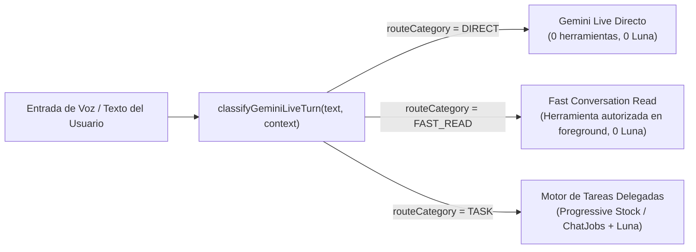

# Arquitectura Técnica — Olivia Ultra Fluida V8

**Rama:** `feat/olivia-ultra-fluida-v8`  
**Base:** `9f5371a96b311e672a3619b99feacb025fa73328` (V7)  
**Entorno de pruebas:** `app-integral-fm-pruebas`

---

## 1. Enrutamiento Determinista de 3 Vías (`DIRECT`, `FAST_READ`, `TASK`)

En V8, `classifyGeminiLiveTurn(text, context)` (`src/shared/oliviaConversationRouter.mjs`) clasifica cada intervención en una de tres categorías explícitas (`routeCategory`):

### 1.1 Ruta 1: `DIRECT` (`route: "direct"`, `routeCategory: "DIRECT"`)
- **Alcance:** Saludos, charla cotidiana, agradecimientos, preguntas de continuidad conversacional (*"¿me escuchás bien?"*, *"¿de qué hablábamos recién?"*), notas dentro de la charla (*"tomá nota en esta conversación..."*) y recolección inicial de slots cuando falta ubicación o lista de ítems (`collection-question`).
- **Seguridad:** Validado por `safeConversationBridge` (`src/shared/oliviaVoiceCollection.mjs`); bloquea cualquier audio o texto donde el modelo intente afirmar precios, stock o ejecuciones no verificadas.

### 1.2 Ruta 2: `FAST_READ` (`route: "delegate"`, `routeCategory: "FAST_READ"`, `fastRead: true`)
- **Alcance:** Consultas puntuales de solo lectura resueltas determinísticamente por `quickReadPlan` + `fastConversationRead` (`netlify/functions/_lib/olivia/fastConversation.mjs`) con **0 llamadas a ChatGPT Luna**:
  - `today-sales`: *"¿cuánto vendimos hoy?"*, *"ventas de hoy"*, *"¿cómo nos fue hoy?"*, *"¿qué vendimos?"*, *"¿cuánta plata entró?"*, *"¿cómo viene la caja?"*.
  - `yesterday-sales`: *"¿cuánto vendimos ayer?"*, *"ventas de ayer"*, *"¿cómo nos fue ayer?"* (`get_sales_metrics` sobre la fecha Argentina de ayer).
  - `stock` y `price`: consultas de stock y precios por producto y ubicación (*"¿cuántas unidades quedan de Arbequina?"*, *"¿a cuánto está Coratina?"*, *"¿tenemos stock de Aceite?"*).
  - `inventory`: *"resumen de stock"*, *"estado del inventario"* (`get_inventory_summary`).
  - `locations` y `warehouses`: *"¿qué ubicaciones están activas?"* (`list_locations`), *"¿qué depósitos están activos?"* (`list_warehouses`).
  - `products-list`: *"¿qué productos tenemos?"*, *"mostrame los productos"* (`search_products`).
  - `alerts`, `shipments`, `promotions`, `customer`, `navigate`: alertas activas (`get_alerts`), envíos pendientes (`get_shipments`), promociones vigentes (`get_promotions`), búsqueda de clientes (`search_customers`) y navegación de módulos (`navigate_to_module`).
- **Ejecución sin condición de carrera:** En `startDelegatedTask` (`netlify/functions/_lib/olivia/delegatedTasks.mjs`), cuando `isForegroundFastRead` es `true`, la tarea nace directamente con `status: "running"` y `jobId: "fg_${requestId}"` dentro de la transacción inicial. Así, `pumpDelegatedTasks` y `listDelegatedTasks` jamás reclaman ni duplican la lectura en background.

### 1.3 Ruta 3: `TASK` (`route: "delegate"`, `routeCategory: "TASK"`)
- **Alcance:**
  - Cargas de stock de 1 ítem (`prepare_stock_load`) o múltiples ítems (`prepare_catalog_stock_load`) resueltas determinísticamente por `progressiveStock` (`netlify/functions/_lib/olivia/tasks.mjs`) con soporte de números en palabras (*"diez"*, *"cinco"*, *"quince"*) y correcciones por ítem (*"no, eran 15 Coratina"*).
  - Análisis comparativos complejos, pronósticos de ferias/demanda, redacción creativa y operaciones compuestas delegadas a `gpt-6-luna` mediante `oliviaChatJobs`.

---

## 2. Pipeline de Voz en Tiempo Real y Estabilidad de Sesión (`P0`)

1. **Captura `AudioWorkletNode` con fallback `ScriptProcessorNode` (`src/gestion/olivia/geminiLive.mjs`):**
   - Cuando el navegador soporta `audioContext.audioWorklet.addModule`, `attachWorkletCapture` registra el procesador `olivia-pcm-capture` fuera del hilo principal y desactiva el callback de `ScriptProcessorNode` para evitar duplicación de frames.
2. **Protección de doble VAD en dictado de listas (`pausePreRoll`):**
   - Preguntas cortas cierran en `550–650 ms` mediante `endpointingWindow` y envían `{ realtimeInput: { audioStreamEnd: true } }`.
   - En listas dictadas (`endpointingWindow = 2000 ms`), tras `600 ms` (`9600` muestras a 16 kHz) de silencio mientras `this.listening === true`, `processCaptureChunk` retiene el silencio en `pausePreRoll` (hasta 200 ms) sin enviarlo al WebSocket, evitando que el VAD del servidor (`silenceDurationMs: 1000`) corte al usuario en medio de una enumeración. Al retomar la voz, `pausePreRoll` se vacía en orden antes del nuevo frame hablado.
3. **Barge-in con `noiseFloor` adaptativo (`src/gestion/olivia/naturalVoice.mjs`):**
   - `evaluateVoice` estima continuamente el piso de ruido ambiental (`noiseFloor`) en reposo y ajusta los umbrales de inicio de voz y barge-in (`speechThreshold`, `bargeThreshold`), exigiendo además `160 ms` de energía sostenida para interrumpir a Olivia.
4. **Liberación de turnos `toolCall` sin `turnComplete` (`handleBackgroundTools`):**
   - En `GeminiLiveSession.handleBackgroundTools`, al despachar `delegate_to_olivia` se marca `turn.completeReceived = true` y se invoca `finishTurn(turn)` cuando `!this.listening`, evitando que `this.currentTurn.pending` bloquee `drainToolResults()`.
5. **Renovación atómica de sesión y presupuesto resiliente (`netlify/functions/olivia-gemini-live.mjs`):**
   - `reserveSession` reemplaza atómicamente cualquier sesión activa previa del mismo `userId` y `conversationId` (o `replaceSessionId`), eliminando los errores `409 gemini-live-session-active` al reconectar.
   - `reportTurn` permite múltiples turnos dentro de la misma sesión sin cortar en `$0.015` y no aborta la sesión cuando un turno aislado carece de `usageMetadata`, manteniendo intactos el objetivo mensual de `USD 5`, aviso en `USD 6`, tope duro en `USD 10` y límite de `660` consultas.

---

## 3. Panel `"Tareas de Olivia"` y Confirmación Visual Obligatoria

- En el flujo principal de mensajes (`.fm-olivia-messages`), solo se muestran inline las tarjetas en estado `awaiting-confirmation` con su botón **Sí, confirmar operación** / **No, rechazar operación**.
- Desde el menú de opciones de Olivia (`Tareas de Olivia (N)`), el usuario puede abrir el panel completo (`OliviaDelegatedTasks` con `panel={true}`), que exhibe todas las tareas de la conversación, su estado, prioridad, fase, `fullResult`, `voiceSummary` desplegable y controles **Pausar**, **Retomar**, **Cancelar tarea** y **Sí, confirmar operación**.
